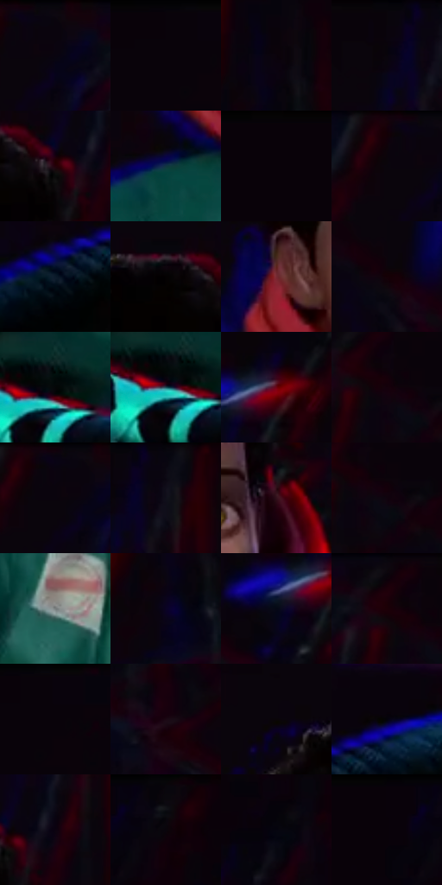

# 电影参考 452

- 状态：条件／活跃；来源世界：miles-home。
- 视角：high-angle；景别：medium；场景：portrait。
- 时段：interior-time-unknown（外观依据，中置信度；具体时间／晨昏未知）；光照：dark-interior。
- 材质候选：skin, hair, fabric, glass, metal（帧级，不是像素分割）。
- 明暗组：very-dark；L* P5/P50/P95：1.05475 / 1.79715 / 30.91587。
- 资格门禁：strong-separation。
- 原截图 SHA-256：`2620e4ebf38cc734e66ceeb7852ceedb0d2e326a055b614436067f26e46d8c57`；尺寸：2858 × 1214。
- sRGB 像素 SHA-256：`2e6998032ac4dcc98362adaba9ab3ee023ea7702e6b5ad9878021486560b6a0d`。

## 观察与迁移

静态反应也有强彩边，不能把所有错版归因为高速运动。

接触中的人物外缘出现宽红蓝错开，背景结构也分色；不能新增鞋、打击或肢体。

11  /  452  /  强彩边与隐身条件：接触中的人物外缘出现宽红蓝错开，背景结构也分色；不能新增鞋、打击或肢体。

本公开版保存32个128×128原像素色卡上下文；图集格子并非原场景相邻位置。原rect、图集tile和像素SHA见 `data/palette-crops.json`。上下文不足时不得批准替色，不能以小样推断完整构图。

## 实测色卡

颜色比例分母为保留采样像素，不是材料面积；全部 32 色参与全库匹配。表内四舍五入仅用于阅读，原精度在 JSON。

| ID | HEX | Lab | 原图 xy | 像素数 | 比例 | 明度角色 |
| --- | --- | --- | --- | ---: | ---: | --- |
| 452-S01 | #0A040D | [1.629769, 2.856449, -2.951176] | [1716, 28] | 19745 | 10.212209% | deep-shadow |
| 452-S02 | #09030A | [1.310881, 2.54225, -2.096035] | [684, 28] | 15118 | 7.819102% | deep-shadow |
| 452-S03 | #0B030C | [1.470787, 3.365663, -2.708874] | [2304, 92] | 14147 | 7.316897% | deep-shadow |
| 452-S04 | #0A050C | [1.803147, 2.296376, -2.230726] | [1312, 28] | 14102 | 7.293622% | deep-shadow |
| 452-S05 | #230209 | [3.799002, 14.930426, 2.268864] | [1292, 220] | 10558 | 5.460648% | deep-shadow |
| 452-S06 | #103640 | [20.511924, -9.522334, -10.171411] | [952, 692] | 9935 | 5.138430% | shadow |
| 452-S07 | #090209 | [1.095016, 2.803767, -2.003929] | [32, 28] | 8071 | 4.174360% | deep-shadow |
| 452-S08 | #0F0209 | [1.487909, 4.565789, -1.383086] | [1656, 40] | 7153 | 3.699566% | deep-shadow |
| 452-S09 | #0D1B2B | [9.350787, 0.06271, -12.631293] | [2412, 1028] | 6810 | 3.522165% | deep-shadow |
| 452-S10 | #030202 | [0.606656, 0.261464, 0.092205] | [1204, 200] | 6573 | 3.399587% | deep-shadow |
| 452-S11 | #762931 | [28.538679, 34.38331, 12.999848] | [988, 532] | 6370 | 3.294595% | shadow |
| 452-S12 | #150106 | [1.755393, 6.894386, 0.29218] | [2052, 196] | 5970 | 3.087713% | deep-shadow |
| 452-S13 | #040707 | [1.744288, -0.78462, -0.276185] | [1660, 1036] | 5908 | 3.055646% | deep-shadow |
| 452-S14 | #1D4D58 | [30.091113, -12.310947, -11.310082] | [1640, 1048] | 5845 | 3.023062% | shadow |
| 452-S15 | #6E0310 | [21.64797, 42.792532, 25.814357] | [2636, 380] | 4802 | 2.483618% | shadow |
| 452-S16 | #15010C | [1.876342, 7.744308, -2.02098] | [1864, 84] | 4677 | 2.418967% | deep-shadow |
| 452-S17 | #0A0410 | [1.705181, 3.386371, -4.393421] | [1684, 32] | 4414 | 2.282942% | deep-shadow |
| 452-S18 | #0C0913 | [2.895494, 2.545545, -4.426075] | [1372, 32] | 4220 | 2.182604% | deep-shadow |
| 452-S19 | #32111B | [10.246183, 17.980924, 1.118961] | [1296, 464] | 4206 | 2.175363% | deep-shadow |
| 452-S20 | #10030D | [1.845994, 5.106077, -2.58598] | [1892, 104] | 3756 | 1.942621% | deep-shadow |
| 452-S21 | #787D7E | [52.024968, -1.6587, -1.189426] | [992, 856] | 3728 | 1.928140% | midtone |
| 452-S22 | #0B0324 | [2.38119, 9.763148, -18.233856] | [2280, 176] | 3698 | 1.912623% | deep-shadow |
| 452-S23 | #050815 | [2.349027, 1.538272, -6.598213] | [2576, 416] | 3375 | 1.745566% | deep-shadow |
| 452-S24 | #0B030A | [1.428985, 3.071916, -1.909408] | [1832, 28] | 3248 | 1.679881% | deep-shadow |
| 452-S25 | #09030C | [1.352683, 2.835997, -2.8955] | [724, 28] | 3164 | 1.636436% | deep-shadow |
| 452-S26 | #1C0814 | [4.255411, 10.004432, -2.906005] | [2376, 364] | 2529 | 1.308011% | deep-shadow |
| 452-S27 | #0A0508 | [1.721772, 1.724541, -0.674413] | [1004, 172] | 2448 | 1.266117% | deep-shadow |
| 452-S28 | #04030A | [1.019337, 1.234754, -2.556727] | [2512, 952] | 2085 | 1.078372% | deep-shadow |
| 452-S29 | #0D0110 | [1.307024, 5.440497, -4.952018] | [1348, 204] | 2017 | 1.043202% | deep-shadow |
| 452-S30 | #0A080D | [2.414081, 1.254207, -1.805904] | [344, 28] | 1893 | 0.979069% | deep-shadow |
| 452-S31 | #05050F | [1.583341, 1.492986, -4.063404] | [2756, 196] | 1698 | 0.878214% | deep-shadow |
| 452-S32 | #09020A | [1.114803, 2.942811, -2.382353] | [252, 28] | 1084 | 0.560650% | deep-shadow |

## 色阶与空间分布

- 采样 ROI：`[0.01, 0.02, 0.98, 0.94]`；步长：4；样本数：193347。
- 排除区：`[]`。
- 深暗、暗、中、亮、高光五段计数：`[170164, 19387, 2947, 827, 22]`。
- RGB 各 256 箱、L* 100 箱、13×5 色相明度表和 3×3 空间统计全部保存在 [总数据](../film-library.json)。
- [可视化档案](../../references/library.html)按需绘制直方图，不存 2,094 张重复图表图片。

## 纹理特征占比

**这是分块图像特征的面积占比，不是波点／排线／丝网／错版的精确语义覆盖率。** 窗格、发丝、织物也会产生方向或周期特征。
原图 ROI 像素 3096324；已测块覆盖 3096324（100.0000%）；未测 0。

| 特征 | 块覆盖像素 | 占已测面积 | 阈值敏感范围 |
| --- | ---: | ---: | --- |
| low-contrast | 1618308 | 52.2655% | 49.2353% ~ 57.9414% |
| directional-structure | 552576 | 17.8462% | 6.8789% ~ 27.4287% |
| periodic-structure | 864384 | 27.9165% | 22.4225% ~ 32.1868% |
| mixed-detail | 61056 | 1.9719% | 0.9136% ~ 2.9930% |

阈值敏感范围不是统计置信区间。逐块坐标、尺度、对比、方向一致性、频谱集中度、频率与角度见 [全量特征记录](../texture-features.jsonl)，以帧号定位。
四种印刷层的真实像素覆盖仍标为 `null`，不能填 0，也不能拿上表代替。不得据这些代理测量删除唯一证据。

[测量方法与保留策略](../../references/library-retention.md) · [分类索引](../archive/README.md)
