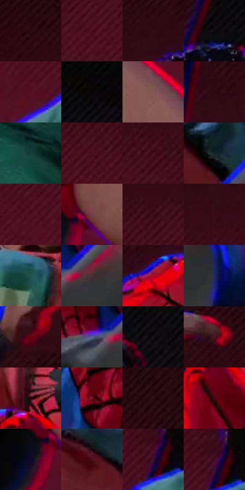

# 电影参考 453

- 状态：条件／活跃；来源世界：miles-home。
- 视角：high-angle；景别：medium；场景：portrait。
- 时段：interior-time-unknown（外观依据，中置信度；具体时间／晨昏未知）；光照：dark-interior。
- 材质候选：skin, hair, fabric, glass, metal（帧级，不是像素分割）。
- 明暗组：very-dark；L* P5/P50/P95：1.83975 / 14.81507 / 41.01414。
- 资格门禁：strong-separation。
- 原截图 SHA-256：`779c6ce21f1ac7683f048731f6586a8d7271d73d47326c117f44c09fa81b77d0`；尺寸：2874 × 1178。
- sRGB 像素 SHA-256：`ca2e953fb469da10e2374d8dd496037781466741cf9c590f2398583a96924377`。

## 观察与迁移

静态反应也有强彩边，不能把所有错版归因为高速运动。

低角度跌落姿态有透视缩短和红蓝轮廓；照片没有跌落时不改变姿态。

12  /  453  /  强彩边与隐身条件：低角度跌落姿态有透视缩短和红蓝轮廓；照片没有跌落时不改变姿态。

本公开版保存32个128×128原像素色卡上下文；图集格子并非原场景相邻位置。原rect、图集tile和像素SHA见 `data/palette-crops.json`。上下文不足时不得批准替色，不能以小样推断完整构图。

## 实测色卡

颜色比例分母为保留采样像素，不是材料面积；全部 32 色参与全库匹配。表内四舍五入仅用于阅读，原精度在 JSON。

| ID | HEX | Lab | 原图 xy | 像素数 | 比例 | 明度角色 |
| --- | --- | --- | --- | ---: | ---: | --- |
| 453-S01 | #270810 | [5.803919, 16.200681, 1.989254] | [624, 24] | 10929 | 5.785999% | deep-shadow |
| 453-S02 | #4C0E21 | [15.280325, 30.116181, 4.567296] | [552, 416] | 10593 | 5.608115% | deep-shadow |
| 453-S03 | #310B15 | [8.538748, 20.249205, 3.109771] | [812, 112] | 10045 | 5.317994% | deep-shadow |
| 453-S04 | #0A090D | [2.610159, 0.853646, -1.519586] | [964, 96] | 9527 | 5.043756% | deep-shadow |
| 453-S05 | #541024 | [17.382535, 32.319092, 5.593934] | [592, 552] | 9317 | 4.932579% | deep-shadow |
| 453-S06 | #050506 | [1.390654, 0.138957, -0.378259] | [1332, 28] | 9208 | 4.874872% | deep-shadow |
| 453-S07 | #875855 | [42.440949, 19.028234, 9.738849] | [2112, 736] | 8925 | 4.725047% | midtone |
| 453-S08 | #2D0912 | [7.200067, 19.240352, 3.001228] | [1512, 116] | 8884 | 4.703341% | deep-shadow |
| 453-S09 | #143E38 | [23.268093, -16.236259, -0.643928] | [496, 852] | 8651 | 4.579987% | shadow |
| 453-S10 | #490E20 | [14.597704, 28.984261, 4.245056] | [600, 356] | 8058 | 4.266043% | deep-shadow |
| 453-S11 | #450D1E | [13.514581, 27.803386, 4.069254] | [652, 308] | 7386 | 3.910274% | deep-shadow |
| 453-S12 | #162627 | [13.845567, -6.370839, -2.80346] | [1508, 604] | 6475 | 3.427975% | deep-shadow |
| 453-S13 | #501023 | [16.493318, 30.870221, 4.942962] | [504, 456] | 6454 | 3.416858% | deep-shadow |
| 453-S14 | #773E42 | [33.481124, 25.208705, 8.75217] | [1936, 908] | 6401 | 3.388799% | shadow |
| 453-S15 | #400D1B | [12.333869, 25.69702, 4.485568] | [444, 300] | 6338 | 3.355445% | deep-shadow |
| 453-S16 | #370A18 | [9.762833, 23.428709, 2.844776] | [692, 220] | 5916 | 3.132031% | deep-shadow |
| 453-S17 | #235351 | [32.117762, -16.733055, -3.777969] | [928, 524] | 5791 | 3.065854% | shadow |
| 453-S18 | #473237 | [23.327406, 10.406639, 0.594921] | [1440, 824] | 5325 | 2.819146% | shadow |
| 453-S19 | #AA0623 | [35.5972, 59.024041, 32.915637] | [1812, 500] | 5282 | 2.796381% | shadow |
| 453-S20 | #272763 | [19.152585, 19.65122, -35.645525] | [1636, 844] | 5010 | 2.652379% | deep-shadow |
| 453-S21 | #660014 | [19.54115, 41.439405, 20.509451] | [1924, 248] | 4761 | 2.520555% | deep-shadow |
| 453-S22 | #5A5E85 | [41.012074, 8.196947, -22.212633] | [1352, 824] | 4664 | 2.469201% | midtone |
| 453-S23 | #141116 | [5.487949, 2.304809, -2.591841] | [1152, 160] | 3514 | 1.860372% | deep-shadow |
| 453-S24 | #4D1223 | [16.166229, 28.964435, 4.390984] | [2072, 104] | 3433 | 1.817489% | deep-shadow |
| 453-S25 | #200207 | [3.305384, 12.616072, 2.308238] | [1076, 608] | 3333 | 1.764547% | deep-shadow |
| 453-S26 | #701425 | [23.933173, 40.087835, 14.754345] | [1720, 680] | 3279 | 1.735959% | shadow |
| 453-S27 | #23080F | [5.108796, 13.454578, 1.436897] | [2220, 24] | 3246 | 1.718488% | deep-shadow |
| 453-S28 | #470310 | [12.238105, 31.313407, 12.159984] | [1072, 724] | 3160 | 1.672958% | deep-shadow |
| 453-S29 | #0F082C | [4.128219, 12.448975, -21.616891] | [1868, 960] | 2347 | 1.242542% | deep-shadow |
| 453-S30 | #4E1019 | [15.803961, 29.307211, 11.173432] | [1356, 536] | 1047 | 0.554300% | deep-shadow |
| 453-S31 | #3D103B | [13.701322, 28.199628, -16.940205] | [768, 452] | 1035 | 0.547947% | deep-shadow |
| 453-S32 | #450821 | [12.916525, 30.071672, 0.979725] | [768, 428] | 553 | 0.292768% | deep-shadow |

## 色阶与空间分布

- 采样 ROI：`[0.01, 0.02, 0.98, 0.94]`；步长：4；样本数：188887。
- 排除区：`[]`。
- 深暗、暗、中、亮、高光五段计数：`[137393, 40757, 10730, 7, 0]`。
- RGB 各 256 箱、L* 100 箱、13×5 色相明度表和 3×3 空间统计全部保存在 [总数据](../film-library.json)。
- [可视化档案](../../references/library.html)按需绘制直方图，不存 2,094 张重复图表图片。

## 纹理特征占比

**这是分块图像特征的面积占比，不是波点／排线／丝网／错版的精确语义覆盖率。** 窗格、发丝、织物也会产生方向或周期特征。
原图 ROI 像素 3022192；已测块覆盖 3022192（100.0000%）；未测 0。

| 特征 | 块覆盖像素 | 占已测面积 | 阈值敏感范围 |
| --- | ---: | ---: | --- |
| low-contrast | 1056624 | 34.9622% | 25.6105% ~ 43.0940% |
| directional-structure | 669696 | 22.1593% | 7.3017% ~ 43.0141% |
| periodic-structure | 1214976 | 40.2018% | 30.0370% ~ 44.7590% |
| mixed-detail | 80896 | 2.6767% | 1.3384% ~ 4.8452% |

阈值敏感范围不是统计置信区间。逐块坐标、尺度、对比、方向一致性、频谱集中度、频率与角度见 [全量特征记录](../texture-features.jsonl)，以帧号定位。
四种印刷层的真实像素覆盖仍标为 `null`，不能填 0，也不能拿上表代替。不得据这些代理测量删除唯一证据。

[测量方法与保留策略](../../references/library-retention.md) · [分类索引](../archive/README.md)
