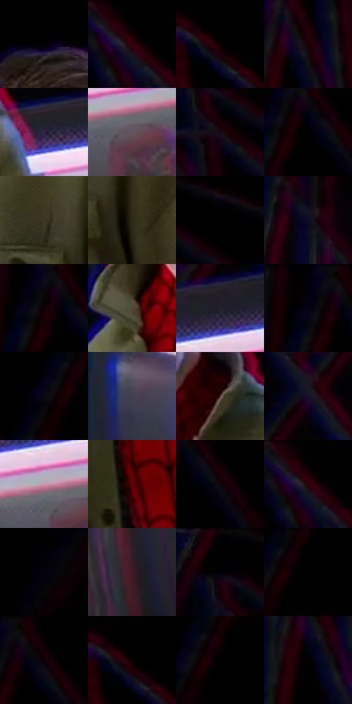

# 电影参考 454

- 状态：条件／活跃；来源世界：miles-home。
- 视角：low-angle；景别：medium；场景：portrait。
- 时段：interior-time-unknown（外观依据，中置信度；具体时间／晨昏未知）；光照：dark-interior。
- 材质候选：skin, hair, fabric, glass, metal（帧级，不是像素分割）。
- 明暗组：very-dark；L* P5/P50/P95：0.0 / 2.44006 / 37.16105。
- 资格门禁：strong-separation。
- 原截图 SHA-256：`2cfd045899e982977af09d472a388d7e0b155dd6e2501d44a206ddd8c1a779fe`；尺寸：2880 × 1210。
- sRGB 像素 SHA-256：`c49479193e659369dda72c08a42a06c2be1f17a0ce67ae3f5a5f63938e7db2c5`。

## 观察与迁移

静态反应也有强彩边，不能把所有错版归因为高速运动。

站立反应近景也有强红蓝边，后方结构同样错版；静帧不足以断言全部由运动产生。

13  /  454  /  强彩边与隐身条件：站立反应近景也有强红蓝边，后方结构同样错版；静帧不足以断言全部由运动产生。

本公开版保存32个128×128原像素色卡上下文；图集格子并非原场景相邻位置。原rect、图集tile和像素SHA见 `data/palette-crops.json`。上下文不足时不得批准替色，不能以小样推断完整构图。

## 实测色卡

颜色比例分母为保留采样像素，不是材料面积；全部 32 色参与全库匹配。表内四舍五入仅用于阅读，原精度在 JSON。

| ID | HEX | Lab | 原图 xy | 像素数 | 比例 | 明度角色 |
| --- | --- | --- | --- | ---: | ---: | --- |
| 454-S01 | #040104 | [0.50846, 1.201612, -0.858822] | [1448, 116] | 19376 | 9.985364% | deep-shadow |
| 454-S02 | #010101 | [0.274173, -1.7e-05, 3.3e-05] | [1152, 28] | 15825 | 8.155367% | deep-shadow |
| 454-S03 | #000000 | [0.0, 0.0, 0.0] | [36, 28] | 14301 | 7.369978% | deep-shadow |
| 454-S04 | #1F000A | [2.830093, 13.195271, 0.375163] | [984, 112] | 10204 | 5.258601% | deep-shadow |
| 454-S05 | #2C2842 | [17.674121, 8.91657, -15.776326] | [2024, 696] | 9415 | 4.851992% | deep-shadow |
| 454-S06 | #64565E | [38.151574, 7.285356, -2.502476] | [2780, 696] | 8358 | 4.307271% | shadow |
| 454-S07 | #170B14 | [4.263856, 6.16992, -2.963822] | [2668, 136] | 7622 | 3.927975% | deep-shadow |
| 454-S08 | #020103 | [0.372056, 0.53957, -0.664676] | [532, 92] | 7544 | 3.887778% | deep-shadow |
| 454-S09 | #3D3727 | [23.24056, -0.344887, 11.013266] | [1776, 812] | 7529 | 3.880048% | shadow |
| 454-S10 | #2F2A19 | [17.134192, -0.850753, 11.954167] | [1856, 888] | 7447 | 3.837789% | deep-shadow |
| 454-S11 | #05030A | [1.077646, 1.496253, -2.464589] | [2744, 40] | 7227 | 3.724413% | deep-shadow |
| 454-S12 | #0D0C20 | [4.089771, 5.232234, -12.48439] | [884, 556] | 7193 | 3.706891% | deep-shadow |
| 454-S13 | #0E0104 | [1.118839, 3.938999, 0.105688] | [504, 72] | 6633 | 3.418297% | deep-shadow |
| 454-S14 | #534C3A | [32.510345, -0.360524, 11.784478] | [1408, 580] | 6339 | 3.266785% | shadow |
| 454-S15 | #211F2A | [12.418983, 3.888158, -7.0222] | [2760, 564] | 6267 | 3.229680% | deep-shadow |
| 454-S16 | #040314 | [1.277497, 3.048869, -7.494049] | [480, 64] | 6261 | 3.226588% | deep-shadow |
| 454-S17 | #090816 | [2.616431, 2.824384, -6.883159] | [220, 80] | 5945 | 3.063738% | deep-shadow |
| 454-S18 | #424051 | [27.896751, 4.942574, -9.910686] | [600, 1016] | 5320 | 2.741646% | shadow |
| 454-S19 | #4E3A34 | [26.430648, 7.828004, 7.146441] | [1652, 532] | 5214 | 2.687019% | shadow |
| 454-S20 | #161226 | [6.712353, 7.761222, -12.982102] | [2784, 440] | 4791 | 2.469028% | deep-shadow |
| 454-S21 | #C398AC | [67.305884, 19.264303, -4.230992] | [2740, 664] | 4690 | 2.416978% | light |
| 454-S22 | #66000F | [19.475081, 41.259893, 23.410755] | [1504, 1104] | 4588 | 2.364412% | deep-shadow |
| 454-S23 | #10040C | [2.019372, 4.546004, -1.86553] | [584, 112] | 3982 | 2.052112% | deep-shadow |
| 454-S24 | #050102 | [0.527195, 1.185024, -0.009836] | [1148, 36] | 3393 | 1.748572% | deep-shadow |
| 454-S25 | #010108 | [0.412681, 0.973289, -2.648932] | [2188, 48] | 2828 | 1.457401% | deep-shadow |
| 454-S26 | #3E1B2A | [15.357575, 19.196149, -2.196926] | [2232, 1116] | 2195 | 1.131187% | deep-shadow |
| 454-S27 | #010001 | [0.078096, 0.400543, -0.286285] | [2640, 28] | 1256 | 0.647276% | deep-shadow |
| 454-S28 | #010000 | [0.058309, 0.261499, 0.092139] | [292, 28] | 939 | 0.483911% | deep-shadow |
| 454-S29 | #020101 | [0.332482, 0.261482, 0.092172] | [556, 28] | 726 | 0.374142% | deep-shadow |
| 454-S30 | #010100 | [0.254387, -0.139061, 0.378457] | [64, 52] | 345 | 0.177795% | deep-shadow |
| 454-S31 | #000201 | [0.411943, -0.662077, 0.194212] | [276, 68] | 197 | 0.101523% | deep-shadow |
| 454-S32 | #020301 | [0.724638, -0.539639, 0.664808] | [960, 160] | 94 | 0.048443% | deep-shadow |

## 色阶与空间分布

- 采样 ROI：`[0.01, 0.02, 0.98, 0.94]`；步长：4；样本数：194044。
- 排除区：`[]`。
- 深暗、暗、中、亮、高光五段计数：`[152048, 34260, 4655, 2071, 1010]`。
- RGB 各 256 箱、L* 100 箱、13×5 色相明度表和 3×3 空间统计全部保存在 [总数据](../film-library.json)。
- [可视化档案](../../references/library.html)按需绘制直方图，不存 2,094 张重复图表图片。

## 纹理特征占比

**这是分块图像特征的面积占比，不是波点／排线／丝网／错版的精确语义覆盖率。** 窗格、发丝、织物也会产生方向或周期特征。
原图 ROI 像素 3109722；已测块覆盖 3109722（100.0000%）；未测 0。

| 特征 | 块覆盖像素 | 占已测面积 | 阈值敏感范围 |
| --- | ---: | ---: | --- |
| low-contrast | 648410 | 20.8511% | 17.1630% ~ 26.6466% |
| directional-structure | 914688 | 29.4138% | 9.4383% ~ 49.2288% |
| periodic-structure | 1530240 | 49.2083% | 33.6081% ~ 60.7540% |
| mixed-detail | 16384 | 0.5269% | 0.0000% ~ 3.1612% |

阈值敏感范围不是统计置信区间。逐块坐标、尺度、对比、方向一致性、频谱集中度、频率与角度见 [全量特征记录](../texture-features.jsonl)，以帧号定位。
四种印刷层的真实像素覆盖仍标为 `null`，不能填 0，也不能拿上表代替。不得据这些代理测量删除唯一证据。

[测量方法与保留策略](../../references/library-retention.md) · [分类索引](../archive/README.md)
