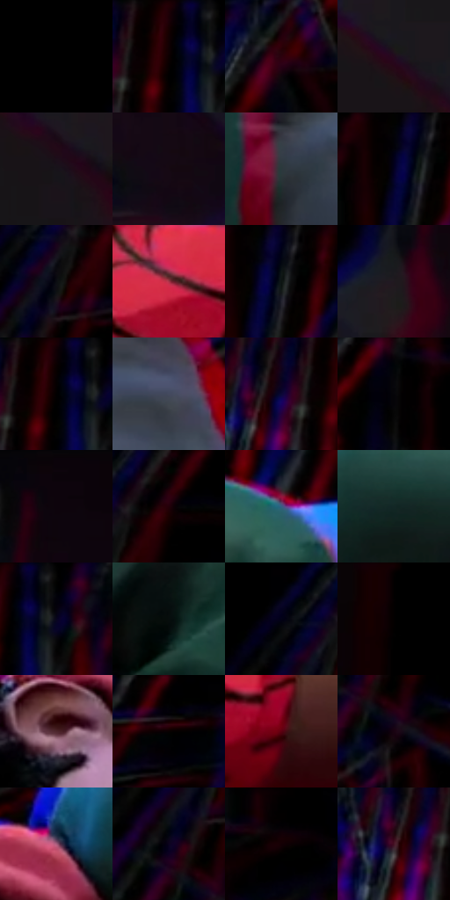

# 电影参考 455

- 状态：条件／活跃；来源世界：miles-home。
- 视角：near-level；景别：medium；场景：portrait。
- 时段：interior-time-unknown（外观依据，中置信度；具体时间／晨昏未知）；光照：dark-interior。
- 材质候选：skin, hair, fabric, glass, metal（帧级，不是像素分割）。
- 明暗组：very-dark；L* P5/P50/P95：0.0 / 3.39268 / 36.95303。
- 资格门禁：strong-separation。
- 原截图 SHA-256：`3eb444538a74cbe255cf1092efb27059e00df0fa7f0619aa2eb5fbc9ca73dae4`；尺寸：2868 × 1210。
- sRGB 像素 SHA-256：`c7769e2f32de75d7769f4f56310ead30f5dd8a6249c3938abaf2ea3c2e26042a`。

## 观察与迁移

静态反应也有强彩边，不能把所有错版归因为高速运动。

手臂与身体贴近亮地板，地面有局部映像和强分色；映像手指不是额外手指。

14  /  455  /  强彩边与隐身条件：手臂与身体贴近亮地板，地面有局部映像和强分色；映像手指不是额外手指。

本公开版保存32个128×128原像素色卡上下文；图集格子并非原场景相邻位置。原rect、图集tile和像素SHA见 `data/palette-crops.json`。上下文不足时不得批准替色，不能以小样推断完整构图。

## 实测色卡

颜色比例分母为保留采样像素，不是材料面积；全部 32 色参与全库匹配。表内四舍五入仅用于阅读，原精度在 JSON。

| ID | HEX | Lab | 原图 xy | 像素数 | 比例 | 明度角色 |
| --- | --- | --- | --- | ---: | ---: | --- |
| 455-S01 | #000000 | [0.0, 0.0, 0.0] | [32, 28] | 19515 | 10.100409% | deep-shadow |
| 455-S02 | #180003 | [1.81405, 8.286448, 1.63746] | [2100, 28] | 9170 | 4.746131% | deep-shadow |
| 455-S03 | #2C020D | [5.493023, 21.580909, 3.200515] | [1288, 164] | 8499 | 4.398841% | deep-shadow |
| 455-S04 | #221017 | [6.978757, 10.501839, -0.938777] | [36, 364] | 8348 | 4.320687% | deep-shadow |
| 455-S05 | #18131A | [6.634887, 4.007425, -3.904374] | [184, 492] | 8259 | 4.274623% | deep-shadow |
| 455-S06 | #160912 | [3.70031, 6.078154, -2.529029] | [608, 876] | 8038 | 4.160240% | deep-shadow |
| 455-S07 | #2B393D | [22.918807, -4.615265, -4.368344] | [2220, 460] | 7768 | 4.020496% | shadow |
| 455-S08 | #020208 | [0.667068, 0.834228, -2.270475] | [2296, 32] | 7708 | 3.989442% | deep-shadow |
| 455-S09 | #0C0D12 | [3.700554, 0.627009, -2.62884] | [804, 124] | 7036 | 3.641633% | deep-shadow |
| 455-S10 | #A43246 | [38.92989, 47.991932, 14.901646] | [2616, 872] | 6771 | 3.504477% | shadow |
| 455-S11 | #101817 | [7.45453, -3.66503, -0.49326] | [2324, 56] | 6731 | 3.483774% | deep-shadow |
| 455-S12 | #20191F | [9.808233, 4.878073, -2.86321] | [168, 188] | 6554 | 3.392164% | deep-shadow |
| 455-S13 | #0C0002 | [0.745845, 3.44553, 0.359192] | [2104, 28] | 6484 | 3.355934% | deep-shadow |
| 455-S14 | #444A5F | [31.698546, 2.95828, -13.119975] | [2424, 400] | 6481 | 3.354381% | shadow |
| 455-S15 | #0C0735 | [4.399656, 16.659796, -27.902957] | [2024, 76] | 6440 | 3.333161% | deep-shadow |
| 455-S16 | #07060A | [1.782497, 0.81757, -1.421358] | [1436, 48] | 6164 | 3.190311% | deep-shadow |
| 455-S17 | #0B030A | [1.428985, 3.071916, -1.909408] | [244, 28] | 5677 | 2.938254% | deep-shadow |
| 455-S18 | #060101 | [0.565717, 1.307479, 0.460726] | [872, 28] | 5510 | 2.851819% | deep-shadow |
| 455-S19 | #375F84 | [39.004716, -2.385381, -24.899515] | [2112, 240] | 5254 | 2.719321% | shadow |
| 455-S20 | #132726 | [13.997427, -8.3975, -1.882937] | [1596, 308] | 5039 | 2.608043% | deep-shadow |
| 455-S21 | #010202 | [0.490038, -0.261534, -0.092073] | [2156, 28] | 4905 | 2.538688% | deep-shadow |
| 455-S22 | #070D0C | [3.247792, -1.796685, -0.142202] | [1928, 372] | 4463 | 2.309922% | deep-shadow |
| 455-S23 | #020217 | [1.067327, 3.646882, -9.925434] | [756, 68] | 4362 | 2.257647% | deep-shadow |
| 455-S24 | #020000 | [0.116618, 0.522999, 0.184277] | [448, 28] | 4207 | 2.177424% | deep-shadow |
| 455-S25 | #4E272C | [21.029798, 18.856118, 4.934953] | [1272, 436] | 4016 | 2.078567% | shadow |
| 455-S26 | #010100 | [0.254387, -0.139061, 0.378457] | [1176, 28] | 3849 | 1.992133% | deep-shadow |
| 455-S27 | #5A0110 | [16.667742, 37.646175, 18.815861] | [2800, 944] | 3804 | 1.968842% | deep-shadow |
| 455-S28 | #190312 | [2.85004, 9.944426, -3.731485] | [804, 260] | 3282 | 1.698670% | deep-shadow |
| 455-S29 | #A55C7C | [48.39894, 33.917165, -4.805395] | [1400, 340] | 2732 | 1.414005% | midtone |
| 455-S30 | #0B031E | [2.077476, 7.628924, -13.961711] | [760, 192] | 2340 | 1.211117% | deep-shadow |
| 455-S31 | #010002 | [0.097882, 0.539587, -0.664709] | [1700, 40] | 2297 | 1.188862% | deep-shadow |
| 455-S32 | #461426 | [15.183571, 25.783992, 0.614491] | [1992, 100] | 1507 | 0.779980% | deep-shadow |

## 色阶与空间分布

- 采样 ROI：`[0.01, 0.02, 0.98, 0.94]`；步长：4；样本数：193210。
- 排除区：`[]`。
- 深暗、暗、中、亮、高光五段计数：`[163475, 22468, 6758, 509, 0]`。
- RGB 各 256 箱、L* 100 箱、13×5 色相明度表和 3×3 空间统计全部保存在 [总数据](../film-library.json)。
- [可视化档案](../../references/library.html)按需绘制直方图，不存 2,094 张重复图表图片。

## 纹理特征占比

**这是分块图像特征的面积占比，不是波点／排线／丝网／错版的精确语义覆盖率。** 窗格、发丝、织物也会产生方向或周期特征。
原图 ROI 像素 3096366；已测块覆盖 3096366（100.0000%）；未测 0。

| 特征 | 块覆盖像素 | 占已测面积 | 阈值敏感范围 |
| --- | ---: | ---: | --- |
| low-contrast | 497792 | 16.0767% | 10.5786% ~ 22.6965% |
| directional-structure | 717614 | 23.1760% | 8.8341% ~ 40.1084% |
| periodic-structure | 1864576 | 60.2182% | 49.3130% ~ 66.4934% |
| mixed-detail | 16384 | 0.5291% | 0.0000% ~ 1.9760% |

阈值敏感范围不是统计置信区间。逐块坐标、尺度、对比、方向一致性、频谱集中度、频率与角度见 [全量特征记录](../texture-features.jsonl)，以帧号定位。
四种印刷层的真实像素覆盖仍标为 `null`，不能填 0，也不能拿上表代替。不得据这些代理测量删除唯一证据。

[测量方法与保留策略](../../references/library-retention.md) · [分类索引](../archive/README.md)
