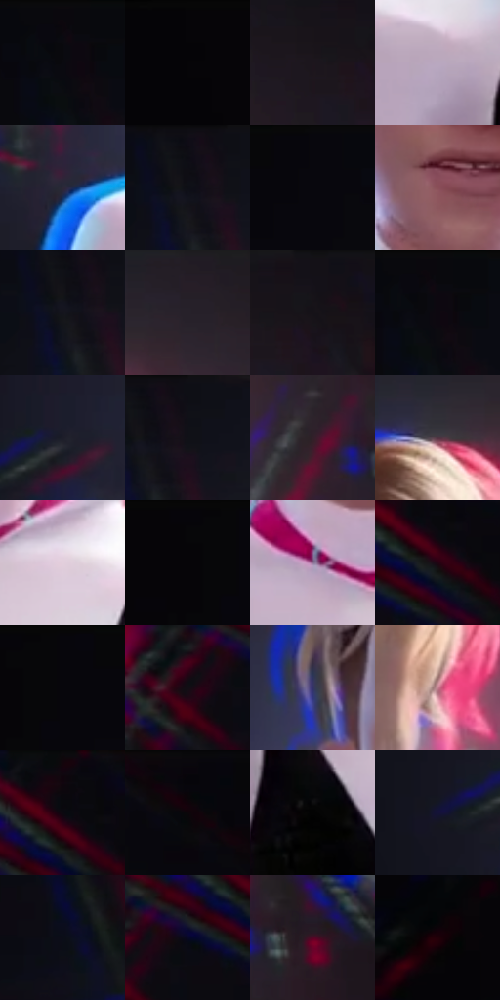

# 电影参考 456

- 状态：条件／活跃；来源世界：miles-home。
- 视角：near-level；景别：medium；场景：portrait。
- 时段：interior-time-unknown（外观依据，中置信度；具体时间／晨昏未知）；光照：dark-interior。
- 材质候选：skin, hair, fabric, glass, metal（帧级，不是像素分割）。
- 明暗组：very-dark；L* P5/P50/P95：1.48854 / 5.86249 / 71.46187。
- 资格门禁：strong-separation。
- 原截图 SHA-256：`17f01eb9e711fffe16a1e3735b88672860a3d04c476af1aeaefece7e4b83fa2d`；尺寸：2880 × 1208。
- sRGB 像素 SHA-256：`c6fd155b293b9b73bf0aec12b9846d7d3be6b0ba4b7e220b2598a8272c050084`。

## 观察与迁移

静态反应也有强彩边，不能把所有错版归因为高速运动。

抱臂女孩的静态反应仍有明显蓝左红右边，背后亮光另成一层；强错版不等于发光轮廓或动作拖尾。

15  /  456  /  强彩边与隐身条件：抱臂女孩的静态反应仍有明显蓝左红右边，背后亮光另成一层；强错版不等于发光轮廓或动作拖尾。

本公开版保存32个128×128原像素色卡上下文；图集格子并非原场景相邻位置。原rect、图集tile和像素SHA见 `data/palette-crops.json`。上下文不足时不得批准替色，不能以小样推断完整构图。

## 实测色卡

颜色比例分母为保留采样像素，不是材料面积；全部 32 色参与全库匹配。表内四舍五入仅用于阅读，原精度在 JSON。

| ID | HEX | Lab | 原图 xy | 像素数 | 比例 | 明度角色 |
| --- | --- | --- | --- | ---: | ---: | --- |
| 456-S01 | #0A0A10 | [2.881648, 0.983008, -2.675512] | [548, 36] | 11381 | 5.886338% | deep-shadow |
| 456-S02 | #060508 | [1.488537, 0.678544, -1.042967] | [72, 28] | 11359 | 5.874960% | deep-shadow |
| 456-S03 | #1D161D | [8.339422, 5.207017, -3.592581] | [1828, 80] | 9815 | 5.076392% | deep-shadow |
| 456-S04 | #B9A8BF | [70.927007, 10.373383, -9.514655] | [1036, 800] | 9686 | 5.009672% | light |
| 456-S05 | #2C2837 | [17.126298, 5.651297, -8.992156] | [900, 728] | 8350 | 4.318683% | deep-shadow |
| 456-S06 | #0D0D14 | [3.829153, 1.360625, -3.703287] | [756, 32] | 8275 | 4.279892% | deep-shadow |
| 456-S07 | #08070D | [2.101385, 1.131769, -2.276499] | [436, 28] | 7971 | 4.122661% | deep-shadow |
| 456-S08 | #8A4F58 | [40.736919, 25.880335, 5.539302] | [1272, 568] | 7619 | 3.940604% | midtone |
| 456-S09 | #14141D | [6.663822, 2.423409, -6.214711] | [748, 80] | 7617 | 3.939569% | deep-shadow |
| 456-S10 | #251D26 | [12.037349, 6.001014, -4.639744] | [1556, 28] | 7571 | 3.915778% | deep-shadow |
| 456-S11 | #161218 | [6.04427, 3.113957, -3.246525] | [1892, 44] | 6865 | 3.550629% | deep-shadow |
| 456-S12 | #09090D | [2.55185, 0.592147, -1.611724] | [560, 28] | 6860 | 3.548043% | deep-shadow |
| 456-S13 | #1C1D29 | [11.174864, 3.001646, -8.239686] | [776, 520] | 6633 | 3.430637% | deep-shadow |
| 456-S14 | #101017 | [4.901195, 1.551087, -4.221706] | [796, 36] | 6575 | 3.400639% | deep-shadow |
| 456-S15 | #31202A | [14.697461, 10.199619, -3.395106] | [1844, 484] | 6397 | 3.308576% | deep-shadow |
| 456-S16 | #4E3441 | [25.129898, 14.024736, -3.372913] | [1428, 116] | 6211 | 3.212376% | shadow |
| 456-S17 | #E3CFDC | [85.059927, 9.179299, -3.890291] | [1380, 752] | 5618 | 2.905672% | highlight |
| 456-S18 | #070709 | [1.958788, 0.277966, -0.756616] | [272, 28] | 5324 | 2.753613% | deep-shadow |
| 456-S19 | #8F6F94 | [51.090771, 19.459104, -15.280943] | [1228, 712] | 5253 | 2.716891% | midtone |
| 456-S20 | #210412 | [4.10025, 14.271368, -1.779446] | [2384, 108] | 5139 | 2.657929% | deep-shadow |
| 456-S21 | #07060C | [1.824299, 1.111317, -2.220823] | [328, 28] | 4960 | 2.565349% | deep-shadow |
| 456-S22 | #120D14 | [4.217994, 3.104473, -3.088847] | [2240, 168] | 4939 | 2.554488% | deep-shadow |
| 456-S23 | #343269 | [23.773228, 17.220722, -32.056811] | [1092, 344] | 4853 | 2.510008% | shadow |
| 456-S24 | #C58493 | [62.067525, 27.078399, 2.247088] | [1500, 508] | 4167 | 2.155204% | light |
| 456-S25 | #0F060D | [2.356509, 3.55585, -1.849835] | [2360, 36] | 3942 | 2.038832% | deep-shadow |
| 456-S26 | #0A0509 | [1.741559, 1.863585, -1.052837] | [2508, 48] | 3909 | 2.021764% | deep-shadow |
| 456-S27 | #030303 | [0.82252, -5.2e-05, 9.9e-05] | [1144, 916] | 3758 | 1.943666% | deep-shadow |
| 456-S28 | #141338 | [8.128007, 13.543901, -24.03821] | [672, 564] | 3404 | 1.760574% | deep-shadow |
| 456-S29 | #0B0D18 | [3.83829, 1.756049, -6.575524] | [568, 260] | 3015 | 1.559381% | deep-shadow |
| 456-S30 | #080826 | [3.298623, 7.766449, -18.377036] | [2304, 140] | 2911 | 1.505591% | deep-shadow |
| 456-S31 | #520725 | [15.901091, 34.802221, 2.707635] | [1952, 504] | 1942 | 1.004417% | deep-shadow |
| 456-S32 | #060707 | [1.860906, -0.261621, -0.091908] | [32, 804] | 1027 | 0.531172% | deep-shadow |

## 色阶与空间分布

- 采样 ROI：`[0.01, 0.02, 0.98, 0.94]`；步长：4；样本数：193346。
- 排除区：`[]`。
- 深暗、暗、中、亮、高光五段计数：`[149785, 14978, 10922, 13459, 4202]`。
- RGB 各 256 箱、L* 100 箱、13×5 色相明度表和 3×3 空间统计全部保存在 [总数据](../film-library.json)。
- [可视化档案](../../references/library.html)按需绘制直方图，不存 2,094 张重复图表图片。

## 纹理特征占比

**这是分块图像特征的面积占比，不是波点／排线／丝网／错版的精确语义覆盖率。** 窗格、发丝、织物也会产生方向或周期特征。
原图 ROI 像素 3104134；已测块覆盖 3104134（100.0000%）；未测 0。

| 特征 | 块覆盖像素 | 占已测面积 | 阈值敏感范围 |
| --- | ---: | ---: | --- |
| low-contrast | 1279104 | 41.2065% | 32.7615% ~ 46.3155% |
| directional-structure | 699520 | 22.5351% | 11.9789% ~ 35.6603% |
| periodic-structure | 1059974 | 34.1472% | 30.5226% ~ 36.2378% |
| mixed-detail | 65536 | 2.1112% | 1.0556% ~ 5.4678% |

阈值敏感范围不是统计置信区间。逐块坐标、尺度、对比、方向一致性、频谱集中度、频率与角度见 [全量特征记录](../texture-features.jsonl)，以帧号定位。
四种印刷层的真实像素覆盖仍标为 `null`，不能填 0，也不能拿上表代替。不得据这些代理测量删除唯一证据。

[测量方法与保留策略](../../references/library-retention.md) · [分类索引](../archive/README.md)
