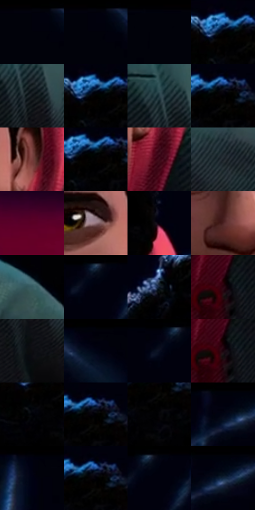

# 电影参考 457

- 状态：常规／活跃；来源世界：miles-home。
- 视角：near-level；景别：close-up；场景：portrait。
- 时段：interior-time-unknown（外观依据，中置信度；具体时间／晨昏未知）；光照：dark-interior。
- 材质候选：skin, hair, fabric, metal, glass（帧级，不是像素分割）。
- 明暗组：very-dark；L* P5/P50/P95：0.03957 / 0.64833 / 35.1288。
- 资格门禁：无附加门禁。
- 原截图 SHA-256：`e3b4a4487047d31403ce4e603beb855daa7f36140b3dea450d8eccc67c7e3302`；尺寸：2880 × 1228。
- sRGB 像素 SHA-256：`edc8bafb6aa7300105330c6bd3eda6e4cd9c39e9ae62d4aabbb9eacaf31f72b8`。

## 观察与迁移

暗室面部与展柜，局部亮边不能取代动画形体。

起身近景回到较稳定的脸与较轻局部彩边，外套排线塑形；与前五帧比较图形强度，不宣称像素配准。

16  /  457  /  强彩边与隐身条件：起身近景回到较稳定的脸与较轻局部彩边，外套排线塑形；与前五帧比较图形强度，不宣称像素配准。

本公开版保存32个128×128原像素色卡上下文；图集格子并非原场景相邻位置。原rect、图集tile和像素SHA见 `data/palette-crops.json`。上下文不足时不得批准替色，不能以小样推断完整构图。

## 实测色卡

颜色比例分母为保留采样像素，不是材料面积；全部 32 色参与全库匹配。表内四舍五入仅用于阅读，原精度在 JSON。

| ID | HEX | Lab | 原图 xy | 像素数 | 比例 | 明度角色 |
| --- | --- | --- | --- | ---: | ---: | --- |
| 457-S01 | #01010C | [0.494057, 1.545124, -4.205244] | [288, 28] | 25523 | 12.966632% | deep-shadow |
| 457-S02 | #01010D | [0.516757, 1.704637, -4.639376] | [304, 28] | 22822 | 11.594424% | deep-shadow |
| 457-S03 | #01020A | [0.648333, 0.850816, -3.119461] | [32, 28] | 18001 | 9.145177% | deep-shadow |
| 457-S04 | #000106 | [0.314799, 0.433702, -1.984223] | [1612, 92] | 11097 | 5.637688% | deep-shadow |
| 457-S05 | #0D1217 | [5.239254, -0.590123, -3.754721] | [2120, 808] | 9650 | 4.902558% | deep-shadow |
| 457-S06 | #000000 | [0.0, 0.0, 0.0] | [1616, 96] | 9495 | 4.823813% | deep-shadow |
| 457-S07 | #263E46 | [24.637116, -6.825838, -7.825484] | [2088, 760] | 7242 | 3.679205% | shadow |
| 457-S08 | #010103 | [0.313747, 0.27807, -0.756814] | [1664, 96] | 6909 | 3.510029% | deep-shadow |
| 457-S09 | #793F3E | [33.917763, 24.999009, 11.956573] | [1832, 660] | 6693 | 3.400293% | shadow |
| 457-S10 | #020101 | [0.332482, 0.261482, 0.092172] | [1636, 104] | 6450 | 3.276840% | deep-shadow |
| 457-S11 | #3E0817 | [10.992576, 26.755118, 5.561213] | [1844, 780] | 6144 | 3.121380% | deep-shadow |
| 457-S12 | #182026 | [11.73692, -1.757524, -5.224005] | [2328, 828] | 5390 | 2.738320% | deep-shadow |
| 457-S13 | #5A0025 | [17.026581, 39.203585, 4.565726] | [708, 1076] | 5178 | 2.630616% | deep-shadow |
| 457-S14 | #94737C | [51.852353, 14.440768, 0.040733] | [1720, 644] | 5099 | 2.590481% | midtone |
| 457-S15 | #07000D | [0.670531, 3.674193, -4.372863] | [1876, 456] | 5006 | 2.543234% | deep-shadow |
| 457-S16 | #4C2323 | [19.475525, 19.324758, 8.953459] | [1532, 768] | 4867 | 2.472617% | deep-shadow |
| 457-S17 | #375A61 | [35.959471, -10.572702, -8.008585] | [2644, 788] | 4542 | 2.307505% | shadow |
| 457-S18 | #040918 | [2.593383, 1.625208, -8.44251] | [888, 40] | 4070 | 2.067711% | deep-shadow |
| 457-S19 | #0C1725 | [7.44729, 0.335036, -11.148529] | [1344, 152] | 3953 | 2.008271% | deep-shadow |
| 457-S20 | #290310 | [5.185707, 19.707259, 1.129971] | [1792, 1000] | 3612 | 1.835030% | deep-shadow |
| 457-S21 | #0C0C10 | [3.419071, 0.689225, -1.875977] | [2124, 924] | 3284 | 1.668394% | deep-shadow |
| 457-S22 | #000009 | [0.178081, 1.251394, -3.405812] | [468, 28] | 3201 | 1.626227% | deep-shadow |
| 457-S23 | #010110 | [0.592168, 2.234559, -6.081621] | [856, 32] | 2768 | 1.406247% | deep-shadow |
| 457-S24 | #1B030D | [2.956082, 10.084528, -0.831837] | [1796, 1008] | 2729 | 1.386433% | deep-shadow |
| 457-S25 | #010208 | [0.608759, 0.572729, -2.362614] | [1600, 160] | 2597 | 1.319372% | deep-shadow |
| 457-S26 | #000002 | [0.039574, 0.278088, -0.756847] | [1672, 92] | 2514 | 1.277205% | deep-shadow |
| 457-S27 | #050508 | [1.430228, 0.417044, -1.135106] | [1664, 156] | 2290 | 1.163405% | deep-shadow |
| 457-S28 | #010514 | [1.494727, 1.46325, -7.197829] | [2716, 64] | 1773 | 0.900750% | deep-shadow |
| 457-S29 | #010212 | [0.844786, 2.231311, -6.876634] | [2480, 52] | 1593 | 0.809303% | deep-shadow |
| 457-S30 | #010006 | [0.17703, 1.095762, -2.178403] | [1668, 92] | 965 | 0.490256% | deep-shadow |
| 457-S31 | #00010D | [0.458448, 1.443137, -4.731515] | [912, 40] | 797 | 0.404906% | deep-shadow |
| 457-S32 | #00040F | [1.09572, 0.58605, -4.810415] | [2756, 32] | 582 | 0.295678% | deep-shadow |

## 色阶与空间分布

- 采样 ROI：`[0.01, 0.02, 0.98, 0.94]`；步长：4；样本数：196836。
- 排除区：`[]`。
- 深暗、暗、中、亮、高光五段计数：`[170974, 18932, 6692, 234, 4]`。
- RGB 各 256 箱、L* 100 箱、13×5 色相明度表和 3×3 空间统计全部保存在 [总数据](../film-library.json)。
- [可视化档案](../../references/library.html)按需绘制直方图，不存 2,094 张重复图表图片。

## 纹理特征占比

**这是分块图像特征的面积占比，不是波点／排线／丝网／错版的精确语义覆盖率。** 窗格、发丝、织物也会产生方向或周期特征。
原图 ROI 像素 3157220；已测块覆盖 3157220（100.0000%）；未测 0。

| 特征 | 块覆盖像素 | 占已测面积 | 阈值敏感范围 |
| --- | ---: | ---: | --- |
| low-contrast | 1386496 | 43.9151% | 43.0556% ~ 46.7611% |
| directional-structure | 709120 | 22.4603% | 11.5788% ~ 32.5714% |
| periodic-structure | 998884 | 31.6381% | 23.9432% ~ 38.2059% |
| mixed-detail | 62720 | 1.9866% | 0.4297% ~ 3.4542% |

阈值敏感范围不是统计置信区间。逐块坐标、尺度、对比、方向一致性、频谱集中度、频率与角度见 [全量特征记录](../texture-features.jsonl)，以帧号定位。
四种印刷层的真实像素覆盖仍标为 `null`，不能填 0，也不能拿上表代替。不得据这些代理测量删除唯一证据。

[测量方法与保留策略](../../references/library-retention.md) · [分类索引](../archive/README.md)
