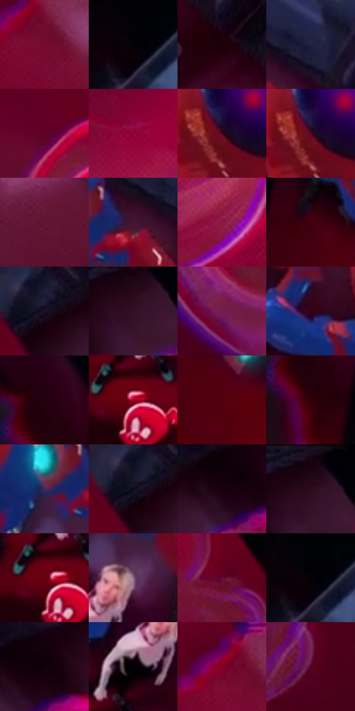

# 电影参考 458

- 状态：条件／活跃；来源世界：miles-home。
- 视角：overhead；景别：environment-wide；场景：interior。
- 时段：event-time-unknown（外观依据，中置信度；具体时间／晨昏未知）；光照：event-light。
- 材质候选：skin, fabric, glass, metal（帧级，不是像素分割）。
- 明暗组：very-dark；L* P5/P50/P95：0.62749 / 14.00935 / 33.37155。
- 资格门禁：invisibility。
- 原截图 SHA-256：`7386465c1656eaf2da6cbff1abeb6b232b5f5de9e0bacccc8aff2897cfb3bbe2`；尺寸：2880 × 1208。
- sRGB 像素 SHA-256：`7a39170a6c8f3f1a68393966d9945a26ee73b32dd2d97be8123debe066aae115`。

## 观察与迁移

透明人物与实体同框，普通材质不继承隐身。

俯视透明红色人物与下方群像同框；隐身属于条件能力，客串人物造型不成为普通人脸默认。

17  /  458  /  强彩边与隐身条件：俯视透明红色人物与下方群像同框；隐身属于条件能力，客串人物造型不成为普通人脸默认。

本公开版保存32个128×128原像素色卡上下文；图集格子并非原场景相邻位置。原rect、图集tile和像素SHA见 `data/palette-crops.json`。上下文不足时不得批准替色，不能以小样推断完整构图。

## 实测色卡

颜色比例分母为保留采样像素，不是材料面积；全部 32 色参与全库匹配。表内四舍五入仅用于阅读，原精度在 JSON。

| ID | HEX | Lab | 原图 xy | 像素数 | 比例 | 明度角色 |
| --- | --- | --- | --- | ---: | ---: | --- |
| 458-S01 | #740B2F | [24.18938, 44.384108, 8.362052] | [640, 312] | 11915 | 6.162527% | shadow |
| 458-S02 | #020309 | [0.882933, 0.572711, -2.362581] | [2232, 44] | 11864 | 6.136150% | deep-shadow |
| 458-S03 | #1F0008 | [2.79052, 12.917183, 1.13201] | [2312, 412] | 10336 | 5.345857% | deep-shadow |
| 458-S04 | #202142 | [14.332946, 10.056125, -21.119464] | [2020, 108] | 10058 | 5.202073% | deep-shadow |
| 458-S05 | #600223 | [18.594014, 40.083268, 8.410163] | [264, 420] | 10011 | 5.177764% | deep-shadow |
| 458-S06 | #910539 | [30.461709, 53.806674, 11.197717] | [656, 824] | 7502 | 3.880091% | shadow |
| 458-S07 | #48021B | [12.612443, 32.770936, 5.1479] | [1572, 180] | 7447 | 3.851644% | deep-shadow |
| 458-S08 | #550622 | [16.393091, 35.73722, 5.693373] | [1568, 176] | 7257 | 3.753375% | deep-shadow |
| 458-S09 | #601531 | [21.001749, 35.609823, 1.85814] | [964, 252] | 6901 | 3.569249% | shadow |
| 458-S10 | #421530 | [14.998179, 25.248516, -6.983415] | [1944, 152] | 6581 | 3.403743% | deep-shadow |
| 458-S11 | #8D1B45 | [31.527361, 49.080996, 4.586254] | [720, 960] | 6473 | 3.347884% | shadow |
| 458-S12 | #41000E | [10.227863, 30.716246, 10.203795] | [1424, 368] | 6188 | 3.200480% | deep-shadow |
| 458-S13 | #191327 | [7.396889, 8.707758, -12.643239] | [620, 120] | 6066 | 3.137381% | deep-shadow |
| 458-S14 | #330D24 | [9.947358, 22.111281, -6.101962] | [876, 88] | 6040 | 3.123933% | deep-shadow |
| 458-S15 | #751F50 | [27.687785, 41.879994, -8.894437] | [304, 956] | 5710 | 2.953255% | shadow |
| 458-S16 | #300217 | [6.628696, 24.892459, -1.137451] | [1436, 240] | 5546 | 2.868433% | deep-shadow |
| 458-S17 | #26000E | [4.009706, 18.688912, 0.408652] | [1236, 312] | 5503 | 2.846193% | deep-shadow |
| 458-S18 | #A40016 | [33.884917, 57.89431, 38.276377] | [1772, 464] | 5493 | 2.841021% | shadow |
| 458-S19 | #54000C | [15.018381, 36.106181, 18.445131] | [1508, 460] | 5398 | 2.791886% | deep-shadow |
| 458-S20 | #2E0008 | [5.406748, 23.199378, 5.26613] | [1240, 392] | 5353 | 2.768612% | deep-shadow |
| 458-S21 | #3F2C5B | [22.349766, 20.00491, -25.118259] | [1848, 168] | 5315 | 2.748958% | shadow |
| 458-S22 | #0C0B19 | [3.501851, 3.204292, -7.846995] | [604, 124] | 5258 | 2.719477% | deep-shadow |
| 458-S23 | #17020D | [2.300497, 8.424322, -1.84426] | [740, 128] | 5133 | 2.654826% | deep-shadow |
| 458-S24 | #230717 | [5.159863, 15.497864, -3.576081] | [880, 48] | 5036 | 2.604657% | deep-shadow |
| 458-S25 | #66000C | [19.442216, 41.170416, 24.849763] | [1756, 460] | 4722 | 2.442254% | deep-shadow |
| 458-S26 | #8C6B85 | [49.234097, 17.721948, -9.251601] | [1904, 272] | 4082 | 2.111241% | midtone |
| 458-S27 | #640A30 | [20.598443, 40.199741, 2.088656] | [1020, 896] | 3277 | 1.694889% | shadow |
| 458-S28 | #040105 | [0.528247, 1.340656, -1.237246] | [2236, 60] | 3105 | 1.605929% | deep-shadow |
| 458-S29 | #100006 | [1.114111, 5.298324, -0.697642] | [772, 112] | 3097 | 1.601792% | deep-shadow |
| 458-S30 | #040001 | [0.253022, 1.185041, -0.009869] | [1828, 356] | 3093 | 1.599723% | deep-shadow |
| 458-S31 | #880028 | [27.815796, 51.336903, 18.758248] | [604, 280] | 2471 | 1.278020% | shadow |
| 458-S32 | #550228 | [16.147594, 37.516818, 0.960484] | [1084, 1080] | 1115 | 0.576686% | deep-shadow |

## 色阶与空间分布

- 采样 ROI：`[0.01, 0.02, 0.98, 0.94]`；步长：4；样本数：193346。
- 排除区：`[]`。
- 深暗、暗、中、亮、高光五段计数：`[136423, 53402, 2698, 656, 167]`。
- RGB 各 256 箱、L* 100 箱、13×5 色相明度表和 3×3 空间统计全部保存在 [总数据](../film-library.json)。
- [可视化档案](../../references/library.html)按需绘制直方图，不存 2,094 张重复图表图片。

## 纹理特征占比

**这是分块图像特征的面积占比，不是波点／排线／丝网／错版的精确语义覆盖率。** 窗格、发丝、织物也会产生方向或周期特征。
原图 ROI 像素 3104134；已测块覆盖 3104134（100.0000%）；未测 0。

| 特征 | 块覆盖像素 | 占已测面积 | 阈值敏感范围 |
| --- | ---: | ---: | --- |
| low-contrast | 862726 | 27.7928% | 20.9312% ~ 30.4319% |
| directional-structure | 500480 | 16.1230% | 9.2408% ~ 29.9327% |
| periodic-structure | 1549568 | 49.9195% | 45.9691% ~ 52.7482% |
| mixed-detail | 191360 | 6.1647% | 3.1669% ~ 7.5791% |

阈值敏感范围不是统计置信区间。逐块坐标、尺度、对比、方向一致性、频谱集中度、频率与角度见 [全量特征记录](../texture-features.jsonl)，以帧号定位。
四种印刷层的真实像素覆盖仍标为 `null`，不能填 0，也不能拿上表代替。不得据这些代理测量删除唯一证据。

[测量方法与保留策略](../../references/library-retention.md) · [分类索引](../archive/README.md)
