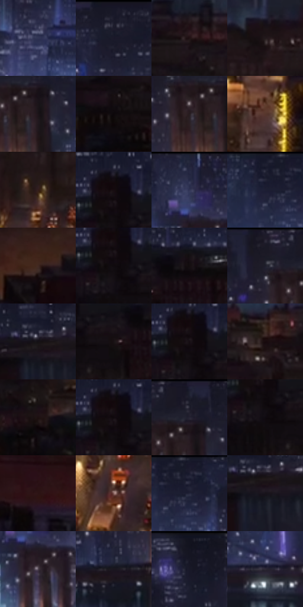

# 电影参考 459

- 状态：常规／活跃；来源世界：miles-home。
- 视角：high-angle；景别：environment-wide；场景：city。
- 时段：night-appearance（外观依据，中置信度；具体时间／晨昏未知）；光照：night-mixed。
- 材质候选：brick, glass, asphalt, sky（帧级，不是像素分割）。
- 明暗组：very-dark；L* P5/P50/P95：2.90179 / 8.8177 / 29.58027。
- 资格门禁：无附加门禁。
- 原截图 SHA-256：`55b96edd75cbd1cf65ddf162c8c60b9ca3c79b63d0a0ceb83ab3ca366bf61621`；尺寸：2880 × 1210。
- sRGB 像素 SHA-256：`59f0ac89099daa9037e5114a538674af51dd4b3e3fd68658cb66b3fdd1f0d5b5`。

## 观察与迁移

夜城鸟瞰，暖街道与冷楼群暗层次连续。

城市桥梁与远楼分层，街道暖灯和较冷天际线分工，水面有竖向光带；不把夜城固定成紫色。

18  /  459  /  夜街与交通玻璃：城市桥梁与远楼分层，街道暖灯和较冷天际线分工，水面有竖向光带；不把夜城固定成紫色。

本公开版保存32个128×128原像素色卡上下文；图集格子并非原场景相邻位置。原rect、图集tile和像素SHA见 `data/palette-crops.json`。上下文不足时不得批准替色，不能以小样推断完整构图。

## 实测色卡

颜色比例分母为保留采样像素，不是材料面积；全部 32 色参与全库匹配。表内四舍五入仅用于阅读，原精度在 JSON。

| ID | HEX | Lab | 原图 xy | 像素数 | 比例 | 明度角色 |
| --- | --- | --- | --- | ---: | ---: | --- |
| 459-S01 | #313554 | [23.132109, 7.241708, -19.354286] | [1668, 132] | 9685 | 4.991136% | shadow |
| 459-S02 | #1A1A29 | [9.94168, 4.462904, -10.156881] | [976, 28] | 8901 | 4.587104% | deep-shadow |
| 459-S03 | #211315 | [7.617276, 7.595875, 1.410117] | [1312, 392] | 8491 | 4.375812% | deep-shadow |
| 459-S04 | #22191B | [9.911148, 4.9059, 0.312182] | [1844, 388] | 8093 | 4.170704% | deep-shadow |
| 459-S05 | #1C1519 | [7.708844, 4.461012, -1.497049] | [840, 120] | 7746 | 3.991878% | deep-shadow |
| 459-S06 | #0C070A | [2.276686, 1.753956, -0.66397] | [152, 460] | 7573 | 3.902723% | deep-shadow |
| 459-S07 | #271D20 | [12.053173, 5.513473, -0.189009] | [780, 124] | 7188 | 3.704314% | deep-shadow |
| 459-S08 | #57372D | [26.587586, 12.948061, 12.1396] | [1820, 956] | 7187 | 3.703799% | shadow |
| 459-S09 | #331E1B | [13.894757, 9.8096, 6.302496] | [1680, 492] | 7134 | 3.676486% | deep-shadow |
| 459-S10 | #170D12 | [4.640253, 4.841312, -1.143942] | [36, 224] | 7122 | 3.670302% | deep-shadow |
| 459-S11 | #252842 | [17.00856, 6.513332, -16.865723] | [1456, 32] | 6988 | 3.601245% | deep-shadow |
| 459-S12 | #232437 | [14.925431, 5.046033, -12.455358] | [1172, 48] | 6590 | 3.396137% | deep-shadow |
| 459-S13 | #422922 | [19.473716, 10.680728, 9.380669] | [2336, 760] | 6427 | 3.312135% | deep-shadow |
| 459-S14 | #0F0A0C | [3.118121, 1.794095, -0.270431] | [52, 268] | 6287 | 3.239987% | deep-shadow |
| 459-S15 | #130E0F | [4.399271, 2.003363, 0.163583] | [228, 264] | 5868 | 3.024056% | deep-shadow |
| 459-S16 | #1A1925 | [9.388481, 3.919753, -8.045476] | [740, 32] | 5821 | 2.999835% | deep-shadow |
| 459-S17 | #141015 | [5.179957, 2.624076, -2.338184] | [392, 240] | 5765 | 2.970976% | deep-shadow |
| 459-S18 | #181214 | [6.118254, 3.091306, -0.242942] | [152, 308] | 5719 | 2.947270% | deep-shadow |
| 459-S19 | #100C0E | [3.656684, 1.623915, -0.434088] | [32, 248] | 5707 | 2.941086% | deep-shadow |
| 459-S20 | #180B0E | [4.202822, 5.46463, 0.45448] | [2040, 448] | 5579 | 2.875121% | deep-shadow |
| 459-S21 | #1D1011 | [6.072948, 6.315064, 1.628878] | [308, 484] | 5401 | 2.783389% | deep-shadow |
| 459-S22 | #120D14 | [4.217994, 3.104473, -3.088847] | [32, 240] | 5389 | 2.777205% | deep-shadow |
| 459-S23 | #211F2E | [12.611437, 5.089465, -9.624472] | [832, 52] | 5198 | 2.678774% | deep-shadow |
| 459-S24 | #0F0A10 | [3.216233, 2.483531, -2.146808] | [72, 308] | 5160 | 2.659191% | deep-shadow |
| 459-S25 | #2D1415 | [9.895352, 12.893681, 4.950335] | [2036, 1052] | 5031 | 2.592711% | deep-shadow |
| 459-S26 | #8C6763 | [47.206807, 14.250728, 8.080447] | [1568, 1008] | 4955 | 2.553545% | midtone |
| 459-S27 | #1C1E31 | [11.938394, 4.918068, -12.872303] | [1212, 32] | 4551 | 2.345344% | deep-shadow |
| 459-S28 | #18131A | [6.634887, 4.007425, -3.904374] | [408, 268] | 4463 | 2.299994% | deep-shadow |
| 459-S29 | #524754 | [31.671026, 7.374641, -6.008541] | [1476, 152] | 3842 | 1.979963% | shadow |
| 459-S30 | #1A161F | [8.06049, 4.377828, -5.566695] | [688, 232] | 3680 | 1.896477% | deep-shadow |
| 459-S31 | #13131F | [6.351033, 3.293317, -8.231416] | [544, 28] | 3530 | 1.819175% | deep-shadow |
| 459-S32 | #2D2935 | [17.463877, 4.803872, -7.07222] | [1036, 224] | 2973 | 1.532127% | deep-shadow |

## 色阶与空间分布

- 采样 ROI：`[0.01, 0.02, 0.98, 0.94]`；步长：4；样本数：194044。
- 排除区：`[]`。
- 深暗、暗、中、亮、高光五段计数：`[167177, 23392, 2835, 540, 100]`。
- RGB 各 256 箱、L* 100 箱、13×5 色相明度表和 3×3 空间统计全部保存在 [总数据](../film-library.json)。
- [可视化档案](../../references/library.html)按需绘制直方图，不存 2,094 张重复图表图片。

## 纹理特征占比

**这是分块图像特征的面积占比，不是波点／排线／丝网／错版的精确语义覆盖率。** 窗格、发丝、织物也会产生方向或周期特征。
原图 ROI 像素 3109722；已测块覆盖 3109722（100.0000%）；未测 0。

| 特征 | 块覆盖像素 | 占已测面积 | 阈值敏感范围 |
| --- | ---: | ---: | --- |
| low-contrast | 0 | 0.0000% | 0.0000% ~ 0.5269% |
| directional-structure | 76928 | 2.4738% | 0.5269% ~ 5.1081% |
| periodic-structure | 2446336 | 78.6674% | 69.2744% ~ 84.9720% |
| mixed-detail | 586458 | 18.8589% | 9.9199% ~ 29.6719% |

阈值敏感范围不是统计置信区间。逐块坐标、尺度、对比、方向一致性、频谱集中度、频率与角度见 [全量特征记录](../texture-features.jsonl)，以帧号定位。
四种印刷层的真实像素覆盖仍标为 `null`，不能填 0，也不能拿上表代替。不得据这些代理测量删除唯一证据。

[测量方法与保留策略](../../references/library-retention.md) · [分类索引](../archive/README.md)
