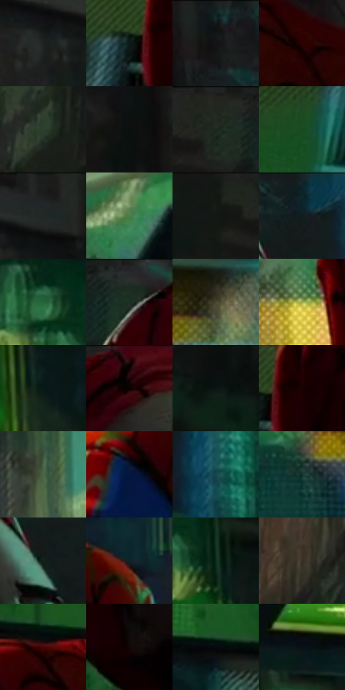

# 电影参考 460

- 状态：常规／活跃；来源世界：miles-home。
- 视角：low-angle；景别：medium；场景：portrait。
- 时段：night-appearance（外观依据，中置信度；具体时间／晨昏未知）；光照：night-mixed。
- 材质候选：skin, hair, fabric, brick, screen（帧级，不是像素分割）。
- 明暗组：very-dark；L* P5/P50/P95：2.10793 / 10.95385 / 47.88858。
- 资格门禁：无附加门禁。
- 原截图 SHA-256：`1a12e4ba70a0cd67faa7893461d2325fbb69f592be3da2d0d904033df3ff7c93`；尺寸：2880 × 1200。
- sRGB 像素 SHA-256：`a380843a0f5234a71e562431147bc3a14db22ff10fc4efbac9b4ec728c7ed17d`。

## 观察与迁移

夜街近脸与背后招牌，皮肤和发光字不是同类色源。

暗街近脸受绿青环境光，砖墙和衣物排线各异，局部店灯暖；不能全脸染成同一发光材质。

19  /  460  /  夜街与交通玻璃：暗街近脸受绿青环境光，砖墙和衣物排线各异，局部店灯暖；不能全脸染成同一发光材质。

本公开版保存32个128×128原像素色卡上下文；图集格子并非原场景相邻位置。原rect、图集tile和像素SHA见 `data/palette-crops.json`。上下文不足时不得批准替色，不能以小样推断完整构图。

## 实测色卡

颜色比例分母为保留采样像素，不是材料面积；全部 32 色参与全库匹配。表内四舍五入仅用于阅读，原精度在 JSON。

| ID | HEX | Lab | 原图 xy | 像素数 | 比例 | 明度角色 |
| --- | --- | --- | --- | ---: | ---: | --- |
| 460-S01 | #1D211E | [12.238701, -2.611053, 1.404822] | [2108, 100] | 10998 | 5.708858% | deep-shadow |
| 460-S02 | #0D191A | [7.726452, -4.629497, -2.396134] | [876, 292] | 10474 | 5.436859% | deep-shadow |
| 460-S03 | #131312 | [5.85212, -0.212589, 0.578276] | [2820, 36] | 9143 | 4.745962% | deep-shadow |
| 460-S04 | #2A0303 | [5.095449, 18.776971, 6.752109] | [1200, 748] | 8525 | 4.425169% | deep-shadow |
| 460-S05 | #2C402B | [24.879256, -12.956637, 10.376384] | [288, 308] | 7647 | 3.969416% | shadow |
| 460-S06 | #0B100E | [4.276411, -1.943127, 0.428566] | [2504, 76] | 7536 | 3.911798% | deep-shadow |
| 460-S07 | #242B24 | [16.651567, -4.808626, 3.539609] | [860, 48] | 7512 | 3.899340% | deep-shadow |
| 460-S08 | #194B21 | [27.705077, -27.07969, 20.046299] | [632, 352] | 7256 | 3.766455% | shadow |
| 460-S09 | #1C1C19 | [10.164872, -0.734182, 2.079062] | [2284, 24] | 7195 | 3.734791% | deep-shadow |
| 460-S10 | #4F804D | [49.051472, -27.60781, 22.601082] | [1988, 684] | 7025 | 3.646547% | midtone |
| 460-S11 | #151916 | [8.241122, -2.682596, 1.439387] | [720, 48] | 6936 | 3.600349% | deep-shadow |
| 460-S12 | #121B1D | [9.000882, -3.449097, -2.721309] | [1372, 64] | 6581 | 3.416075% | deep-shadow |
| 460-S13 | #236439 | [37.420158, -31.302177, 18.444816] | [2404, 500] | 6480 | 3.363648% | shadow |
| 460-S14 | #1B2C20 | [16.198379, -10.28877, 5.587084] | [984, 44] | 6208 | 3.222458% | deep-shadow |
| 460-S15 | #494832 | [30.112087, -3.728717, 13.396145] | [2788, 1040] | 5606 | 2.909971% | shadow |
| 460-S16 | #9FA94A | [66.70437, -17.104479, 46.954505] | [812, 1004] | 5590 | 2.901665% | light |
| 460-S17 | #091815 | [6.914225, -6.265343, 0.095985] | [2556, 728] | 5574 | 2.893360% | deep-shadow |
| 460-S18 | #060101 | [0.565717, 1.307479, 0.460726] | [1144, 32] | 5534 | 2.872597% | deep-shadow |
| 460-S19 | #0A1513 | [5.851971, -4.298232, -0.123729] | [2752, 384] | 5353 | 2.778643% | deep-shadow |
| 460-S20 | #1C0203 | [2.682275, 9.620373, 2.962374] | [940, 272] | 5190 | 2.694033% | deep-shadow |
| 460-S21 | #4B6346 | [39.346288, -15.241229, 13.648642] | [1876, 532] | 5187 | 2.692475% | shadow |
| 460-S22 | #04173E | [8.8762, 10.022909, -27.177568] | [948, 732] | 5175 | 2.686246% | deep-shadow |
| 460-S23 | #14474E | [27.3105, -13.98857, -9.107403] | [1476, 216] | 5175 | 2.686246% | shadow |
| 460-S24 | #10322B | [18.212793, -14.438654, 0.768735] | [2648, 1124] | 4837 | 2.510797% | deep-shadow |
| 460-S25 | #12201B | [10.85432, -7.531607, 1.481879] | [1344, 156] | 4691 | 2.435011% | deep-shadow |
| 460-S26 | #102327 | [12.342489, -6.365107, -5.092287] | [1636, 684] | 4594 | 2.384660% | deep-shadow |
| 460-S27 | #0B2B19 | [14.784112, -17.004304, 8.344905] | [2500, 584] | 4212 | 2.186371% | deep-shadow |
| 460-S28 | #373024 | [20.257304, 0.867265, 8.855737] | [100, 304] | 4207 | 2.183776% | shadow |
| 460-S29 | #480506 | [12.607144, 30.3759, 17.2104] | [1044, 652] | 3905 | 2.027013% | deep-shadow |
| 460-S30 | #120606 | [2.457194, 3.642185, 1.283548] | [1056, 456] | 3653 | 1.896204% | deep-shadow |
| 460-S31 | #060A0A | [2.5085, -1.046171, -0.368224] | [632, 596] | 3083 | 1.600328% | deep-shadow |
| 460-S32 | #0A1018 | [4.525785, -0.03873, -5.578799] | [2164, 808] | 1566 | 0.812882% | deep-shadow |

## 色阶与空间分布

- 采样 ROI：`[0.01, 0.02, 0.98, 0.94]`；步长：4；样本数：192648。
- 排除区：`[]`。
- 深暗、暗、中、亮、高光五段计数：`[137708, 37690, 13481, 3247, 522]`。
- RGB 各 256 箱、L* 100 箱、13×5 色相明度表和 3×3 空间统计全部保存在 [总数据](../film-library.json)。
- [可视化档案](../../references/library.html)按需绘制直方图，不存 2,094 张重复图表图片。

## 纹理特征占比

**这是分块图像特征的面积占比，不是波点／排线／丝网／错版的精确语义覆盖率。** 窗格、发丝、织物也会产生方向或周期特征。
原图 ROI 像素 3084576；已测块覆盖 3084576（100.0000%）；未测 0。

| 特征 | 块覆盖像素 | 占已测面积 | 阈值敏感范围 |
| --- | ---: | ---: | --- |
| low-contrast | 303616 | 9.8430% | 4.7306% ~ 14.3330% |
| directional-structure | 495616 | 16.0676% | 6.1747% ~ 33.5045% |
| periodic-structure | 2242336 | 72.6951% | 61.7649% ~ 76.1725% |
| mixed-detail | 43008 | 1.3943% | 0.0000% ~ 3.3197% |

阈值敏感范围不是统计置信区间。逐块坐标、尺度、对比、方向一致性、频谱集中度、频率与角度见 [全量特征记录](../texture-features.jsonl)，以帧号定位。
四种印刷层的真实像素覆盖仍标为 `null`，不能填 0，也不能拿上表代替。不得据这些代理测量删除唯一证据。

[测量方法与保留策略](../../references/library-retention.md) · [分类索引](../archive/README.md)
