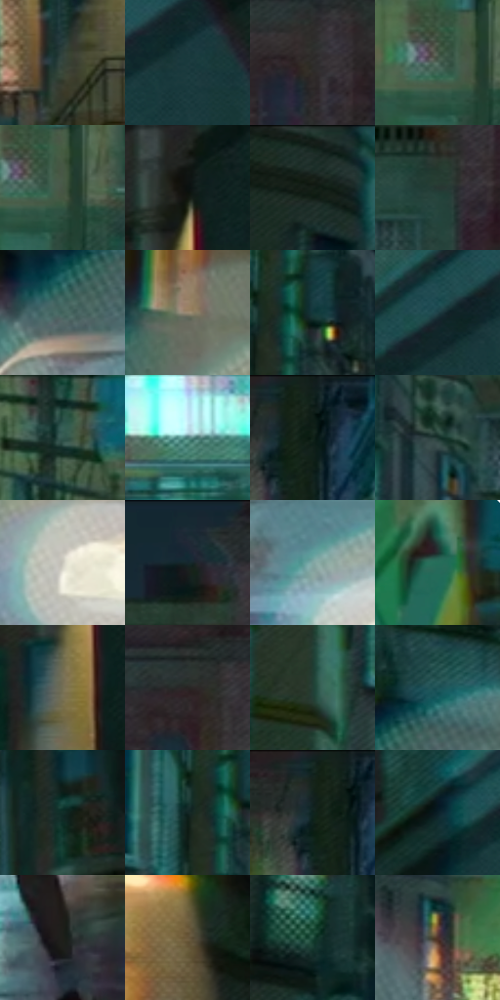

# 电影参考 461

- 状态：常规／活跃；来源世界：miles-home。
- 视角：near-level；景别：environment-wide；场景：street。
- 时段：night-appearance（外观依据，中置信度；具体时间／晨昏未知）；光照：night-mixed。
- 材质候选：skin, fabric, brick, glass, asphalt, painted-metal, screen（帧级，不是像素分割）。
- 明暗组：dark；L* P5/P50/P95：8.01352 / 24.61029 / 64.36119。
- 资格门禁：无附加门禁。
- 原截图 SHA-256：`ef050f7e44d319d6f30c88d613fb9024fa3eb4f8faa7e09dde14db81985685ca`；尺寸：2880 × 1206。
- sRGB 像素 SHA-256：`b8d16321ee803e4b5dbfeda21c3c1d509924372703f19b650d7db9c48c88c0d4`。

## 观察与迁移

灯源圆形网点光晕、店窗与湿路分层；远楼可概括软化。

车灯白芯外有多层近圆形半透明网点光晕，湿地映光横向断开；有源灯晕不能误禁为装饰光球。

20  /  461  /  夜街与交通玻璃：车灯白芯外有多层近圆形半透明网点光晕，湿地映光横向断开；有源灯晕不能误禁为装饰光球。

本公开版保存32个128×128原像素色卡上下文；图集格子并非原场景相邻位置。原rect、图集tile和像素SHA见 `data/palette-crops.json`。上下文不足时不得批准替色，不能以小样推断完整构图。

## 实测色卡

颜色比例分母为保留采样像素，不是材料面积；全部 32 色参与全库匹配。表内四舍五入仅用于阅读，原精度在 JSON。

| ID | HEX | Lab | 原图 xy | 像素数 | 比例 | 明度角色 |
| --- | --- | --- | --- | ---: | ---: | --- |
| 461-S01 | #35453C | [27.680204, -8.586574, 3.349297] | [2032, 728] | 9028 | 4.669349% | shadow |
| 461-S02 | #1A3A3D | [22.239855, -10.75528, -5.490525] | [2632, 164] | 8796 | 4.549357% | shadow |
| 461-S03 | #312F2D | [19.538158, 0.440303, 1.601918] | [1356, 108] | 8266 | 4.275237% | deep-shadow |
| 461-S04 | #536B5E | [43.006662, -11.829348, 4.388072] | [1536, 604] | 8222 | 4.252480% | midtone |
| 461-S05 | #455745 | [35.02547, -10.991977, 8.214977] | [1568, 612] | 7739 | 4.002669% | shadow |
| 461-S06 | #0B110F | [4.575365, -2.325909, 0.347771] | [2224, 420] | 7453 | 3.854747% | deep-shadow |
| 461-S07 | #1D2C27 | [16.54783, -7.676241, 1.219051] | [312, 28] | 7365 | 3.809233% | deep-shadow |
| 461-S08 | #283733 | [21.66186, -7.207302, 0.4935] | [1160, 192] | 6807 | 3.520631% | shadow |
| 461-S09 | #42635D | [39.363692, -13.442551, -0.418385] | [376, 576] | 6753 | 3.492702% | shadow |
| 461-S10 | #998972 | [57.922276, 2.239117, 14.550807] | [72, 596] | 6471 | 3.346850% | midtone |
| 461-S11 | #12393A | [21.431877, -13.125555, -4.71235] | [792, 92] | 6460 | 3.341160% | shadow |
| 461-S12 | #1E4147 | [25.294257, -10.661439, -7.535644] | [2492, 188] | 6445 | 3.333402% | shadow |
| 461-S13 | #33564E | [33.792789, -14.793339, 0.66674] | [1656, 316] | 6398 | 3.309094% | shadow |
| 461-S14 | #4D7E7A | [49.379121, -17.54247, -3.056768] | [1276, 892] | 6282 | 3.249097% | midtone |
| 461-S15 | #0F1D17 | [9.337409, -7.846782, 2.226908] | [1840, 44] | 6271 | 3.243408% | deep-shadow |
| 461-S16 | #1B352F | [19.980914, -11.78086, 0.660865] | [840, 244] | 6210 | 3.211859% | deep-shadow |
| 461-S17 | #C9C7BC | [80.120781, -1.258939, 5.750173] | [144, 748] | 6164 | 3.188067% | highlight |
| 461-S18 | #122A34 | [15.655868, -5.765784, -9.318206] | [1132, 56] | 5987 | 3.096521% | deep-shadow |
| 461-S19 | #80A6A3 | [65.361327, -13.521596, -2.680208] | [496, 680] | 5857 | 3.029284% | light |
| 461-S20 | #266D5A | [41.353651, -27.069578, 4.140462] | [2788, 684] | 5648 | 2.921188% | midtone |
| 461-S21 | #757055 | [47.009183, -2.778641, 15.750977] | [2200, 588] | 5415 | 2.800679% | midtone |
| 461-S22 | #292524 | [15.072234, 1.633032, 1.338033] | [1540, 72] | 5405 | 2.795507% | deep-shadow |
| 461-S23 | #224036 | [24.554208, -14.050373, 2.62847] | [584, 164] | 5313 | 2.747923% | shadow |
| 461-S24 | #1E5357 | [32.146208, -15.928563, -7.561751] | [444, 480] | 5184 | 2.681204% | shadow |
| 461-S25 | #102D28 | [16.205433, -12.435278, -0.071304] | [2164, 212] | 4633 | 2.396222% | deep-shadow |
| 461-S26 | #132624 | [13.543235, -8.384433, -1.120145] | [732, 112] | 4588 | 2.372948% | deep-shadow |
| 461-S27 | #0E231F | [11.919496, -9.720097, 0.077261] | [1808, 64] | 4375 | 2.262783% | deep-shadow |
| 461-S28 | #0A1F27 | [10.489995, -5.310566, -7.937746] | [2300, 288] | 4323 | 2.235888% | deep-shadow |
| 461-S29 | #1E1F19 | [11.457408, -1.897437, 3.946128] | [1124, 996] | 4311 | 2.229682% | deep-shadow |
| 461-S30 | #6A583D | [38.517774, 3.204927, 18.416368] | [144, 364] | 4140 | 2.141239% | shadow |
| 461-S31 | #224F3F | [30.134032, -19.971265, 4.784994] | [336, 296] | 3758 | 1.943666% | shadow |
| 461-S32 | #4F322B | [24.058547, 12.165203, 9.845077] | [856, 520] | 3279 | 1.695923% | shadow |

## 色阶与空间分布

- 采样 ROI：`[0.01, 0.02, 0.98, 0.94]`；步长：4；样本数：193346。
- 排除区：`[]`。
- 深暗、暗、中、亮、高光五段计数：`[66424, 82368, 31844, 9410, 3300]`。
- RGB 各 256 箱、L* 100 箱、13×5 色相明度表和 3×3 空间统计全部保存在 [总数据](../film-library.json)。
- [可视化档案](../../references/library.html)按需绘制直方图，不存 2,094 张重复图表图片。

## 纹理特征占比

**这是分块图像特征的面积占比，不是波点／排线／丝网／错版的精确语义覆盖率。** 窗格、发丝、织物也会产生方向或周期特征。
原图 ROI 像素 3098546；已测块覆盖 3098546（100.0000%）；未测 0。

| 特征 | 块覆盖像素 | 占已测面积 | 阈值敏感范围 |
| --- | ---: | ---: | --- |
| low-contrast | 70912 | 2.2886% | 1.4087% ~ 2.2886% |
| directional-structure | 392576 | 12.6697% | 6.4195% ~ 22.9723% |
| periodic-structure | 2536754 | 81.8692% | 75.0903% ~ 81.8692% |
| mixed-detail | 98304 | 3.1726% | 0.5288% ~ 10.0465% |

阈值敏感范围不是统计置信区间。逐块坐标、尺度、对比、方向一致性、频谱集中度、频率与角度见 [全量特征记录](../texture-features.jsonl)，以帧号定位。
四种印刷层的真实像素覆盖仍标为 `null`，不能填 0，也不能拿上表代替。不得据这些代理测量删除唯一证据。

[测量方法与保留策略](../../references/library-retention.md) · [分类索引](../archive/README.md)
