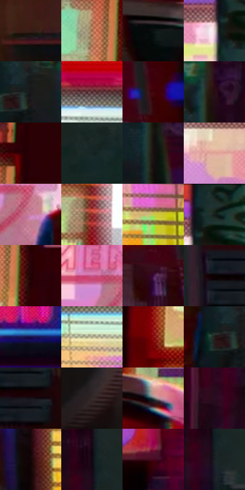

# 电影参考 462

- 状态：常规／活跃；来源世界：miles-home。
- 视角：near-level；景别：environment-wide；场景：street。
- 时段：night-appearance（外观依据，中置信度；具体时间／晨昏未知）；光照：night-mixed。
- 材质候选：skin, fabric, brick, glass, asphalt, painted-metal, screen（帧级，不是像素分割）。
- 明暗组：very-dark；L* P5/P50/P95：2.64541 / 13.65077 / 81.0118。
- 资格门禁：无附加门禁。
- 原截图 SHA-256：`ae75adf8455404d0f4f4fee471ae3e57148a259f0e235fc61eb86a891bbec251`；尺寸：2880 × 1206。
- sRGB 像素 SHA-256：`1efa16bdec7c9c8ad490d3946ac3e5502315d42633fa7fd873bdd4b360984b33`。

## 观察与迁移

灯源圆形网点光晕、店窗与湿路分层；远楼可概括软化。

店窗成为高亮矩形色块，前方柱子遮挡人物，车辆边缘色移；遮挡保留，不把所有彩块叫故障。

21  /  462  /  夜街与交通玻璃：店窗成为高亮矩形色块，前方柱子遮挡人物，车辆边缘色移；遮挡保留，不把所有彩块叫故障。

本公开版保存32个128×128原像素色卡上下文；图集格子并非原场景相邻位置。原rect、图集tile和像素SHA见 `data/palette-crops.json`。上下文不足时不得批准替色，不能以小样推断完整构图。

## 实测色卡

颜色比例分母为保留采样像素，不是材料面积；全部 32 色参与全库匹配。表内四舍五入仅用于阅读，原精度在 JSON。

| ID | HEX | Lab | 原图 xy | 像素数 | 比例 | 明度角色 |
| --- | --- | --- | --- | ---: | ---: | --- |
| 462-S01 | #3A1D16 | [14.604291, 13.316912, 11.013619] | [1072, 932] | 10057 | 5.201556% | deep-shadow |
| 462-S02 | #9C6845 | [48.759938, 16.942239, 28.070984] | [128, 356] | 9050 | 4.680728% | midtone |
| 462-S03 | #0A1010 | [4.26812, -1.849365, -0.650951] | [384, 604] | 8687 | 4.492981% | deep-shadow |
| 462-S04 | #EACBD2 | [84.410972, 12.0025, 0.550145] | [1352, 128] | 8662 | 4.480051% | highlight |
| 462-S05 | #19181A | [8.433627, 1.006416, -1.229241] | [1432, 552] | 8238 | 4.260755% | deep-shadow |
| 462-S06 | #4E292E | [21.59129, 17.881966, 4.354432] | [2808, 300] | 7665 | 3.964395% | shadow |
| 462-S07 | #3F040A | [10.303, 27.995298, 12.056819] | [2236, 140] | 7370 | 3.811819% | deep-shadow |
| 462-S08 | #270D12 | [6.891796, 14.07778, 2.413908] | [1576, 540] | 7258 | 3.753892% | deep-shadow |
| 462-S09 | #290105 | [4.554704, 19.211962, 5.125295] | [216, 248] | 7171 | 3.708895% | deep-shadow |
| 462-S10 | #162624 | [13.733581, -7.304604, -0.818353] | [1940, 760] | 6824 | 3.529424% | deep-shadow |
| 462-S11 | #171110 | [5.604826, 2.358005, 1.428443] | [1564, 696] | 6739 | 3.485461% | deep-shadow |
| 462-S12 | #E3A89C | [74.022714, 20.076293, 14.71851] | [1196, 160] | 6614 | 3.420810% | light |
| 462-S13 | #C87DA0 | [61.208913, 33.916642, -6.401965] | [1260, 496] | 6607 | 3.417190% | light |
| 462-S14 | #9C3734 | [37.932611, 41.859523, 24.557494] | [808, 364] | 6532 | 3.378399% | shadow |
| 462-S15 | #C6C84D | [78.375128, -16.273955, 59.357509] | [2632, 636] | 6336 | 3.277027% | light |
| 462-S16 | #1E3230 | [19.100277, -8.59928, -1.291298] | [1404, 44] | 6268 | 3.241857% | deep-shadow |
| 462-S17 | #240607 | [4.704066, 13.769116, 4.424327] | [204, 416] | 6213 | 3.213410% | deep-shadow |
| 462-S18 | #C05489 | [51.100984, 49.013502, -8.143867] | [1184, 436] | 5916 | 3.059800% | midtone |
| 462-S19 | #39093B | [11.831554, 30.193137, -19.950674] | [2156, 220] | 5538 | 2.864295% | deep-shadow |
| 462-S20 | #0B0202 | [1.074612, 2.360126, 0.831662] | [2096, 648] | 5526 | 2.858089% | deep-shadow |
| 462-S21 | #180F44 | [8.594123, 21.880254, -31.828959] | [2636, 128] | 4974 | 2.572590% | deep-shadow |
| 462-S22 | #A7A284 | [66.307483, -3.277148, 16.291147] | [2556, 380] | 4965 | 2.567935% | light |
| 462-S23 | #8B0D0F | [28.935967, 49.075421, 35.577458] | [500, 244] | 4930 | 2.549833% | shadow |
| 462-S24 | #221D1B | [11.2613, 1.972398, 2.262737] | [1376, 564] | 4740 | 2.451564% | deep-shadow |
| 462-S25 | #151017 | [5.346399, 3.547709, -3.518202] | [2160, 732] | 4707 | 2.434496% | deep-shadow |
| 462-S26 | #342928 | [17.778879, 4.902772, 2.579053] | [332, 956] | 4686 | 2.423634% | deep-shadow |
| 462-S27 | #465557 | [34.977182, -5.327472, -3.111772] | [556, 600] | 4333 | 2.241060% | shadow |
| 462-S28 | #270D20 | [7.439064, 16.717197, -7.099121] | [1712, 400] | 3915 | 2.024867% | deep-shadow |
| 462-S29 | #130705 | [2.722478, 3.501694, 2.088916] | [2396, 656] | 3771 | 1.950389% | deep-shadow |
| 462-S30 | #130512 | [2.62571, 6.378528, -4.13301] | [1776, 608] | 3210 | 1.660236% | deep-shadow |
| 462-S31 | #4B0720 | [14.131054, 32.222232, 3.647424] | [1676, 88] | 2997 | 1.550071% | deep-shadow |
| 462-S32 | #191F26 | [11.459852, -0.636173, -5.634552] | [1784, 676] | 2847 | 1.472490% | deep-shadow |

## 色阶与空间分布

- 采样 ROI：`[0.01, 0.02, 0.98, 0.94]`；步长：4；样本数：193346。
- 排除区：`[]`。
- 深暗、暗、中、亮、高光五段计数：`[121945, 19702, 20175, 21080, 10444]`。
- RGB 各 256 箱、L* 100 箱、13×5 色相明度表和 3×3 空间统计全部保存在 [总数据](../film-library.json)。
- [可视化档案](../../references/library.html)按需绘制直方图，不存 2,094 张重复图表图片。

## 纹理特征占比

**这是分块图像特征的面积占比，不是波点／排线／丝网／错版的精确语义覆盖率。** 窗格、发丝、织物也会产生方向或周期特征。
原图 ROI 像素 3098546；已测块覆盖 3098546（100.0000%）；未测 0。

| 特征 | 块覆盖像素 | 占已测面积 | 阈值敏感范围 |
| --- | ---: | ---: | --- |
| low-contrast | 136448 | 4.4036% | 2.1151% ~ 6.5187% |
| directional-structure | 671794 | 21.6809% | 11.5601% ~ 38.5023% |
| periodic-structure | 2224768 | 71.8004% | 58.8539% ~ 77.8688% |
| mixed-detail | 65536 | 2.1151% | 0.5288% ~ 4.0525% |

阈值敏感范围不是统计置信区间。逐块坐标、尺度、对比、方向一致性、频谱集中度、频率与角度见 [全量特征记录](../texture-features.jsonl)，以帧号定位。
四种印刷层的真实像素覆盖仍标为 `null`，不能填 0，也不能拿上表代替。不得据这些代理测量删除唯一证据。

[测量方法与保留策略](../../references/library-retention.md) · [分类索引](../archive/README.md)
