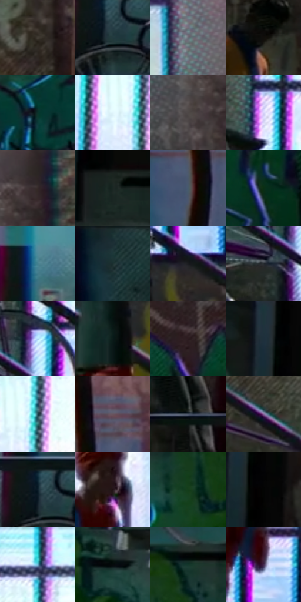

# 电影参考 463

- 状态：常规／活跃；来源世界：miles-home。
- 视角：near-level；景别：environment-wide；场景：street。
- 时段：night-appearance（外观依据，中置信度；具体时间／晨昏未知）；光照：night-mixed。
- 材质候选：skin, fabric, brick, glass, asphalt, painted-metal, screen（帧级，不是像素分割）。
- 明暗组：dark；L* P5/P50/P95：3.30418 / 21.48828 / 90.87941。
- 资格门禁：无附加门禁。
- 原截图 SHA-256：`790acb285da6b8c0ec0544b1986a5787e4b40a4be137449f4a526bfa0af2115f`；尺寸：2880 × 1200。
- sRGB 像素 SHA-256：`d8a0d4bf7cc665b57693ca5e138719248ea2b5144c5417699fe8ef1b0c348779`。

## 观察与迁移

灯源圆形网点光晕、店窗与湿路分层；远楼可概括软化。

窗格、栏杆、台阶及街物分色，涂鸦自身线色另算；建筑也参与彩边设计。

22  /  463  /  夜街与交通玻璃：窗格、栏杆、台阶及街物分色，涂鸦自身线色另算；建筑也参与彩边设计。

本公开版保存32个128×128原像素色卡上下文；图集格子并非原场景相邻位置。原rect、图集tile和像素SHA见 `data/palette-crops.json`。上下文不足时不得批准替色，不能以小样推断完整构图。

## 实测色卡

颜色比例分母为保留采样像素，不是材料面积；全部 32 色参与全库匹配。表内四舍五入仅用于阅读，原精度在 JSON。

| ID | HEX | Lab | 原图 xy | 像素数 | 比例 | 明度角色 |
| --- | --- | --- | --- | ---: | ---: | --- |
| 463-S01 | #403B33 | [25.128185, 0.549605, 5.746623] | [2220, 564] | 9421 | 4.890266% | shadow |
| 463-S02 | #20393D | [22.195832, -8.384917, -5.52469] | [828, 412] | 8578 | 4.452681% | shadow |
| 463-S03 | #656B74 | [45.001578, -0.295646, -5.796165] | [1824, 144] | 8339 | 4.328620% | midtone |
| 463-S04 | #100E0B | [4.050414, 0.201761, 1.543053] | [288, 152] | 8224 | 4.268926% | deep-shadow |
| 463-S05 | #0A332C | [18.425835, -16.022428, 0.365498] | [488, 836] | 7877 | 4.088804% | deep-shadow |
| 463-S06 | #E1F5FC | [95.303632, -5.188414, -5.589602] | [2768, 216] | 7870 | 4.085171% | highlight |
| 463-S07 | #4E4847 | [31.136097, 2.302109, 1.504879] | [1908, 460] | 7736 | 4.015614% | shadow |
| 463-S08 | #D9D3FB | [86.158536, 9.721673, -18.770314] | [1204, 364] | 7299 | 3.788775% | highlight |
| 463-S09 | #342926 | [17.718329, 4.519675, 3.889993] | [1992, 384] | 7162 | 3.717661% | deep-shadow |
| 463-S10 | #1B2724 | [14.464456, -6.01219, 0.293416] | [124, 660] | 7040 | 3.654333% | deep-shadow |
| 463-S11 | #485B69 | [37.625132, -3.56374, -10.364908] | [2316, 156] | 6990 | 3.628379% | shadow |
| 463-S12 | #092E14 | [15.811684, -20.183502, 13.025015] | [2192, 936] | 6628 | 3.440472% | deep-shadow |
| 463-S13 | #45818F | [50.625828, -15.425536, -13.558752] | [824, 180] | 6607 | 3.429571% | midtone |
| 463-S14 | #1B2F30 | [17.824798, -7.716917, -3.198808] | [444, 404] | 6590 | 3.420747% | deep-shadow |
| 463-S15 | #191B1E | [9.674539, -0.123581, -2.399062] | [1560, 748] | 6373 | 3.308106% | deep-shadow |
| 463-S16 | #292E32 | [18.608387, -1.133948, -3.306482] | [1140, 664] | 6146 | 3.190274% | deep-shadow |
| 463-S17 | #AAD5F2 | [83.201235, -7.447312, -18.778286] | [1204, 580] | 5739 | 2.979008% | highlight |
| 463-S18 | #0A1A19 | [7.889859, -6.563908, -1.417707] | [1468, 824] | 5678 | 2.947344% | deep-shadow |
| 463-S19 | #2A1A1E | [11.448179, 8.717248, 0.452274] | [2396, 668] | 5672 | 2.944230% | deep-shadow |
| 463-S20 | #0D1217 | [5.239254, -0.590123, -3.754721] | [44, 28] | 5562 | 2.887131% | deep-shadow |
| 463-S21 | #244953 | [28.809798, -10.004797, -10.016793] | [2816, 192] | 5511 | 2.860658% | shadow |
| 463-S22 | #624E5F | [35.73644, 11.66821, -6.736988] | [2384, 48] | 5457 | 2.832627% | shadow |
| 463-S23 | #3D4758 | [29.918783, 0.47808, -11.407428] | [300, 480] | 4952 | 2.570491% | shadow |
| 463-S24 | #8B6BA0 | [50.147692, 23.028147, -23.805704] | [1040, 384] | 4858 | 2.521698% | midtone |
| 463-S25 | #0D202C | [11.277797, -3.227578, -10.363975] | [812, 376] | 4773 | 2.477576% | deep-shadow |
| 463-S26 | #1F1015 | [6.468336, 8.371835, -0.302309] | [1540, 464] | 4644 | 2.410614% | deep-shadow |
| 463-S27 | #143E1B | [22.559263, -23.519456, 17.198432] | [688, 788] | 4366 | 2.266310% | shadow |
| 463-S28 | #030403 | [1.018598, -0.400613, 0.286417] | [108, 152] | 3910 | 2.029608% | deep-shadow |
| 463-S29 | #64ADCA | [67.170461, -14.856825, -21.791328] | [1428, 68] | 3902 | 2.025456% | light |
| 463-S30 | #060A0C | [2.550302, -0.752424, -1.16769] | [948, 724] | 3414 | 1.772144% | deep-shadow |
| 463-S31 | #13362A | [19.8173, -16.221597, 3.777019] | [760, 664] | 2969 | 1.541153% | deep-shadow |
| 463-S32 | #43264B | [20.391446, 20.991274, -17.47304] | [1564, 612] | 2361 | 1.225551% | shadow |

## 色阶与空间分布

- 采样 ROI：`[0.01, 0.02, 0.98, 0.94]`；步长：4；样本数：192648。
- 排除区：`[]`。
- 深暗、暗、中、亮、高光五段计数：`[87402, 59926, 20648, 6272, 18400]`。
- RGB 各 256 箱、L* 100 箱、13×5 色相明度表和 3×3 空间统计全部保存在 [总数据](../film-library.json)。
- [可视化档案](../../references/library.html)按需绘制直方图，不存 2,094 张重复图表图片。

## 纹理特征占比

**这是分块图像特征的面积占比，不是波点／排线／丝网／错版的精确语义覆盖率。** 窗格、发丝、织物也会产生方向或周期特征。
原图 ROI 像素 3084576；已测块覆盖 3084576（100.0000%）；未测 0。

| 特征 | 块覆盖像素 | 占已测面积 | 阈值敏感范围 |
| --- | ---: | ---: | --- |
| low-contrast | 0 | 0.0000% | 0.0000% ~ 0.0000% |
| directional-structure | 635392 | 20.5990% | 10.3576% ~ 36.5753% |
| periodic-structure | 2242336 | 72.6951% | 61.8313% ~ 78.6872% |
| mixed-detail | 206848 | 6.7059% | 1.5935% ~ 10.9552% |

阈值敏感范围不是统计置信区间。逐块坐标、尺度、对比、方向一致性、频谱集中度、频率与角度见 [全量特征记录](../texture-features.jsonl)，以帧号定位。
四种印刷层的真实像素覆盖仍标为 `null`，不能填 0，也不能拿上表代替。不得据这些代理测量删除唯一证据。

[测量方法与保留策略](../../references/library-retention.md) · [分类索引](../archive/README.md)
