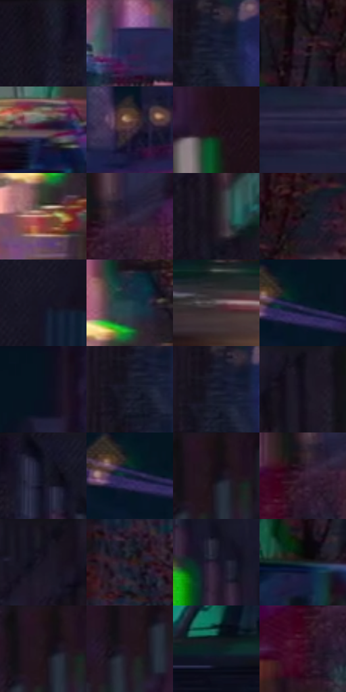

# 电影参考 464

- 状态：常规／活跃；来源世界：miles-home。
- 视角：near-level；景别：environment-wide；场景：street。
- 时段：night-appearance（外观依据，中置信度；具体时间／晨昏未知）；光照：night-mixed。
- 材质候选：skin, fabric, brick, glass, asphalt, painted-metal, screen（帧级，不是像素分割）。
- 明暗组：very-dark；L* P5/P50/P95：4.28429 / 10.33454 / 38.15931。
- 资格门禁：无附加门禁。
- 原截图 SHA-256：`53786e0546885961ad1f23462538de446757938acf6cbdc822236e320c97cc32`；尺寸：2880 × 1206。
- sRGB 像素 SHA-256：`0712cc620b6c02d909e40ffcc8e7b3b9199addaee29cbc52b2b892643da8b88f`。

## 观察与迁移

灯源圆形网点光晕、店窗与湿路分层；远楼可概括软化。

远窗简成竖向彩光块，桥梁体量仍可辨，远人和车列减细节；模糊与色版失焦可以并用。

23  /  464  /  夜街与交通玻璃：远窗简成竖向彩光块，桥梁体量仍可辨，远人和车列减细节；模糊与色版失焦可以并用。

本公开版保存32个128×128原像素色卡上下文；图集格子并非原场景相邻位置。原rect、图集tile和像素SHA见 `data/palette-crops.json`。上下文不足时不得批准替色，不能以小样推断完整构图。

## 实测色卡

颜色比例分母为保留采样像素，不是材料面积；全部 32 色参与全库匹配。表内四舍五入仅用于阅读，原精度在 JSON。

| ID | HEX | Lab | 原图 xy | 像素数 | 比例 | 明度角色 |
| --- | --- | --- | --- | ---: | ---: | --- |
| 464-S01 | #17131F | [6.746005, 5.064664, -7.594897] | [548, 32] | 11024 | 5.701695% | deep-shadow |
| 464-S02 | #22254E | [16.567939, 12.104538, -25.799005] | [1320, 860] | 9401 | 4.862268% | deep-shadow |
| 464-S03 | #191D35 | [11.568532, 6.10036, -16.350016] | [1112, 68] | 8855 | 4.579872% | deep-shadow |
| 464-S04 | #2C1F2E | [13.9012, 9.652251, -7.536373] | [544, 508] | 8095 | 4.186795% | deep-shadow |
| 464-S05 | #533245 | [25.412752, 18.14185, -5.55221] | [944, 832] | 7096 | 3.670104% | shadow |
| 464-S06 | #432C3B | [21.247138, 13.438521, -5.258044] | [1224, 508] | 7047 | 3.644761% | shadow |
| 464-S07 | #1F0D14 | [5.688214, 9.698021, -0.76563] | [2632, 244] | 6972 | 3.605971% | deep-shadow |
| 464-S08 | #211D3C | [12.786387, 11.186566, -19.360246] | [1228, 1080] | 6899 | 3.568214% | deep-shadow |
| 464-S09 | #B4806D | [58.271395, 17.638786, 18.315087] | [2236, 840] | 6560 | 3.392881% | midtone |
| 464-S10 | #30273F | [17.637114, 10.191681, -13.730758] | [1992, 664] | 6457 | 3.339609% | deep-shadow |
| 464-S11 | #221C26 | [11.348975, 5.398254, -5.713996] | [2140, 260] | 6437 | 3.329265% | deep-shadow |
| 464-S12 | #0C0910 | [2.808754, 1.936018, -2.767177] | [636, 464] | 6364 | 3.291508% | deep-shadow |
| 464-S13 | #171526 | [7.753863, 6.113689, -11.351078] | [300, 84] | 6350 | 3.284268% | deep-shadow |
| 464-S14 | #25424C | [26.190067, -7.717386, -9.433968] | [2260, 736] | 6348 | 3.283233% | shadow |
| 464-S15 | #605559 | [37.308093, 5.280452, -0.674126] | [2588, 1040] | 6305 | 3.260993% | shadow |
| 464-S16 | #081628 | [7.0327, 1.224189, -14.064694] | [1756, 144] | 6276 | 3.245994% | deep-shadow |
| 464-S17 | #07131E | [5.461321, -0.815979, -8.889025] | [1876, 28] | 5958 | 3.081522% | deep-shadow |
| 464-S18 | #171A28 | [9.5941, 2.970448, -9.979813] | [1080, 100] | 5955 | 3.079971% | deep-shadow |
| 464-S19 | #121527 | [7.328972, 4.58142, -12.800993] | [1092, 72] | 5539 | 2.864812% | deep-shadow |
| 464-S20 | #100F17 | [4.639847, 2.084984, -4.603332] | [2268, 32] | 5129 | 2.652757% | deep-shadow |
| 464-S21 | #101120 | [5.558053, 3.683335, -10.229493] | [648, 32] | 5096 | 2.635689% | deep-shadow |
| 464-S22 | #0F1D33 | [10.698161, 2.426331, -16.333856] | [1732, 152] | 5093 | 2.634138% | deep-shadow |
| 464-S23 | #170D17 | [4.804485, 5.995385, -4.284881] | [2504, 44] | 5048 | 2.610863% | deep-shadow |
| 464-S24 | #391E34 | [15.729244, 17.130253, -8.867256] | [1952, 688] | 4998 | 2.585003% | deep-shadow |
| 464-S25 | #13131D | [6.258751, 2.644842, -6.833027] | [2144, 32] | 4966 | 2.568452% | deep-shadow |
| 464-S26 | #2E1721 | [11.300305, 13.281284, -1.91883] | [340, 364] | 4956 | 2.563280% | deep-shadow |
| 464-S27 | #1D162A | [9.009591, 8.993602, -12.322187] | [760, 208] | 4705 | 2.433461% | deep-shadow |
| 464-S28 | #1A292C | [15.420159, -5.358271, -3.987363] | [508, 620] | 4586 | 2.371914% | deep-shadow |
| 464-S29 | #1E151B | [8.052861, 5.935728, -2.48594] | [2492, 52] | 4583 | 2.370362% | deep-shadow |
| 464-S30 | #231521 | [9.020592, 9.724468, -5.509533] | [2472, 108] | 4434 | 2.293298% | deep-shadow |
| 464-S31 | #0D1E24 | [10.117909, -4.928065, -6.282502] | [268, 748] | 3395 | 1.755919% | deep-shadow |
| 464-S32 | #3F0F26 | [12.851526, 25.725844, -2.980203] | [1920, 744] | 2419 | 1.251125% | deep-shadow |

## 色阶与空间分布

- 采样 ROI：`[0.01, 0.02, 0.98, 0.94]`；步长：4；样本数：193346。
- 排除区：`[]`。
- 深暗、暗、中、亮、高光五段计数：`[161931, 22657, 6343, 1845, 570]`。
- RGB 各 256 箱、L* 100 箱、13×5 色相明度表和 3×3 空间统计全部保存在 [总数据](../film-library.json)。
- [可视化档案](../../references/library.html)按需绘制直方图，不存 2,094 张重复图表图片。

## 纹理特征占比

**这是分块图像特征的面积占比，不是波点／排线／丝网／错版的精确语义覆盖率。** 窗格、发丝、织物也会产生方向或周期特征。
原图 ROI 像素 3098546；已测块覆盖 3098546（100.0000%）；未测 0。

| 特征 | 块覆盖像素 | 占已测面积 | 阈值敏感范围 |
| --- | ---: | ---: | --- |
| low-contrast | 114688 | 3.7013% | 2.1151% ~ 4.6680% |
| directional-structure | 862642 | 27.8402% | 19.3841% ~ 35.6808% |
| periodic-structure | 1940992 | 62.6420% | 59.5603% ~ 62.6420% |
| mixed-detail | 180224 | 5.8164% | 2.6438% ~ 13.9214% |

阈值敏感范围不是统计置信区间。逐块坐标、尺度、对比、方向一致性、频谱集中度、频率与角度见 [全量特征记录](../texture-features.jsonl)，以帧号定位。
四种印刷层的真实像素覆盖仍标为 `null`，不能填 0，也不能拿上表代替。不得据这些代理测量删除唯一证据。

[测量方法与保留策略](../../references/library-retention.md) · [分类索引](../archive/README.md)
