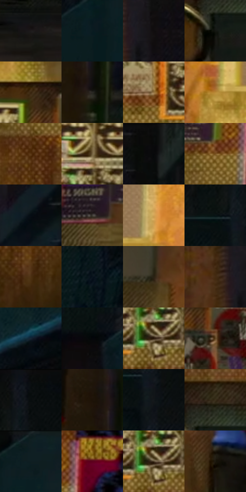

# 电影参考 465

- 状态：常规／活跃；来源世界：miles-home。
- 视角：near-level；景别：environment-wide；场景：street。
- 时段：night-appearance（外观依据，中置信度；具体时间／晨昏未知）；光照：night-mixed。
- 材质候选：skin, fabric, brick, glass, asphalt, painted-metal, screen（帧级，不是像素分割）。
- 明暗组：very-dark；L* P5/P50/P95：2.7311 / 12.82436 / 60.48796。
- 资格门禁：无附加门禁。
- 原截图 SHA-256：`d40df871be91f9c398c891a8589920608c40929610e183076c7162b7f890fc88`；尺寸：2880 × 1214。
- sRGB 像素 SHA-256：`a72e7b54d8e186a91000dbcd05ed210dcb59ae93656f827fec854ce34680cd61`。

## 观察与迁移

灯源圆形网点光晕、店窗与湿路分层；远楼可概括软化。

暖黄砖墙和海报群对比冷暗巷口，近处车轮与柱子遮挡；海报人物不是现场人数。

24  /  465  /  夜街与交通玻璃：暖黄砖墙和海报群对比冷暗巷口，近处车轮与柱子遮挡；海报人物不是现场人数。

本公开版保存32个128×128原像素色卡上下文；图集格子并非原场景相邻位置。原rect、图集tile和像素SHA见 `data/palette-crops.json`。上下文不足时不得批准替色，不能以小样推断完整构图。

## 实测色卡

颜色比例分母为保留采样像素，不是材料面积；全部 32 色参与全库匹配。表内四舍五入仅用于阅读，原精度在 JSON。

| ID | HEX | Lab | 原图 xy | 像素数 | 比例 | 明度角色 |
| --- | --- | --- | --- | ---: | ---: | --- |
| 465-S01 | #1D1B1C | [10.022336, 1.212456, -0.345439] | [2272, 1104] | 8933 | 4.587095% | deep-shadow |
| 465-S02 | #0A1B21 | [8.637676, -4.808473, -6.320624] | [2680, 144] | 8397 | 4.311859% | deep-shadow |
| 465-S03 | #100E0E | [4.118531, 0.680426, 0.240312] | [1932, 88] | 7782 | 3.996056% | deep-shadow |
| 465-S04 | #131610 | [6.771749, -2.604083, 3.085035] | [624, 840] | 7620 | 3.912869% | deep-shadow |
| 465-S05 | #38240D | [16.164061, 6.704012, 18.297533] | [1528, 304] | 7286 | 3.741360% | deep-shadow |
| 465-S06 | #2A2926 | [16.59242, -0.236921, 2.129383] | [1888, 960] | 7253 | 3.724415% | deep-shadow |
| 465-S07 | #957340 | [50.7135, 7.092663, 33.052548] | [1196, 524] | 7139 | 3.665876% | midtone |
| 465-S08 | #B98937 | [60.3233, 10.10307, 49.425932] | [544, 204] | 6991 | 3.589878% | light |
| 465-S09 | #583513 | [25.768533, 12.363, 27.11691] | [452, 672] | 6916 | 3.551365% | shadow |
| 465-S10 | #756241 | [42.611481, 2.701936, 21.616202] | [1408, 424] | 6866 | 3.525690% | midtone |
| 465-S11 | #080B0A | [2.826195, -0.933946, 0.109671] | [2072, 28] | 6761 | 3.471773% | deep-shadow |
| 465-S12 | #764E1C | [36.715445, 11.972499, 35.111639] | [480, 552] | 6711 | 3.446098% | shadow |
| 465-S13 | #060C13 | [3.149391, -0.299694, -4.098084] | [1976, 376] | 6682 | 3.431206% | deep-shadow |
| 465-S14 | #3F3B35 | [25.081314, 0.482028, 4.342078] | [212, 520] | 6236 | 3.202185% | shadow |
| 465-S15 | #D2A456 | [70.124919, 8.200665, 46.326243] | [832, 144] | 6232 | 3.200131% | light |
| 465-S16 | #0A1215 | [4.979483, -1.932312, -2.72218] | [2200, 156] | 5997 | 3.079459% | deep-shadow |
| 465-S17 | #4D3112 | [23.061977, 9.352468, 24.318803] | [976, 984] | 5869 | 3.013731% | shadow |
| 465-S18 | #09141D | [5.844754, -1.249893, -7.528257] | [2624, 676] | 5763 | 2.959300% | deep-shadow |
| 465-S19 | #2A2112 | [13.373851, 1.743567, 11.603951] | [248, 192] | 5561 | 2.855573% | deep-shadow |
| 465-S20 | #442B12 | [20.04656, 8.678872, 20.625079] | [1848, 80] | 5556 | 2.853006% | shadow |
| 465-S21 | #162434 | [13.710256, -0.418169, -12.299375] | [2556, 440] | 5433 | 2.789845% | deep-shadow |
| 465-S22 | #040609 | [1.587784, -0.105972, -1.31935] | [2180, 384] | 5407 | 2.776494% | deep-shadow |
| 465-S23 | #28180A | [10.002951, 6.145857, 10.977047] | [1352, 548] | 5299 | 2.721036% | deep-shadow |
| 465-S24 | #604522 | [31.483917, 7.290321, 25.363465] | [1596, 404] | 5252 | 2.696902% | shadow |
| 465-S25 | #0A0E10 | [3.757733, -0.806714, -1.396231] | [2268, 32] | 5157 | 2.648119% | deep-shadow |
| 465-S26 | #1D1207 | [6.406327, 3.575989, 6.786601] | [1844, 856] | 5066 | 2.601391% | deep-shadow |
| 465-S27 | #121719 | [7.330723, -1.642728, -2.17606] | [2256, 212] | 5002 | 2.568527% | deep-shadow |
| 465-S28 | #3B301D | [20.567206, 1.831735, 14.015282] | [656, 748] | 4615 | 2.369802% | shadow |
| 465-S29 | #0F1E23 | [10.19377, -4.654333, -5.417133] | [2776, 64] | 4480 | 2.300480% | deep-shadow |
| 465-S30 | #5C011C | [17.374379, 38.811958, 11.667566] | [576, 500] | 4402 | 2.260427% | deep-shadow |
| 465-S31 | #4D4029 | [27.858566, 1.907822, 16.155271] | [1352, 544] | 4346 | 2.231671% | shadow |
| 465-S32 | #1D190F | [8.916203, -0.051446, 6.883053] | [1700, 712] | 3732 | 1.916382% | deep-shadow |

## 色阶与空间分布

- 采样 ROI：`[0.01, 0.02, 0.98, 0.94]`；步长：4；样本数：194742。
- 排除区：`[]`。
- 深暗、暗、中、亮、高光五段计数：`[125396, 42775, 16341, 9929, 301]`。
- RGB 各 256 箱、L* 100 箱、13×5 色相明度表和 3×3 空间统计全部保存在 [总数据](../film-library.json)。
- [可视化档案](../../references/library.html)按需绘制直方图，不存 2,094 张重复图表图片。

## 纹理特征占比

**这是分块图像特征的面积占比，不是波点／排线／丝网／错版的精确语义覆盖率。** 窗格、发丝、织物也会产生方向或周期特征。
原图 ROI 像素 3120898；已测块覆盖 3120898（100.0000%）；未测 0。

| 特征 | 块覆盖像素 | 占已测面积 | 阈值敏感范围 |
| --- | ---: | ---: | --- |
| low-contrast | 148096 | 4.7453% | 1.4847% ~ 6.2300% |
| directional-structure | 541442 | 17.3489% | 7.9978% ~ 30.7686% |
| periodic-structure | 2267520 | 72.6560% | 66.6967% ~ 72.6560% |
| mixed-detail | 163840 | 5.2498% | 1.0500% ~ 13.5059% |

阈值敏感范围不是统计置信区间。逐块坐标、尺度、对比、方向一致性、频谱集中度、频率与角度见 [全量特征记录](../texture-features.jsonl)，以帧号定位。
四种印刷层的真实像素覆盖仍标为 `null`，不能填 0，也不能拿上表代替。不得据这些代理测量删除唯一证据。

[测量方法与保留策略](../../references/library-retention.md) · [分类索引](../archive/README.md)
