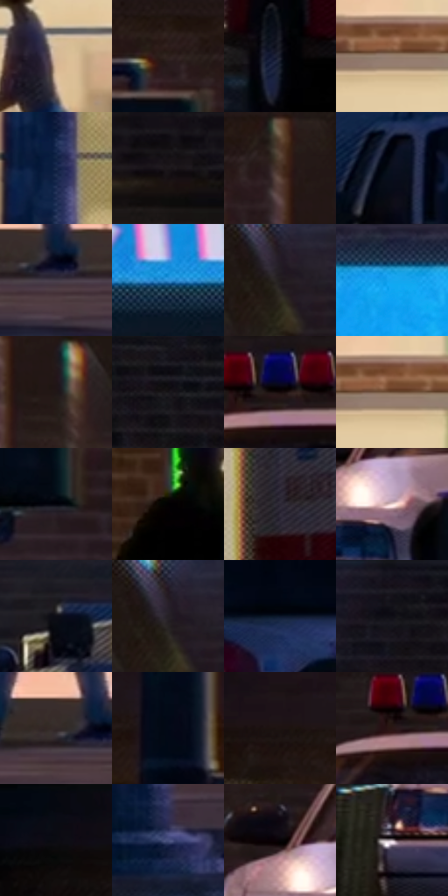

# 电影参考 466

- 状态：常规／活跃；来源世界：miles-home。
- 视角：near-level；景别：environment-wide；场景：street。
- 时段：night-appearance（外观依据，中置信度；具体时间／晨昏未知）；光照：night-mixed。
- 材质候选：skin, fabric, brick, glass, asphalt, painted-metal, screen（帧级，不是像素分割）。
- 明暗组：very-dark；L* P5/P50/P95：1.15403 / 11.63877 / 79.86571。
- 资格门禁：无附加门禁。
- 原截图 SHA-256：`a0f48448cd7f78ad60300a720e578312d388d6fc4c95a903d9c17ccc49099b97`；尺寸：2880 × 1214。
- sRGB 像素 SHA-256：`26ca79cedac218eacbe6ee3b495a71f6a6a84b0753dcc7c2a3c3870bd2c993f9`。

## 观察与迁移

灯源圆形网点光晕、店窗与湿路分层；远楼可概括软化。

医院暖窗、街上暗人物与车辆前后分层，重点标识仍可读；非焦点人群可概括但不清空。

25  /  466  /  夜街与交通玻璃：医院暖窗、街上暗人物与车辆前后分层，重点标识仍可读；非焦点人群可概括但不清空。

本公开版保存32个128×128原像素色卡上下文；图集格子并非原场景相邻位置。原rect、图集tile和像素SHA见 `data/palette-crops.json`。上下文不足时不得批准替色，不能以小样推断完整构图。

## 实测色卡

颜色比例分母为保留采样像素，不是材料面积；全部 32 色参与全库匹配。表内四舍五入仅用于阅读，原精度在 JSON。

| ID | HEX | Lab | 原图 xy | 像素数 | 比例 | 明度角色 |
| --- | --- | --- | --- | ---: | ---: | --- |
| 466-S01 | #D7B999 | [76.94887, 5.985738, 20.233209] | [316, 672] | 11322 | 5.813846% | light |
| 466-S02 | #2D201D | [13.707733, 5.727939, 4.473032] | [792, 140] | 10216 | 5.245915% | deep-shadow |
| 466-S03 | #151725 | [8.180293, 3.458366, -9.952687] | [2044, 944] | 8140 | 4.179889% | deep-shadow |
| 466-S04 | #977F6F | [54.976008, 6.641954, 12.135218] | [340, 468] | 7933 | 4.073595% | midtone |
| 466-S05 | #1B2B4C | [17.838484, 5.180875, -22.446283] | [588, 856] | 7930 | 4.072054% | deep-shadow |
| 466-S06 | #1D181B | [8.938241, 3.193845, -1.188186] | [1304, 272] | 7457 | 3.829169% | deep-shadow |
| 466-S07 | #483226 | [22.995955, 8.163722, 11.571988] | [908, 152] | 7156 | 3.674605% | shadow |
| 466-S08 | #0A0F1E | [4.515351, 2.258357, -10.298907] | [2240, 624] | 7024 | 3.606823% | deep-shadow |
| 466-S09 | #433B47 | [26.087352, 6.132823, -6.067942] | [364, 1020] | 6947 | 3.567284% | shadow |
| 466-S10 | #3192D8 | [58.193851, -4.05945, -43.648405] | [2012, 200] | 6892 | 3.539041% | midtone |
| 466-S11 | #221C1F | [11.060787, 3.610519, -0.980892] | [1096, 172] | 6783 | 3.483070% | deep-shadow |
| 466-S12 | #13203C | [12.592562, 4.908932, -19.740193] | [2780, 36] | 6494 | 3.334668% | deep-shadow |
| 466-S13 | #211717 | [8.975057, 5.042622, 1.947534] | [972, 224] | 6331 | 3.250968% | deep-shadow |
| 466-S14 | #171519 | [7.124056, 1.938601, -2.424875] | [1528, 68] | 6315 | 3.242752% | deep-shadow |
| 466-S15 | #170A0B | [3.82491, 4.909167, 1.291809] | [1404, 640] | 6052 | 3.107701% | deep-shadow |
| 466-S16 | #74563F | [39.118825, 9.199737, 18.21245] | [356, 464] | 6048 | 3.105647% | shadow |
| 466-S17 | #04050D | [1.475995, 0.886892, -3.217689] | [812, 336] | 5881 | 3.019893% | deep-shadow |
| 466-S18 | #010102 | [0.29396, 0.139026, -0.378391] | [76, 736] | 5634 | 2.893059% | deep-shadow |
| 466-S19 | #2B2633 | [16.199548, 5.552177, -7.607947] | [2012, 668] | 5622 | 2.886897% | deep-shadow |
| 466-S20 | #EFD9D7 | [88.392349, 7.242433, 3.741624] | [1240, 856] | 5534 | 2.841709% | highlight |
| 466-S21 | #0D0D15 | [3.861984, 1.591331, -4.331179] | [2100, 360] | 5432 | 2.789332% | deep-shadow |
| 466-S22 | #252026 | [13.023444, 3.818331, -3.163003] | [1092, 160] | 5399 | 2.772386% | deep-shadow |
| 466-S23 | #0A162A | [7.275417, 2.633304, -15.169264] | [2400, 688] | 5348 | 2.746198% | deep-shadow |
| 466-S24 | #131018 | [5.193696, 2.956675, -4.523377] | [1292, 44] | 5227 | 2.684064% | deep-shadow |
| 466-S25 | #342929 | [17.810274, 5.100147, 1.92495] | [320, 996] | 5154 | 2.646579% | deep-shadow |
| 466-S26 | #030916 | [2.462657, 0.854828, -7.149672] | [564, 92] | 4756 | 2.442206% | deep-shadow |
| 466-S27 | #1D1312 | [6.961405, 4.76164, 2.33115] | [444, 76] | 4394 | 2.256319% | deep-shadow |
| 466-S28 | #2B1615 | [10.119895, 10.519147, 5.219873] | [1360, 656] | 4021 | 2.064783% | deep-shadow |
| 466-S29 | #090A14 | [2.941586, 1.552442, -5.02913] | [80, 36] | 3826 | 1.964651% | deep-shadow |
| 466-S30 | #47507E | [35.168205, 9.282874, -27.154673] | [608, 1108] | 3738 | 1.919463% | shadow |
| 466-S31 | #050306 | [0.998498, 0.940078, -0.950895] | [1180, 800] | 3417 | 1.754629% | deep-shadow |
| 466-S32 | #AA9EA4 | [66.27503, 5.460086, -1.539472] | [1108, 932] | 2319 | 1.190806% | light |

## 色阶与空间分布

- 采样 ROI：`[0.01, 0.02, 0.98, 0.94]`；步长：4；样本数：194742。
- 排除区：`[]`。
- 深暗、暗、中、亮、高光五段计数：`[135173, 22510, 14273, 13179, 9607]`。
- RGB 各 256 箱、L* 100 箱、13×5 色相明度表和 3×3 空间统计全部保存在 [总数据](../film-library.json)。
- [可视化档案](../../references/library.html)按需绘制直方图，不存 2,094 张重复图表图片。

## 纹理特征占比

**这是分块图像特征的面积占比，不是波点／排线／丝网／错版的精确语义覆盖率。** 窗格、发丝、织物也会产生方向或周期特征。
原图 ROI 像素 3120898；已测块覆盖 3120898（100.0000%）；未测 0。

| 特征 | 块覆盖像素 | 占已测面积 | 阈值敏感范围 |
| --- | ---: | ---: | --- |
| low-contrast | 77440 | 2.4813% | 0.0000% ~ 4.7536% |
| directional-structure | 595074 | 19.0674% | 10.0197% ~ 32.1959% |
| periodic-structure | 2366464 | 75.8264% | 67.2791% ~ 79.5956% |
| mixed-detail | 81920 | 2.6249% | 0.5250% ~ 5.6312% |

阈值敏感范围不是统计置信区间。逐块坐标、尺度、对比、方向一致性、频谱集中度、频率与角度见 [全量特征记录](../texture-features.jsonl)，以帧号定位。
四种印刷层的真实像素覆盖仍标为 `null`，不能填 0，也不能拿上表代替。不得据这些代理测量删除唯一证据。

[测量方法与保留策略](../../references/library-retention.md) · [分类索引](../archive/README.md)
