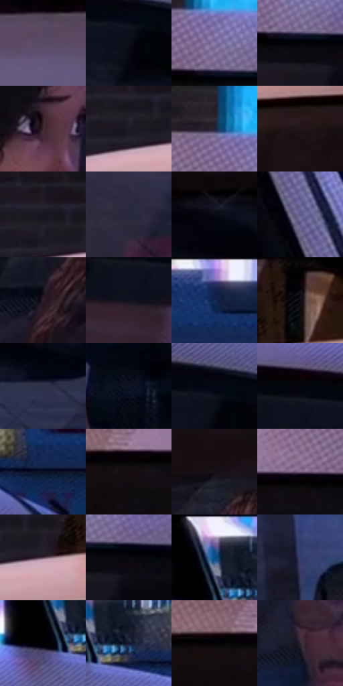

# 电影参考 467

- 状态：条件／活跃；来源世界：miles-home。
- 视角：near-level；景别：medium；场景：reflection。
- 时段：night-appearance（外观依据，中置信度；具体时间／晨昏未知）；光照：night-mixed。
- 材质候选：skin, hair, fabric, glass, painted-metal（帧级，不是像素分割）。
- 明暗组：very-dark；L* P5/P50/P95：0.94452 / 9.28357 / 51.91572。
- 资格门禁：reflection。
- 原截图 SHA-256：`b3c058b0283093cd915c2f9a7b0c58502f09d2128044338f80a5ed4ba1f2f8d4`；尺寸：2880 × 1214。
- sRGB 像素 SHA-256：`bf716f2199ab321f96244b56c4254dcae870ef73ceff3eab19e3089a63a0825f`。

## 观察与迁移

车内人物、玻璃映像与后方隔网并存，隔网是实体内饰。

挡风玻璃上宽淡反光叠在车内两人前，后方隔网是实体内饰；不将车窗涂成不透明青板。

26  /  467  /  夜街与交通玻璃：挡风玻璃上宽淡反光叠在车内两人前，后方隔网是实体内饰；不将车窗涂成不透明青板。

本公开版保存32个128×128原像素色卡上下文；图集格子并非原场景相邻位置。原rect、图集tile和像素SHA见 `data/palette-crops.json`。上下文不足时不得批准替色，不能以小样推断完整构图。

## 实测色卡

颜色比例分母为保留采样像素，不是材料面积；全部 32 色参与全库匹配。表内四舍五入仅用于阅读，原精度在 JSON。

| ID | HEX | Lab | 原图 xy | 像素数 | 比例 | 明度角色 |
| --- | --- | --- | --- | ---: | ---: | --- |
| 467-S01 | #5A4C66 | [34.603832, 11.440342, -12.933495] | [136, 1092] | 8414 | 4.320588% | shadow |
| 467-S02 | #0D0E19 | [4.243751, 2.125338, -6.753965] | [2376, 308] | 7813 | 4.011975% | deep-shadow |
| 467-S03 | #887CA9 | [54.567994, 14.124433, -22.258734] | [1664, 148] | 7799 | 4.004786% | midtone |
| 467-S04 | #02030A | [0.90272, 0.711755, -2.741004] | [1684, 204] | 7790 | 4.000164% | deep-shadow |
| 467-S05 | #3D2932 | [19.259659, 11.020211, -2.097042] | [1020, 636] | 7291 | 3.743928% | deep-shadow |
| 467-S06 | #1D1A26 | [10.106595, 4.727464, -7.658501] | [340, 120] | 7275 | 3.735712% | deep-shadow |
| 467-S07 | #1F2237 | [13.891711, 5.080522, -14.092286] | [1616, 92] | 7218 | 3.706442% | deep-shadow |
| 467-S08 | #221619 | [8.858604, 6.699793, 0.285413] | [556, 248] | 7198 | 3.696172% | deep-shadow |
| 467-S09 | #18151F | [7.492286, 4.210186, -6.451469] | [344, 84] | 6971 | 3.579608% | deep-shadow |
| 467-S10 | #28283D | [17.015336, 5.910316, -13.374753] | [1484, 716] | 6789 | 3.486151% | deep-shadow |
| 467-S11 | #090C17 | [3.45835, 1.426661, -6.385038] | [1220, 340] | 6760 | 3.471259% | deep-shadow |
| 467-S12 | #5F5A87 | [40.40058, 12.828464, -24.341104] | [2816, 800] | 6623 | 3.400910% | midtone |
| 467-S13 | #291E26 | [12.85981, 7.090975, -3.355783] | [620, 492] | 6556 | 3.366505% | deep-shadow |
| 467-S14 | #12121D | [5.870493, 2.857084, -7.425411] | [2132, 316] | 6542 | 3.359316% | deep-shadow |
| 467-S15 | #132751 | [16.421085, 8.526826, -28.123151] | [2772, 64] | 6485 | 3.330047% | deep-shadow |
| 467-S16 | #0D0910 | [2.875647, 2.236013, -2.661474] | [520, 64] | 6467 | 3.320804% | deep-shadow |
| 467-S17 | #2E2F4A | [20.471933, 7.197338, -16.849005] | [1368, 460] | 6377 | 3.274589% | shadow |
| 467-S18 | #101526 | [7.103282, 3.446627, -12.414091] | [2420, 536] | 6223 | 3.195510% | deep-shadow |
| 467-S19 | #040814 | [2.257887, 1.046067, -6.062459] | [2380, 268] | 5960 | 3.060459% | deep-shadow |
| 467-S20 | #03050F | [1.466724, 0.969988, -4.247681] | [2148, 240] | 5891 | 3.025028% | deep-shadow |
| 467-S21 | #0A1020 | [4.871928, 2.393649, -11.311943] | [2492, 140] | 5643 | 2.897680% | deep-shadow |
| 467-S22 | #140D11 | [4.30922, 3.283224, -1.068493] | [1224, 216] | 5264 | 2.703064% | deep-shadow |
| 467-S23 | #160F15 | [5.116051, 4.043444, -2.407817] | [664, 312] | 5259 | 2.700496% | deep-shadow |
| 467-S24 | #796581 | [45.575855, 13.512342, -12.566285] | [1516, 184] | 5247 | 2.694334% | midtone |
| 467-S25 | #573F50 | [29.814248, 13.65098, -6.148562] | [408, 140] | 4794 | 2.461719% | shadow |
| 467-S26 | #08070D | [2.101385, 1.131769, -2.276499] | [1744, 212] | 4758 | 2.443233% | deep-shadow |
| 467-S27 | #D2C6DF | [81.52057, 8.781063, -10.887933] | [2288, 32] | 4602 | 2.363127% | highlight |
| 467-S28 | #353D6B | [27.173318, 10.641044, -27.921059] | [1836, 484] | 4304 | 2.210104% | shadow |
| 467-S29 | #020103 | [0.372056, 0.53957, -0.664676] | [2264, 124] | 4294 | 2.204969% | deep-shadow |
| 467-S30 | #141A30 | [9.804644, 4.913235, -15.545802] | [2348, 108] | 4142 | 2.126917% | deep-shadow |
| 467-S31 | #030307 | [0.901668, 0.556123, -1.513595] | [1164, 200] | 4109 | 2.109971% | deep-shadow |
| 467-S32 | #302330 | [15.715925, 9.024721, -6.163963] | [1988, 572] | 3884 | 1.994434% | deep-shadow |

## 色阶与空间分布

- 采样 ROI：`[0.01, 0.02, 0.98, 0.94]`；步长：4；样本数：194742。
- 排除区：`[]`。
- 深暗、暗、中、亮、高光五段计数：`[146135, 26495, 15957, 4263, 1892]`。
- RGB 各 256 箱、L* 100 箱、13×5 色相明度表和 3×3 空间统计全部保存在 [总数据](../film-library.json)。
- [可视化档案](../../references/library.html)按需绘制直方图，不存 2,094 张重复图表图片。

## 纹理特征占比

**这是分块图像特征的面积占比，不是波点／排线／丝网／错版的精确语义覆盖率。** 窗格、发丝、织物也会产生方向或周期特征。
原图 ROI 像素 3120898；已测块覆盖 3120898（100.0000%）；未测 0。

| 特征 | 块覆盖像素 | 占已测面积 | 阈值敏感范围 |
| --- | ---: | ---: | --- |
| low-contrast | 152064 | 4.8724% | 1.2878% ~ 8.0223% |
| directional-structure | 925696 | 29.6612% | 22.6355% ~ 40.0091% |
| periodic-structure | 1993986 | 63.8914% | 58.1781% ~ 64.2359% |
| mixed-detail | 49152 | 1.5749% | 0.5250% ~ 5.1062% |

阈值敏感范围不是统计置信区间。逐块坐标、尺度、对比、方向一致性、频谱集中度、频率与角度见 [全量特征记录](../texture-features.jsonl)，以帧号定位。
四种印刷层的真实像素覆盖仍标为 `null`，不能填 0，也不能拿上表代替。不得据这些代理测量删除唯一证据。

[测量方法与保留策略](../../references/library-retention.md) · [分类索引](../archive/README.md)
