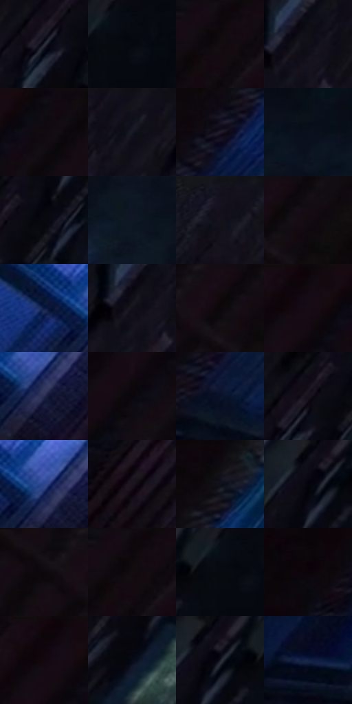

# 电影参考 468

- 状态：常规／活跃；来源世界：miles-home。
- 视角：rolled-or-dutch；景别：environment-wide；场景：city。
- 时段：night-appearance（外观依据，中置信度；具体时间／晨昏未知）；光照：night-mixed。
- 材质候选：skin, fabric, brick, glass, metal, sky（帧级，不是像素分割）。
- 明暗组：very-dark；L* P5/P50/P95：1.67207 / 4.25409 / 20.00593。
- 资格门禁：无附加门禁。
- 原截图 SHA-256：`497340d020736507ff4f202126d00d82c0df148ca1839381ea1a73b3a85153a2`；尺寸：2880 × 1198。
- sRGB 像素 SHA-256：`13de2d577cc879c1caed3a02b26daf7a9b4d0fbeaa28d330fe6b507316fbc25a`。

## 观察与迁移

消防梯和冷亮窗口，窄亮线必须有结构或光照依据。

倾斜俯视楼体、消防梯和蓝窗，人物尺度小但可定位；不得替原照新增倾斜机位。

27  /  468  /  冷室与暖夜：倾斜俯视楼体、消防梯和蓝窗，人物尺度小但可定位；不得替原照新增倾斜机位。

本公开版保存32个128×128原像素色卡上下文；图集格子并非原场景相邻位置。原rect、图集tile和像素SHA见 `data/palette-crops.json`。上下文不足时不得批准替色，不能以小样推断完整构图。

## 实测色卡

颜色比例分母为保留采样像素，不是材料面积；全部 32 色参与全库匹配。表内四舍五入仅用于阅读，原精度在 JSON。

| ID | HEX | Lab | 原图 xy | 像素数 | 比例 | 明度角色 |
| --- | --- | --- | --- | ---: | ---: | --- |
| 468-S01 | #272733 | [16.111609, 3.204153, -7.77997] | [2160, 236] | 10608 | 5.506416% | deep-shadow |
| 468-S02 | #060A10 | [2.648413, -0.062989, -3.044066] | [2432, 24] | 10026 | 5.204310% | deep-shadow |
| 468-S03 | #0D080C | [2.581458, 1.947138, -1.071415] | [64, 24] | 8534 | 4.429841% | deep-shadow |
| 468-S04 | #0F0E16 | [4.277565, 1.995562, -4.410398] | [2060, 36] | 8030 | 4.168224% | deep-shadow |
| 468-S05 | #0D0B13 | [3.359542, 2.034206, -3.740437] | [352, 24] | 7269 | 3.773203% | deep-shadow |
| 468-S06 | #171925 | [9.08238, 2.703787, -8.542153] | [1916, 64] | 7173 | 3.723371% | deep-shadow |
| 468-S07 | #201C29 | [11.259154, 5.389972, -8.073678] | [708, 352] | 7113 | 3.692226% | deep-shadow |
| 468-S08 | #0A101D | [4.731291, 1.405378, -9.194366] | [2476, 264] | 6937 | 3.600868% | deep-shadow |
| 468-S09 | #08080D | [2.297463, 0.731208, -1.990181] | [2252, 184] | 6713 | 3.484594% | deep-shadow |
| 468-S10 | #0F1825 | [8.024295, 0.532431, -10.23526] | [2384, 388] | 6695 | 3.475250% | deep-shadow |
| 468-S11 | #11101C | [5.181068, 3.310763, -7.690398] | [1760, 28] | 6661 | 3.457601% | deep-shadow |
| 468-S12 | #130E14 | [4.543891, 3.019624, -2.602288] | [636, 28] | 6509 | 3.378701% | deep-shadow |
| 468-S13 | #0A193F | [9.942002, 9.853083, -26.144344] | [1068, 412] | 6449 | 3.347556% | deep-shadow |
| 468-S14 | #141018 | [5.286544, 3.373072, -4.37666] | [2036, 80] | 6393 | 3.318488% | deep-shadow |
| 468-S15 | #160B14 | [4.159173, 5.700442, -3.129242] | [588, 36] | 5942 | 3.084382% | deep-shadow |
| 468-S16 | #10090F | [3.071499, 3.047309, -1.805926] | [248, 24] | 5853 | 3.038184% | deep-shadow |
| 468-S17 | #262C4E | [19.069825, 8.151154, -21.798729] | [1172, 448] | 5803 | 3.012230% | deep-shadow |
| 468-S18 | #09060C | [1.940917, 1.634316, -2.036546] | [204, 176] | 5666 | 2.941115% | deep-shadow |
| 468-S19 | #08112A | [5.596904, 5.301046, -17.821998] | [588, 576] | 5564 | 2.888169% | deep-shadow |
| 468-S20 | #18121A | [6.335623, 4.61878, -4.346844] | [2180, 196] | 5546 | 2.878826% | deep-shadow |
| 468-S21 | #2E458C | [31.183422, 15.622161, -42.221005] | [1156, 416] | 5451 | 2.829513% | shadow |
| 468-S22 | #1B131E | [7.158637, 6.703773, -6.160416] | [1016, 796] | 5135 | 2.665483% | deep-shadow |
| 468-S23 | #0D0810 | [2.679569, 2.636573, -2.947792] | [928, 24] | 4695 | 2.437087% | deep-shadow |
| 468-S24 | #04040A | [1.215415, 0.834193, -2.270409] | [2280, 72] | 4693 | 2.436049% | deep-shadow |
| 468-S25 | #100C12 | [3.764729, 2.383156, -2.500447] | [500, 32] | 4679 | 2.428782% | deep-shadow |
| 468-S26 | #130B12 | [3.807177, 3.964952, -2.407802] | [48, 32] | 4457 | 2.313546% | deep-shadow |
| 468-S27 | #090E16 | [3.884672, 0.233541, -5.031241] | [2400, 28] | 4456 | 2.313027% | deep-shadow |
| 468-S28 | #0A0409 | [1.545481, 2.264145, -1.339155] | [340, 704] | 4246 | 2.204020% | deep-shadow |
| 468-S29 | #0E050A | [2.021871, 3.171019, -1.019581] | [224, 28] | 4233 | 2.197272% | deep-shadow |
| 468-S30 | #060A18 | [2.906078, 1.747646, -7.971915] | [2044, 572] | 4086 | 2.120967% | deep-shadow |
| 468-S31 | #060712 | [2.116719, 1.536005, -4.984351] | [2304, 56] | 3820 | 1.982891% | deep-shadow |
| 468-S32 | #112246 | [13.857294, 7.198475, -24.719154] | [608, 848] | 3213 | 1.667809% | deep-shadow |

## 色阶与空间分布

- 采样 ROI：`[0.01, 0.02, 0.98, 0.94]`；步长：4；样本数：192648。
- 排除区：`[]`。
- 深暗、暗、中、亮、高光五段计数：`[183005, 8523, 1120, 0, 0]`。
- RGB 各 256 箱、L* 100 箱、13×5 色相明度表和 3×3 空间统计全部保存在 [总数据](../film-library.json)。
- [可视化档案](../../references/library.html)按需绘制直方图，不存 2,094 张重复图表图片。

## 纹理特征占比

**这是分块图像特征的面积占比，不是波点／排线／丝网／错版的精确语义覆盖率。** 窗格、发丝、织物也会产生方向或周期特征。
原图 ROI 像素 3081782；已测块覆盖 3081782（100.0000%）；未测 0。

| 特征 | 块覆盖像素 | 占已测面积 | 阈值敏感范围 |
| --- | ---: | ---: | --- |
| low-contrast | 879488 | 28.5383% | 17.4528% ~ 35.1672% |
| directional-structure | 573440 | 18.6074% | 9.0379% ~ 34.5566% |
| periodic-structure | 1537536 | 49.8911% | 47.3908% ~ 51.4404% |
| mixed-detail | 91318 | 2.9632% | 0.5998% ~ 4.3546% |

阈值敏感范围不是统计置信区间。逐块坐标、尺度、对比、方向一致性、频谱集中度、频率与角度见 [全量特征记录](../texture-features.jsonl)，以帧号定位。
四种印刷层的真实像素覆盖仍标为 `null`，不能填 0，也不能拿上表代替。不得据这些代理测量删除唯一证据。

[测量方法与保留策略](../../references/library-retention.md) · [分类索引](../archive/README.md)
