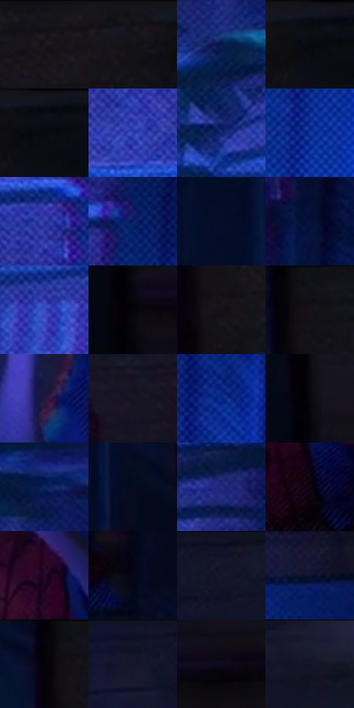

# 电影参考 469

- 状态：常规／活跃；来源世界：miles-home。
- 视角：near-level；景别：medium；场景：city。
- 时段：night-appearance（外观依据，中置信度；具体时间／晨昏未知）；光照：night-mixed。
- 材质候选：skin, fabric, brick, glass, metal, sky（帧级，不是像素分割）。
- 明暗组：very-dark；L* P5/P50/P95：1.73964 / 6.99944 / 32.26073。
- 资格门禁：无附加门禁。
- 原截图 SHA-256：`b6409f37d380375ba25be72e71626838abafe654f7e4f714ec215dfa1e3db3ae`；尺寸：2880 × 1204。
- sRGB 像素 SHA-256：`b43e39ec48962dd7224b43735f79ad96a4fbfe53258ba3424a3f5f616219662a`。

## 观察与迁移

消防梯和冷亮窗口，窄亮线必须有结构或光照依据。

人物贴窗探看，冷蓝植物与砖墙衬出手脸；透过窗的真实人物不自动判成镜像。

28  /  469  /  冷室与暖夜：人物贴窗探看，冷蓝植物与砖墙衬出手脸；透过窗的真实人物不自动判成镜像。

本公开版保存32个128×128原像素色卡上下文；图集格子并非原场景相邻位置。原rect、图集tile和像素SHA见 `data/palette-crops.json`。上下文不足时不得批准替色，不能以小样推断完整构图。

## 实测色卡

颜色比例分母为保留采样像素，不是材料面积；全部 32 色参与全库匹配。表内四舍五入仅用于阅读，原精度在 JSON。

| ID | HEX | Lab | 原图 xy | 像素数 | 比例 | 明度角色 |
| --- | --- | --- | --- | ---: | ---: | --- |
| 469-S01 | #15141C | [6.716616, 2.54843, -5.357455] | [2008, 28] | 18333 | 9.516320% | deep-shadow |
| 469-S02 | #100F16 | [4.604323, 1.835354, -3.923934] | [2176, 32] | 11791 | 6.120489% | deep-shadow |
| 469-S03 | #0A194C | [11.14444, 15.69665, -33.27835] | [420, 204] | 11194 | 5.810598% | deep-shadow |
| 469-S04 | #0D0E15 | [4.098888, 1.107369, -3.985246] | [2284, 48] | 9091 | 4.718969% | deep-shadow |
| 469-S05 | #090A10 | [2.823339, 0.721509, -2.767651] | [2308, 56] | 8722 | 4.527428% | deep-shadow |
| 469-S06 | #2B3EAE | [31.837621, 32.611703, -61.757828] | [484, 876] | 7646 | 3.968897% | shadow |
| 469-S07 | #142973 | [19.930736, 21.538608, -44.826066] | [172, 540] | 7575 | 3.932042% | deep-shadow |
| 469-S08 | #11359A | [26.727261, 28.70032, -58.103776] | [704, 748] | 7303 | 3.790852% | shadow |
| 469-S09 | #2A349E | [27.888008, 33.116286, -58.59745] | [568, 616] | 6934 | 3.599311% | shadow |
| 469-S10 | #0A1B64 | [14.219817, 24.464782, -44.436977] | [648, 408] | 6814 | 3.537021% | deep-shadow |
| 469-S11 | #040D29 | [4.278704, 5.89235, -19.155698] | [1624, 80] | 6798 | 3.528716% | deep-shadow |
| 469-S12 | #051236 | [6.603891, 10.063641, -25.102363] | [684, 84] | 6455 | 3.350671% | deep-shadow |
| 469-S13 | #3850C7 | [39.07016, 31.648006, -64.62396] | [244, 652] | 6326 | 3.283709% | shadow |
| 469-S14 | #03040C | [1.198908, 0.866441, -3.162013] | [1828, 780] | 6271 | 3.255160% | deep-shadow |
| 469-S15 | #16101A | [5.561936, 4.806315, -5.513648] | [1852, 236] | 5639 | 2.927100% | deep-shadow |
| 469-S16 | #11121B | [5.698839, 1.867431, -6.141002] | [1840, 28] | 5559 | 2.885574% | deep-shadow |
| 469-S17 | #21193E | [11.731599, 14.819779, -22.457415] | [988, 596] | 5457 | 2.832627% | deep-shadow |
| 469-S18 | #181723 | [8.379363, 3.977413, -8.118695] | [1348, 204] | 5424 | 2.815498% | deep-shadow |
| 469-S19 | #0A2787 | [21.071705, 30.287779, -55.658566] | [736, 556] | 5000 | 2.595407% | shadow |
| 469-S20 | #070710 | [2.118488, 1.400192, -3.810882] | [1820, 596] | 4955 | 2.572049% | deep-shadow |
| 469-S21 | #0F245C | [16.183599, 14.93889, -35.90198] | [472, 68] | 4736 | 2.458370% | deep-shadow |
| 469-S22 | #040B1F | [3.288326, 2.906457, -12.968466] | [1724, 352] | 4561 | 2.367530% | deep-shadow |
| 469-S23 | #252B81 | [22.672576, 27.724384, -49.212566] | [576, 292] | 4559 | 2.366492% | shadow |
| 469-S24 | #0F0612 | [2.488461, 4.483085, -4.37341] | [1400, 736] | 4250 | 2.206096% | deep-shadow |
| 469-S25 | #270A25 | [7.064317, 19.515925, -11.495444] | [1356, 568] | 3930 | 2.039990% | deep-shadow |
| 469-S26 | #040719 | [2.239503, 2.695303, -9.747188] | [1564, 792] | 3750 | 1.946555% | deep-shadow |
| 469-S27 | #14152D | [7.898865, 7.638453, -16.361355] | [1100, 44] | 3361 | 1.744633% | deep-shadow |
| 469-S28 | #0E142E | [7.143677, 6.962779, -18.332243] | [1080, 864] | 2557 | 1.327291% | deep-shadow |
| 469-S29 | #040108 | [0.587608, 1.757787, -2.372516] | [1796, 40] | 2471 | 1.282650% | deep-shadow |
| 469-S30 | #0F1125 | [5.744769, 5.19299, -13.776527] | [976, 44] | 1903 | 0.987812% | deep-shadow |
| 469-S31 | #100B1D | [3.958199, 5.676046, -10.311317] | [1928, 756] | 1877 | 0.974316% | deep-shadow |
| 469-S32 | #1A192C | [9.772181, 6.240943, -12.630103] | [1264, 52] | 1406 | 0.729828% | deep-shadow |

## 色阶与空间分布

- 采样 ROI：`[0.01, 0.02, 0.98, 0.94]`；步长：4；样本数：192648。
- 排除区：`[]`。
- 深暗、暗、中、亮、高光五段计数：`[153424, 37046, 2167, 11, 0]`。
- RGB 各 256 箱、L* 100 箱、13×5 色相明度表和 3×3 空间统计全部保存在 [总数据](../film-library.json)。
- [可视化档案](../../references/library.html)按需绘制直方图，不存 2,094 张重复图表图片。

## 纹理特征占比

**这是分块图像特征的面积占比，不是波点／排线／丝网／错版的精确语义覆盖率。** 窗格、发丝、织物也会产生方向或周期特征。
原图 ROI 像素 3092958；已测块覆盖 3092958（100.0000%）；未测 0。

| 特征 | 块覆盖像素 | 占已测面积 | 阈值敏感范围 |
| --- | ---: | ---: | --- |
| low-contrast | 924800 | 29.9002% | 24.8803% ~ 42.7707% |
| directional-structure | 338654 | 10.9492% | 3.7194% ~ 18.4315% |
| periodic-structure | 1780352 | 57.5615% | 50.8613% ~ 57.5615% |
| mixed-detail | 49152 | 1.5892% | 0.0000% ~ 2.6486% |

阈值敏感范围不是统计置信区间。逐块坐标、尺度、对比、方向一致性、频谱集中度、频率与角度见 [全量特征记录](../texture-features.jsonl)，以帧号定位。
四种印刷层的真实像素覆盖仍标为 `null`，不能填 0，也不能拿上表代替。不得据这些代理测量删除唯一证据。

[测量方法与保留策略](../../references/library-retention.md) · [分类索引](../archive/README.md)
