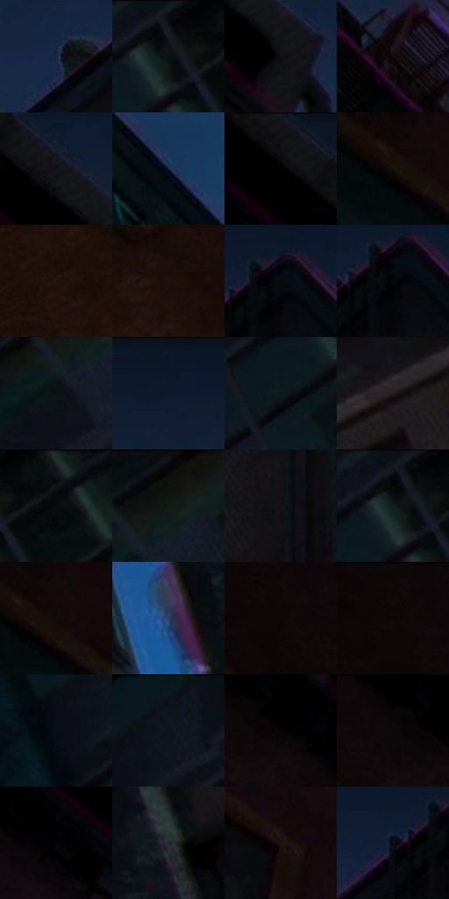

# 电影参考 470

- 状态：常规／活跃；来源世界：miles-home。
- 视角：low-angle；景别：environment-wide；场景：city。
- 时段：night-appearance（外观依据，中置信度；具体时间／晨昏未知）；光照：night-mixed。
- 材质候选：skin, fabric, brick, glass, metal, sky（帧级，不是像素分割）。
- 明暗组：very-dark；L* P5/P50/P95：1.17479 / 4.95279 / 17.81737。
- 资格门禁：无附加门禁。
- 原截图 SHA-256：`3c0b7cacb575847793815073c9a3a5f0d088f1c7b111da20b7a282e520972ac3`；尺寸：2880 × 1216。
- sRGB 像素 SHA-256：`4acc6e094edde307ea73680b84ff8c1cfd3fedcebbf96bb70c7534c992d15a8d`。

## 观察与迁移

消防梯和冷亮窗口，窄亮线必须有结构或光照依据。

仰视巷道暗砖体量稳定，蓝窗和少量青粉边强调转折；不是整栋楼发光描边。

29  /  470  /  冷室与暖夜：仰视巷道暗砖体量稳定，蓝窗和少量青粉边强调转折；不是整栋楼发光描边。

本公开版保存32个128×128原像素色卡上下文；图集格子并非原场景相邻位置。原rect、图集tile和像素SHA见 `data/palette-crops.json`。上下文不足时不得批准替色，不能以小样推断完整构图。

## 实测色卡

颜色比例分母为保留采样像素，不是材料面积；全部 32 色参与全库匹配。表内四舍五入仅用于阅读，原精度在 JSON。

| ID | HEX | Lab | 原图 xy | 像素数 | 比例 | 明度角色 |
| --- | --- | --- | --- | ---: | ---: | --- |
| 470-S01 | #192A44 | [16.891777, 2.253528, -18.488569] | [1212, 220] | 10448 | 5.365047% | deep-shadow |
| 470-S02 | #161B21 | [9.515289, -0.519768, -4.906476] | [2396, 36] | 7874 | 4.043298% | deep-shadow |
| 470-S03 | #0F0E14 | [4.210565, 1.524742, -3.129005] | [640, 208] | 7799 | 4.004786% | deep-shadow |
| 470-S04 | #160C0F | [4.227713, 4.248721, -0.052108] | [1676, 256] | 7708 | 3.958057% | deep-shadow |
| 470-S05 | #15141A | [6.633015, 1.960961, -3.94212] | [580, 116] | 7617 | 3.911329% | deep-shadow |
| 470-S06 | #132136 | [12.559489, 1.698682, -15.535272] | [1992, 584] | 7501 | 3.851763% | deep-shadow |
| 470-S07 | #0D0C0D | [3.410552, 0.459297, -0.32803] | [468, 52] | 7470 | 3.835844% | deep-shadow |
| 470-S08 | #190D0B | [4.685605, 4.596837, 2.57519] | [164, 264] | 7464 | 3.832763% | deep-shadow |
| 470-S09 | #24130E | [7.882167, 8.053399, 6.023212] | [292, 804] | 7459 | 3.830196% | deep-shadow |
| 470-S10 | #1F0F0D | [5.980499, 7.344448, 3.647682] | [424, 776] | 7080 | 3.635579% | deep-shadow |
| 470-S11 | #060B10 | [2.84949, -0.473763, -2.750448] | [1460, 80] | 7018 | 3.603742% | deep-shadow |
| 470-S12 | #05080A | [2.058035, -0.50655, -1.032999] | [1452, 100] | 6556 | 3.366505% | deep-shadow |
| 470-S13 | #0A1216 | [5.013653, -1.692197, -3.37568] | [2652, 136] | 6317 | 3.243779% | deep-shadow |
| 470-S14 | #0D192C | [8.67581, 2.020232, -14.428566] | [1120, 40] | 6258 | 3.213482% | deep-shadow |
| 470-S15 | #0D191B | [7.767539, -4.340774, -3.093764] | [2324, 148] | 6152 | 3.159051% | deep-shadow |
| 470-S16 | #221B1E | [10.68741, 4.109433, -0.78878] | [2624, 1072] | 6151 | 3.158538% | deep-shadow |
| 470-S17 | #080B0C | [2.867997, -0.640199, -0.689794] | [2488, 48] | 6110 | 3.137484% | deep-shadow |
| 470-S18 | #0D1311 | [5.345378, -2.558688, 0.376073] | [2692, 48] | 6052 | 3.107701% | deep-shadow |
| 470-S19 | #141314 | [6.006675, 0.637429, -0.455156] | [1372, 592] | 5845 | 3.001407% | deep-shadow |
| 470-S20 | #060609 | [1.704401, 0.417027, -1.135073] | [2380, 36] | 5403 | 2.774440% | deep-shadow |
| 470-S21 | #15090A | [3.403164, 4.246077, 1.06903] | [196, 260] | 5374 | 2.759549% | deep-shadow |
| 470-S22 | #2D4265 | [27.827567, 3.046896, -23.083866] | [2204, 1000] | 5224 | 2.682524% | shadow |
| 470-S23 | #0E0607 | [2.158589, 2.353327, 0.402008] | [108, 100] | 5117 | 2.627579% | deep-shadow |
| 470-S24 | #10090B | [2.978251, 2.392044, -0.022546] | [88, 44] | 5115 | 2.626552% | deep-shadow |
| 470-S25 | #090E14 | [3.817671, -0.23728, -3.749848] | [2120, 124] | 4986 | 2.560311% | deep-shadow |
| 470-S26 | #0D121A | [5.354098, 0.2169, -5.906998] | [2188, 32] | 4961 | 2.547473% | deep-shadow |
| 470-S27 | #060506 | [1.448963, 0.400456, -0.28612] | [276, 76] | 4733 | 2.430395% | deep-shadow |
| 470-S28 | #010101 | [0.274173, -1.7e-05, 3.3e-05] | [224, 28] | 4607 | 2.365694% | deep-shadow |
| 470-S29 | #050305 | [0.978712, 0.801034, -0.572471] | [468, 192] | 3897 | 2.001109% | deep-shadow |
| 470-S30 | #23282F | [15.902062, -0.283851, -5.312409] | [2412, 992] | 3653 | 1.875815% | deep-shadow |
| 470-S31 | #1E1210 | [6.73941, 5.576368, 3.18693] | [740, 684] | 3521 | 1.808033% | deep-shadow |
| 470-S32 | #061214 | [4.713417, -3.209015, -2.462842] | [1384, 104] | 3272 | 1.680172% | deep-shadow |

## 色阶与空间分布

- 采样 ROI：`[0.01, 0.02, 0.98, 0.94]`；步长：4；样本数：194742。
- 排除区：`[]`。
- 深暗、暗、中、亮、高光五段计数：`[188561, 6161, 20, 0, 0]`。
- RGB 各 256 箱、L* 100 箱、13×5 色相明度表和 3×3 空间统计全部保存在 [总数据](../film-library.json)。
- [可视化档案](../../references/library.html)按需绘制直方图，不存 2,094 张重复图表图片。

## 纹理特征占比

**这是分块图像特征的面积占比，不是波点／排线／丝网／错版的精确语义覆盖率。** 窗格、发丝、织物也会产生方向或周期特征。
原图 ROI 像素 3126486；已测块覆盖 3126486（100.0000%）；未测 0。

| 特征 | 块覆盖像素 | 占已测面积 | 阈值敏感范围 |
| --- | ---: | ---: | --- |
| low-contrast | 548096 | 17.5307% | 8.5033% ~ 26.8283% |
| directional-structure | 357632 | 11.4388% | 3.1442% ~ 24.1126% |
| periodic-structure | 1930070 | 61.7329% | 61.2539% ~ 63.7158% |
| mixed-detail | 290688 | 9.2976% | 3.6683% ~ 9.2976% |

阈值敏感范围不是统计置信区间。逐块坐标、尺度、对比、方向一致性、频谱集中度、频率与角度见 [全量特征记录](../texture-features.jsonl)，以帧号定位。
四种印刷层的真实像素覆盖仍标为 `null`，不能填 0，也不能拿上表代替。不得据这些代理测量删除唯一证据。

[测量方法与保留策略](../../references/library-retention.md) · [分类索引](../archive/README.md)
