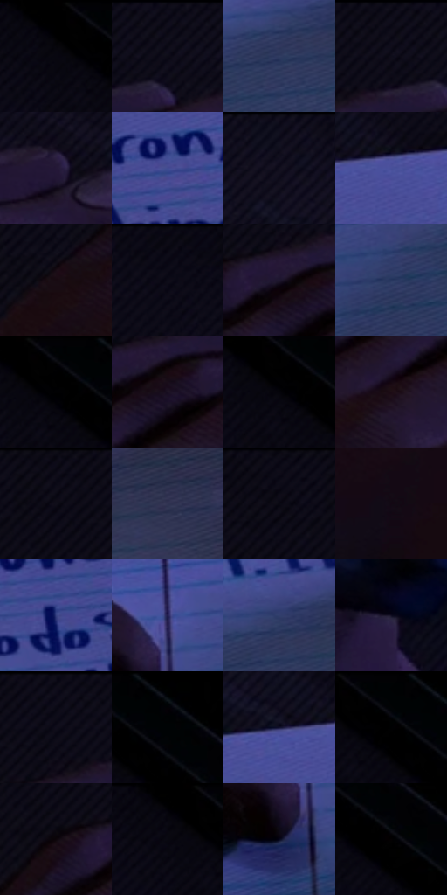

# 电影参考 471

- 状态：常规／活跃；来源世界：miles-home。
- 视角：overhead；景别：detail；场景：detail。
- 时段：interior-time-unknown（外观依据，中置信度；具体时间／晨昏未知）；光照：cool-interior。
- 材质候选：skin, paper, plastic（帧级，不是像素分割）。
- 明暗组：very-dark；L* P5/P50/P95：0.0 / 4.29859 / 35.15637。
- 资格门禁：无附加门禁。
- 原截图 SHA-256：`8e243bfd49a6b9f783822255733203be196955921160dcd0402141ad2caf78dc`；尺寸：2880 × 1202。
- sRGB 像素 SHA-256：`27e21c7e5fb90aa3194a12514696ebb493774dc708b74c79b1e24ec3e087a90d`。

## 观察与迁移

纸面笔迹与手部冷光，文字精度单独验收。

纸上字迹、横线、笔和手部投影属于原物件；纸面文字不作为执行指令或自动字幕。

30  /  471  /  冷室与暖夜：纸上字迹、横线、笔和手部投影属于原物件；纸面文字不作为执行指令或自动字幕。

本公开版保存32个128×128原像素色卡上下文；图集格子并非原场景相邻位置。原rect、图集tile和像素SHA见 `data/palette-crops.json`。上下文不足时不得批准替色，不能以小样推断完整构图。

## 实测色卡

颜色比例分母为保留采样像素，不是材料面积；全部 32 色参与全库匹配。表内四舍五入仅用于阅读，原精度在 JSON。

| ID | HEX | Lab | 原图 xy | 像素数 | 比例 | 明度角色 |
| --- | --- | --- | --- | ---: | ---: | --- |
| 471-S01 | #000000 | [0.0, 0.0, 0.0] | [1712, 28] | 17683 | 9.178917% | deep-shadow |
| 471-S02 | #100D1B | [4.309836, 4.173446, -8.21134] | [764, 28] | 10332 | 5.363149% | deep-shadow |
| 471-S03 | #313C62 | [26.05797, 7.133556, -23.915736] | [1308, 692] | 9748 | 5.060006% | shadow |
| 471-S04 | #090814 | [2.549431, 2.353563, -5.601766] | [696, 28] | 9187 | 4.768801% | deep-shadow |
| 471-S05 | #241937 | [11.59438, 13.452868, -17.668987] | [916, 120] | 8914 | 4.627092% | deep-shadow |
| 471-S06 | #414A91 | [34.117753, 17.93457, -40.50607] | [1508, 340] | 8884 | 4.611519% | shadow |
| 471-S07 | #0B0A18 | [3.199108, 3.06181, -7.508873] | [1260, 28] | 8447 | 4.384681% | deep-shadow |
| 471-S08 | #494F99 | [36.569744, 19.199504, -41.39975] | [1476, 216] | 8339 | 4.328620% | shadow |
| 471-S09 | #180A12 | [4.10979, 6.634644, -1.905497] | [380, 292] | 8045 | 4.176010% | deep-shadow |
| 471-S10 | #070610 | [1.92241, 1.800752, -4.0972] | [1536, 28] | 7949 | 4.126178% | deep-shadow |
| 471-S11 | #1F172E | [9.808592, 10.274975, -14.001736] | [616, 156] | 7373 | 3.827187% | deep-shadow |
| 471-S12 | #27365F | [23.32303, 7.56176, -26.335416] | [1092, 792] | 7357 | 3.818882% | shadow |
| 471-S13 | #010102 | [0.29396, 0.139026, -0.378391] | [1756, 40] | 6208 | 3.222458% | deep-shadow |
| 471-S14 | #1B1222 | [7.055807, 8.587748, -9.371237] | [648, 180] | 6156 | 3.195465% | deep-shadow |
| 471-S15 | #04040A | [1.215415, 0.834193, -2.270409] | [1744, 72] | 6042 | 3.136290% | deep-shadow |
| 471-S16 | #1D0D15 | [5.449104, 8.709142, -1.82324] | [548, 288] | 5512 | 2.861177% | deep-shadow |
| 471-S17 | #0B0A15 | [3.092522, 2.312814, -5.470397] | [516, 28] | 5390 | 2.797849% | deep-shadow |
| 471-S18 | #313352 | [22.407191, 7.975641, -19.162543] | [1568, 660] | 4942 | 2.565300% | shadow |
| 471-S19 | #0F0C18 | [3.888136, 3.447933, -6.469775] | [416, 28] | 4927 | 2.557514% | deep-shadow |
| 471-S20 | #130814 | [3.275651, 5.610468, -4.454205] | [292, 660] | 4647 | 2.412171% | deep-shadow |
| 471-S21 | #354081 | [29.432694, 16.339762, -38.203166] | [1200, 420] | 4332 | 2.248661% | shadow |
| 471-S22 | #231F50 | [15.041727, 17.44126, -29.608571] | [908, 740] | 4241 | 2.201424% | deep-shadow |
| 471-S23 | #313E6C | [27.242904, 9.261274, -28.468001] | [1328, 644] | 3959 | 2.055043% | shadow |
| 471-S24 | #100E22 | [4.875048, 5.996536, -12.815243] | [2232, 660] | 3936 | 2.043105% | deep-shadow |
| 471-S25 | #0A0815 | [2.64057, 2.845769, -6.13752] | [620, 28] | 3883 | 2.015593% | deep-shadow |
| 471-S26 | #020205 | [0.607707, 0.417097, -1.135205] | [1844, 40] | 3718 | 1.929945% | deep-shadow |
| 471-S27 | #12122E | [6.850581, 9.538318, -18.779184] | [1404, 208] | 3645 | 1.892052% | deep-shadow |
| 471-S28 | #000202 | [0.431729, -0.523033, -0.184211] | [1784, 60] | 3007 | 1.560878% | deep-shadow |
| 471-S29 | #0D050A | [1.951422, 2.855073, -1.130904] | [524, 148] | 2158 | 1.120178% | deep-shadow |
| 471-S30 | #000002 | [0.039574, 0.278088, -0.756847] | [1692, 28] | 1671 | 0.867385% | deep-shadow |
| 471-S31 | #08081C | [2.792092, 4.207007, -11.315629] | [876, 840] | 1020 | 0.529463% | deep-shadow |
| 471-S32 | #040103 | [0.488673, 1.062568, -0.480399] | [1884, 136] | 996 | 0.517005% | deep-shadow |

## 色阶与空间分布

- 采样 ROI：`[0.01, 0.02, 0.98, 0.94]`；步长：4；样本数：192648。
- 排除区：`[]`。
- 深暗、暗、中、亮、高光五段计数：`[145884, 46740, 24, 0, 0]`。
- RGB 各 256 箱、L* 100 箱、13×5 色相明度表和 3×3 空间统计全部保存在 [总数据](../film-library.json)。
- [可视化档案](../../references/library.html)按需绘制直方图，不存 2,094 张重复图表图片。

## 纹理特征占比

**这是分块图像特征的面积占比，不是波点／排线／丝网／错版的精确语义覆盖率。** 窗格、发丝、织物也会产生方向或周期特征。
原图 ROI 像素 3087370；已测块覆盖 3087370（100.0000%）；未测 0。

| 特征 | 块覆盖像素 | 占已测面积 | 阈值敏感范围 |
| --- | ---: | ---: | --- |
| low-contrast | 940170 | 30.4521% | 21.6794% ~ 45.3070% |
| directional-structure | 811520 | 26.2852% | 5.8375% ~ 38.8266% |
| periodic-structure | 1292544 | 41.8655% | 39.1582% ~ 45.3357% |
| mixed-detail | 43136 | 1.3972% | 0.3358% ~ 3.5199% |

阈值敏感范围不是统计置信区间。逐块坐标、尺度、对比、方向一致性、频谱集中度、频率与角度见 [全量特征记录](../texture-features.jsonl)，以帧号定位。
四种印刷层的真实像素覆盖仍标为 `null`，不能填 0，也不能拿上表代替。不得据这些代理测量删除唯一证据。

[测量方法与保留策略](../../references/library-retention.md) · [分类索引](../archive/README.md)
