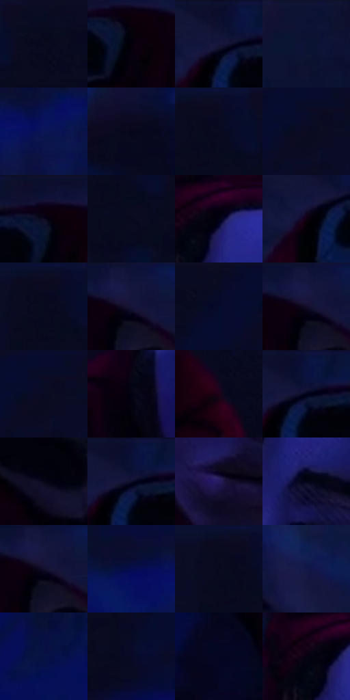

# 电影参考 472

- 状态：常规／活跃；来源世界：miles-home。
- 视角：high-angle；景别：close-up；场景：interior。
- 时段：interior-time-unknown（外观依据，中置信度；具体时间／晨昏未知）；光照：dark-interior。
- 材质候选：skin, hair, fabric, brick, wood, plastic, foliage（帧级，不是像素分割）。
- 明暗组：very-dark；L* P5/P50/P95：0.72265 / 3.54525 / 11.32547。
- 资格门禁：无附加门禁。
- 原截图 SHA-256：`21937a421ece6f709174eeb0a8f27b5f5e1996b6dae0bad0fddbcfe569c8e18d`；尺寸：2880 × 1216。
- sRGB 像素 SHA-256：`b894a836e9089607181d8fab46b7062d98e8c62d9e9d01d5be6ae2e0194b622a`。

## 观察与迁移

冷蓝窗光与大暗形，杂物可减细节但不新增。

低照度蓝色近脸保留眼神与面部转折，红衣降为暗部；不靠全局提亮表达清楚。

31  /  472  /  冷室与暖夜：低照度蓝色近脸保留眼神与面部转折，红衣降为暗部；不靠全局提亮表达清楚。

本公开版保存32个128×128原像素色卡上下文；图集格子并非原场景相邻位置。原rect、图集tile和像素SHA见 `data/palette-crops.json`。上下文不足时不得批准替色，不能以小样推断完整构图。

## 实测色卡

颜色比例分母为保留采样像素，不是材料面积；全部 32 色参与全库匹配。表内四舍五入仅用于阅读，原精度在 JSON。

| ID | HEX | Lab | 原图 xy | 像素数 | 比例 | 明度角色 |
| --- | --- | --- | --- | ---: | ---: | --- |
| 472-S01 | #07091E | [3.019222, 4.172897, -12.56944] | [248, 48] | 16720 | 8.585719% | deep-shadow |
| 472-S02 | #05000A | [0.489412, 2.697935, -3.323543] | [1616, 96] | 12237 | 6.283698% | deep-shadow |
| 472-S03 | #0B0F2D | [5.439444, 8.600018, -20.30832] | [1416, 28] | 11681 | 5.998192% | deep-shadow |
| 472-S04 | #0B1134 | [6.502557, 11.013012, -23.787003] | [2680, 28] | 11509 | 5.909870% | deep-shadow |
| 472-S05 | #0A1555 | [10.967424, 22.539625, -39.736657] | [1008, 172] | 11147 | 5.723984% | deep-shadow |
| 472-S06 | #06071A | [2.395796, 3.4971, -10.311526] | [848, 460] | 10177 | 5.225889% | deep-shadow |
| 472-S07 | #080A22 | [3.470042, 5.414191, -15.015734] | [140, 44] | 9605 | 4.932167% | deep-shadow |
| 472-S08 | #0C0B22 | [3.910921, 6.078865, -14.31905] | [520, 72] | 8802 | 4.519826% | deep-shadow |
| 472-S09 | #0A000D | [0.845458, 4.458691, -4.096448] | [1596, 52] | 6856 | 3.520555% | deep-shadow |
| 472-S10 | #08081E | [2.881453, 4.834956, -12.770868] | [152, 132] | 6628 | 3.403477% | deep-shadow |
| 472-S11 | #040415 | [1.506406, 2.879015, -7.835624] | [1364, 452] | 6510 | 3.342884% | deep-shadow |
| 472-S12 | #0F0010 | [1.255453, 6.489136, -5.009988] | [1388, 96] | 6363 | 3.267400% | deep-shadow |
| 472-S13 | #090920 | [3.23107, 5.365084, -13.812642] | [120, 44] | 6293 | 3.231455% | deep-shadow |
| 472-S14 | #151437 | [8.441998, 12.628118, -22.802999] | [1728, 64] | 5180 | 2.659930% | deep-shadow |
| 472-S15 | #060B2B | [4.086537, 8.219078, -20.964766] | [428, 68] | 5124 | 2.631174% | deep-shadow |
| 472-S16 | #1A163F | [10.199954, 15.47316, -25.669667] | [1716, 52] | 5124 | 2.631174% | deep-shadow |
| 472-S17 | #090C27 | [4.222401, 6.79572, -17.700466] | [528, 28] | 5090 | 2.613715% | deep-shadow |
| 472-S18 | #030210 | [0.904864, 2.356997, -5.611026] | [1276, 728] | 4932 | 2.532582% | deep-shadow |
| 472-S19 | #1E0219 | [3.519971, 14.837453, -7.606209] | [1980, 784] | 4905 | 2.518717% | deep-shadow |
| 472-S20 | #0A123D | [7.532705, 14.453824, -28.637036] | [1444, 28] | 4607 | 2.365694% | deep-shadow |
| 472-S21 | #070617 | [2.143182, 3.352137, -8.319469] | [1812, 228] | 4484 | 2.302534% | deep-shadow |
| 472-S22 | #0C0D27 | [4.628837, 7.150141, -17.052636] | [1436, 64] | 4300 | 2.208050% | deep-shadow |
| 472-S23 | #271C5E | [15.849085, 25.364952, -37.707229] | [1464, 936] | 4283 | 2.199320% | deep-shadow |
| 472-S24 | #040617 | [1.968256, 2.567639, -8.595885] | [1392, 592] | 4055 | 2.082242% | deep-shadow |
| 472-S25 | #100D2A | [5.104711, 9.759108, -18.561181] | [1724, 68] | 3522 | 1.808547% | deep-shadow |
| 472-S26 | #060D4E | [7.916314, 24.88476, -39.979873] | [892, 148] | 3437 | 1.764899% | deep-shadow |
| 472-S27 | #080B20 | [3.569916, 4.29225, -13.303139] | [100, 48] | 3288 | 1.688388% | deep-shadow |
| 472-S28 | #131847 | [10.895789, 15.646187, -30.192837] | [1920, 96] | 2687 | 1.379774% | deep-shadow |
| 472-S29 | #081144 | [7.855861, 18.067541, -33.088085] | [440, 328] | 2041 | 1.048053% | deep-shadow |
| 472-S30 | #070925 | [3.378886, 6.700286, -17.486036] | [356, 172] | 1597 | 0.820059% | deep-shadow |
| 472-S31 | #040621 | [2.401141, 5.60956, -15.888236] | [1008, 1000] | 1042 | 0.535067% | deep-shadow |
| 472-S32 | #080312 | [1.449025, 3.661246, -5.945346] | [1320, 460] | 516 | 0.264966% | deep-shadow |

## 色阶与空间分布

- 采样 ROI：`[0.01, 0.02, 0.98, 0.94]`；步长：4；样本数：194742。
- 排除区：`[]`。
- 深暗、暗、中、亮、高光五段计数：`[194035, 707, 0, 0, 0]`。
- RGB 各 256 箱、L* 100 箱、13×5 色相明度表和 3×3 空间统计全部保存在 [总数据](../film-library.json)。
- [可视化档案](../../references/library.html)按需绘制直方图，不存 2,094 张重复图表图片。

## 纹理特征占比

**这是分块图像特征的面积占比，不是波点／排线／丝网／错版的精确语义覆盖率。** 窗格、发丝、织物也会产生方向或周期特征。
原图 ROI 像素 3126486；已测块覆盖 3126486（100.0000%）；未测 0。

| 特征 | 块覆盖像素 | 占已测面积 | 阈值敏感范围 |
| --- | ---: | ---: | --- |
| low-contrast | 2229590 | 71.3130% | 54.6788% ~ 76.9423% |
| directional-structure | 163840 | 5.2404% | 1.0481% ~ 9.2976% |
| periodic-structure | 716672 | 22.9226% | 21.4856% ~ 35.4995% |
| mixed-detail | 16384 | 0.5240% | 0.5240% ~ 0.5240% |

阈值敏感范围不是统计置信区间。逐块坐标、尺度、对比、方向一致性、频谱集中度、频率与角度见 [全量特征记录](../texture-features.jsonl)，以帧号定位。
四种印刷层的真实像素覆盖仍标为 `null`，不能填 0，也不能拿上表代替。不得据这些代理测量删除唯一证据。

[测量方法与保留策略](../../references/library-retention.md) · [分类索引](../archive/README.md)
