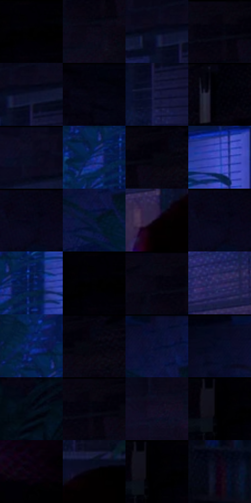

# 电影参考 473

- 状态：常规／活跃；来源世界：miles-home。
- 视角：near-level；景别：environment-wide；场景：interior。
- 时段：interior-time-unknown（外观依据，中置信度；具体时间／晨昏未知）；光照：dark-interior。
- 材质候选：skin, hair, fabric, brick, wood, plastic, foliage（帧级，不是像素分割）。
- 明暗组：very-dark；L* P5/P50/P95：0.0 / 2.77834 / 22.45253。
- 资格门禁：无附加门禁。
- 原截图 SHA-256：`7d06df7692bfc7fd252c2f18e639ba36931f4a57f2d33ce70aed2a083e16d271`；尺寸：2880 × 1212。
- sRGB 像素 SHA-256：`1830f1abb61d203cb1a98c5ad610bd5444797e3fa54c18f9382fba718dece6da`。

## 观察与迁移

冷蓝窗光与大暗形，杂物可减细节但不新增。

蓝窗局部照亮植物、砖墙，周围音响和陈列留暗；不能补造房间全域蓝光。

32  /  473  /  冷室与暖夜：蓝窗局部照亮植物、砖墙，周围音响和陈列留暗；不能补造房间全域蓝光。

本公开版保存32个128×128原像素色卡上下文；图集格子并非原场景相邻位置。原rect、图集tile和像素SHA见 `data/palette-crops.json`。上下文不足时不得批准替色，不能以小样推断完整构图。

## 实测色卡

颜色比例分母为保留采样像素，不是材料面积；全部 32 色参与全库匹配。表内四舍五入仅用于阅读，原精度在 JSON。

| ID | HEX | Lab | 原图 xy | 像素数 | 比例 | 明度角色 |
| --- | --- | --- | --- | ---: | ---: | --- |
| 473-S01 | #000000 | [0.0, 0.0, 0.0] | [2816, 60] | 11660 | 6.008946% | deep-shadow |
| 473-S02 | #0B0B19 | [3.438462, 2.92001, -7.947199] | [2104, 152] | 10700 | 5.514213% | deep-shadow |
| 473-S03 | #060B1E | [3.358069, 3.100063, -12.065317] | [1612, 100] | 10291 | 5.303436% | deep-shadow |
| 473-S04 | #050510 | [1.609715, 1.678314, -4.567795] | [2112, 28] | 8825 | 4.547938% | deep-shadow |
| 473-S05 | #10132F | [7.055274, 8.683503, -19.203558] | [1660, 104] | 8176 | 4.213477% | deep-shadow |
| 473-S06 | #02030D | [0.967221, 1.165015, -3.974602] | [368, 28] | 7220 | 3.720806% | deep-shadow |
| 473-S07 | #161840 | [10.512057, 13.400112, -25.890984] | [1668, 196] | 7053 | 3.634743% | deep-shadow |
| 473-S08 | #010209 | [0.628546, 0.711773, -2.741037] | [2392, 28] | 6945 | 3.579085% | deep-shadow |
| 473-S09 | #0E0D1F | [4.336808, 4.748857, -11.323233] | [1512, 36] | 6943 | 3.578054% | deep-shadow |
| 473-S10 | #182C7E | [21.948813, 24.293587, -48.530931] | [1044, 388] | 6805 | 3.506937% | shadow |
| 473-S11 | #05030D | [1.142148, 1.949513, -3.698186] | [2188, 28] | 6488 | 3.343572% | deep-shadow |
| 473-S12 | #2A40AF | [32.375639, 31.570936, -61.475116] | [1204, 248] | 6462 | 3.330173% | shadow |
| 473-S13 | #060717 | [2.280951, 2.690077, -8.125289] | [136, 32] | 6192 | 3.191029% | deep-shadow |
| 473-S14 | #061630 | [7.459622, 4.476011, -19.333067] | [776, 160] | 6135 | 3.161654% | deep-shadow |
| 473-S15 | #060009 | [0.527934, 2.82039, -2.852981] | [1592, 552] | 6123 | 3.155470% | deep-shadow |
| 473-S16 | #070816 | [2.499814, 2.301386, -7.067436] | [132, 28] | 6123 | 3.155470% | deep-shadow |
| 473-S17 | #061945 | [10.28488, 12.020342, -29.822188] | [1104, 376] | 6118 | 3.152893% | deep-shadow |
| 473-S18 | #000006 | [0.118721, 0.834263, -2.270541] | [2804, 28] | 5911 | 3.046216% | deep-shadow |
| 473-S19 | #080713 | [2.263537, 2.271219, -5.377642] | [2060, 36] | 5783 | 2.980252% | deep-shadow |
| 473-S20 | #232256 | [16.370299, 17.502093, -31.522437] | [1488, 452] | 5466 | 2.816887% | deep-shadow |
| 473-S21 | #09215A | [14.864234, 15.685343, -36.724923] | [1012, 308] | 5383 | 2.774113% | deep-shadow |
| 473-S22 | #020613 | [1.717606, 1.102784, -6.216791] | [2220, 36] | 5348 | 2.756076% | deep-shadow |
| 473-S23 | #070E2F | [5.09811, 9.056959, -22.357394] | [768, 48] | 5348 | 2.756076% | deep-shadow |
| 473-S24 | #080D24 | [4.216504, 4.862298, -15.414402] | [624, 60] | 4929 | 2.540146% | deep-shadow |
| 473-S25 | #040B18 | [2.990538, 0.813874, -7.862574] | [428, 328] | 4626 | 2.383995% | deep-shadow |
| 473-S26 | #090510 | [1.84295, 2.724312, -4.199241] | [2128, 32] | 4121 | 2.123745% | deep-shadow |
| 473-S27 | #130E24 | [5.237936, 7.89674, -13.771913] | [1980, 224] | 3845 | 1.981509% | deep-shadow |
| 473-S28 | #010104 | [0.333534, 0.417114, -1.135238] | [2732, 28] | 3801 | 1.958834% | deep-shadow |
| 473-S29 | #0B0210 | [1.37282, 4.455659, -4.871569] | [2772, 800] | 3756 | 1.935643% | deep-shadow |
| 473-S30 | #020001 | [0.136404, 0.662042, -0.194147] | [1700, 484] | 2806 | 1.446064% | deep-shadow |
| 473-S31 | #000002 | [0.039574, 0.278088, -0.756847] | [2744, 28] | 2399 | 1.236318% | deep-shadow |
| 473-S32 | #130417 | [2.593864, 7.933161, -7.560267] | [588, 852] | 2263 | 1.166230% | deep-shadow |

## 色阶与空间分布

- 采样 ROI：`[0.01, 0.02, 0.98, 0.94]`；步长：4；样本数：194044。
- 排除区：`[]`。
- 深暗、暗、中、亮、高光五段计数：`[182127, 11445, 470, 2, 0]`。
- RGB 各 256 箱、L* 100 箱、13×5 色相明度表和 3×3 空间统计全部保存在 [总数据](../film-library.json)。
- [可视化档案](../../references/library.html)按需绘制直方图，不存 2,094 张重复图表图片。

## 纹理特征占比

**这是分块图像特征的面积占比，不是波点／排线／丝网／错版的精确语义覆盖率。** 窗格、发丝、织物也会产生方向或周期特征。
原图 ROI 像素 3115310；已测块覆盖 3115310（100.0000%）；未测 0。

| 特征 | 块覆盖像素 | 占已测面积 | 阈值敏感范围 |
| --- | ---: | ---: | --- |
| low-contrast | 1226798 | 39.3796% | 25.5044% ~ 51.5456% |
| directional-structure | 149632 | 4.8031% | 1.4257% ~ 14.6230% |
| periodic-structure | 1469824 | 47.1807% | 37.5621% ~ 55.2913% |
| mixed-detail | 269056 | 8.6366% | 4.5812% ~ 9.4665% |

阈值敏感范围不是统计置信区间。逐块坐标、尺度、对比、方向一致性、频谱集中度、频率与角度见 [全量特征记录](../texture-features.jsonl)，以帧号定位。
四种印刷层的真实像素覆盖仍标为 `null`，不能填 0，也不能拿上表代替。不得据这些代理测量删除唯一证据。

[测量方法与保留策略](../../references/library-retention.md) · [分类索引](../archive/README.md)
