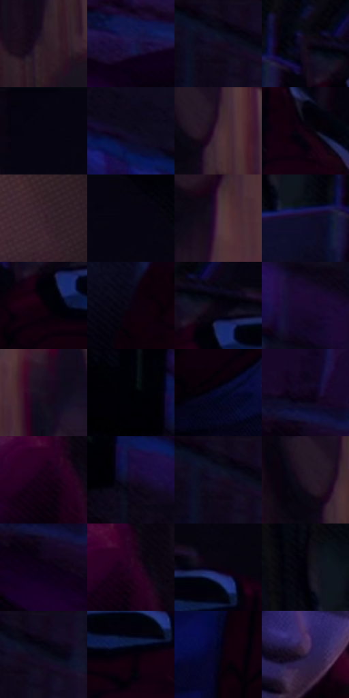

# 电影参考 474

- 状态：常规／活跃；来源世界：miles-home。
- 视角：near-level；景别：medium；场景：interior。
- 时段：interior-time-unknown（外观依据，中置信度；具体时间／晨昏未知）；光照：dark-interior。
- 材质候选：skin, hair, fabric, brick, wood, plastic, foliage（帧级，不是像素分割）。
- 明暗组：very-dark；L* P5/P50/P95：0.58624 / 3.08174 / 20.78942。
- 资格门禁：无附加门禁。
- 原截图 SHA-256：`507bc62fe50a463ba15fd6a733985fcf7c3689e541ed2fd9a5a35e5413678b75`；尺寸：2880 × 1208。
- sRGB 像素 SHA-256：`4d8e580d347d0fa76de6d194143c11732729897ac42df23bfe3effcb2676d42a`。

## 观察与迁移

冷蓝窗光与大暗形，杂物可减细节但不新增。

紫色沙发、冷面部和右侧较暖空间共存，墙上圆盘是实体陈设；不是任意装饰光斑。

33  /  474  /  冷室与暖夜：紫色沙发、冷面部和右侧较暖空间共存，墙上圆盘是实体陈设；不是任意装饰光斑。

本公开版保存32个128×128原像素色卡上下文；图集格子并非原场景相邻位置。原rect、图集tile和像素SHA见 `data/palette-crops.json`。上下文不足时不得批准替色，不能以小样推断完整构图。

## 实测色卡

颜色比例分母为保留采样像素，不是材料面积；全部 32 色参与全库匹配。表内四舍五入仅用于阅读，原精度在 JSON。

| ID | HEX | Lab | 原图 xy | 像素数 | 比例 | 明度角色 |
| --- | --- | --- | --- | ---: | ---: | --- |
| 474-S01 | #2A1A26 | [11.763485, 10.420472, -4.986631] | [2104, 500] | 11928 | 6.169251% | deep-shadow |
| 474-S02 | #181346 | [9.813641, 19.867557, -31.240236] | [300, 640] | 11534 | 5.965471% | deep-shadow |
| 474-S03 | #0A0715 | [2.444492, 3.246329, -6.423838] | [652, 32] | 9754 | 5.044842% | deep-shadow |
| 474-S04 | #120A19 | [3.756507, 5.658909, -7.420412] | [1420, 128] | 9171 | 4.743310% | deep-shadow |
| 474-S05 | #060510 | [1.668024, 1.939814, -4.475657] | [912, 28] | 8780 | 4.541082% | deep-shadow |
| 474-S06 | #0C091B | [3.185458, 4.583148, -9.908457] | [400, 96] | 8181 | 4.231275% | deep-shadow |
| 474-S07 | #422935 | [20.049328, 13.800317, -2.931742] | [2132, 344] | 8125 | 4.202311% | shadow |
| 474-S08 | #12010F | [1.669491, 6.999017, -3.833188] | [1728, 272] | 7415 | 3.835094% | deep-shadow |
| 474-S09 | #39222C | [16.483499, 12.809408, -2.048853] | [2684, 408] | 7133 | 3.689241% | deep-shadow |
| 474-S10 | #05030D | [1.142148, 1.949513, -3.698186] | [1060, 28] | 6719 | 3.475117% | deep-shadow |
| 474-S11 | #4F3342 | [25.024877, 15.284121, -4.183499] | [2300, 128] | 6620 | 3.423914% | shadow |
| 474-S12 | #0F0E27 | [5.077141, 7.614252, -16.337119] | [1320, 164] | 6607 | 3.417190% | deep-shadow |
| 474-S13 | #0C000A | [0.90414, 4.55788, -2.668196] | [1464, 228] | 6603 | 3.415121% | deep-shadow |
| 474-S14 | #0B0213 | [1.45956, 5.065187, -6.530468] | [1344, 308] | 6372 | 3.295646% | deep-shadow |
| 474-S15 | #06010F | [0.857338, 3.356728, -5.116538] | [1488, 156] | 6350 | 3.284268% | deep-shadow |
| 474-S16 | #1A0832 | [5.632316, 19.454963, -23.64008] | [772, 316] | 5856 | 3.028767% | deep-shadow |
| 474-S17 | #181021 | [6.093379, 7.998264, -10.113047] | [2328, 332] | 5563 | 2.877225% | deep-shadow |
| 474-S18 | #020108 | [0.47099, 1.234789, -2.556793] | [92, 32] | 4793 | 2.478976% | deep-shadow |
| 474-S19 | #090A2E | [4.266598, 10.863419, -22.926372] | [1632, 980] | 4784 | 2.474321% | deep-shadow |
| 474-S20 | #0B0117 | [1.397514, 6.407604, -9.380156] | [36, 544] | 4689 | 2.425186% | deep-shadow |
| 474-S21 | #1B021A | [3.171032, 13.373418, -8.969089] | [1868, 784] | 4477 | 2.315538% | deep-shadow |
| 474-S22 | #150824 | [4.159291, 11.337868, -15.42348] | [164, 116] | 4462 | 2.307780% | deep-shadow |
| 474-S23 | #0A0815 | [2.64057, 2.845769, -6.13752] | [644, 32] | 4449 | 2.301056% | deep-shadow |
| 474-S24 | #201424 | [8.435892, 9.929107, -8.701583] | [2084, 332] | 4281 | 2.214165% | deep-shadow |
| 474-S25 | #10001D | [1.796342, 10.092425, -13.54478] | [64, 632] | 4221 | 2.183133% | deep-shadow |
| 474-S26 | #270324 | [5.635822, 22.768271, -12.942217] | [1892, 764] | 4098 | 2.119516% | deep-shadow |
| 474-S27 | #0B0310 | [1.568898, 4.055099, -4.585251] | [1616, 168] | 3951 | 2.043487% | deep-shadow |
| 474-S28 | #04000A | [0.431103, 2.436435, -3.415681] | [1260, 80] | 3861 | 1.996938% | deep-shadow |
| 474-S29 | #080313 | [1.479225, 3.873461, -6.522914] | [688, 44] | 3737 | 1.932804% | deep-shadow |
| 474-S30 | #070009 | [0.586243, 3.08189, -2.760842] | [1584, 244] | 3735 | 1.931770% | deep-shadow |
| 474-S31 | #05051D | [2.072886, 4.933058, -13.205344] | [924, 932] | 3180 | 1.644720% | deep-shadow |
| 474-S32 | #2C1D3F | [14.248168, 15.796763, -19.076043] | [1640, 736] | 1917 | 0.991487% | deep-shadow |

## 色阶与空间分布

- 采样 ROI：`[0.01, 0.02, 0.98, 0.94]`；步长：4；样本数：193346。
- 排除区：`[]`。
- 深暗、暗、中、亮、高光五段计数：`[182046, 11260, 40, 0, 0]`。
- RGB 各 256 箱、L* 100 箱、13×5 色相明度表和 3×3 空间统计全部保存在 [总数据](../film-library.json)。
- [可视化档案](../../references/library.html)按需绘制直方图，不存 2,094 张重复图表图片。

## 纹理特征占比

**这是分块图像特征的面积占比，不是波点／排线／丝网／错版的精确语义覆盖率。** 窗格、发丝、织物也会产生方向或周期特征。
原图 ROI 像素 3104134；已测块覆盖 3104134（100.0000%）；未测 0。

| 特征 | 块覆盖像素 | 占已测面积 | 阈值敏感范围 |
| --- | ---: | ---: | --- |
| low-contrast | 972160 | 31.3182% | 22.5062% ~ 41.7054% |
| directional-structure | 339974 | 10.9523% | 4.3505% ~ 20.2839% |
| periodic-structure | 1775616 | 57.2017% | 52.5297% ~ 57.2099% |
| mixed-detail | 16384 | 0.5278% | 0.0000% ~ 1.4144% |

阈值敏感范围不是统计置信区间。逐块坐标、尺度、对比、方向一致性、频谱集中度、频率与角度见 [全量特征记录](../texture-features.jsonl)，以帧号定位。
四种印刷层的真实像素覆盖仍标为 `null`，不能填 0，也不能拿上表代替。不得据这些代理测量删除唯一证据。

[测量方法与保留策略](../../references/library-retention.md) · [分类索引](../archive/README.md)
