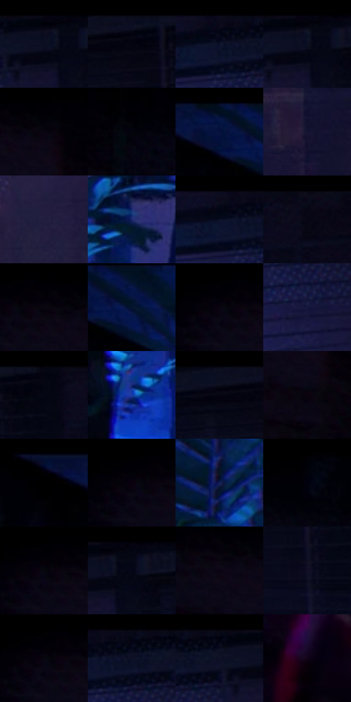

# 电影参考 475

- 状态：条件／活跃；来源世界：miles-home。
- 视角：near-level；景别：environment-wide；场景：interior。
- 时段：interior-time-unknown（外观依据，中置信度；具体时间／晨昏未知）；光照：dark-interior。
- 材质候选：skin, fabric, brick, wood, foliage（帧级，不是像素分割）。
- 明暗组：very-dark；L* P5/P50/P95：0.31375 / 2.55812 / 18.48236。
- 资格门禁：invisibility。
- 原截图 SHA-256：`8046ce54c1326da2dc27e11fe9c4e55cf98c982d78bcc8cb963ae9e3a746e033`；尺寸：2880 × 1244。
- sRGB 像素 SHA-256：`fcd79c2a6af9b0242b4da588f7c9eb20921c58885806a58967fba87a877c1832`。

## 观察与迁移

隐身轮廓与房间分开，普通照片不透体。

亮窗前黑色人物与左侧部分透明的人物并存；透明属于隐身条件，不是肤质或一般景深。

34  /  475  /  冷室与暖夜：亮窗前黑色人物与左侧部分透明的人物并存；透明属于隐身条件，不是肤质或一般景深。

本公开版保存32个128×128原像素色卡上下文；图集格子并非原场景相邻位置。原rect、图集tile和像素SHA见 `data/palette-crops.json`。上下文不足时不得批准替色，不能以小样推断完整构图。

## 实测色卡

颜色比例分母为保留采样像素，不是材料面积；全部 32 色参与全库匹配。表内四舍五入仅用于阅读，原精度在 JSON。

| ID | HEX | Lab | 原图 xy | 像素数 | 比例 | 明度角色 |
| --- | --- | --- | --- | ---: | ---: | --- |
| 475-S01 | #050510 | [1.609715, 1.678314, -4.567795] | [2128, 40] | 13749 | 6.887310% | deep-shadow |
| 475-S02 | #0B0E24 | [4.62982, 5.169501, -14.761285] | [2408, 36] | 8732 | 4.374136% | deep-shadow |
| 475-S03 | #060B1E | [3.358069, 3.100063, -12.065317] | [1960, 60] | 8625 | 4.320536% | deep-shadow |
| 475-S04 | #03030C | [1.00283, 1.267001, -3.448331] | [2144, 32] | 8421 | 4.218346% | deep-shadow |
| 475-S05 | #0A0612 | [2.153877, 2.982563, -4.902115] | [188, 72] | 8256 | 4.135692% | deep-shadow |
| 475-S06 | #03050F | [1.466724, 0.969988, -4.247681] | [304, 96] | 8052 | 4.033502% | deep-shadow |
| 475-S07 | #051744 | [9.49929, 13.001078, -30.403469] | [992, 48] | 7785 | 3.899754% | deep-shadow |
| 475-S08 | #151432 | [8.038885, 10.666395, -19.812072] | [2324, 588] | 7622 | 3.818102% | deep-shadow |
| 475-S09 | #211D3F | [12.989781, 12.236367, -21.152424] | [2056, 648] | 7209 | 3.611217% | deep-shadow |
| 475-S10 | #19276A | [18.790802, 19.90476, -40.8555] | [1448, 624] | 7148 | 3.580660% | deep-shadow |
| 475-S11 | #0D0A1B | [3.448428, 4.482582, -9.511857] | [1928, 36] | 6949 | 3.480975% | deep-shadow |
| 475-S12 | #090919 | [2.923203, 3.201678, -8.71386] | [2672, 36] | 6817 | 3.414852% | deep-shadow |
| 475-S13 | #06020D | [1.004378, 2.611573, -3.892366] | [116, 56] | 6071 | 3.041157% | deep-shadow |
| 475-S14 | #051530 | [7.062706, 4.943186, -19.970531] | [1068, 84] | 5932 | 2.971527% | deep-shadow |
| 475-S15 | #04010A | [0.627181, 2.035875, -3.129363] | [68, 56] | 5835 | 2.922937% | deep-shadow |
| 475-S16 | #16173E | [10.038576, 13.360056, -25.239083] | [2004, 176] | 5821 | 2.915924% | deep-shadow |
| 475-S17 | #050613 | [1.892532, 1.887282, -5.940376] | [2528, 28] | 5715 | 2.862825% | deep-shadow |
| 475-S18 | #1A3AA3 | [29.130259, 29.480702, -59.617855] | [1340, 788] | 5708 | 2.859318% | shadow |
| 475-S19 | #070814 | [2.432813, 1.830565, -5.786043] | [2344, 52] | 5446 | 2.728074% | deep-shadow |
| 475-S20 | #0B030F | [1.542525, 3.869771, -4.08086] | [184, 168] | 5252 | 2.630893% | deep-shadow |
| 475-S21 | #040D2F | [4.68628, 8.756423, -23.023881] | [872, 36] | 5154 | 2.581802% | deep-shadow |
| 475-S22 | #000002 | [0.039574, 0.278088, -0.756847] | [32, 28] | 5139 | 2.574288% | deep-shadow |
| 475-S23 | #141F57 | [14.493291, 17.222355, -35.292735] | [1320, 328] | 5053 | 2.531208% | deep-shadow |
| 475-S24 | #010108 | [0.412681, 0.973289, -2.648932] | [456, 32] | 4989 | 2.499148% | deep-shadow |
| 475-S25 | #010006 | [0.17703, 1.095762, -2.178403] | [76, 28] | 4934 | 2.471597% | deep-shadow |
| 475-S26 | #060A16 | [2.833661, 1.238765, -6.586938] | [2172, 48] | 4884 | 2.446551% | deep-shadow |
| 475-S27 | #0B0414 | [1.883223, 4.485471, -6.560412] | [136, 88] | 4669 | 2.338850% | deep-shadow |
| 475-S28 | #111029 | [5.869578, 8.148984, -16.598466] | [2456, 208] | 4531 | 2.269722% | deep-shadow |
| 475-S29 | #010105 | [0.353321, 0.556158, -1.513661] | [72, 32] | 4226 | 2.116938% | deep-shadow |
| 475-S30 | #040618 | [2.005149, 2.826889, -9.301464] | [2004, 48] | 4180 | 2.093895% | deep-shadow |
| 475-S31 | #010412 | [1.236942, 1.43019, -6.303997] | [2064, 40] | 4034 | 2.020759% | deep-shadow |
| 475-S32 | #110418 | [2.456576, 7.411258, -8.541084] | [428, 820] | 2690 | 1.347506% | deep-shadow |

## 色阶与空间分布

- 采样 ROI：`[0.01, 0.02, 0.98, 0.94]`；步长：4；样本数：199628。
- 排除区：`[]`。
- 深暗、暗、中、亮、高光五段计数：`[191682, 7516, 425, 4, 1]`。
- RGB 各 256 箱、L* 100 箱、13×5 色相明度表和 3×3 空间统计全部保存在 [总数据](../film-library.json)。
- [可视化档案](../../references/library.html)按需绘制直方图，不存 2,094 张重复图表图片。

## 纹理特征占比

**这是分块图像特征的面积占比，不是波点／排线／丝网／错版的精确语义覆盖率。** 窗格、发丝、织物也会产生方向或周期特征。
原图 ROI 像素 3199130；已测块覆盖 3199130（100.0000%）；未测 0。

| 特征 | 块覆盖像素 | 占已测面积 | 阈值敏感范围 |
| --- | ---: | ---: | --- |
| low-contrast | 1293850 | 40.4438% | 28.2965% ~ 51.0867% |
| directional-structure | 274048 | 8.5663% | 2.0486% ~ 16.6485% |
| periodic-structure | 1582080 | 49.4534% | 42.7676% ~ 54.5428% |
| mixed-detail | 49152 | 1.5364% | 0.5121% ~ 4.0971% |

阈值敏感范围不是统计置信区间。逐块坐标、尺度、对比、方向一致性、频谱集中度、频率与角度见 [全量特征记录](../texture-features.jsonl)，以帧号定位。
四种印刷层的真实像素覆盖仍标为 `null`，不能填 0，也不能拿上表代替。不得据这些代理测量删除唯一证据。

[测量方法与保留策略](../../references/library-retention.md) · [分类索引](../archive/README.md)
