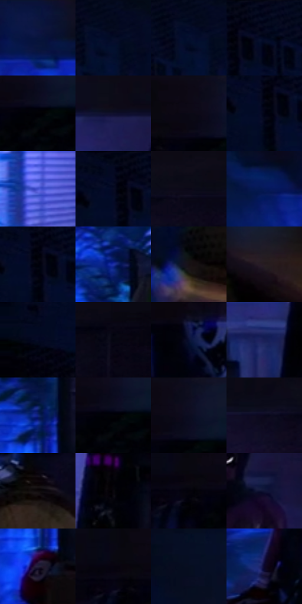

# 电影参考 476

- 状态：常规／活跃；来源世界：miles-home。
- 视角：near-level；景别：environment-wide；场景：interior。
- 时段：interior-time-unknown（外观依据，中置信度；具体时间／晨昏未知）；光照：dark-interior。
- 材质候选：skin, hair, fabric, brick, wood, plastic, foliage（帧级，不是像素分割）。
- 明暗组：very-dark；L* P5/P50/P95：0.36647 / 3.85772 / 27.50545。
- 资格门禁：无附加门禁。
- 原截图 SHA-256：`c1a971d6e10d2cf8b8eee5dcfeff71ffc4973865c6f6ce4c54253185a01c5506`；尺寸：2880 × 1208。
- sRGB 像素 SHA-256：`088bcdf9fab91849216b2999f60df4c061fad392d7e0ae66d200870c5e695125`。

## 观察与迁移

冷蓝窗光与大暗形，杂物可减细节但不新增。

深暗衣物仅腕部和脚侧有紫亮点，蓝窗维持房间方向；前景曲面不推定未知设备型号。

35  /  476  /  冷室与暖夜：深暗衣物仅腕部和脚侧有紫亮点，蓝窗维持房间方向；前景曲面不推定未知设备型号。

本公开版保存32个128×128原像素色卡上下文；图集格子并非原场景相邻位置。原rect、图集tile和像素SHA见 `data/palette-crops.json`。上下文不足时不得批准替色，不能以小样推断完整构图。

## 实测色卡

颜色比例分母为保留采样像素，不是材料面积；全部 32 色参与全库匹配。表内四舍五入仅用于阅读，原精度在 JSON。

| ID | HEX | Lab | 原图 xy | 像素数 | 比例 | 明度角色 |
| --- | --- | --- | --- | ---: | ---: | --- |
| 476-S01 | #09143F | [8.280896, 13.66474, -28.846672] | [1128, 60] | 9343 | 4.832270% | deep-shadow |
| 476-S02 | #040D27 | [4.1558, 5.028696, -17.826072] | [428, 72] | 9299 | 4.809512% | deep-shadow |
| 476-S03 | #040E2D | [4.780756, 7.27161, -21.378824] | [404, 80] | 9138 | 4.726242% | deep-shadow |
| 476-S04 | #02081D | [2.486193, 2.946878, -12.6056] | [216, 28] | 7877 | 4.074043% | deep-shadow |
| 476-S05 | #010105 | [0.353321, 0.556158, -1.513661] | [2504, 116] | 7816 | 4.042494% | deep-shadow |
| 476-S06 | #10102C | [5.984564, 9.16201, -18.67453] | [1592, 96] | 7097 | 3.670622% | deep-shadow |
| 476-S07 | #0D0916 | [3.060895, 3.537767, -6.204346] | [2464, 28] | 7044 | 3.643210% | deep-shadow |
| 476-S08 | #020314 | [1.16088, 2.525871, -7.678326] | [156, 96] | 7041 | 3.641658% | deep-shadow |
| 476-S09 | #424ECC | [39.521244, 35.987024, -66.76294] | [1420, 360] | 6910 | 3.573904% | shadow |
| 476-S10 | #060A22 | [3.353425, 4.891193, -15.204618] | [148, 44] | 6881 | 3.558905% | deep-shadow |
| 476-S11 | #090716 | [2.420354, 3.224945, -7.169477] | [2060, 92] | 6775 | 3.504081% | deep-shadow |
| 476-S12 | #051857 | [11.77899, 20.760091, -39.765767] | [968, 92] | 6638 | 3.433223% | deep-shadow |
| 476-S13 | #01020C | [0.690135, 1.144563, -3.918926] | [164, 80] | 6627 | 3.427534% | deep-shadow |
| 476-S14 | #1D2FA6 | [26.866003, 37.976594, -65.150013] | [1196, 412] | 6349 | 3.283750% | shadow |
| 476-S15 | #171116 | [5.790074, 3.659759, -2.114428] | [2168, 992] | 6035 | 3.121347% | deep-shadow |
| 476-S16 | #261B21 | [11.315895, 6.713229, -2.025908] | [2560, 1040] | 5702 | 2.949117% | deep-shadow |
| 476-S17 | #030717 | [2.106025, 1.905579, -8.401705] | [40, 192] | 5538 | 2.864295% | deep-shadow |
| 476-S18 | #03040F | [1.270646, 1.370548, -4.533999] | [2240, 128] | 5515 | 2.852399% | deep-shadow |
| 476-S19 | #0A1032 | [6.009631, 10.357805, -23.112717] | [2780, 132] | 5510 | 2.849813% | deep-shadow |
| 476-S20 | #191F56 | [14.725099, 17.635162, -34.22699] | [1476, 736] | 5430 | 2.808437% | deep-shadow |
| 476-S21 | #0F247B | [19.19388, 27.854377, -51.162528] | [1192, 608] | 5391 | 2.788266% | deep-shadow |
| 476-S22 | #020208 | [0.667068, 0.834228, -2.270475] | [2504, 112] | 5353 | 2.768612% | deep-shadow |
| 476-S23 | #0F0E20 | [4.696126, 4.936823, -11.548726] | [2508, 40] | 5332 | 2.757750% | deep-shadow |
| 476-S24 | #0A071C | [2.712631, 5.130566, -11.421284] | [1924, 108] | 5252 | 2.716374% | deep-shadow |
| 476-S25 | #0F0A0C | [3.118121, 1.794095, -0.270431] | [2424, 416] | 4852 | 2.509491% | deep-shadow |
| 476-S26 | #09060C | [1.940917, 1.634316, -2.036546] | [1588, 568] | 4786 | 2.475355% | deep-shadow |
| 476-S27 | #02010A | [0.510564, 1.512876, -3.31364] | [2404, 108] | 4703 | 2.432427% | deep-shadow |
| 476-S28 | #101536 | [8.242151, 10.20877, -22.422818] | [1756, 288] | 4646 | 2.402946% | deep-shadow |
| 476-S29 | #25203D | [14.191936, 10.640913, -17.813803] | [1192, 724] | 4357 | 2.253473% | deep-shadow |
| 476-S30 | #06030F | [1.249494, 2.555607, -4.543902] | [2384, 84] | 4228 | 2.186753% | deep-shadow |
| 476-S31 | #070E22 | [4.287819, 3.36297, -13.766868] | [656, 60] | 3801 | 1.965906% | deep-shadow |
| 476-S32 | #0D062A | [3.458992, 11.670487, -21.166461] | [1104, 916] | 2080 | 1.075792% | deep-shadow |

## 色阶与空间分布

- 采样 ROI：`[0.01, 0.02, 0.98, 0.94]`；步长：4；样本数：193346。
- 排除区：`[]`。
- 深暗、暗、中、亮、高光五段计数：`[177007, 14010, 2183, 146, 0]`。
- RGB 各 256 箱、L* 100 箱、13×5 色相明度表和 3×3 空间统计全部保存在 [总数据](../film-library.json)。
- [可视化档案](../../references/library.html)按需绘制直方图，不存 2,094 张重复图表图片。

## 纹理特征占比

**这是分块图像特征的面积占比，不是波点／排线／丝网／错版的精确语义覆盖率。** 窗格、发丝、织物也会产生方向或周期特征。
原图 ROI 像素 3104134；已测块覆盖 3104134（100.0000%）；未测 0。

| 特征 | 块覆盖像素 | 占已测面积 | 阈值敏感范围 |
| --- | ---: | ---: | --- |
| low-contrast | 970368 | 31.2605% | 19.3806% ~ 42.7817% |
| directional-structure | 255622 | 8.2349% | 2.4083% ~ 22.8734% |
| periodic-structure | 1769088 | 56.9914% | 49.2762% ~ 56.9914% |
| mixed-detail | 109056 | 3.5132% | 1.4927% ~ 5.5338% |

阈值敏感范围不是统计置信区间。逐块坐标、尺度、对比、方向一致性、频谱集中度、频率与角度见 [全量特征记录](../texture-features.jsonl)，以帧号定位。
四种印刷层的真实像素覆盖仍标为 `null`，不能填 0，也不能拿上表代替。不得据这些代理测量删除唯一证据。

[测量方法与保留策略](../../references/library-retention.md) · [分类索引](../archive/README.md)
