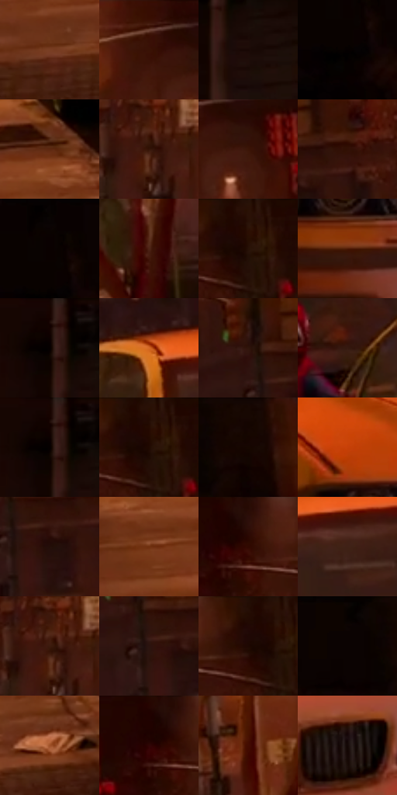

# 电影参考 477

- 状态：常规／活跃；来源世界：miles-home。
- 视角：rolled-or-dutch；景别：environment-wide；场景：city。
- 时段：night-appearance（外观依据，中置信度；具体时间／晨昏未知）；光照：night-mixed。
- 材质候选：fabric, brick, asphalt, glass, painted-metal, sky（帧级，不是像素分割）。
- 明暗组：very-dark；L* P5/P50/P95：0.7618 / 10.78636 / 47.30535。
- 资格门禁：无附加门禁。
- 原截图 SHA-256：`9ea9f680ad5cf8f5f53942836f912562d1d0ac8481ff514d9fc1da376a29ee21`；尺寸：2852 × 1204。
- sRGB 像素 SHA-256：`603731f71be900338abbd9fcb9f560319c6709c59a13d2507e1340a3c559f5d6`。

## 观察与迁移

暖街灯与深暗屋顶，事件人物内容不复制。

橙黄车辆、暖街灯和暗砖构成夜街，局部人物留暗；夜景也可暖，不固定青紫。

36  /  477  /  冷室与暖夜：橙黄车辆、暖街灯和暗砖构成夜街，局部人物留暗；夜景也可暖，不固定青紫。

本公开版保存32个128×128原像素色卡上下文；图集格子并非原场景相邻位置。原rect、图集tile和像素SHA见 `data/palette-crops.json`。上下文不足时不得批准替色，不能以小样推断完整构图。

## 实测色卡

颜色比例分母为保留采样像素，不是材料面积；全部 32 色参与全库匹配。表内四舍五入仅用于阅读，原精度在 JSON。

| ID | HEX | Lab | 原图 xy | 像素数 | 比例 | 明度角色 |
| --- | --- | --- | --- | ---: | ---: | --- |
| 477-S01 | #793E23 | [33.205835, 23.253676, 27.684434] | [1120, 772] | 10611 | 5.563770% | shadow |
| 477-S02 | #431A0C | [15.270439, 18.724989, 18.018128] | [1496, 32] | 8369 | 4.388200% | deep-shadow |
| 477-S03 | #190905 | [3.73112, 5.465349, 3.635713] | [2792, 132] | 7969 | 4.178464% | deep-shadow |
| 477-S04 | #040101 | [0.4491, 0.784481, 0.276449] | [32, 120] | 7964 | 4.175843% | deep-shadow |
| 477-S05 | #5D2810 | [23.280226, 22.512053, 26.451219] | [1440, 604] | 7692 | 4.033222% | shadow |
| 477-S06 | #351408 | [11.099115, 15.532228, 13.658942] | [2396, 152] | 7617 | 3.993897% | deep-shadow |
| 477-S07 | #3B1506 | [12.477529, 17.66239, 16.549802] | [1572, 96] | 7484 | 3.924159% | deep-shadow |
| 477-S08 | #321005 | [9.480394, 16.368825, 12.517372] | [2264, 112] | 7240 | 3.796221% | deep-shadow |
| 477-S09 | #0A0101 | [0.798952, 2.353476, 0.82928] | [40, 48] | 6750 | 3.539294% | deep-shadow |
| 477-S10 | #4D2414 | [19.599812, 17.791692, 19.238928] | [1336, 408] | 6689 | 3.507309% | deep-shadow |
| 477-S11 | #2A0F03 | [7.593119, 12.832013, 10.399271] | [1892, 40] | 6510 | 3.413452% | deep-shadow |
| 477-S12 | #4F1B06 | [17.73575, 23.271166, 24.072881] | [2196, 800] | 6507 | 3.411879% | deep-shadow |
| 477-S13 | #100100 | [1.191468, 4.063501, 1.859217] | [2736, 36] | 6205 | 3.253529% | deep-shadow |
| 477-S14 | #D56926 | [56.479466, 38.459423, 54.253971] | [1896, 324] | 6037 | 3.165440% | midtone |
| 477-S15 | #30150C | [10.493938, 12.693786, 11.000213] | [2136, 104] | 5990 | 3.140796% | deep-shadow |
| 477-S16 | #361910 | [12.716667, 13.394327, 12.20534] | [1740, 368] | 5963 | 3.126639% | deep-shadow |
| 477-S17 | #140300 | [1.93208, 4.825113, 2.982478] | [2736, 40] | 5921 | 3.104616% | deep-shadow |
| 477-S18 | #230A02 | [5.229117, 10.752635, 7.208373] | [1888, 28] | 5884 | 3.085216% | deep-shadow |
| 477-S19 | #150500 | [2.420984, 4.457881, 3.707993] | [284, 52] | 5751 | 3.015479% | deep-shadow |
| 477-S20 | #C7400A | [46.756817, 51.742234, 55.398694] | [2160, 644] | 5723 | 3.000797% | midtone |
| 477-S21 | #230E08 | [6.223923, 9.754474, 6.217113] | [2200, 172] | 5633 | 2.953606% | deep-shadow |
| 477-S22 | #70300E | [28.357205, 26.263288, 33.46826] | [1112, 628] | 5533 | 2.901172% | shadow |
| 477-S23 | #2B0A03 | [6.660918, 16.148713, 9.06119] | [1736, 48] | 5361 | 2.810986% | deep-shadow |
| 477-S24 | #3F2116 | [16.516796, 13.129248, 13.631971] | [2012, 376] | 4987 | 2.614883% | deep-shadow |
| 477-S25 | #3C1B0D | [14.25265, 14.811834, 15.985197] | [2392, 144] | 4880 | 2.558778% | deep-shadow |
| 477-S26 | #2B140F | [9.389282, 11.132705, 7.835133] | [2160, 156] | 4304 | 2.256759% | deep-shadow |
| 477-S27 | #1E0802 | [4.10229, 8.258948, 5.474821] | [1856, 60] | 3975 | 2.084251% | deep-shadow |
| 477-S28 | #0D0402 | [1.59705, 2.143283, 1.610166] | [184, 36] | 3926 | 2.058558% | deep-shadow |
| 477-S29 | #9E5028 | [43.00583, 29.317876, 37.344147] | [1496, 724] | 3897 | 2.043352% | midtone |
| 477-S30 | #200401 | [3.578819, 10.980688, 5.151415] | [1704, 52] | 3597 | 1.886050% | deep-shadow |
| 477-S31 | #420B02 | [11.97328, 25.657127, 17.741358] | [1312, 240] | 3351 | 1.757063% | deep-shadow |
| 477-S32 | #140807 | [3.050977, 3.795618, 1.765103] | [2616, 704] | 2396 | 1.256318% | deep-shadow |

## 色阶与空间分布

- 采样 ROI：`[0.01, 0.02, 0.98, 0.94]`；步长：4；样本数：190716。
- 排除区：`[]`。
- 深暗、暗、中、亮、高光五段计数：`[148407, 27618, 13716, 722, 253]`。
- RGB 各 256 箱、L* 100 箱、13×5 色相明度表和 3×3 空间统计全部保存在 [总数据](../film-library.json)。
- [可视化档案](../../references/library.html)按需绘制直方图，不存 2,094 张重复图表图片。

## 纹理特征占比

**这是分块图像特征的面积占比，不是波点／排线／丝网／错版的精确语义覆盖率。** 窗格、发丝、织物也会产生方向或周期特征。
原图 ROI 像素 3061962；已测块覆盖 3061962（100.0000%）；未测 0。

| 特征 | 块覆盖像素 | 占已测面积 | 阈值敏感范围 |
| --- | ---: | ---: | --- |
| low-contrast | 403018 | 13.1621% | 9.9283% ~ 14.5792% |
| directional-structure | 1032192 | 33.7102% | 21.6624% ~ 49.8504% |
| periodic-structure | 1561216 | 50.9874% | 39.6863% ~ 56.1292% |
| mixed-detail | 65536 | 2.1403% | 0.5351% ~ 7.6291% |

阈值敏感范围不是统计置信区间。逐块坐标、尺度、对比、方向一致性、频谱集中度、频率与角度见 [全量特征记录](../texture-features.jsonl)，以帧号定位。
四种印刷层的真实像素覆盖仍标为 `null`，不能填 0，也不能拿上表代替。不得据这些代理测量删除唯一证据。

[测量方法与保留策略](../../references/library-retention.md) · [分类索引](../archive/README.md)
