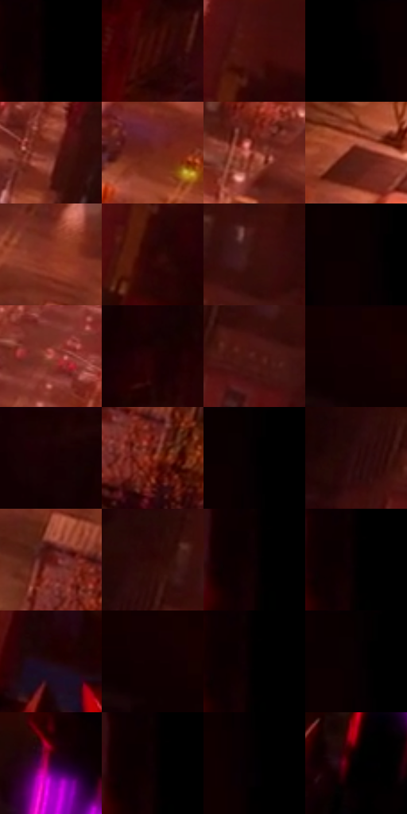

# 电影参考 478

- 状态：常规／活跃；来源世界：miles-home。
- 视角：high-angle；景别：environment-wide；场景：city。
- 时段：night-appearance（外观依据，中置信度；具体时间／晨昏未知）；光照：night-mixed。
- 材质候选：fabric, brick, asphalt, glass, painted-metal, sky（帧级，不是像素分割）。
- 明暗组：very-dark；L* P5/P50/P95：0.0 / 2.63223 / 38.26429。
- 资格门禁：无附加门禁。
- 原截图 SHA-256：`c7473b218486df8f83f59e7fb9f9fe258cef1d2feb3d3723654bae826dcc0245`；尺寸：2880 × 1198。
- sRGB 像素 SHA-256：`a4ed5e2669ef47f83a499cc27a2a0876b94337c151a9a2b308b7496a2a00662a`。

## 观察与迁移

暖街灯与深暗屋顶，事件人物内容不复制。

倾斜俯视暖街与近处巨大暗形，紫色腕部只作小强调；近处非焦点无需全纹理清楚。

37  /  478  /  冷室与暖夜：倾斜俯视暖街与近处巨大暗形，紫色腕部只作小强调；近处非焦点无需全纹理清楚。

本公开版保存32个128×128原像素色卡上下文；图集格子并非原场景相邻位置。原rect、图集tile和像素SHA见 `data/palette-crops.json`。上下文不足时不得批准替色，不能以小样推断完整构图。

## 实测色卡

颜色比例分母为保留采样像素，不是材料面积；全部 32 色参与全库匹配。表内四舍五入仅用于阅读，原精度在 JSON。

| ID | HEX | Lab | 原图 xy | 像素数 | 比例 | 明度角色 |
| --- | --- | --- | --- | ---: | ---: | --- |
| 478-S01 | #000000 | [0.0, 0.0, 0.0] | [1748, 24] | 54571 | 28.326793% | deep-shadow |
| 478-S02 | #360402 | [7.910497, 24.434095, 11.586571] | [424, 396] | 7800 | 4.048835% | deep-shadow |
| 478-S03 | #460D09 | [13.291377, 26.668548, 16.823443] | [1460, 48] | 7765 | 4.030667% | deep-shadow |
| 478-S04 | #020001 | [0.136404, 0.662042, -0.194147] | [1872, 24] | 7111 | 3.691188% | deep-shadow |
| 478-S05 | #752E24 | [29.067675, 30.492637, 22.050527] | [1312, 264] | 7083 | 3.676654% | shadow |
| 478-S06 | #692315 | [24.514205, 30.495016, 25.517587] | [976, 444] | 6900 | 3.581662% | shadow |
| 478-S07 | #964233 | [38.935216, 34.158297, 26.163219] | [992, 276] | 6833 | 3.546883% | shadow |
| 478-S08 | #5E1E13 | [21.416573, 28.515103, 22.768508] | [420, 820] | 6447 | 3.346518% | shadow |
| 478-S09 | #8A3422 | [33.933618, 35.595475, 29.855291] | [980, 640] | 6298 | 3.269175% | shadow |
| 478-S10 | #290202 | [4.691422, 18.411963, 6.546884] | [1444, 160] | 6192 | 3.214152% | deep-shadow |
| 478-S11 | #390F0C | [10.837024, 20.60733, 11.741712] | [736, 92] | 6089 | 3.160687% | deep-shadow |
| 478-S12 | #090000 | [0.524779, 2.353494, 0.829247] | [1964, 24] | 6026 | 3.127985% | deep-shadow |
| 478-S13 | #BC5C52 | [50.637722, 37.721507, 23.865445] | [1264, 112] | 5378 | 2.791620% | midtone |
| 478-S14 | #200001 | [2.794507, 12.58293, 4.006143] | [376, 148] | 5278 | 2.739712% | deep-shadow |
| 478-S15 | #4C1915 | [16.923491, 23.859005, 15.330166] | [696, 160] | 5030 | 2.610980% | deep-shadow |
| 478-S16 | #140002 | [1.38342, 6.304883, 1.366677] | [40, 24] | 4906 | 2.546614% | deep-shadow |
| 478-S17 | #1A0203 | [2.435917, 8.515521, 2.573082] | [284, 24] | 4686 | 2.432416% | deep-shadow |
| 478-S18 | #7D2615 | [28.906552, 36.730371, 31.248426] | [1032, 812] | 4616 | 2.396080% | shadow |
| 478-S19 | #040001 | [0.253022, 1.185041, -0.009869] | [1996, 24] | 4387 | 2.277210% | deep-shadow |
| 478-S20 | #2D0C0B | [7.634221, 16.905558, 7.261528] | [592, 132] | 3687 | 1.913853% | deep-shadow |
| 478-S21 | #5A100D | [18.249987, 32.915364, 22.284502] | [972, 760] | 3681 | 1.910739% | deep-shadow |
| 478-S22 | #2A0706 | [5.939121, 17.27827, 6.762111] | [636, 48] | 3556 | 1.845854% | deep-shadow |
| 478-S23 | #0C0002 | [0.745845, 3.44553, 0.359192] | [1732, 76] | 3518 | 1.826128% | deep-shadow |
| 478-S24 | #040000 | [0.233235, 1.045997, 0.368554] | [1740, 40] | 3251 | 1.687534% | deep-shadow |
| 478-S25 | #20060C | [4.190858, 11.724708, 1.518774] | [1368, 720] | 3075 | 1.596175% | deep-shadow |
| 478-S26 | #0E0001 | [0.8634, 3.922428, 0.954641] | [32, 76] | 2438 | 1.265521% | deep-shadow |
| 478-S27 | #010000 | [0.058309, 0.261499, 0.092139] | [1744, 24] | 2217 | 1.150804% | deep-shadow |
| 478-S28 | #070002 | [0.447735, 2.108583, -0.111877] | [1984, 40] | 2096 | 1.087995% | deep-shadow |
| 478-S29 | #3C002E | [10.244993, 32.674375, -12.952574] | [1588, 596] | 966 | 0.501433% | deep-shadow |
| 478-S30 | #0B0102 | [0.878535, 2.760687, 0.545344] | [1732, 40] | 472 | 0.245006% | deep-shadow |
| 478-S31 | #020003 | [0.175978, 0.94013, -0.950994] | [2008, 188] | 178 | 0.092396% | deep-shadow |
| 478-S32 | #010102 | [0.29396, 0.139026, -0.378391] | [1556, 772] | 117 | 0.060733% | deep-shadow |

## 色阶与空间分布

- 采样 ROI：`[0.01, 0.02, 0.98, 0.94]`；步长：4；样本数：192648。
- 排除区：`[]`。
- 深暗、暗、中、亮、高光五段计数：`[149462, 35309, 7436, 428, 13]`。
- RGB 各 256 箱、L* 100 箱、13×5 色相明度表和 3×3 空间统计全部保存在 [总数据](../film-library.json)。
- [可视化档案](../../references/library.html)按需绘制直方图，不存 2,094 张重复图表图片。

## 纹理特征占比

**这是分块图像特征的面积占比，不是波点／排线／丝网／错版的精确语义覆盖率。** 窗格、发丝、织物也会产生方向或周期特征。
原图 ROI 像素 3081782；已测块覆盖 3081782（100.0000%）；未测 0。

| 特征 | 块覆盖像素 | 占已测面积 | 阈值敏感范围 |
| --- | ---: | ---: | --- |
| low-contrast | 1522486 | 49.4028% | 46.7446% ~ 50.4661% |
| directional-structure | 114688 | 3.7215% | 1.0633% ~ 12.0242% |
| periodic-structure | 1227776 | 39.8398% | 33.0074% ~ 39.8398% |
| mixed-detail | 216832 | 7.0359% | 3.5180% ~ 15.4633% |

阈值敏感范围不是统计置信区间。逐块坐标、尺度、对比、方向一致性、频谱集中度、频率与角度见 [全量特征记录](../texture-features.jsonl)，以帧号定位。
四种印刷层的真实像素覆盖仍标为 `null`，不能填 0，也不能拿上表代替。不得据这些代理测量删除唯一证据。

[测量方法与保留策略](../../references/library-retention.md) · [分类索引](../archive/README.md)
