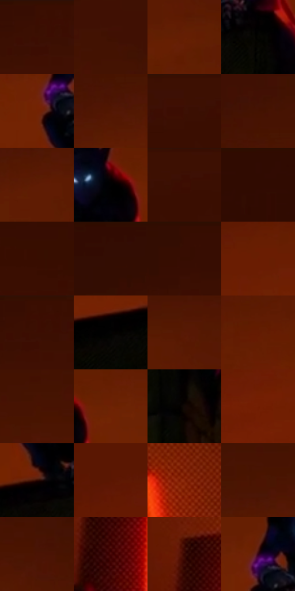

# 电影参考 479

- 状态：常规／活跃；来源世界：miles-home。
- 视角：low-angle；景别：environment-wide；场景：city。
- 时段：night-appearance（外观依据，中置信度；具体时间／晨昏未知）；光照：night-mixed。
- 材质候选：fabric, brick, asphalt, glass, painted-metal, sky（帧级，不是像素分割）。
- 明暗组：very-dark；L* P5/P50/P95：0.54835 / 12.39984 / 26.06819。
- 资格门禁：无附加门禁。
- 原截图 SHA-256：`a0b8d4ff60898c0bd0606f84363b1e7063fefb6ec4ed054b271efe27ec5b80d1`；尺寸：2880 × 1210。
- sRGB 像素 SHA-256：`f4641a873a4cd6c62dea833bfa885d2c6e2680cb2b636f16f7de3579b49760a5`。

## 观察与迁移

暖街灯与深暗屋顶，事件人物内容不复制。

屋顶小黑影对橙红大天空，眼部和腕部微亮；戏剧性天空仅供条件场景匹配。

38  /  479  /  冷室与暖夜：屋顶小黑影对橙红大天空，眼部和腕部微亮；戏剧性天空仅供条件场景匹配。

本公开版保存32个128×128原像素色卡上下文；图集格子并非原场景相邻位置。原rect、图集tile和像素SHA见 `data/palette-crops.json`。上下文不足时不得批准替色，不能以小样推断完整构图。

## 实测色卡

颜色比例分母为保留采样像素，不是材料面积；全部 32 色参与全库匹配。表内四舍五入仅用于阅读，原精度在 JSON。

| ID | HEX | Lab | 原图 xy | 像素数 | 比例 | 明度角色 |
| --- | --- | --- | --- | ---: | ---: | --- |
| 479-S01 | #3A0E01 | [10.67554, 20.899665, 16.074791] | [1444, 28] | 10464 | 5.392591% | deep-shadow |
| 479-S02 | #401002 | [12.385705, 22.496629, 18.228388] | [1636, 164] | 10340 | 5.328688% | deep-shadow |
| 479-S03 | #651E02 | [22.655518, 30.712473, 32.423899] | [1620, 464] | 10098 | 5.203974% | shadow |
| 479-S04 | #060602 | [1.565894, -0.55628, 1.513892] | [1520, 816] | 9878 | 5.090598% | deep-shadow |
| 479-S05 | #732203 | [26.147293, 34.299866, 36.375692] | [1332, 672] | 9075 | 4.676774% | shadow |
| 479-S06 | #521602 | [17.332391, 26.964244, 25.357147] | [1380, 344] | 8966 | 4.620602% | deep-shadow |
| 479-S07 | #3D1002 | [11.73876, 21.203297, 17.240295] | [2052, 28] | 8301 | 4.277896% | deep-shadow |
| 479-S08 | #441201 | [13.615607, 23.116135, 20.432834] | [1368, 248] | 8228 | 4.240275% | deep-shadow |
| 479-S09 | #5F1C04 | [21.105388, 29.351607, 29.594087] | [1488, 380] | 8216 | 4.234091% | shadow |
| 479-S10 | #010101 | [0.274173, -1.7e-05, 3.3e-05] | [1492, 588] | 8076 | 4.161943% | deep-shadow |
| 479-S11 | #3D0F02 | [11.541719, 21.731838, 16.969542] | [2112, 60] | 7703 | 3.969718% | deep-shadow |
| 479-S12 | #310B02 | [8.101217, 18.604641, 11.722641] | [544, 28] | 6946 | 3.579601% | deep-shadow |
| 479-S13 | #370D00 | [9.800732, 20.051828, 15.155139] | [216, 312] | 6611 | 3.406959% | deep-shadow |
| 479-S14 | #330D02 | [8.960206, 18.392096, 13.021906] | [1052, 28] | 6336 | 3.265239% | deep-shadow |
| 479-S15 | #370D02 | [9.834929, 20.182508, 14.389022] | [1196, 28] | 6275 | 3.233803% | deep-shadow |
| 479-S16 | #6A1C02 | [23.338177, 33.544529, 33.44766] | [576, 700] | 6204 | 3.197213% | shadow |
| 479-S17 | #3B0F02 | [11.107488, 20.864608, 16.301897] | [1460, 28] | 6089 | 3.137948% | deep-shadow |
| 479-S18 | #030303 | [0.82252, -5.2e-05, 9.9e-05] | [1176, 856] | 5766 | 2.971491% | deep-shadow |
| 479-S19 | #581904 | [19.13777, 28.001563, 26.989957] | [1624, 352] | 5616 | 2.894189% | deep-shadow |
| 479-S20 | #641A02 | [21.775064, 32.158446, 31.432845] | [860, 604] | 5267 | 2.714333% | shadow |
| 479-S21 | #481301 | [14.657873, 24.293409, 21.957345] | [1540, 244] | 5209 | 2.684443% | deep-shadow |
| 479-S22 | #6E2204 | [25.164559, 32.400342, 34.697829] | [1580, 584] | 5097 | 2.626724% | shadow |
| 479-S23 | #130805 | [2.918556, 3.101133, 2.375234] | [1560, 1040] | 4805 | 2.476243% | deep-shadow |
| 479-S24 | #721D02 | [25.142461, 36.073095, 35.775946] | [296, 848] | 4389 | 2.261858% | shadow |
| 479-S25 | #2E0A01 | [7.229019, 17.608208, 10.778275] | [1380, 788] | 4035 | 2.079425% | deep-shadow |
| 479-S26 | #5B1602 | [19.237246, 30.495752, 28.08165] | [72, 720] | 3979 | 2.050566% | deep-shadow |
| 479-S27 | #842207 | [29.579613, 40.575999, 39.003462] | [2328, 1056] | 3853 | 1.985632% | shadow |
| 479-S28 | #4C1402 | [15.704461, 25.496521, 23.06033] | [1480, 284] | 3710 | 1.911937% | deep-shadow |
| 479-S29 | #4B1404 | [15.515563, 25.170716, 21.962435] | [1732, 288] | 3123 | 1.609429% | deep-shadow |
| 479-S30 | #480808 | [13.042366, 29.303381, 16.980464] | [2184, 1128] | 647 | 0.333430% | deep-shadow |
| 479-S31 | #360601 | [8.279634, 23.279205, 12.532059] | [2144, 1056] | 510 | 0.262827% | deep-shadow |
| 479-S32 | #310218 | [6.887778, 25.446645, -1.49193] | [1356, 620] | 232 | 0.119561% | deep-shadow |

## 色阶与空间分布

- 采样 ROI：`[0.01, 0.02, 0.98, 0.94]`；步长：4；样本数：194044。
- 排除区：`[]`。
- 深暗、暗、中、亮、高光五段计数：`[141386, 52368, 287, 2, 1]`。
- RGB 各 256 箱、L* 100 箱、13×5 色相明度表和 3×3 空间统计全部保存在 [总数据](../film-library.json)。
- [可视化档案](../../references/library.html)按需绘制直方图，不存 2,094 张重复图表图片。

## 纹理特征占比

**这是分块图像特征的面积占比，不是波点／排线／丝网／错版的精确语义覆盖率。** 窗格、发丝、织物也会产生方向或周期特征。
原图 ROI 像素 3109722；已测块覆盖 3109722（100.0000%）；未测 0。

| 特征 | 块覆盖像素 | 占已测面积 | 阈值敏感范围 |
| --- | ---: | ---: | --- |
| low-contrast | 2427354 | 78.0569% | 68.7339% ~ 81.5845% |
| directional-structure | 262144 | 8.4298% | 7.3761% ~ 9.4835% |
| periodic-structure | 387456 | 12.4595% | 10.5126% ~ 19.1482% |
| mixed-detail | 32768 | 1.0537% | 0.5269% ~ 2.6343% |

阈值敏感范围不是统计置信区间。逐块坐标、尺度、对比、方向一致性、频谱集中度、频率与角度见 [全量特征记录](../texture-features.jsonl)，以帧号定位。
四种印刷层的真实像素覆盖仍标为 `null`，不能填 0，也不能拿上表代替。不得据这些代理测量删除唯一证据。

[测量方法与保留策略](../../references/library-retention.md) · [分类索引](../archive/README.md)
