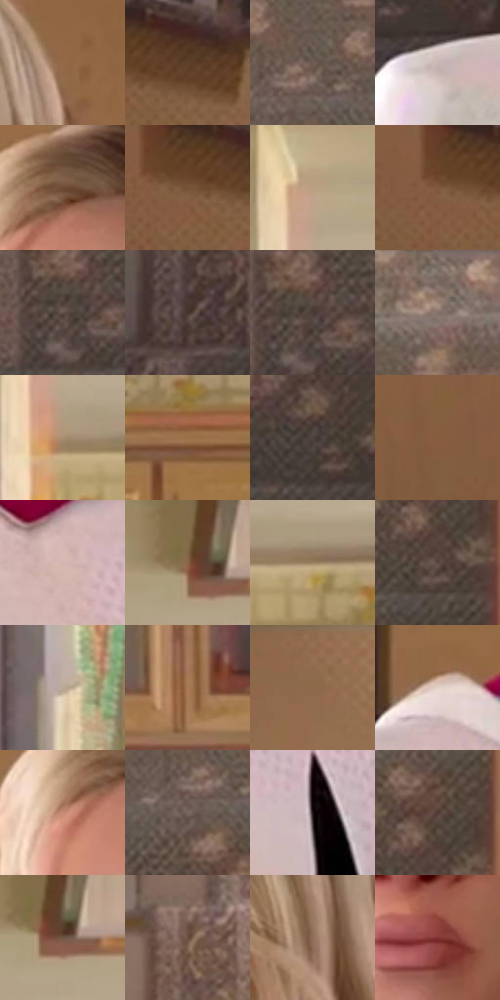

# 电影参考 480

- 状态：常规／活跃；来源世界：miles-home。
- 视角：near-level；景别：medium；场景：interior。
- 时段：daylight-time-unspecified（外观依据，中置信度；具体时间／晨昏未知）；光照：warm-day。
- 材质候选：skin, hair, fabric, wood, paint, glass（帧级，不是像素分割）。
- 明暗组：middle；L* P5/P50/P95：24.42097 / 44.36243 / 76.59301。
- 资格门禁：无附加门禁。
- 原截图 SHA-256：`14639e0bbaab35375004a623efa664b5299d52250be1b11171331857dc443447`；尺寸：2880 × 1208。
- sRGB 像素 SHA-256：`11bb58fc9ab7f561c23c0ed8097ffec85c4501a34490460a37133172d2ad9089`。

## 观察与迁移

暖住宅、楼梯与陈设，镜中、相片中和现场人物需逐一分开。

暖日光家居近脸，白衣、赭墙、花纹和玻璃柜区别明确；普通日景不必霓虹化。

39  /  480  /  暖家居与条件图形：暖日光家居近脸，白衣、赭墙、花纹和玻璃柜区别明确；普通日景不必霓虹化。

本公开版保存32个128×128原像素色卡上下文；图集格子并非原场景相邻位置。原rect、图集tile和像素SHA见 `data/palette-crops.json`。上下文不足时不得批准替色，不能以小样推断完整构图。

## 实测色卡

颜色比例分母为保留采样像素，不是材料面积；全部 32 色参与全库匹配。表内四舍五入仅用于阅读，原精度在 JSON。

| ID | HEX | Lab | 原图 xy | 像素数 | 比例 | 明度角色 |
| --- | --- | --- | --- | ---: | ---: | --- |
| 480-S01 | #936947 | [47.959302, 12.622428, 25.694419] | [2028, 144] | 11354 | 5.872374% | midtone |
| 480-S02 | #61422C | [30.926204, 10.586511, 18.716239] | [460, 264] | 8957 | 4.632628% | shadow |
| 480-S03 | #6D5B52 | [40.15224, 5.769698, 7.92136] | [1208, 188] | 8862 | 4.583493% | midtone |
| 480-S04 | #C8B7B3 | [75.700624, 5.351935, 4.221247] | [1252, 816] | 8587 | 4.441261% | light |
| 480-S05 | #6C4B33 | [34.923086, 10.891648, 19.826283] | [1624, 116] | 8503 | 4.397815% | shadow |
| 480-S06 | #775238 | [38.274889, 12.199044, 21.388378] | [392, 280] | 7984 | 4.129385% | shadow |
| 480-S07 | #BA9F82 | [67.163206, 5.555983, 18.839842] | [2336, 168] | 7740 | 4.003186% | light |
| 480-S08 | #805A3E | [41.611193, 12.089959, 22.330362] | [360, 276] | 7697 | 3.980946% | midtone |
| 480-S09 | #615049 | [35.518179, 5.843889, 6.773736] | [1008, 528] | 7346 | 3.799406% | shadow |
| 480-S10 | #44332D | [22.951836, 6.620057, 6.752781] | [716, 964] | 7326 | 3.789062% | shadow |
| 480-S11 | #473C37 | [26.295203, 3.832626, 4.863724] | [1024, 516] | 7076 | 3.659760% | shadow |
| 480-S12 | #837067 | [48.752008, 5.897705, 7.7581] | [1264, 64] | 7068 | 3.655623% | midtone |
| 480-S13 | #A78F70 | [60.809336, 4.304031, 19.855017] | [2344, 336] | 6957 | 3.598213% | light |
| 480-S14 | #9B7246 | [51.205954, 10.859594, 30.532435] | [2692, 452] | 6951 | 3.595109% | midtone |
| 480-S15 | #50433D | [29.55558, 4.454766, 5.711386] | [1244, 536] | 6842 | 3.538734% | shadow |
| 480-S16 | #875D40 | [43.287258, 13.641004, 23.477486] | [196, 220] | 6552 | 3.388743% | midtone |
| 480-S17 | #D6B6AF | [76.587304, 10.370557, 7.830641] | [1764, 960] | 6283 | 3.249615% | light |
| 480-S18 | #8B6445 | [45.680895, 11.809373, 23.73634] | [2772, 76] | 5989 | 3.097556% | midtone |
| 480-S19 | #9A8160 | [55.498397, 4.691829, 21.478797] | [2476, 348] | 5961 | 3.083074% | midtone |
| 480-S20 | #5A4840 | [32.210673, 6.265219, 7.689088] | [1328, 368] | 5625 | 2.909292% | shadow |
| 480-S21 | #BCAA98 | [70.669689, 3.540169, 11.648716] | [2292, 940] | 5206 | 2.692582% | light |
| 480-S22 | #A77955 | [54.603479, 13.512625, 26.760153] | [2672, 724] | 5063 | 2.618622% | midtone |
| 480-S23 | #956F4F | [49.887, 10.853936, 23.648526] | [688, 32] | 4747 | 2.455184% | midtone |
| 480-S24 | #E5D2CA | [85.512339, 5.252112, 6.344179] | [1440, 736] | 4728 | 2.445357% | highlight |
| 480-S25 | #C58B72 | [62.971601, 18.998275, 22.192057] | [1568, 168] | 4410 | 2.280885% | light |
| 480-S26 | #786761 | [45.021444, 5.689354, 5.879346] | [1176, 236] | 3990 | 2.063658% | midtone |
| 480-S27 | #211717 | [8.975057, 5.042622, 1.947534] | [1932, 1088] | 3397 | 1.756954% | deep-shadow |
| 480-S28 | #523C34 | [27.500999, 8.383582, 8.71146] | [1332, 300] | 2825 | 1.461111% | shadow |
| 480-S29 | #735747 | [39.439987, 9.162633, 13.766807] | [2796, 92] | 2665 | 1.378358% | shadow |
| 480-S30 | #6B5042 | [36.474515, 9.193744, 12.640886] | [1028, 108] | 2542 | 1.314741% | shadow |
| 480-S31 | #8E6F57 | [49.263342, 8.773994, 18.055534] | [1916, 256] | 2329 | 1.204576% | midtone |
| 480-S32 | #803533 | [32.647346, 32.291672, 17.458701] | [1716, 520] | 1784 | 0.922698% | shadow |

## 色阶与空间分布

- 采样 ROI：`[0.01, 0.02, 0.98, 0.94]`；步长：4；样本数：193346。
- 排除区：`[]`。
- 深暗、暗、中、亮、高光五段计数：`[4010, 73125, 75018, 36506, 4687]`。
- RGB 各 256 箱、L* 100 箱、13×5 色相明度表和 3×3 空间统计全部保存在 [总数据](../film-library.json)。
- [可视化档案](../../references/library.html)按需绘制直方图，不存 2,094 张重复图表图片。

## 纹理特征占比

**这是分块图像特征的面积占比，不是波点／排线／丝网／错版的精确语义覆盖率。** 窗格、发丝、织物也会产生方向或周期特征。
原图 ROI 像素 3104134；已测块覆盖 3104134（100.0000%）；未测 0。

| 特征 | 块覆盖像素 | 占已测面积 | 阈值敏感范围 |
| --- | ---: | ---: | --- |
| low-contrast | 344704 | 11.1047% | 8.9934% ~ 12.6881% |
| directional-structure | 954624 | 30.7533% | 20.9847% ~ 41.4745% |
| periodic-structure | 1616262 | 52.0680% | 48.0394% ~ 56.0308% |
| mixed-detail | 188544 | 6.0740% | 1.4927% ~ 10.2965% |

阈值敏感范围不是统计置信区间。逐块坐标、尺度、对比、方向一致性、频谱集中度、频率与角度见 [全量特征记录](../texture-features.jsonl)，以帧号定位。
四种印刷层的真实像素覆盖仍标为 `null`，不能填 0，也不能拿上表代替。不得据这些代理测量删除唯一证据。

[测量方法与保留策略](../../references/library-retention.md) · [分类索引](../archive/README.md)
