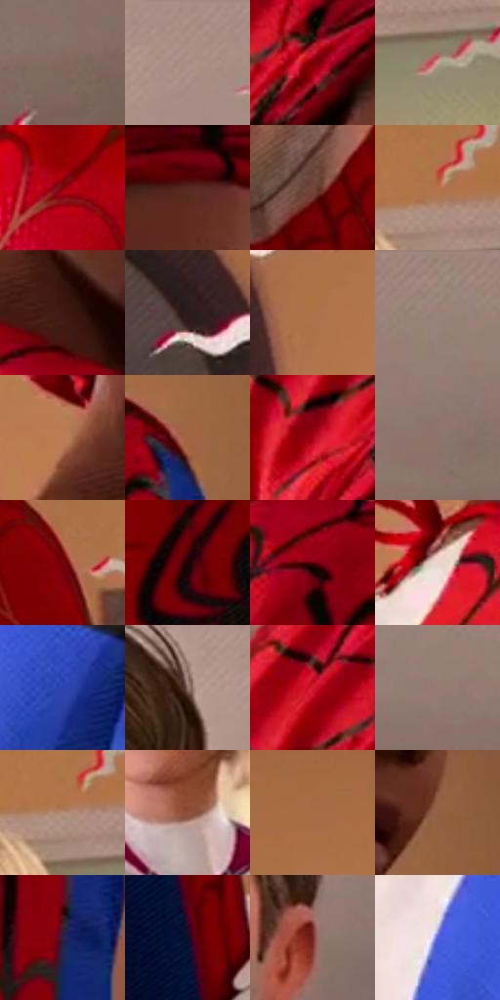

# 电影参考 481

- 状态：条件／活跃；来源世界：miles-home。
- 视角：near-level；景别：medium；场景：portrait。
- 时段：daylight-time-unspecified（外观依据，中置信度；具体时间／晨昏未知）；光照：warm-day。
- 材质候选：skin, hair, fabric, wood, paint（帧级，不是像素分割）。
- 明暗组：middle；L* P5/P50/P95：9.882 / 44.62988 / 69.09267。
- 资格门禁：sense。
- 原截图 SHA-256：`38e093af332d2e84a2eeeef1c0d7f34bce6053c0e47359dbfc00c4ec5a023c20`；尺寸：2878 × 1206。
- sRGB 像素 SHA-256：`a2fb495323ad8957f3b7a5e17320b64b4ccc652b905afbdc7fe0d04ac329212d`。

## 观察与迁移

头周感应及黄框属条件图形，日光肤色不自动带线。

多人头周波浪图形表现感应，人物和暖室仍稳定；只学线形，不改变当次口令触发条件。

40  /  481  /  暖家居与条件图形：多人头周波浪图形表现感应，人物和暖室仍稳定；只学线形，不改变当次口令触发条件。

本公开版保存32个128×128原像素色卡上下文；图集格子并非原场景相邻位置。原rect、图集tile和像素SHA见 `data/palette-crops.json`。上下文不足时不得批准替色，不能以小样推断完整构图。

## 实测色卡

颜色比例分母为保留采样像素，不是材料面积；全部 32 色参与全库匹配。表内四舍五入仅用于阅读，原精度在 JSON。

| ID | HEX | Lab | 原图 xy | 像素数 | 比例 | 明度角色 |
| --- | --- | --- | --- | ---: | ---: | --- |
| 481-S01 | #826860 | [46.300362, 9.071559, 8.438581] | [2588, 292] | 9768 | 5.052083% | midtone |
| 481-S02 | #A48B80 | [59.813858, 7.636656, 9.387986] | [1824, 28] | 9333 | 4.827098% | midtone |
| 481-S03 | #750102 | [23.030563, 44.870084, 33.911673] | [696, 204] | 8837 | 4.570563% | shadow |
| 481-S04 | #CAA497 | [70.415978, 12.003243, 12.024012] | [2720, 592] | 8674 | 4.486258% | light |
| 481-S05 | #85020A | [26.88673, 49.207072, 35.64123] | [1208, 788] | 8574 | 4.434537% | shadow |
| 481-S06 | #522920 | [21.888145, 18.020054, 14.376292] | [940, 164] | 8156 | 4.218344% | shadow |
| 481-S07 | #72483A | [35.04006, 16.207161, 15.81989] | [1616, 560] | 7927 | 4.099904% | shadow |
| 481-S08 | #B5744D | [54.920303, 21.535957, 31.959825] | [2628, 500] | 7549 | 3.904399% | midtone |
| 481-S09 | #3E1A13 | [14.458026, 16.890266, 12.983467] | [684, 656] | 7505 | 3.881642% | deep-shadow |
| 481-S10 | #563F39 | [28.97737, 9.057389, 7.587691] | [48, 364] | 7263 | 3.756478% | shadow |
| 481-S11 | #AD7349 | [53.630939, 18.371015, 32.347549] | [216, 460] | 6989 | 3.614763% | midtone |
| 481-S12 | #988077 | [55.529249, 7.703455, 8.308507] | [2748, 44] | 6667 | 3.448222% | midtone |
| 481-S13 | #B97C55 | [57.451356, 19.449842, 30.824428] | [580, 584] | 6528 | 3.376331% | midtone |
| 481-S14 | #A26542 | [48.740236, 20.988285, 29.905369] | [988, 808] | 6320 | 3.268751% | midtone |
| 481-S15 | #A60112 | [34.344839, 58.195933, 40.907358] | [560, 268] | 6310 | 3.263579% | shadow |
| 481-S16 | #8C736B | [50.569035, 8.462175, 8.10007] | [2428, 240] | 5821 | 3.010665% | midtone |
| 481-S17 | #700208 | [21.969047, 43.382542, 29.993062] | [2056, 732] | 5753 | 2.975495% | shadow |
| 481-S18 | #190504 | [2.927022, 6.928548, 2.868864] | [1512, 928] | 5705 | 2.950669% | deep-shadow |
| 481-S19 | #540308 | [15.318899, 34.963324, 20.50464] | [764, 796] | 5385 | 2.785162% | deep-shadow |
| 481-S20 | #EAD4CD | [86.498347, 6.46626, 6.230084] | [516, 720] | 5378 | 2.781542% | highlight |
| 481-S21 | #2C45AF | [33.743223, 28.521539, -59.236321] | [616, 940] | 5225 | 2.702409% | shadow |
| 481-S22 | #9F8478 | [57.299299, 8.377461, 10.335464] | [1680, 60] | 5178 | 2.678100% | midtone |
| 481-S23 | #CC192B | [43.81591, 65.446353, 39.065442] | [596, 156] | 5083 | 2.628966% | midtone |
| 481-S24 | #937B70 | [53.535056, 7.461493, 9.472608] | [2800, 124] | 5040 | 2.606726% | midtone |
| 481-S25 | #B8907C | [63.005704, 12.219851, 16.413264] | [2612, 520] | 4989 | 2.580348% | light |
| 481-S26 | #8E503B | [40.905045, 23.801649, 23.580557] | [2480, 908] | 4583 | 2.370362% | midtone |
| 481-S27 | #A76D46 | [51.37837, 18.933238, 31.06401] | [336, 272] | 4524 | 2.339847% | midtone |
| 481-S28 | #916043 | [45.348122, 16.583013, 24.616082] | [1044, 576] | 3769 | 1.949355% | midtone |
| 481-S29 | #2C2445 | [16.635207, 12.705657, -19.474006] | [980, 1092] | 3595 | 1.859361% | deep-shadow |
| 481-S30 | #0E0F2B | [5.504346, 8.545762, -18.694188] | [2036, 1120] | 3308 | 1.710922% | deep-shadow |
| 481-S31 | #742622 | [27.341038, 33.984627, 21.187138] | [1720, 332] | 2001 | 1.034932% | shadow |
| 481-S32 | #5065E0 | [47.485141, 30.587327, -65.217132] | [432, 908] | 1609 | 0.832187% | midtone |

## 色阶与空间分布

- 采样 ROI：`[0.01, 0.02, 0.98, 0.94]`；步长：4；样本数：193346。
- 排除区：`[]`。
- 深暗、暗、中、亮、高光五段计数：`[29138, 56076, 84038, 19695, 4399]`。
- RGB 各 256 箱、L* 100 箱、13×5 色相明度表和 3×3 空间统计全部保存在 [总数据](../film-library.json)。
- [可视化档案](../../references/library.html)按需绘制直方图，不存 2,094 张重复图表图片。

## 纹理特征占比

**这是分块图像特征的面积占比，不是波点／排线／丝网／错版的精确语义覆盖率。** 窗格、发丝、织物也会产生方向或周期特征。
原图 ROI 像素 3096328；已测块覆盖 3096328（100.0000%）；未测 0。

| 特征 | 块覆盖像素 | 占已测面积 | 阈值敏感范围 |
| --- | ---: | ---: | --- |
| low-contrast | 196608 | 6.3497% | 5.8206% ~ 7.4080% |
| directional-structure | 833160 | 26.9080% | 12.6294% ~ 44.8741% |
| periodic-structure | 1859072 | 60.0412% | 47.8957% ~ 65.7047% |
| mixed-detail | 207488 | 6.7011% | 1.4097% ~ 14.2579% |

阈值敏感范围不是统计置信区间。逐块坐标、尺度、对比、方向一致性、频谱集中度、频率与角度见 [全量特征记录](../texture-features.jsonl)，以帧号定位。
四种印刷层的真实像素覆盖仍标为 `null`，不能填 0，也不能拿上表代替。不得据这些代理测量删除唯一证据。

[测量方法与保留策略](../../references/library-retention.md) · [分类索引](../archive/README.md)
