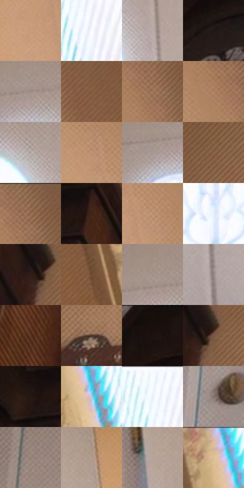

# 电影参考 482

- 状态：常规／活跃；来源世界：miles-home。
- 视角：low-angle；景别：detail；场景：interior。
- 时段：daylight-time-unspecified（外观依据，中置信度；具体时间／晨昏未知）；光照：warm-day。
- 材质候选：skin, hair, fabric, wood, paint, glass（帧级，不是像素分割）。
- 明暗组：middle；L* P5/P50/P95：7.83825 / 58.53341 / 98.69359。
- 资格门禁：无附加门禁。
- 原截图 SHA-256：`c54c97557f55b4d8d2babf39819e5c3978f64867e1ceb664c3c4fae2f8ab47c3`；尺寸：2880 × 1206。
- sRGB 像素 SHA-256：`77f08731bfd21e33cc475da26bac1624c2379843daed88c64139807f9589c860`。

## 观察与迁移

暖住宅、楼梯与陈设，镜中、相片中和现场人物需逐一分开。

门上椭圆透光玻璃、暖木钟和墙色形成材质差；玻璃亮形不是背景贴纸。

41  /  482  /  暖家居与条件图形：门上椭圆透光玻璃、暖木钟和墙色形成材质差；玻璃亮形不是背景贴纸。

本公开版保存32个128×128原像素色卡上下文；图集格子并非原场景相邻位置。原rect、图集tile和像素SHA见 `data/palette-crops.json`。上下文不足时不得批准替色，不能以小样推断完整构图。

## 实测色卡

颜色比例分母为保留采样像素，不是材料面积；全部 32 色参与全库匹配。表内四舍五入仅用于阅读，原精度在 JSON。

| ID | HEX | Lab | 原图 xy | 像素数 | 比例 | 明度角色 |
| --- | --- | --- | --- | ---: | ---: | --- |
| 482-S01 | #CB9F7D | [68.733638, 11.726709, 23.994057] | [2124, 304] | 11445 | 5.919440% | light |
| 482-S02 | #FBFBFF | [98.718985, 0.704605, -1.904009] | [2812, 136] | 11122 | 5.752382% | highlight |
| 482-S03 | #BBABA8 | [71.226908, 5.231719, 3.630306] | [1672, 356] | 10981 | 5.679455% | light |
| 482-S04 | #1D1615 | [8.032108, 3.315974, 1.948528] | [160, 208] | 7719 | 3.992325% | deep-shadow |
| 482-S05 | #9D8C85 | [59.542352, 5.150189, 6.061772] | [1440, 156] | 7688 | 3.976291% | midtone |
| 482-S06 | #825B3D | [42.10181, 12.292078, 23.594179] | [2452, 224] | 7601 | 3.931294% | midtone |
| 482-S07 | #9F775A | [53.280797, 11.779899, 22.028259] | [2308, 100] | 7406 | 3.830439% | midtone |
| 482-S08 | #AD8263 | [57.800936, 12.469248, 23.209052] | [2276, 144] | 7349 | 3.800958% | midtone |
| 482-S09 | #B0A29F | [67.705858, 4.550124, 3.397131] | [1556, 232] | 7328 | 3.790097% | light |
| 482-S10 | #BF9473 | [64.560498, 11.72189, 23.660542] | [2132, 148] | 6847 | 3.541320% | light |
| 482-S11 | #A89894 | [64.096103, 5.18718, 4.24492] | [1376, 188] | 6758 | 3.495288% | light |
| 482-S12 | #896349 | [45.254047, 11.94485, 20.802879] | [764, 92] | 6714 | 3.472531% | midtone |
| 482-S13 | #946D51 | [49.287427, 11.797389, 21.6899] | [2316, 44] | 6490 | 3.356677% | midtone |
| 482-S14 | #412417 | [17.680457, 12.235539, 14.487878] | [504, 96] | 6363 | 3.290991% | deep-shadow |
| 482-S15 | #B78C6C | [61.574765, 12.057692, 23.395423] | [2204, 228] | 6350 | 3.284268% | light |
| 482-S16 | #E4F0FC | [94.244513, -1.693391, -7.130699] | [1428, 844] | 6149 | 3.180309% | highlight |
| 482-S17 | #2F1E18 | [13.223795, 7.346862, 7.445137] | [608, 256] | 6032 | 3.119796% | deep-shadow |
| 482-S18 | #704B32 | [35.41582, 12.633921, 21.164474] | [2584, 376] | 5945 | 3.074799% | shadow |
| 482-S19 | #A29189 | [61.428351, 4.942395, 6.550417] | [1416, 132] | 5730 | 2.963599% | light |
| 482-S20 | #938785 | [57.293819, 4.136098, 2.704543] | [1724, 1072] | 5705 | 2.950669% | midtone |
| 482-S21 | #5D3924 | [27.794703, 13.538656, 19.621577] | [404, 808] | 5478 | 2.833263% | shadow |
| 482-S22 | #4A3024 | [22.644853, 10.191059, 12.478845] | [756, 560] | 5455 | 2.821367% | shadow |
| 482-S23 | #170F0D | [4.994245, 2.921361, 2.08922] | [180, 40] | 5255 | 2.717925% | deep-shadow |
| 482-S24 | #775743 | [39.822505, 10.423335, 16.79426] | [648, 248] | 4942 | 2.556039% | shadow |
| 482-S25 | #271915 | [10.415127, 6.317676, 5.546401] | [408, 104] | 4684 | 2.422600% | deep-shadow |
| 482-S26 | #B6CBE0 | [80.759577, -2.702445, -12.77713] | [2672, 152] | 4370 | 2.260197% | highlight |
| 482-S27 | #F6FBFF | [98.355414, -0.927349, -2.47966] | [2772, 40] | 3798 | 1.964354% | highlight |
| 482-S28 | #81726C | [49.23415, 4.7596, 5.459037] | [1008, 984] | 3540 | 1.830915% | midtone |
| 482-S29 | #948076 | [55.116526, 5.949054, 8.246888] | [1072, 188] | 3113 | 1.610067% | midtone |
| 482-S30 | #B19B8C | [65.502091, 5.661818, 10.848184] | [1908, 132] | 2420 | 1.251642% | light |
| 482-S31 | #B9A599 | [69.130163, 5.276739, 8.875369] | [1840, 188] | 1372 | 0.709609% | light |
| 482-S32 | #DDBE9E | [78.85063, 6.306968, 20.266014] | [2620, 32] | 1197 | 0.619097% | light |

## 色阶与空间分布

- 采样 ROI：`[0.01, 0.02, 0.98, 0.94]`；步长：4；样本数：193346。
- 排除区：`[]`。
- 深暗、暗、中、亮、高光五段计数：`[29271, 20285, 56084, 63980, 23726]`。
- RGB 各 256 箱、L* 100 箱、13×5 色相明度表和 3×3 空间统计全部保存在 [总数据](../film-library.json)。
- [可视化档案](../../references/library.html)按需绘制直方图，不存 2,094 张重复图表图片。

## 纹理特征占比

**这是分块图像特征的面积占比，不是波点／排线／丝网／错版的精确语义覆盖率。** 窗格、发丝、织物也会产生方向或周期特征。
原图 ROI 像素 3098546；已测块覆盖 3098546（100.0000%）；未测 0。

| 特征 | 块覆盖像素 | 占已测面积 | 阈值敏感范围 |
| --- | ---: | ---: | --- |
| low-contrast | 98304 | 3.1726% | 1.0575% ~ 6.3452% |
| directional-structure | 927872 | 29.9454% | 15.1524% ~ 49.9434% |
| periodic-structure | 2012338 | 64.9446% | 48.9990% ~ 72.0788% |
| mixed-detail | 60032 | 1.9374% | 0.0000% ~ 6.4237% |

阈值敏感范围不是统计置信区间。逐块坐标、尺度、对比、方向一致性、频谱集中度、频率与角度见 [全量特征记录](../texture-features.jsonl)，以帧号定位。
四种印刷层的真实像素覆盖仍标为 `null`，不能填 0，也不能拿上表代替。不得据这些代理测量删除唯一证据。

[测量方法与保留策略](../../references/library-retention.md) · [分类索引](../archive/README.md)
