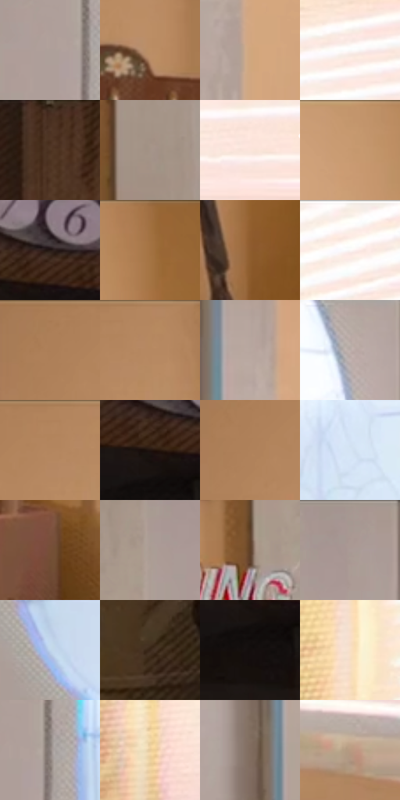

# 电影参考 483

- 状态：条件／活跃；来源世界：miles-home。
- 视角：near-level；景别：environment-wide；场景：interior。
- 时段：daylight-time-unspecified（外观依据，中置信度；具体时间／晨昏未知）；光照：warm-day。
- 材质候选：skin, fabric, wood, paint, glass（帧级，不是像素分割）。
- 明暗组：light；L* P5/P50/P95：7.3509 / 62.737 / 95.45175。
- 资格门禁：caption。
- 原截图 SHA-256：`72256b54d66c406d370d12d5645ccfd5e41dbb15e7ee19d77c8d466474e8d5a4`；尺寸：2880 × 1200。
- sRGB 像素 SHA-256：`ac20719e24c6dfb9a7a60405114928305478d9a52ea0c3972fdcb9547c09f92f`。

## 观察与迁移

拟声字与对白需确认，不当作原照默认内容。

窗帘侧金白漫亮和半调边，百叶实体线与排线分开；拟声字不自动复制。

42  /  483  /  暖家居与条件图形：窗帘侧金白漫亮和半调边，百叶实体线与排线分开；拟声字不自动复制。

本公开版保存32个128×128原像素色卡上下文；图集格子并非原场景相邻位置。原rect、图集tile和像素SHA见 `data/palette-crops.json`。上下文不足时不得批准替色，不能以小样推断完整构图。

## 实测色卡

颜色比例分母为保留采样像素，不是材料面积；全部 32 色参与全库匹配。表内四舍五入仅用于阅读，原精度在 JSON。

| ID | HEX | Lab | 原图 xy | 像素数 | 比例 | 明度角色 |
| --- | --- | --- | --- | ---: | ---: | --- |
| 483-S01 | #AD9F99 | [66.505413, 4.049734, 4.97398] | [1068, 404] | 9596 | 4.981105% | light |
| 483-S02 | #BC8F65 | [62.741565, 11.70419, 28.892252] | [760, 204] | 9168 | 4.758939% | light |
| 483-S03 | #D0A77F | [71.27028, 9.63409, 26.398587] | [1748, 484] | 7995 | 4.150056% | light |
| 483-S04 | #FAFAFA | [98.272024, -0.002418, 0.004584] | [2704, 312] | 7838 | 4.068560% | highlight |
| 483-S05 | #4E3422 | [24.29479, 9.300731, 16.038436] | [432, 64] | 7209 | 3.742058% | shadow |
| 483-S06 | #A49388 | [62.11587, 4.431929, 8.123034] | [916, 968] | 7124 | 3.697936% | light |
| 483-S07 | #FBE5DA | [92.403052, 5.726102, 8.081754] | [2772, 620] | 7021 | 3.644471% | highlight |
| 483-S08 | #C79A70 | [66.843711, 11.369062, 28.48088] | [1868, 64] | 6951 | 3.608135% | light |
| 483-S09 | #241915 | [9.98857, 4.747042, 4.884147] | [116, 152] | 6658 | 3.456044% | deep-shadow |
| 483-S10 | #A06F3F | [50.923923, 14.189549, 34.146033] | [2008, 28] | 6567 | 3.408808% | midtone |
| 483-S11 | #8F5D2F | [44.053133, 15.817771, 34.203271] | [2028, 728] | 6456 | 3.351190% | midtone |
| 483-S12 | #FBEEE7 | [94.919896, 3.20202, 4.952722] | [2664, 40] | 6446 | 3.345999% | highlight |
| 483-S13 | #AA7C54 | [55.688318, 13.000286, 28.778108] | [580, 28] | 6326 | 3.283709% | midtone |
| 483-S14 | #B68960 | [60.500738, 12.004662, 28.601871] | [736, 48] | 6227 | 3.232320% | light |
| 483-S15 | #B7A79F | [69.617889, 4.411903, 6.232077] | [1704, 168] | 6205 | 3.220900% | light |
| 483-S16 | #BBAEAA | [72.054214, 3.947251, 3.727285] | [1460, 68] | 6186 | 3.211038% | light |
| 483-S17 | #B3855D | [59.113834, 12.665527, 28.39679] | [688, 32] | 6079 | 3.155496% | midtone |
| 483-S18 | #1B130F | [6.623686, 3.036884, 3.514232] | [36, 192] | 6032 | 3.131099% | deep-shadow |
| 483-S19 | #B0825A | [57.975708, 12.773602, 28.521175] | [592, 96] | 5999 | 3.113970% | midtone |
| 483-S20 | #D5E4F5 | [89.963381, -1.663157, -9.944228] | [1364, 304] | 5975 | 3.101512% | highlight |
| 483-S21 | #765036 | [37.582856, 12.747674, 21.674693] | [2172, 996] | 5747 | 2.983161% | shadow |
| 483-S22 | #AA9B92 | [65.013904, 3.942224, 6.710718] | [980, 120] | 5489 | 2.849238% | light |
| 483-S23 | #5E3F29 | [29.651686, 10.733964, 18.873119] | [864, 380] | 5432 | 2.819650% | shadow |
| 483-S24 | #A59891 | [63.754548, 3.540804, 5.406545] | [1048, 28] | 5246 | 2.723101% | light |
| 483-S25 | #C1D6EC | [84.733149, -2.496605, -13.146922] | [1236, 776] | 5173 | 2.685208% | highlight |
| 483-S26 | #3A271A | [17.577572, 7.016394, 12.120133] | [188, 920] | 5116 | 2.655621% | deep-shadow |
| 483-S27 | #150F0E | [4.812775, 2.168293, 1.30747] | [32, 260] | 5004 | 2.597483% | deep-shadow |
| 483-S28 | #F8DFC5 | [90.213347, 4.58356, 15.884942] | [2412, 152] | 4712 | 2.445912% | highlight |
| 483-S29 | #8D827F | [55.237409, 3.601662, 3.123709] | [1116, 392] | 4392 | 2.279806% | midtone |
| 483-S30 | #E9CB9B | [83.128037, 3.722154, 27.86197] | [2428, 752] | 3887 | 2.017670% | highlight |
| 483-S31 | #816C5F | [47.260611, 6.143448, 10.371616] | [1628, 780] | 3467 | 1.799655% | midtone |
| 483-S32 | #B89A81 | [65.661341, 7.365296, 17.293636] | [2708, 900] | 925 | 0.480150% | light |

## 色阶与空间分布

- 采样 ROI：`[0.01, 0.02, 0.98, 0.94]`；步长：4；样本数：192648。
- 排除区：`[]`。
- 深暗、暗、中、亮、高光五段计数：`[21957, 19586, 39508, 72235, 39362]`。
- RGB 各 256 箱、L* 100 箱、13×5 色相明度表和 3×3 空间统计全部保存在 [总数据](../film-library.json)。
- [可视化档案](../../references/library.html)按需绘制直方图，不存 2,094 张重复图表图片。

## 纹理特征占比

**这是分块图像特征的面积占比，不是波点／排线／丝网／错版的精确语义覆盖率。** 窗格、发丝、织物也会产生方向或周期特征。
原图 ROI 像素 3084576；已测块覆盖 3084576（100.0000%）；未测 0。

| 特征 | 块覆盖像素 | 占已测面积 | 阈值敏感范围 |
| --- | ---: | ---: | --- |
| low-contrast | 190752 | 6.1841% | 4.4578% ~ 12.9978% |
| directional-structure | 1386496 | 44.9493% | 29.2386% ~ 56.6348% |
| periodic-structure | 1392640 | 45.1485% | 37.8451% ~ 51.5888% |
| mixed-detail | 114688 | 3.7181% | 1.0623% ~ 6.1747% |

阈值敏感范围不是统计置信区间。逐块坐标、尺度、对比、方向一致性、频谱集中度、频率与角度见 [全量特征记录](../texture-features.jsonl)，以帧号定位。
四种印刷层的真实像素覆盖仍标为 `null`，不能填 0，也不能拿上表代替。不得据这些代理测量删除唯一证据。

[测量方法与保留策略](../../references/library-retention.md) · [分类索引](../archive/README.md)
