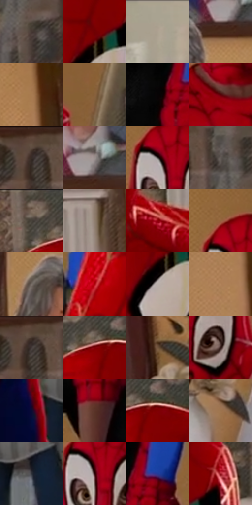

# 电影参考 484

- 状态：常规／活跃；来源世界：miles-home。
- 视角：near-level；景别：medium；场景：interior。
- 时段：daylight-time-unspecified（外观依据，中置信度；具体时间／晨昏未知）；光照：warm-day。
- 材质候选：skin, hair, fabric, wood, paint, glass（帧级，不是像素分割）。
- 明暗组：dark；L* P5/P50/P95：3.55397 / 32.50734 / 66.83253。
- 资格门禁：无附加门禁。
- 原截图 SHA-256：`7f515759510f80e550246e5f2902ebc3528dfb72716618746d3ddba03a50c691`；尺寸：2880 × 1208。
- sRGB 像素 SHA-256：`57f9a4ded08e70150d66c4f9cf72de0ec59db121738d8dc5f99427a922d53d16`。

## 观察与迁移

暖住宅、楼梯与陈设，镜中、相片中和现场人物需逐一分开。

暖家居群像及左侧镜面局部人像、墙上照片共存；实人、镜像和照片分层计数。

43  /  484  /  暖家居与条件图形：暖家居群像及左侧镜面局部人像、墙上照片共存；实人、镜像和照片分层计数。

本公开版保存32个128×128原像素色卡上下文；图集格子并非原场景相邻位置。原rect、图集tile和像素SHA见 `data/palette-crops.json`。上下文不足时不得批准替色，不能以小样推断完整构图。

## 实测色卡

颜色比例分母为保留采样像素，不是材料面积；全部 32 色参与全库匹配。表内四舍五入仅用于阅读，原精度在 JSON。

| ID | HEX | Lab | 原图 xy | 像素数 | 比例 | 明度角色 |
| --- | --- | --- | --- | ---: | ---: | --- |
| 484-S01 | #453933 | [25.046868, 4.154868, 5.708528] | [876, 192] | 11615 | 6.007365% | shadow |
| 484-S02 | #710103 | [22.088951, 43.779427, 32.228429] | [1744, 268] | 10485 | 5.422921% | shadow |
| 484-S03 | #ADA190 | [66.81553, 1.459231, 10.429562] | [2740, 64] | 9097 | 4.705037% | light |
| 484-S04 | #45291B | [19.763449, 11.320755, 14.575419] | [2304, 136] | 7940 | 4.106627% | deep-shadow |
| 484-S05 | #A87B51 | [55.161389, 12.418491, 29.723099] | [548, 232] | 7790 | 4.029046% | midtone |
| 484-S06 | #87603B | [43.993231, 11.397631, 27.251222] | [1336, 160] | 7641 | 3.951982% | midtone |
| 484-S07 | #080405 | [1.349716, 1.184971, -0.009737] | [888, 872] | 7333 | 3.792683% | deep-shadow |
| 484-S08 | #5D0107 | [17.296616, 38.214899, 23.855153] | [1160, 504] | 7173 | 3.709929% | deep-shadow |
| 484-S09 | #5F4A3C | [33.258296, 6.654607, 11.760692] | [728, 32] | 7170 | 3.708378% | shadow |
| 484-S10 | #9C918E | [61.021024, 3.522512, 3.057507] | [2332, 80] | 6794 | 3.513908% | light |
| 484-S11 | #4E4846 | [31.106267, 2.099699, 2.10396] | [1124, 220] | 6512 | 3.368055% | shadow |
| 484-S12 | #615956 | [38.477765, 2.644809, 2.90303] | [828, 88] | 6309 | 3.263062% | shadow |
| 484-S13 | #766556 | [43.989982, 4.246509, 11.010822] | [1604, 48] | 6273 | 3.244443% | midtone |
| 484-S14 | #907F70 | [54.321277, 3.957787, 10.539842] | [1964, 344] | 6242 | 3.228409% | midtone |
| 484-S15 | #90020C | [29.41554, 52.194228, 37.903418] | [1880, 516] | 5902 | 3.052559% | shadow |
| 484-S16 | #986440 | [47.185622, 17.061535, 28.828822] | [1112, 152] | 5836 | 3.018423% | midtone |
| 484-S17 | #786E68 | [47.163744, 2.780286, 4.753794] | [2072, 76] | 5732 | 2.964633% | midtone |
| 484-S18 | #B1020F | [36.795842, 60.842964, 45.185167] | [1132, 1080] | 5672 | 2.933601% | shadow |
| 484-S19 | #BAB0AB | [72.515331, 2.674818, 3.834942] | [1728, 348] | 5645 | 2.919636% | light |
| 484-S20 | #B3845C | [58.845341, 13.123231, 28.602211] | [516, 376] | 5464 | 2.826022% | midtone |
| 484-S21 | #352A27 | [18.185112, 4.499629, 3.873124] | [736, 56] | 5463 | 2.825505% | deep-shadow |
| 484-S22 | #7B0006 | [24.403358, 46.80175, 34.122066] | [1660, 108] | 5415 | 2.800679% | shadow |
| 484-S23 | #71543D | [38.17944, 8.816247, 18.116429] | [276, 568] | 5051 | 2.612415% | shadow |
| 484-S24 | #341D19 | [13.7044, 10.713963, 7.504963] | [1232, 300] | 4841 | 2.503801% | deep-shadow |
| 484-S25 | #090C33 | [5.057885, 12.666743, -25.379999] | [2088, 876] | 4839 | 2.502767% | deep-shadow |
| 484-S26 | #5B3429 | [26.276194, 16.227892, 14.434572] | [940, 996] | 4616 | 2.387430% | shadow |
| 484-S27 | #7E0101 | [25.140417, 47.327723, 37.111565] | [1708, 108] | 4513 | 2.334157% | shadow |
| 484-S28 | #9D744E | [52.074263, 11.350807, 27.215707] | [528, 864] | 4170 | 2.156755% | midtone |
| 484-S29 | #303239 | [20.846668, 0.892066, -4.71224] | [2216, 884] | 3755 | 1.942114% | shadow |
| 484-S30 | #2B0608 | [5.97554, 18.557853, 6.0238] | [1140, 248] | 3463 | 1.791090% | deep-shadow |
| 484-S31 | #213C9A | [29.125745, 25.282246, -54.155521] | [964, 840] | 2744 | 1.419217% | shadow |
| 484-S32 | #A5212B | [36.487695, 52.676326, 28.748525] | [1832, 212] | 1851 | 0.957351% | shadow |

## 色阶与空间分布

- 采样 ROI：`[0.01, 0.02, 0.98, 0.94]`；步长：4；样本数：193346。
- 排除区：`[]`。
- 深暗、暗、中、亮、高光五段计数：`[38395, 80458, 53351, 20515, 627]`。
- RGB 各 256 箱、L* 100 箱、13×5 色相明度表和 3×3 空间统计全部保存在 [总数据](../film-library.json)。
- [可视化档案](../../references/library.html)按需绘制直方图，不存 2,094 张重复图表图片。

## 纹理特征占比

**这是分块图像特征的面积占比，不是波点／排线／丝网／错版的精确语义覆盖率。** 窗格、发丝、织物也会产生方向或周期特征。
原图 ROI 像素 3104134；已测块覆盖 3104134（100.0000%）；未测 0。

| 特征 | 块覆盖像素 | 占已测面积 | 阈值敏感范围 |
| --- | ---: | ---: | --- |
| low-contrast | 191360 | 6.1647% | 2.6391% ~ 7.7481% |
| directional-structure | 617344 | 19.8878% | 9.3316% ~ 34.7861% |
| periodic-structure | 2254342 | 72.6239% | 62.5748% ~ 79.6545% |
| mixed-detail | 41088 | 1.3237% | 0.0000% ~ 3.2658% |

阈值敏感范围不是统计置信区间。逐块坐标、尺度、对比、方向一致性、频谱集中度、频率与角度见 [全量特征记录](../texture-features.jsonl)，以帧号定位。
四种印刷层的真实像素覆盖仍标为 `null`，不能填 0，也不能拿上表代替。不得据这些代理测量删除唯一证据。

[测量方法与保留策略](../../references/library-retention.md) · [分类索引](../archive/README.md)
