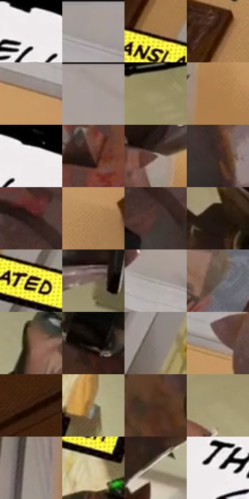

# 电影参考 485

- 状态：条件／活跃；来源世界：miles-home。
- 视角：low-angle；景别：medium；场景：interior。
- 时段：daylight-time-unspecified（外观依据，中置信度；具体时间／晨昏未知）；光照：warm-day。
- 材质候选：skin, fabric, wood, paint, glass（帧级，不是像素分割）。
- 明暗组：middle；L* P5/P50/P95：2.84163 / 54.44886 / 93.09965。
- 资格门禁：caption。
- 原截图 SHA-256：`e89a1559c00f09f762a614b5e491506a0dcbea1b305e27fe772c3a448855668a`；尺寸：2880 × 1212。
- sRGB 像素 SHA-256：`86568323caa04d0cf67bcf1ceacd8134d63fd5c4cb96b131a6c815df28129d48`。

## 观察与迁移

拟声字与对白需确认，不当作原照默认内容。

大近手、黑白粗边气泡与黄色文字条；只作条件版式，不能添武器、气泡或未确认对白。

44  /  485  /  暖家居与条件图形：大近手、黑白粗边气泡与黄色文字条；只作条件版式，不能添武器、气泡或未确认对白。

本公开版保存32个128×128原像素色卡上下文；图集格子并非原场景相邻位置。原rect、图集tile和像素SHA见 `data/palette-crops.json`。上下文不足时不得批准替色，不能以小样推断完整构图。

## 实测色卡

颜色比例分母为保留采样像素，不是材料面积；全部 32 色参与全库匹配。表内四舍五入仅用于阅读，原精度在 JSON。

| ID | HEX | Lab | 原图 xy | 像素数 | 比例 | 明度角色 |
| --- | --- | --- | --- | ---: | ---: | --- |
| 485-S01 | #EFEBEC | [93.373883, 1.513468, -0.004264] | [572, 28] | 16331 | 8.416132% | highlight |
| 485-S02 | #A99E99 | [65.895631, 3.109219, 4.050035] | [1336, 28] | 12283 | 6.330008% | light |
| 485-S03 | #9F7649 | [52.741323, 10.603546, 30.882962] | [296, 828] | 9599 | 4.946816% | midtone |
| 485-S04 | #41220E | [16.988265, 12.808021, 19.132504] | [408, 500] | 9358 | 4.822618% | deep-shadow |
| 485-S05 | #C39860 | [65.674915, 9.201834, 35.471678] | [2432, 524] | 8984 | 4.629878% | light |
| 485-S06 | #A29791 | [63.226495, 2.964428, 4.612399] | [2448, 32] | 8787 | 4.528354% | light |
| 485-S07 | #9D916B | [60.32104, -1.573567, 21.826698] | [1056, 572] | 8154 | 4.202140% | light |
| 485-S08 | #AB7D4A | [55.90856, 11.961985, 34.537734] | [2108, 664] | 7392 | 3.809445% | midtone |
| 485-S09 | #020101 | [0.332482, 0.261482, 0.092172] | [660, 28] | 6896 | 3.553833% | deep-shadow |
| 485-S10 | #5D3B2F | [28.540132, 13.441343, 13.603787] | [1788, 88] | 6857 | 3.533735% | shadow |
| 485-S11 | #5A473D | [31.846458, 6.417635, 9.090387] | [2032, 552] | 6523 | 3.361609% | shadow |
| 485-S12 | #3B2923 | [18.528082, 7.411245, 7.241067] | [2036, 384] | 6384 | 3.289975% | deep-shadow |
| 485-S13 | #291D17 | [12.037898, 4.79976, 6.40909] | [1932, 220] | 6297 | 3.245140% | deep-shadow |
| 485-S14 | #AE8355 | [57.931504, 10.874248, 31.165963] | [2460, 736] | 6090 | 3.138463% | midtone |
| 485-S15 | #483730 | [24.713976, 6.352914, 7.283037] | [1952, 296] | 5955 | 3.068892% | shadow |
| 485-S16 | #1F140D | [7.413618, 4.383457, 5.740359] | [1480, 764] | 5733 | 2.954485% | deep-shadow |
| 485-S17 | #E1CE80 | [82.759432, -3.991038, 41.117872] | [400, 900] | 5618 | 2.895220% | highlight |
| 485-S18 | #7A6757 | [44.97905, 4.916513, 11.849197] | [1800, 792] | 5540 | 2.855023% | midtone |
| 485-S19 | #AFAAA2 | [69.804653, 0.340774, 4.756148] | [2288, 372] | 5435 | 2.800911% | light |
| 485-S20 | #62564F | [37.511991, 3.611235, 5.873202] | [136, 664] | 5240 | 2.700418% | shadow |
| 485-S21 | #75523F | [38.156732, 12.067409, 16.959306] | [1028, 944] | 4906 | 2.528293% | shadow |
| 485-S22 | #0F0806 | [2.605016, 1.745294, 1.470093] | [1672, 556] | 4708 | 2.426254% | deep-shadow |
| 485-S23 | #847C76 | [52.541169, 1.923427, 4.365332] | [556, 788] | 4629 | 2.385541% | midtone |
| 485-S24 | #938780 | [57.162944, 3.250555, 5.391139] | [1424, 204] | 4143 | 2.135083% | midtone |
| 485-S25 | #361F12 | [14.446153, 9.52601, 13.329713] | [2712, 920] | 4117 | 2.121684% | deep-shadow |
| 485-S26 | #89775C | [51.019487, 2.680609, 17.443555] | [892, 964] | 3936 | 2.028406% | midtone |
| 485-S27 | #4B2D1E | [21.823719, 11.959005, 15.398193] | [1528, 492] | 3712 | 1.912968% | shadow |
| 485-S28 | #A99D78 | [64.887819, -1.511251, 20.987359] | [1256, 764] | 3469 | 1.787739% | light |
| 485-S29 | #9B9086 | [60.459725, 2.303979, 6.782663] | [1984, 980] | 3304 | 1.702707% | light |
| 485-S30 | #D7CBA5 | [81.771193, -1.834093, 20.500065] | [760, 1076] | 1864 | 0.960607% | highlight |
| 485-S31 | #AEA38E | [67.386985, 0.433119, 12.358252] | [1564, 1104] | 1515 | 0.780751% | light |
| 485-S32 | #DDD9DA | [87.026284, 1.536636, -0.004335] | [416, 196] | 285 | 0.146874% | highlight |

## 色阶与空间分布

- 采样 ROI：`[0.01, 0.02, 0.98, 0.94]`；步长：4；样本数：194044。
- 排除区：`[]`。
- 深暗、暗、中、亮、高光五段计数：`[43014, 31016, 47986, 52160, 19868]`。
- RGB 各 256 箱、L* 100 箱、13×5 色相明度表和 3×3 空间统计全部保存在 [总数据](../film-library.json)。
- [可视化档案](../../references/library.html)按需绘制直方图，不存 2,094 张重复图表图片。

## 纹理特征占比

**这是分块图像特征的面积占比，不是波点／排线／丝网／错版的精确语义覆盖率。** 窗格、发丝、织物也会产生方向或周期特征。
原图 ROI 像素 3115310；已测块覆盖 3115310（100.0000%）；未测 0。

| 特征 | 块覆盖像素 | 占已测面积 | 阈值敏感范围 |
| --- | ---: | ---: | --- |
| low-contrast | 335790 | 10.7787% | 8.3915% ~ 11.7401% |
| directional-structure | 940160 | 30.1787% | 15.9994% ~ 47.8874% |
| periodic-structure | 1687808 | 54.1779% | 41.0217% ~ 63.7142% |
| mixed-detail | 151552 | 4.8647% | 2.6994% ~ 8.5462% |

阈值敏感范围不是统计置信区间。逐块坐标、尺度、对比、方向一致性、频谱集中度、频率与角度见 [全量特征记录](../texture-features.jsonl)，以帧号定位。
四种印刷层的真实像素覆盖仍标为 `null`，不能填 0，也不能拿上表代替。不得据这些代理测量删除唯一证据。

[测量方法与保留策略](../../references/library-retention.md) · [分类索引](../archive/README.md)
