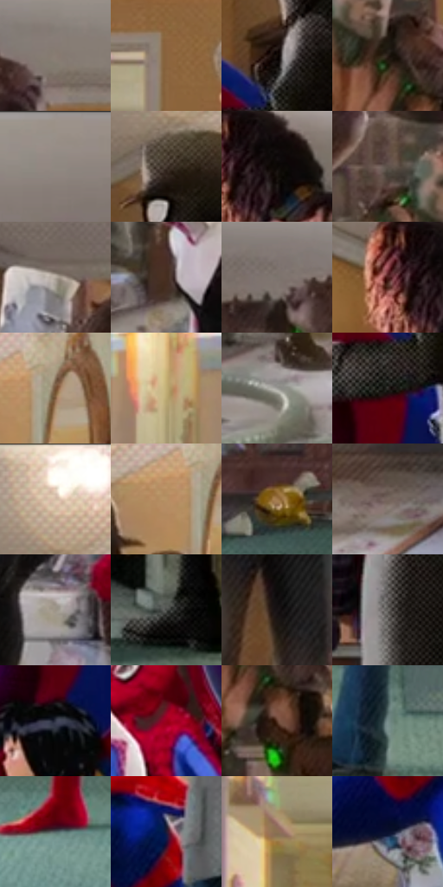

# 电影参考 486

- 状态：常规／活跃；来源世界：miles-home。
- 视角：near-level；景别：environment-wide；场景：interior。
- 时段：daylight-time-unspecified（外观依据，中置信度；具体时间／晨昏未知）；光照：warm-day。
- 材质候选：skin, hair, fabric, wood, paint, glass（帧级，不是像素分割）。
- 明暗组：middle；L* P5/P50/P95：3.19825 / 40.74253 / 76.31477。
- 资格门禁：无附加门禁。
- 原截图 SHA-256：`30bdb026d130aca58dfe531568bd8692b2b130c8c76ee25fde00eaa2ad0d7f16`；尺寸：2880 × 1210。
- sRGB 像素 SHA-256：`e1dfa160bd739eb5bdc2c9d784cf50d46a55cb7ce67218ea0f063f2281bfb8da`。

## 观察与迁移

暖住宅、楼梯与陈设，镜中、相片中和现场人物需逐一分开。

群像含各自图形语言的客串角色，暖家居材料统一空间；不平均混合为普通肖像画风。

45  /  486  /  暖家居与条件图形：群像含各自图形语言的客串角色，暖家居材料统一空间；不平均混合为普通肖像画风。

本公开版保存32个128×128原像素色卡上下文；图集格子并非原场景相邻位置。原rect、图集tile和像素SHA见 `data/palette-crops.json`。上下文不足时不得批准替色，不能以小样推断完整构图。

## 实测色卡

颜色比例分母为保留采样像素，不是材料面积；全部 32 色参与全库匹配。表内四舍五入仅用于阅读，原精度在 JSON。

| ID | HEX | Lab | 原图 xy | 像素数 | 比例 | 明度角色 |
| --- | --- | --- | --- | ---: | ---: | --- |
| 486-S01 | #897D73 | [53.193592, 2.791004, 7.109745] | [1108, 160] | 9793 | 5.046794% | midtone |
| 486-S02 | #89633E | [45.068804, 10.813345, 26.932671] | [1572, 284] | 8664 | 4.464967% | midtone |
| 486-S03 | #130B08 | [3.57115, 2.30637, 2.106218] | [2424, 328] | 8191 | 4.221208% | deep-shadow |
| 486-S04 | #281D16 | [11.876537, 4.113638, 6.890583] | [1020, 428] | 7540 | 3.885717% | deep-shadow |
| 486-S05 | #8F8780 | [56.807873, 1.70681, 4.834483] | [2056, 64] | 7375 | 3.800684% | midtone |
| 486-S06 | #473A32 | [25.551828, 4.254769, 7.112615] | [2444, 180] | 7297 | 3.760487% | shadow |
| 486-S07 | #0A0704 | [2.03478, 0.367245, 1.411917] | [516, 100] | 7245 | 3.733689% | deep-shadow |
| 486-S08 | #5E524A | [35.808354, 3.476382, 6.514096] | [920, 336] | 7084 | 3.650718% | shadow |
| 486-S09 | #B5ABA1 | [70.54103, 1.831514, 6.431848] | [752, 216] | 7076 | 3.646596% | light |
| 486-S10 | #452E21 | [21.317083, 8.696786, 12.59345] | [1848, 596] | 6892 | 3.551772% | shadow |
| 486-S11 | #7B746D | [49.260074, 1.375283, 4.831296] | [968, 156] | 6790 | 3.499206% | midtone |
| 486-S12 | #4A1B19 | [17.038081, 22.207163, 12.618503] | [440, 100] | 6622 | 3.412628% | deep-shadow |
| 486-S13 | #724F34 | [36.777092, 11.321477, 21.742809] | [2640, 132] | 6478 | 3.338418% | shadow |
| 486-S14 | #D8BB91 | [77.391878, 4.281023, 25.126506] | [52, 752] | 6352 | 3.273484% | light |
| 486-S15 | #9D9C98 | [64.332299, -0.394713, 2.220901] | [576, 1092] | 6270 | 3.231226% | light |
| 486-S16 | #2F2D29 | [18.545667, 0.008481, 2.908757] | [2384, 444] | 6261 | 3.226588% | deep-shadow |
| 486-S17 | #F7EEE1 | [94.466197, 0.844342, 7.367748] | [2448, 48] | 6190 | 3.189998% | highlight |
| 486-S18 | #B69265 | [62.880841, 7.542293, 28.951991] | [2584, 148] | 6099 | 3.143102% | light |
| 486-S19 | #A3794E | [54.040723, 11.10638, 29.848503] | [1200, 940] | 5892 | 3.036425% | midtone |
| 486-S20 | #77665E | [44.565619, 5.363423, 7.022566] | [940, 1000] | 5799 | 2.988497% | midtone |
| 486-S21 | #9C9387 | [61.381535, 1.184793, 7.544915] | [1884, 888] | 5621 | 2.896766% | light |
| 486-S22 | #484A47 | [31.184638, -1.478919, 1.504757] | [2616, 1080] | 5503 | 2.835955% | shadow |
| 486-S23 | #191315 | [6.563144, 3.216515, -0.255604] | [712, 716] | 5438 | 2.802457% | deep-shadow |
| 486-S24 | #686661 | [43.225111, -0.21711, 3.102087] | [2452, 852] | 5379 | 2.772052% | midtone |
| 486-S25 | #333748 | [23.351312, 2.849174, -11.022055] | [2364, 584] | 5214 | 2.687019% | shadow |
| 486-S26 | #9B001C | [31.931099, 55.742691, 32.291001] | [2060, 592] | 4847 | 2.497887% | shadow |
| 486-S27 | #5C3829 | [27.474823, 14.189006, 16.026897] | [1056, 512] | 4768 | 2.457175% | shadow |
| 486-S28 | #768B8A | [56.238895, -7.71928, -1.990829] | [1644, 1112] | 4548 | 2.343798% | midtone |
| 486-S29 | #526162 | [39.956559, -5.478403, -2.492604] | [1340, 1088] | 4474 | 2.305663% | shadow |
| 486-S30 | #201B38 | [11.799677, 10.963034, -18.088768] | [1604, 692] | 4155 | 2.141267% | deep-shadow |
| 486-S31 | #8C7153 | [49.509653, 6.254734, 20.669098] | [1360, 368] | 2582 | 1.330626% | midtone |
| 486-S32 | #0A102E | [5.711379, 8.292544, -20.626123] | [1532, 832] | 1605 | 0.827132% | deep-shadow |

## 色阶与空间分布

- 采样 ROI：`[0.01, 0.02, 0.98, 0.94]`；步长：4；样本数：194044。
- 排除区：`[]`。
- 深暗、暗、中、亮、高光五段计数：`[48128, 47065, 63808, 27162, 7881]`。
- RGB 各 256 箱、L* 100 箱、13×5 色相明度表和 3×3 空间统计全部保存在 [总数据](../film-library.json)。
- [可视化档案](../../references/library.html)按需绘制直方图，不存 2,094 张重复图表图片。

## 纹理特征占比

**这是分块图像特征的面积占比，不是波点／排线／丝网／错版的精确语义覆盖率。** 窗格、发丝、织物也会产生方向或周期特征。
原图 ROI 像素 3109722；已测块覆盖 3109722（100.0000%）；未测 0。

| 特征 | 块覆盖像素 | 占已测面积 | 阈值敏感范围 |
| --- | ---: | ---: | --- |
| low-contrast | 16384 | 0.5269% | 0.0000% ~ 0.5269% |
| directional-structure | 491648 | 15.8100% | 7.1950% ~ 34.3478% |
| periodic-structure | 2568922 | 82.6094% | 65.6522% ~ 86.4827% |
| mixed-detail | 32768 | 1.0537% | 0.0000% ~ 5.7955% |

阈值敏感范围不是统计置信区间。逐块坐标、尺度、对比、方向一致性、频谱集中度、频率与角度见 [全量特征记录](../texture-features.jsonl)，以帧号定位。
四种印刷层的真实像素覆盖仍标为 `null`，不能填 0，也不能拿上表代替。不得据这些代理测量删除唯一证据。

[测量方法与保留策略](../../references/library-retention.md) · [分类索引](../archive/README.md)
