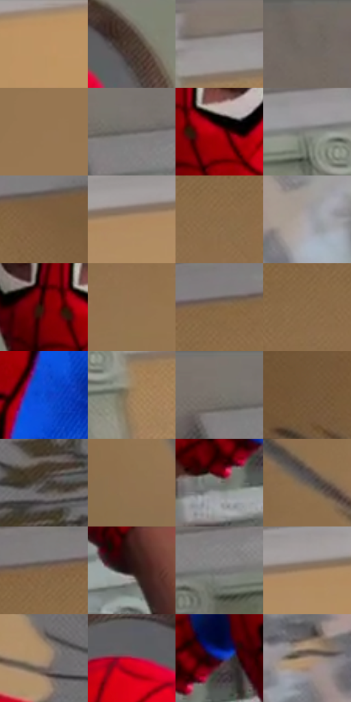

# 电影参考 487

- 状态：常规／活跃；来源世界：miles-home。
- 视角：low-angle；景别：medium；场景：interior。
- 时段：daylight-time-unspecified（外观依据，中置信度；具体时间／晨昏未知）；光照：warm-day。
- 材质候选：skin, hair, fabric, wood, paint, glass（帧级，不是像素分割）。
- 明暗组：middle；L* P5/P50/P95：19.15332 / 48.14429 / 63.1833。
- 资格门禁：无附加门禁。
- 原截图 SHA-256：`c0f9979df6a71e29c8a866d3ceed15d2d79f4bf34e8ce894f5d7f8e4d64ecc29`；尺寸：2880 × 1204。
- sRGB 像素 SHA-256：`b17b12e94ea611c12e93a8d467950ec0cc6c3a9771e65f6529c333c2e884eec8`。

## 观察与迁移

暖住宅、楼梯与陈设，镜中、相片中和现场人物需逐一分开。

面罩眼洞中真实眉眼可见，后墙裂缝属物理损坏；不把裂缝当排线添加到完好墙。

46  /  487  /  暖家居与条件图形：面罩眼洞中真实眉眼可见，后墙裂缝属物理损坏；不把裂缝当排线添加到完好墙。

本公开版保存32个128×128原像素色卡上下文；图集格子并非原场景相邻位置。原rect、图集tile和像素SHA见 `data/palette-crops.json`。上下文不足时不得批准替色，不能以小样推断完整构图。

## 实测色卡

颜色比例分母为保留采样像素，不是材料面积；全部 32 色参与全库匹配。表内四舍五入仅用于阅读，原精度在 JSON。

| ID | HEX | Lab | 原图 xy | 像素数 | 比例 | 明度角色 |
| --- | --- | --- | --- | ---: | ---: | --- |
| 487-S01 | #B79065 | [62.469818, 9.064999, 28.437647] | [2752, 28] | 13640 | 7.080271% | light |
| 487-S02 | #493A30 | [25.731912, 4.862429, 8.715055] | [1660, 292] | 12088 | 6.274656% | shadow |
| 487-S03 | #948F8B | [59.712253, 1.093367, 2.782905] | [1864, 56] | 9266 | 4.809809% | midtone |
| 487-S04 | #746B63 | [45.811074, 2.033628, 5.754824] | [388, 36] | 8228 | 4.271002% | midtone |
| 487-S05 | #987753 | [52.392101, 7.993576, 24.697671] | [828, 568] | 8219 | 4.266330% | midtone |
| 487-S06 | #66625F | [41.823871, 0.979465, 2.269163] | [1168, 80] | 8078 | 4.193140% | midtone |
| 487-S07 | #A8000F | [34.725873, 58.785999, 42.815105] | [1496, 620] | 7948 | 4.125659% | shadow |
| 487-S08 | #81827B | [54.093258, -1.736542, 3.658108] | [1716, 88] | 7925 | 4.113720% | midtone |
| 487-S09 | #7E5F3E | [42.716065, 8.217125, 23.696415] | [988, 248] | 7638 | 3.964744% | midtone |
| 487-S10 | #AE8962 | [59.683518, 8.856066, 26.271467] | [2264, 84] | 7574 | 3.931523% | midtone |
| 487-S11 | #8A6B49 | [47.495882, 7.703439, 23.748537] | [708, 336] | 7280 | 3.778913% | midtone |
| 487-S12 | #A6A4A7 | [67.611759, 1.283179, -1.29327] | [2796, 512] | 6944 | 3.604501% | light |
| 487-S13 | #520706 | [15.273413, 32.944627, 21.162645] | [1420, 612] | 6792 | 3.525601% | deep-shadow |
| 487-S14 | #937451 | [51.023651, 7.3246, 23.946605] | [660, 512] | 6050 | 3.140443% | midtone |
| 487-S15 | #866745 | [45.906192, 7.832334, 23.912039] | [784, 244] | 6044 | 3.137328% | midtone |
| 487-S16 | #8E6F4B | [49.042664, 7.361063, 24.688609] | [616, 336] | 5990 | 3.109298% | midtone |
| 487-S17 | #0B4DD3 | [37.985197, 34.744096, -73.393105] | [1716, 936] | 5906 | 3.065695% | shadow |
| 487-S18 | #987A59 | [53.294567, 6.966604, 22.479641] | [1816, 172] | 5867 | 3.045451% | midtone |
| 487-S19 | #7A756E | [49.479281, 0.582138, 4.543746] | [1120, 28] | 5804 | 3.012749% | midtone |
| 487-S20 | #75573B | [39.436618, 8.593028, 21.045334] | [60, 476] | 5728 | 2.973298% | shadow |
| 487-S21 | #58524F | [35.34874, 1.850535, 2.641726] | [2276, 800] | 5574 | 2.893360% | shadow |
| 487-S22 | #8F7151 | [49.79194, 7.316691, 22.252376] | [544, 1000] | 5129 | 2.662369% | midtone |
| 487-S23 | #7E7B75 | [51.708109, -0.019072, 3.681959] | [1296, 1108] | 4677 | 2.427744% | midtone |
| 487-S24 | #665A51 | [39.124465, 3.223422, 6.981587] | [436, 784] | 4552 | 2.362859% | shadow |
| 487-S25 | #806447 | [44.460521, 7.153876, 20.742392] | [648, 256] | 3985 | 2.068540% | midtone |
| 487-S26 | #241313 | [8.020432, 8.802549, 3.37932] | [2212, 1092] | 3901 | 2.024937% | deep-shadow |
| 487-S27 | #717070 | [47.325352, 0.382102, 0.137996] | [1228, 136] | 3587 | 1.861945% | midtone |
| 487-S28 | #A18262 | [56.511252, 7.321645, 21.827419] | [2348, 68] | 3536 | 1.835472% | midtone |
| 487-S29 | #AA8C6D | [60.255272, 6.819641, 20.832535] | [2104, 768] | 2756 | 1.430588% | light |
| 487-S30 | #B20F38 | [38.012694, 60.800508, 23.089759] | [1512, 296] | 802 | 0.416303% | shadow |
| 487-S31 | #131E63 | [15.31551, 22.752878, -41.959632] | [1352, 1048] | 658 | 0.341556% | deep-shadow |
| 487-S32 | #A9907D | [61.536067, 6.365473, 13.581393] | [2620, 768] | 482 | 0.250197% | light |

## 色阶与空间分布

- 采样 ROI：`[0.01, 0.02, 0.98, 0.94]`；步长：4；样本数：192648。
- 排除区：`[]`。
- 深暗、暗、中、亮、高光五段计数：`[10396, 35519, 115987, 30596, 150]`。
- RGB 各 256 箱、L* 100 箱、13×5 色相明度表和 3×3 空间统计全部保存在 [总数据](../film-library.json)。
- [可视化档案](../../references/library.html)按需绘制直方图，不存 2,094 张重复图表图片。

## 纹理特征占比

**这是分块图像特征的面积占比，不是波点／排线／丝网／错版的精确语义覆盖率。** 窗格、发丝、织物也会产生方向或周期特征。
原图 ROI 像素 3092958；已测块覆盖 3092958（100.0000%）；未测 0。

| 特征 | 块覆盖像素 | 占已测面积 | 阈值敏感范围 |
| --- | ---: | ---: | --- |
| low-contrast | 711424 | 23.0014% | 17.1745% ~ 25.6500% |
| directional-structure | 804992 | 26.0266% | 13.2430% ~ 39.1868% |
| periodic-structure | 1494622 | 48.3234% | 42.0495% ~ 57.0555% |
| mixed-detail | 81920 | 2.6486% | 1.5892% ~ 4.0515% |

阈值敏感范围不是统计置信区间。逐块坐标、尺度、对比、方向一致性、频谱集中度、频率与角度见 [全量特征记录](../texture-features.jsonl)，以帧号定位。
四种印刷层的真实像素覆盖仍标为 `null`，不能填 0，也不能拿上表代替。不得据这些代理测量删除唯一证据。

[测量方法与保留策略](../../references/library-retention.md) · [分类索引](../archive/README.md)
