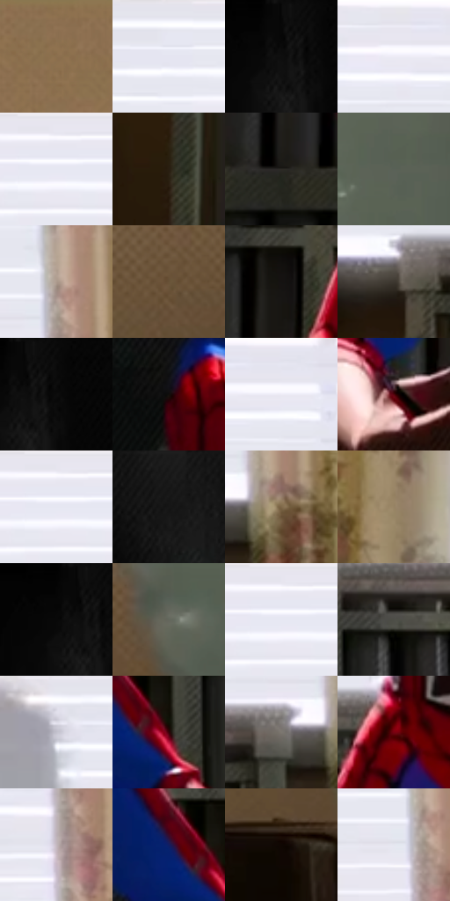

# 电影参考 488

- 状态：条件／活跃；来源世界：miles-home。
- 视角：near-level；景别：medium；场景：portrait。
- 时段：daylight-time-unspecified（外观依据，中置信度；具体时间／晨昏未知）；光照：warm-day。
- 材质候选：skin, hair, fabric, wood, paint（帧级，不是像素分割）。
- 明暗组：dark；L* P5/P50/P95：1.91921 / 39.84659 / 92.93071。
- 资格门禁：sense。
- 原截图 SHA-256：`b38a3d035ebb6898a7b8bc8746ded4846bdf8e31bacf39fd77bcfd36ce05d978`；尺寸：2876 × 1198。
- sRGB 像素 SHA-256：`95b20a612aebfb02b0001893245c380342f914eeff3d0da8d40f134a7fb95cba`。

## 观察与迁移

头周感应及黄框属条件图形，日光肤色不自动带线。

亮窗前蹲姿及头周黑线，窗帘与暖墙保持实体空间；单人电影感应不改技能人数规则。

47  /  488  /  暖家居与条件图形：亮窗前蹲姿及头周黑线，窗帘与暖墙保持实体空间；单人电影感应不改技能人数规则。

本公开版保存32个128×128原像素色卡上下文；图集格子并非原场景相邻位置。原rect、图集tile和像素SHA见 `data/palette-crops.json`。上下文不足时不得批准替色，不能以小样推断完整构图。

## 实测色卡

颜色比例分母为保留采样像素，不是材料面积；全部 32 色参与全库匹配。表内四舍五入仅用于阅读，原精度在 JSON。

| ID | HEX | Lab | 原图 xy | 像素数 | 比例 | 明度角色 |
| --- | --- | --- | --- | ---: | ---: | --- |
| 488-S01 | #8C6F50 | [48.914214, 7.052856, 21.612268] | [2420, 24] | 10311 | 5.359928% | midtone |
| 488-S02 | #E6E7F1 | [91.830662, 1.487109, -4.952988] | [1048, 36] | 10310 | 5.359408% | highlight |
| 488-S03 | #070707 | [1.919214, -0.000122, 0.000231] | [88, 24] | 9961 | 5.177988% | deep-shadow |
| 488-S04 | #E4E3EC | [90.545805, 1.966788, -4.247844] | [1848, 24] | 9625 | 5.003327% | highlight |
| 488-S05 | #E9E8F2 | [92.330445, 2.142271, -4.713027] | [1264, 24] | 9321 | 4.845300% | highlight |
| 488-S06 | #291F12 | [12.57717, 2.618559, 10.514276] | [828, 996] | 8461 | 4.398249% | deep-shadow |
| 488-S07 | #2C2924 | [16.742033, 0.278021, 3.775409] | [952, 1116] | 8236 | 4.281288% | deep-shadow |
| 488-S08 | #5A6157 | [40.26445, -4.827785, 4.774966] | [2736, 656] | 7671 | 3.987587% | midtone |
| 488-S09 | #AC9A8D | [64.808096, 4.440779, 9.241629] | [2156, 488] | 7669 | 3.986547% | light |
| 488-S10 | #685338 | [36.772472, 4.705796, 19.098624] | [2472, 840] | 7107 | 3.694405% | shadow |
| 488-S11 | #141312 | [5.944967, 0.203808, 0.724993] | [1044, 848] | 6858 | 3.564968% | deep-shadow |
| 488-S12 | #3D3730 | [23.465283, 1.22111, 5.34786] | [820, 772] | 6686 | 3.475558% | shadow |
| 488-S13 | #0A0A0A | [2.741735, -0.000174, 0.00033] | [124, 24] | 6496 | 3.376791% | deep-shadow |
| 488-S14 | #120E0C | [4.23854, 1.100142, 1.394942] | [1620, 1056] | 6476 | 3.366394% | deep-shadow |
| 488-S15 | #E6E5F0 | [91.303325, 2.333181, -5.207874] | [1940, 40] | 5886 | 3.059697% | highlight |
| 488-S16 | #52030C | [14.877744, 34.495098, 18.165755] | [1160, 1048] | 5698 | 2.961970% | deep-shadow |
| 488-S17 | #E8E6F0 | [91.70306, 2.475544, -4.601738] | [1256, 36] | 5547 | 2.883476% | highlight |
| 488-S18 | #1B1B1B | [9.766934, -0.000545, 0.001034] | [336, 24] | 5501 | 2.859564% | deep-shadow |
| 488-S19 | #7E6748 | [45.087994, 4.617133, 20.940981] | [2188, 752] | 5203 | 2.704656% | midtone |
| 488-S20 | #978365 | [55.839015, 2.952789, 19.052183] | [696, 108] | 5097 | 2.649554% | midtone |
| 488-S21 | #030303 | [0.82252, -5.2e-05, 9.9e-05] | [32, 24] | 5091 | 2.646435% | deep-shadow |
| 488-S22 | #64685D | [43.36028, -3.774389, 5.669362] | [2636, 804] | 5039 | 2.619404% | midtone |
| 488-S23 | #EDECF6 | [93.731678, 2.134886, -4.697977] | [1256, 24] | 4957 | 2.576778% | highlight |
| 488-S24 | #4E4E48 | [32.998095, -1.259505, 3.554038] | [1928, 796] | 4905 | 2.549747% | shadow |
| 488-S25 | #F7F7FE | [97.410439, 1.245673, -3.343369] | [904, 24] | 4742 | 2.465016% | highlight |
| 488-S26 | #340308 | [7.343343, 24.595494, 8.255743] | [1832, 892] | 4323 | 2.247209% | deep-shadow |
| 488-S27 | #7C7770 | [50.273738, 0.578911, 4.529718] | [2100, 752] | 3619 | 1.881251% | midtone |
| 488-S28 | #770210 | [23.684849, 45.517024, 28.588475] | [1176, 768] | 3439 | 1.787682% | shadow |
| 488-S29 | #C4B8BE | [75.906227, 5.30927, -1.503852] | [2132, 128] | 3006 | 1.562597% | light |
| 488-S30 | #121D62 | [14.892436, 22.947121, -41.994019] | [1768, 860] | 2935 | 1.525690% | deep-shadow |
| 488-S31 | #0F0702 | [2.329791, 1.589679, 2.697469] | [2592, 972] | 1771 | 0.920612% | deep-shadow |
| 488-S32 | #E5E7EF | [91.70349, 0.787554, -4.104391] | [2124, 532] | 425 | 0.220926% | highlight |

## 色阶与空间分布

- 采样 ROI：`[0.01, 0.02, 0.98, 0.94]`；步长：4；样本数：192372。
- 排除区：`[]`。
- 深暗、暗、中、亮、高光五段计数：`[73145, 23298, 35581, 8845, 51503]`。
- RGB 各 256 箱、L* 100 箱、13×5 色相明度表和 3×3 空间统计全部保存在 [总数据](../film-library.json)。
- [可视化档案](../../references/library.html)按需绘制直方图，不存 2,094 张重复图表图片。

## 纹理特征占比

**这是分块图像特征的面积占比，不是波点／排线／丝网／错版的精确语义覆盖率。** 窗格、发丝、织物也会产生方向或周期特征。
原图 ROI 像素 3077370；已测块覆盖 3077370（100.0000%）；未测 0。

| 特征 | 块覆盖像素 | 占已测面积 | 阈值敏感范围 |
| --- | ---: | ---: | --- |
| low-contrast | 350976 | 11.4051% | 6.9379% ~ 15.5561% |
| directional-structure | 776832 | 25.2434% | 17.2573% ~ 44.0022% |
| periodic-structure | 1810810 | 58.8428% | 48.5275% ~ 60.7519% |
| mixed-detail | 138752 | 4.5088% | 0.5324% ~ 6.4346% |

阈值敏感范围不是统计置信区间。逐块坐标、尺度、对比、方向一致性、频谱集中度、频率与角度见 [全量特征记录](../texture-features.jsonl)，以帧号定位。
四种印刷层的真实像素覆盖仍标为 `null`，不能填 0，也不能拿上表代替。不得据这些代理测量删除唯一证据。

[测量方法与保留策略](../../references/library-retention.md) · [分类索引](../archive/README.md)
