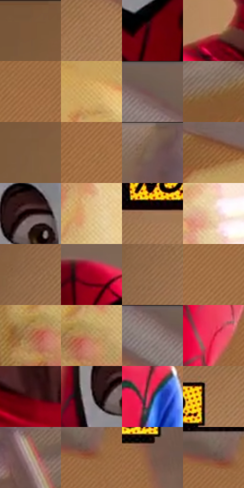

# 电影参考 489

- 状态：条件／活跃；来源世界：miles-home。
- 视角：low-angle；景别：close-up；场景：portrait。
- 时段：daylight-time-unspecified（外观依据，中置信度；具体时间／晨昏未知）；光照：warm-day。
- 材质候选：skin, hair, fabric, wood, paint（帧级，不是像素分割）。
- 明暗组：middle；L* P5/P50/P95：16.82363 / 49.04645 / 78.56819。
- 资格门禁：sense。
- 原截图 SHA-256：`f5f266b7a5289ae07527bf7c3a2e09432439fefb0a394e60837ab8b957130a91`；尺寸：2874 × 1204。
- sRGB 像素 SHA-256：`ae4af31895e071bc5b8618861591302659f1cab646da8adce3e34a06beecfb2b`。

## 观察与迁移

头周感应及黄框属条件图形，日光肤色不自动带线。

面罩上可见眼神，三块黄色NO框有网点和黑偏移边；文字未确认不入照片，风扇不移植。

48  /  489  /  暖家居与条件图形：面罩上可见眼神，三块黄色NO框有网点和黑偏移边；文字未确认不入照片，风扇不移植。

本公开版保存32个128×128原像素色卡上下文；图集格子并非原场景相邻位置。原rect、图集tile和像素SHA见 `data/palette-crops.json`。上下文不足时不得批准替色，不能以小样推断完整构图。

## 实测色卡

颜色比例分母为保留采样像素，不是材料面积；全部 32 色参与全库匹配。表内四舍五入仅用于阅读，原精度在 JSON。

| ID | HEX | Lab | 原图 xy | 像素数 | 比例 | 明度角色 |
| --- | --- | --- | --- | ---: | ---: | --- |
| 489-S01 | #7A5739 | [39.998793, 10.660238, 23.068071] | [460, 40] | 13939 | 7.245857% | shadow |
| 489-S02 | #AD815C | [57.423754, 12.269385, 26.632404] | [912, 172] | 12114 | 6.297174% | midtone |
| 489-S03 | #6D000F | [21.157611, 43.186235, 25.756985] | [1328, 524] | 10364 | 5.387478% | shadow |
| 489-S04 | #BC8764 | [60.73007, 16.028265, 26.820276] | [1244, 864] | 10087 | 5.243487% | light |
| 489-S05 | #A57146 | [52.122739, 15.803105, 31.924037] | [1896, 520] | 10057 | 5.227892% | midtone |
| 489-S06 | #D1A862 | [71.176647, 6.592073, 41.552231] | [2520, 336] | 9495 | 4.935749% | light |
| 489-S07 | #705750 | [39.311104, 9.163783, 8.011105] | [1132, 64] | 8824 | 4.586946% | shadow |
| 489-S08 | #856142 | [44.132807, 10.596431, 23.347048] | [2528, 84] | 8168 | 4.245940% | midtone |
| 489-S09 | #7F5D3F | [42.3085, 9.961501, 22.614686] | [276, 400] | 8130 | 4.226187% | midtone |
| 489-S10 | #9F6C40 | [50.058796, 15.541396, 32.536276] | [1796, 708] | 7002 | 3.639823% | midtone |
| 489-S11 | #7F6454 | [44.613693, 8.393939, 13.219789] | [1864, 40] | 6930 | 3.602395% | midtone |
| 489-S12 | #99663C | [47.755718, 16.023097, 31.785179] | [2700, 84] | 6643 | 3.453205% | midtone |
| 489-S13 | #1D0708 | [3.891124, 8.893674, 2.706519] | [1316, 360] | 6110 | 3.176138% | deep-shadow |
| 489-S14 | #DFBE86 | [78.600631, 4.167538, 32.649176] | [2588, 548] | 5981 | 3.109080% | light |
| 489-S15 | #A27855 | [53.783968, 11.942357, 25.589137] | [712, 280] | 5917 | 3.075811% | midtone |
| 489-S16 | #EFD5B2 | [86.581073, 3.771051, 20.62943] | [2800, 956] | 5897 | 3.065415% | highlight |
| 489-S17 | #966E4E | [49.722444, 11.757992, 24.029025] | [568, 228] | 5842 | 3.036824% | midtone |
| 489-S18 | #9C001C | [32.155143, 55.999072, 32.590141] | [1472, 140] | 5736 | 2.981723% | shadow |
| 489-S19 | #8F6644 | [46.659323, 12.308553, 25.658915] | [576, 288] | 5717 | 2.971846% | midtone |
| 489-S20 | #AA774C | [54.305362, 15.082551, 31.454123] | [2064, 552] | 5614 | 2.918304% | midtone |
| 489-S21 | #AF7851 | [55.219349, 17.10377, 29.966038] | [2448, 832] | 5324 | 2.767555% | midtone |
| 489-S22 | #B7895A | [60.514907, 11.835914, 31.916993] | [2496, 816] | 4258 | 2.213420% | light |
| 489-S23 | #856E69 | [48.459668, 8.212694, 6.182865] | [1040, 36] | 3944 | 2.050194% | midtone |
| 489-S24 | #DB2346 | [47.891393, 68.495337, 28.577328] | [1636, 652] | 3637 | 1.890608% | midtone |
| 489-S25 | #430D0F | [12.709397, 25.839786, 13.181804] | [1408, 956] | 2943 | 1.529848% | deep-shadow |
| 489-S26 | #91878A | [57.253214, 4.302745, -0.253687] | [1252, 392] | 2862 | 1.487742% | midtone |
| 489-S27 | #40253E | [19.060403, 17.494455, -10.675903] | [1900, 1100] | 2516 | 1.307883% | deep-shadow |
| 489-S28 | #9E724E | [51.67322, 12.927792, 26.726103] | [836, 196] | 2113 | 1.098393% | midtone |
| 489-S29 | #B39F8B | [66.706755, 4.087401, 13.128596] | [2276, 68] | 2091 | 1.086957% | light |
| 489-S30 | #935937 | [43.690541, 20.480424, 29.50139] | [1964, 328] | 2054 | 1.067723% | midtone |
| 489-S31 | #7A5B4B | [41.419611, 10.363818, 14.167238] | [2232, 420] | 1127 | 0.585844% | midtone |
| 489-S32 | #735144 | [37.748511, 12.402891, 13.30035] | [1936, 308] | 936 | 0.486557% | shadow |

## 色阶与空间分布

- 采样 ROI：`[0.01, 0.02, 0.98, 0.94]`；步长：4；样本数：192372。
- 排除区：`[]`。
- 深暗、暗、中、亮、高光五段计数：`[13149, 28611, 118063, 24011, 8538]`。
- RGB 各 256 箱、L* 100 箱、13×5 色相明度表和 3×3 空间统计全部保存在 [总数据](../film-library.json)。
- [可视化档案](../../references/library.html)按需绘制直方图，不存 2,094 张重复图表图片。

## 纹理特征占比

**这是分块图像特征的面积占比，不是波点／排线／丝网／错版的精确语义覆盖率。** 窗格、发丝、织物也会产生方向或周期特征。
原图 ROI 像素 3086316；已测块覆盖 3086316（100.0000%）；未测 0。

| 特征 | 块覆盖像素 | 占已测面积 | 阈值敏感范围 |
| --- | ---: | ---: | --- |
| low-contrast | 403840 | 13.0849% | 11.4923% ~ 17.8626% |
| directional-structure | 1157504 | 37.5044% | 25.4813% ~ 52.1528% |
| periodic-structure | 1475820 | 47.8182% | 36.3549% ~ 54.5327% |
| mixed-detail | 49152 | 1.5926% | 0.0000% ~ 2.1234% |

阈值敏感范围不是统计置信区间。逐块坐标、尺度、对比、方向一致性、频谱集中度、频率与角度见 [全量特征记录](../texture-features.jsonl)，以帧号定位。
四种印刷层的真实像素覆盖仍标为 `null`，不能填 0，也不能拿上表代替。不得据这些代理测量删除唯一证据。

[测量方法与保留策略](../../references/library-retention.md) · [分类索引](../archive/README.md)
