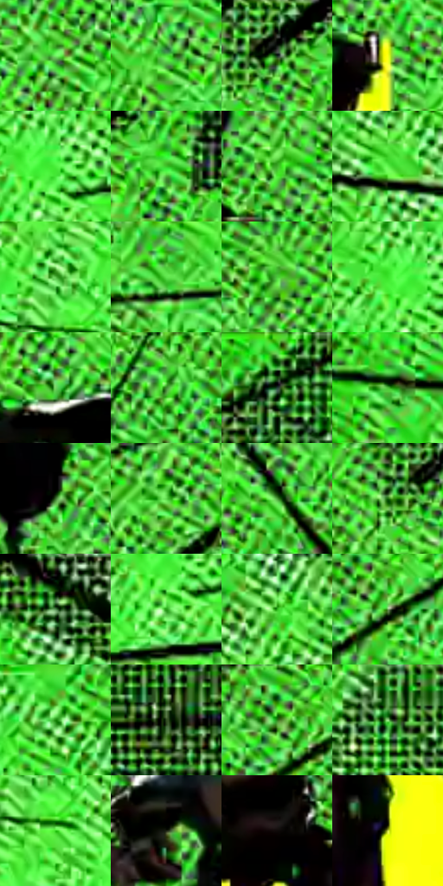

# 电影参考 490

- 状态：条件／活跃；来源世界：miles-home。
- 视角：graphic-nonphysical；景别：full-body；场景：graphic。
- 时段：graphic-no-physical-time（外观依据，中置信度；具体时间／晨昏未知）；光照：graphic-field。
- 材质候选：fabric, metal（帧级，不是像素分割）。
- 明暗组：light；L* P5/P50/P95：3.34725 / 67.72622 / 90.60465。
- 资格门禁：motion。
- 原截图 SHA-256：`3620bbff4111a6cd14659f425b5b3b49bfd9a611e4dd672ca8269e1b02d66a43`；尺寸：2880 × 1196。
- sRGB 像素 SHA-256：`31454d90398c600b2cd157f893faae7e5f3ea0ea795fbd1cc2834fce35e4455e`。

## 观察与迁移

荧光绿黄速度插帧，放射线与大点阵独立于材质。

荧绿点阵和黑色收束线形成动作插帧，黄色竖条托住暗主体；不作为普通街景背景。

49  /  490  /  暖家居与条件图形：荧绿点阵和黑色收束线形成动作插帧，黄色竖条托住暗主体；不作为普通街景背景。

本公开版保存32个128×128原像素色卡上下文；图集格子并非原场景相邻位置。原rect、图集tile和像素SHA见 `data/palette-crops.json`。上下文不足时不得批准替色，不能以小样推断完整构图。

## 实测色卡

颜色比例分母为保留采样像素，不是材料面积；全部 32 色参与全库匹配。表内四舍五入仅用于阅读，原精度在 JSON。

| ID | HEX | Lab | 原图 xy | 像素数 | 比例 | 明度角色 |
| --- | --- | --- | --- | ---: | ---: | --- |
| 490-S01 | #74F566 | [86.98426, -62.301856, 57.003892] | [1088, 452] | 9915 | 5.146692% | highlight |
| 490-S02 | #4CDD3B | [78.206027, -67.052582, 64.159978] | [1756, 388] | 7900 | 4.100743% | light |
| 490-S03 | #010401 | [0.862407, -1.201699, 0.858987] | [1832, 48] | 7859 | 4.079461% | deep-shadow |
| 490-S04 | #F8FE16 | [96.369135, -23.751763, 91.864698] | [1648, 540] | 7539 | 3.913355% | highlight |
| 490-S05 | #4CF13D | [84.370689, -73.309201, 69.625231] | [2388, 356] | 7523 | 3.905050% | highlight |
| 490-S06 | #3BC629 | [70.50817, -64.049854, 62.281403] | [1920, 92] | 7247 | 3.761783% | light |
| 490-S07 | #40AB2C | [61.994678, -53.748405, 53.052639] | [1592, 444] | 7169 | 3.721295% | light |
| 490-S08 | #60F74F | [86.785388, -69.932503, 65.962274] | [612, 304] | 7046 | 3.657448% | highlight |
| 490-S09 | #5CC04A | [69.801172, -51.630982, 49.459079] | [584, 456] | 6834 | 3.547403% | light |
| 490-S10 | #5EE54C | [81.257254, -64.490752, 61.222828] | [2212, 560] | 6817 | 3.538578% | highlight |
| 490-S11 | #4ACD39 | [73.162234, -62.292046, 59.749092] | [1040, 128] | 6810 | 3.534945% | light |
| 490-S12 | #39E42A | [79.90939, -73.549241, 70.749951] | [2348, 348] | 6803 | 3.531311% | light |
| 490-S13 | #71D261 | [76.353911, -50.194714, 46.767577] | [1604, 192] | 6600 | 3.425937% | light |
| 490-S14 | #428C31 | [51.989966, -40.988065, 40.489087] | [1084, 1112] | 6521 | 3.384930% | midtone |
| 490-S15 | #104309 | [24.141884, -29.034409, 28.19863] | [2588, 52] | 6331 | 3.286305% | shadow |
| 490-S16 | #4BBC38 | [67.833129, -56.237204, 54.643053] | [328, 304] | 6189 | 3.212595% | light |
| 490-S17 | #3B6D2D | [41.305245, -30.230056, 30.165632] | [1216, 268] | 6090 | 3.161206% | midtone |
| 490-S18 | #5CD54A | [76.287322, -59.47925, 56.644136] | [964, 672] | 6015 | 3.122275% | light |
| 490-S19 | #4E9D3D | [58.103067, -43.099658, 41.951966] | [1956, 1048] | 5980 | 3.104107% | midtone |
| 490-S20 | #16630B | [36.210429, -39.553467, 38.874585] | [1776, 84] | 5899 | 3.062061% | shadow |
| 490-S21 | #072102 | [10.085913, -17.158028, 13.91282] | [572, 44] | 5465 | 2.836780% | deep-shadow |
| 490-S22 | #279C17 | [56.356041, -55.064629, 54.021589] | [2376, 408] | 5391 | 2.798368% | midtone |
| 490-S23 | #2EAE1B | [62.448958, -59.445165, 58.564765] | [648, 208] | 5274 | 2.737635% | light |
| 490-S24 | #6B9D56 | [59.808278, -30.361924, 31.855094] | [2160, 188] | 5253 | 2.726735% | midtone |
| 490-S25 | #19850B | [48.266352, -50.400343, 49.521202] | [2472, 240] | 5249 | 2.724658% | midtone |
| 490-S26 | #324E22 | [30.015604, -19.790344, 22.570303] | [120, 676] | 4958 | 2.573606% | shadow |
| 490-S27 | #2E841D | [48.475168, -45.063041, 44.841536] | [2124, 156] | 4917 | 2.552323% | midtone |
| 490-S28 | #9FED8D | [86.928467, -41.683248, 39.071442] | [2608, 672] | 4867 | 2.526369% | highlight |
| 490-S29 | #29C718 | [70.442771, -67.938838, 66.267462] | [612, 528] | 4790 | 2.486400% | light |
| 490-S30 | #212616 | [14.216479, -5.807058, 9.897729] | [1332, 420] | 3753 | 1.948113% | deep-shadow |
| 490-S31 | #0F0908 | [2.840668, 1.622821, 0.999564] | [1476, 492] | 3217 | 1.669885% | deep-shadow |
| 490-S32 | #D5E74D | [87.889148, -25.271817, 69.632138] | [1420, 652] | 427 | 0.221648% | highlight |

## 色阶与空间分布

- 采样 ROI：`[0.01, 0.02, 0.98, 0.94]`；步长：4；样本数：192648。
- 排除区：`[]`。
- 深暗、暗、中、亮、高光五段计数：`[21015, 17458, 35475, 71109, 47591]`。
- RGB 各 256 箱、L* 100 箱、13×5 色相明度表和 3×3 空间统计全部保存在 [总数据](../film-library.json)。
- [可视化档案](../../references/library.html)按需绘制直方图，不存 2,094 张重复图表图片。

## 纹理特征占比

**这是分块图像特征的面积占比，不是波点／排线／丝网／错版的精确语义覆盖率。** 窗格、发丝、织物也会产生方向或周期特征。
原图 ROI 像素 3076194；已测块覆盖 3076194（100.0000%）；未测 0。

| 特征 | 块覆盖像素 | 占已测面积 | 阈值敏感范围 |
| --- | ---: | ---: | --- |
| low-contrast | 0 | 0.0000% | 0.0000% ~ 0.0000% |
| directional-structure | 150784 | 4.9016% | 1.7060% ~ 7.8851% |
| periodic-structure | 2882786 | 93.7127% | 92.1149% ~ 94.6698% |
| mixed-detail | 42624 | 1.3856% | 0.0000% ~ 3.6242% |

阈值敏感范围不是统计置信区间。逐块坐标、尺度、对比、方向一致性、频谱集中度、频率与角度见 [全量特征记录](../texture-features.jsonl)，以帧号定位。
四种印刷层的真实像素覆盖仍标为 `null`，不能填 0，也不能拿上表代替。不得据这些代理测量删除唯一证据。

[测量方法与保留策略](../../references/library-retention.md) · [分类索引](../archive/README.md)
