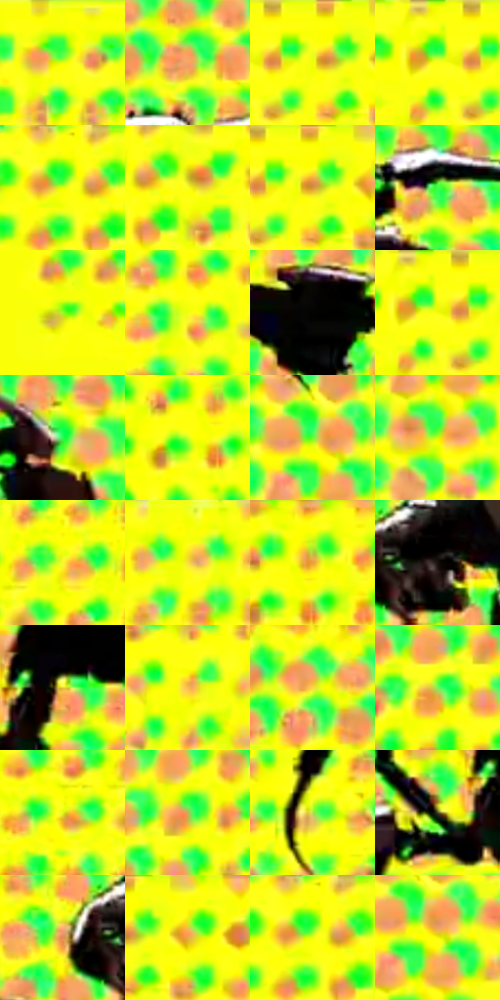

# 电影参考 491

- 状态：条件／活跃；来源世界：miles-home。
- 视角：graphic-nonphysical；景别：full-body；场景：graphic。
- 时段：graphic-no-physical-time（外观依据，中置信度；具体时间／晨昏未知）；光照：graphic-field。
- 材质候选：fabric, metal（帧级，不是像素分割）。
- 明暗组：very-light；L* P5/P50/P95：4.99296 / 92.22297 / 97.15131。
- 资格门禁：motion。
- 原截图 SHA-256：`6e5d697de0b2004b98ab062ff7b460b820926db346b0e52a4aec12285714a7da`；尺寸：2880 × 1204。
- sRGB 像素 SHA-256：`0ee01d86d37a8feef3da9407a5cd954e554f5e603bf6833683f8cb73936948fd`。

## 观察与迁移

荧光绿黄速度插帧，放射线与大点阵独立于材质。

荧黄插帧中绿橙点阵成片，暗色机械肢体轮廓清楚；不移植多肢或机械装置。

50  /  491  /  暖家居与条件图形：荧黄插帧中绿橙点阵成片，暗色机械肢体轮廓清楚；不移植多肢或机械装置。

本公开版保存32个128×128原像素色卡上下文；图集格子并非原场景相邻位置。原rect、图集tile和像素SHA见 `data/palette-crops.json`。上下文不足时不得批准替色，不能以小样推断完整构图。

## 实测色卡

颜色比例分母为保留采样像素，不是材料面积；全部 32 色参与全库匹配。表内四舍五入仅用于阅读，原精度在 JSON。

| ID | HEX | Lab | 原图 xy | 像素数 | 比例 | 明度角色 |
| --- | --- | --- | --- | ---: | ---: | --- |
| 491-S01 | #F9FF08 | [96.68934, -23.951389, 93.391038] | [860, 28] | 11035 | 5.728064% | highlight |
| 491-S02 | #F7A369 | [74.185397, 25.405762, 42.590733] | [1692, 116] | 10136 | 5.261409% | light |
| 491-S03 | #FEFF06 | [97.067887, -21.921155, 93.97882] | [140, 28] | 9665 | 5.016922% | highlight |
| 491-S04 | #FBFF0E | [96.846366, -23.086884, 93.134933] | [36, 28] | 9291 | 4.822786% | highlight |
| 491-S05 | #F0FE06 | [95.757436, -27.162821, 92.536986] | [348, 32] | 8921 | 4.630725% | highlight |
| 491-S06 | #FDFE1D | [96.762208, -21.606266, 91.400525] | [424, 72] | 8554 | 4.440223% | highlight |
| 491-S07 | #FDFE15 | [96.748068, -21.720933, 92.436869] | [156, 44] | 8436 | 4.378971% | highlight |
| 491-S08 | #42FF4B | [88.534644, -78.165099, 69.040721] | [1764, 212] | 7981 | 4.142789% | highlight |
| 491-S09 | #9AFD25 | [90.437689, -58.451408, 82.35107] | [224, 216] | 7862 | 4.081018% | highlight |
| 491-S10 | #F0FE13 | [95.771537, -27.044101, 91.484469] | [2352, 324] | 7425 | 3.854180% | highlight |
| 491-S11 | #030302 | [0.802734, -0.139096, 0.378523] | [1152, 508] | 7156 | 3.714547% | deep-shadow |
| 491-S12 | #FFFF0D | [97.151312, -21.459093, 93.581184] | [76, 28] | 6415 | 3.329907% | highlight |
| 491-S13 | #26FE4C | [87.878716, -80.892544, 67.89447] | [1992, 612] | 6357 | 3.299801% | highlight |
| 491-S14 | #C9FF26 | [93.484165, -42.524747, 85.724503] | [2560, 96] | 5901 | 3.063100% | highlight |
| 491-S15 | #67FE31 | [88.915791, -72.633964, 77.609509] | [2280, 568] | 5856 | 3.039741% | highlight |
| 491-S16 | #D4FD07 | [93.564907, -37.894099, 89.964017] | [2280, 684] | 5805 | 3.013268% | highlight |
| 491-S17 | #FBF92D | [95.35137, -19.705939, 87.220772] | [988, 1064] | 5695 | 2.956169% | highlight |
| 491-S18 | #F7DF20 | [88.284063, -8.962842, 84.001017] | [1048, 56] | 5426 | 2.816536% | highlight |
| 491-S19 | #EAAC4D | [74.532121, 13.474551, 56.213471] | [2592, 60] | 5210 | 2.704414% | light |
| 491-S20 | #18100C | [5.341611, 2.715523, 3.076772] | [1316, 396] | 4887 | 2.536751% | deep-shadow |
| 491-S21 | #E4CB33 | [81.537165, -6.4282, 72.9112] | [1396, 548] | 4860 | 2.522736% | highlight |
| 491-S22 | #F9B950 | [79.283371, 13.070393, 60.447113] | [2528, 680] | 4806 | 2.494705% | light |
| 491-S23 | #FAD846 | [86.938846, -2.985174, 72.265418] | [1584, 76] | 4722 | 2.451103% | highlight |
| 491-S24 | #7AF355 | [86.450615, -61.623251, 63.537749] | [2088, 1112] | 4321 | 2.242951% | highlight |
| 491-S25 | #E3F51E | [92.456094, -27.946532, 87.012991] | [880, 1116] | 3699 | 1.920082% | highlight |
| 491-S26 | #C0B254 | [72.020159, -7.027611, 49.042515] | [2148, 1064] | 3697 | 1.919044% | light |
| 491-S27 | #B3E14A | [83.92854, -36.035412, 65.980019] | [956, 892] | 3679 | 1.909701% | highlight |
| 491-S28 | #454122 | [27.18989, -3.512114, 19.459614] | [1304, 584] | 3573 | 1.854678% | shadow |
| 491-S29 | #E08E50 | [66.348757, 25.47567, 45.330171] | [1220, 396] | 3148 | 1.634068% | light |
| 491-S30 | #FBFF06 | [96.838786, -23.148936, 93.706668] | [216, 28] | 2999 | 1.556725% | highlight |
| 491-S31 | #F9FE02 | [96.422602, -23.524436, 93.607079] | [352, 32] | 2979 | 1.546344% | highlight |
| 491-S32 | #F9F508 | [94.083191, -19.196717, 91.453572] | [2300, 588] | 2151 | 1.116544% | highlight |

## 色阶与空间分布

- 采样 ROI：`[0.01, 0.02, 0.98, 0.94]`；步长：4；样本数：192648。
- 排除区：`[]`。
- 深暗、暗、中、亮、高光五段计数：`[13122, 1812, 1297, 26972, 149445]`。
- RGB 各 256 箱、L* 100 箱、13×5 色相明度表和 3×3 空间统计全部保存在 [总数据](../film-library.json)。
- [可视化档案](../../references/library.html)按需绘制直方图，不存 2,094 张重复图表图片。

## 纹理特征占比

**这是分块图像特征的面积占比，不是波点／排线／丝网／错版的精确语义覆盖率。** 窗格、发丝、织物也会产生方向或周期特征。
原图 ROI 像素 3092958；已测块覆盖 3092958（100.0000%）；未测 0。

| 特征 | 块覆盖像素 | 占已测面积 | 阈值敏感范围 |
| --- | ---: | ---: | --- |
| low-contrast | 81024 | 2.6196% | 2.6196% ~ 3.1493% |
| directional-structure | 0 | 0.0000% | 0.0000% ~ 9.0052% |
| periodic-structure | 2979166 | 96.3209% | 88.3751% ~ 96.3209% |
| mixed-detail | 32768 | 1.0594% | 0.0000% ~ 2.4033% |

阈值敏感范围不是统计置信区间。逐块坐标、尺度、对比、方向一致性、频谱集中度、频率与角度见 [全量特征记录](../texture-features.jsonl)，以帧号定位。
四种印刷层的真实像素覆盖仍标为 `null`，不能填 0，也不能拿上表代替。不得据这些代理测量删除唯一证据。

[测量方法与保留策略](../../references/library-retention.md) · [分类索引](../archive/README.md)
