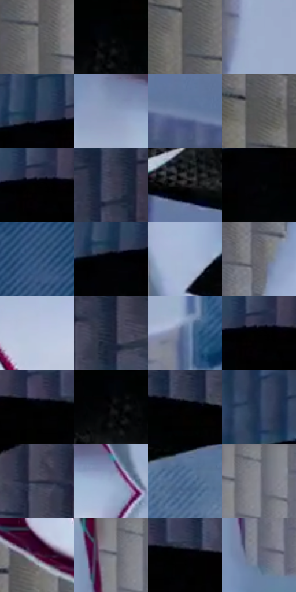

# 电影参考 492

- 状态：条件／活跃；来源世界：miles-home。
- 视角：rolled-or-dutch；景别：full-body；场景：city。
- 时段：daylight-time-unspecified（外观依据，中置信度；具体时间／晨昏未知）；光照：neutral-day。
- 材质候选：skin, fabric, stone, wood, foliage, sky（帧级，不是像素分割）。
- 明暗组：dark；L* P5/P50/P95：0.27417 / 31.25422 / 73.52299。
- 资格门禁：motion。
- 原截图 SHA-256：`042a0ff4e5f05e4434298d113ccf40a54e3afc96e3bba0467354fca8c8467393`；尺寸：2880 × 1200。
- sRGB 像素 SHA-256：`8801ae5dfdaef0cd29b6d367a0f3589fa70d0c16b520380562520cd9c96ff25e`。

## 观察与迁移

屋顶动作和现有玻璃碎片按原图事实，不新增破损。

横置人物的黑衣有局部三角微纹，白衣另有细纹；结构图案不是所有材质通用网点。

51  /  492  /  屋顶、冲击插帧与巷道：横置人物的黑衣有局部三角微纹，白衣另有细纹；结构图案不是所有材质通用网点。

本公开版保存32个128×128原像素色卡上下文；图集格子并非原场景相邻位置。原rect、图集tile和像素SHA见 `data/palette-crops.json`。上下文不足时不得批准替色，不能以小样推断完整构图。

## 实测色卡

颜色比例分母为保留采样像素，不是材料面积；全部 32 色参与全库匹配。表内四舍五入仅用于阅读，原精度在 JSON。

| ID | HEX | Lab | 原图 xy | 像素数 | 比例 | 明度角色 |
| --- | --- | --- | --- | ---: | ---: | --- |
| 492-S01 | #757578 | [49.326498, 0.611413, -1.644652] | [540, 176] | 10422 | 5.409867% | midtone |
| 492-S02 | #040608 | [1.567997, -0.245015, -0.940926] | [2556, 396] | 8980 | 4.661351% | deep-shadow |
| 492-S03 | #55555B | [36.335378, 1.318192, -3.474049] | [476, 116] | 8253 | 4.283979% | shadow |
| 492-S04 | #9EAECB | [70.768681, 0.730369, -16.572803] | [1312, 112] | 8234 | 4.274117% | light |
| 492-S05 | #313D5A | [25.946397, 3.756119, -18.898423] | [2164, 260] | 8056 | 4.181720% | shadow |
| 492-S06 | #8A9BBB | [63.698965, 1.268352, -18.535172] | [648, 568] | 7706 | 4.000042% | light |
| 492-S07 | #697EA4 | [52.5137, 2.002434, -22.728705] | [2028, 1112] | 7658 | 3.975126% | midtone |
| 492-S08 | #5E5E62 | [40.026413, 0.853753, -2.278612] | [344, 28] | 7327 | 3.803310% | midtone |
| 492-S09 | #000000 | [0.0, 0.0, 0.0] | [2232, 284] | 7064 | 3.666791% | deep-shadow |
| 492-S10 | #404156 | [28.227138, 4.89146, -12.675167] | [2588, 60] | 7059 | 3.664196% | shadow |
| 492-S11 | #1C181D | [8.898298, 3.227071, -2.769431] | [1976, 896] | 6883 | 3.572838% | deep-shadow |
| 492-S12 | #030406 | [1.077959, 0.016519, -0.848854] | [2160, 352] | 6833 | 3.546883% | deep-shadow |
| 492-S13 | #2E4E77 | [32.614661, 1.813119, -26.935067] | [1596, 124] | 6644 | 3.448777% | shadow |
| 492-S14 | #000304 | [0.667381, -0.645506, -0.65474] | [2148, 292] | 6533 | 3.391159% | deep-shadow |
| 492-S15 | #A6B7D4 | [74.014295, 0.370028, -16.542839] | [924, 364] | 6253 | 3.245816% | light |
| 492-S16 | #68686D | [44.15793, 1.05128, -2.797695] | [816, 180] | 6018 | 3.123832% | midtone |
| 492-S17 | #BAC5DC | [79.350125, 0.888363, -12.711667] | [428, 692] | 5993 | 3.110855% | light |
| 492-S18 | #1F2638 | [15.291617, 2.507362, -12.619593] | [2768, 100] | 5952 | 3.089573% | deep-shadow |
| 492-S19 | #5C7195 | [47.306837, 1.708013, -22.044512] | [1436, 1112] | 5575 | 2.893879% | midtone |
| 492-S20 | #010101 | [0.274173, -1.7e-05, 3.3e-05] | [2236, 284] | 5507 | 2.858581% | deep-shadow |
| 492-S21 | #010204 | [0.529612, 0.016554, -0.84892] | [2340, 292] | 5408 | 2.807192% | deep-shadow |
| 492-S22 | #0D0C0F | [3.45959, 0.803892, -1.265884] | [2532, 420] | 5097 | 2.645758% | deep-shadow |
| 492-S23 | #010202 | [0.490038, -0.261534, -0.092073] | [2596, 316] | 4961 | 2.575163% | deep-shadow |
| 492-S24 | #223654 | [22.366791, 2.205361, -20.631216] | [2016, 236] | 4565 | 2.369607% | shadow |
| 492-S25 | #2C2F40 | [19.796198, 3.374451, -11.119407] | [2792, 836] | 4547 | 2.360263% | deep-shadow |
| 492-S26 | #98AAC9 | [69.212856, 0.60113, -17.864704] | [888, 604] | 4464 | 2.317180% | light |
| 492-S27 | #436088 | [40.140343, 1.231961, -25.5068] | [1528, 928] | 4230 | 2.195714% | midtone |
| 492-S28 | #848590 | [55.780153, 1.89083, -6.010408] | [1108, 64] | 4122 | 2.139654% | midtone |
| 492-S29 | #430D31 | [13.84544, 29.60016, -9.447871] | [284, 780] | 3986 | 2.069059% | deep-shadow |
| 492-S30 | #7C7E89 | [52.963455, 1.555225, -6.198424] | [1056, 56] | 3789 | 1.966800% | midtone |
| 492-S31 | #010104 | [0.333534, 0.417114, -1.135238] | [2412, 296] | 3243 | 1.683381% | deep-shadow |
| 492-S32 | #5D6177 | [41.545095, 3.610225, -12.870478] | [1068, 240] | 1286 | 0.667539% | midtone |

## 色阶与空间分布

- 采样 ROI：`[0.01, 0.02, 0.98, 0.94]`；步长：4；样本数：192648。
- 排除区：`[]`。
- 深暗、暗、中、亮、高光五段计数：`[72825, 42986, 44978, 29503, 2356]`。
- RGB 各 256 箱、L* 100 箱、13×5 色相明度表和 3×3 空间统计全部保存在 [总数据](../film-library.json)。
- [可视化档案](../../references/library.html)按需绘制直方图，不存 2,094 张重复图表图片。

## 纹理特征占比

**这是分块图像特征的面积占比，不是波点／排线／丝网／错版的精确语义覆盖率。** 窗格、发丝、织物也会产生方向或周期特征。
原图 ROI 像素 3084576；已测块覆盖 3084576（100.0000%）；未测 0。

| 特征 | 块覆盖像素 | 占已测面积 | 阈值敏感范围 |
| --- | ---: | ---: | --- |
| low-contrast | 342016 | 11.0879% | 9.4945% ~ 12.1503% |
| directional-structure | 942080 | 30.5416% | 18.9225% ~ 40.7664% |
| periodic-structure | 1717280 | 55.6731% | 49.2079% ~ 62.2711% |
| mixed-detail | 83200 | 2.6973% | 0.5312% ~ 6.6561% |

阈值敏感范围不是统计置信区间。逐块坐标、尺度、对比、方向一致性、频谱集中度、频率与角度见 [全量特征记录](../texture-features.jsonl)，以帧号定位。
四种印刷层的真实像素覆盖仍标为 `null`，不能填 0，也不能拿上表代替。不得据这些代理测量删除唯一证据。

[测量方法与保留策略](../../references/library-retention.md) · [分类索引](../archive/README.md)
