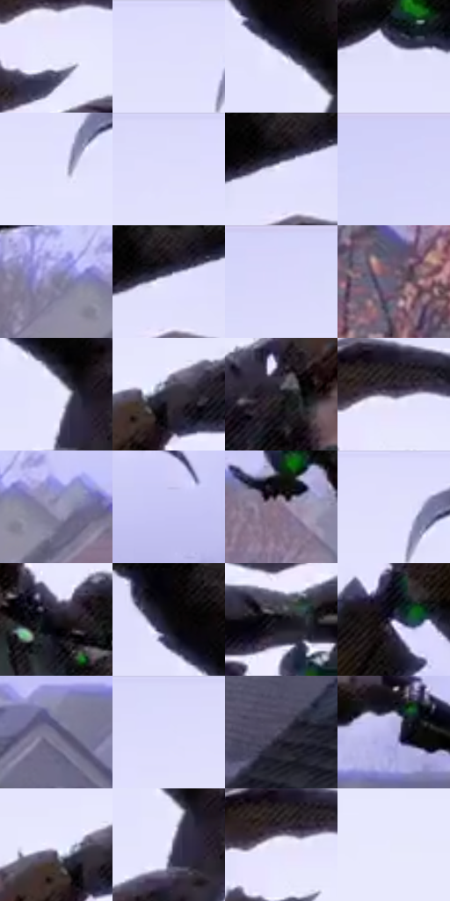

# 电影参考 493

- 状态：条件／活跃；来源世界：miles-home。
- 视角：low-angle；景别：environment-wide；场景：city。
- 时段：daylight-time-unspecified（外观依据，中置信度；具体时间／晨昏未知）；光照：neutral-day。
- 材质候选：skin, fabric, stone, wood, foliage, sky（帧级，不是像素分割）。
- 明暗组：very-light；L* P5/P50/P95：5.05713 / 86.03049 / 92.80604。
- 资格门禁：motion。
- 原截图 SHA-256：`f7bf510cea6ea88de706173a3d1fdc60219e0ebc96bf29a00f090ca549053871`；尺寸：2880 × 1210。
- sRGB 像素 SHA-256：`95956aa661476dcc46e1831b6dddaf40c671485c15d78f051a0ecdfa07eee5e1`。

## 观察与迁移

屋顶动作和现有玻璃碎片按原图事实，不新增破损。

淡紫白天空下深色腾空主体，远房屋低对比但屋顶走向清楚；不添加打斗或改变原姿态。

52  /  493  /  屋顶、冲击插帧与巷道：淡紫白天空下深色腾空主体，远房屋低对比但屋顶走向清楚；不添加打斗或改变原姿态。

本公开版保存32个128×128原像素色卡上下文；图集格子并非原场景相邻位置。原rect、图集tile和像素SHA见 `data/palette-crops.json`。上下文不足时不得批准替色，不能以小样推断完整构图。

## 实测色卡

颜色比例分母为保留采样像素，不是材料面积；全部 32 色参与全库匹配。表内四舍五入仅用于阅读，原精度在 JSON。

| ID | HEX | Lab | 原图 xy | 像素数 | 比例 | 明度角色 |
| --- | --- | --- | --- | ---: | ---: | --- |
| 493-S01 | #E8E9FD | [92.806039, 3.373609, -9.751284] | [2064, 244] | 10122 | 5.216343% | highlight |
| 493-S02 | #DFDEFD | [89.403134, 6.225024, -14.899299] | [1548, 40] | 10005 | 5.156047% | highlight |
| 493-S03 | #E5E5FE | [91.618302, 4.679296, -12.064531] | [2260, 124] | 9410 | 4.849416% | highlight |
| 493-S04 | #E2E2FE | [90.650381, 5.285764, -13.533223] | [1792, 76] | 9156 | 4.718517% | highlight |
| 493-S05 | #E3E4FD | [91.193035, 4.365495, -12.192063] | [1588, 120] | 8615 | 4.439715% | highlight |
| 493-S06 | #DBDBFC | [88.328613, 6.334082, -16.016243] | [1152, 28] | 8560 | 4.411371% | highlight |
| 493-S07 | #E7E8FE | [92.511831, 3.763196, -10.717676] | [2000, 68] | 7528 | 3.879532% | highlight |
| 493-S08 | #D1D1FA | [85.025677, 8.07822, -20.010897] | [468, 36] | 7358 | 3.791923% | highlight |
| 493-S09 | #7E7B9A | [52.877536, 7.851059, -16.223505] | [1332, 908] | 7224 | 3.722867% | midtone |
| 493-S10 | #E1E1FC | [90.268921, 5.093021, -13.06411] | [2012, 64] | 7100 | 3.658964% | highlight |
| 493-S11 | #D6D6FB | [86.678753, 7.194428, -18.008246] | [724, 48] | 6987 | 3.600730% | highlight |
| 493-S12 | #69627B | [43.016168, 8.20845, -12.970143] | [348, 988] | 6790 | 3.499206% | midtone |
| 493-S13 | #E6E7FD | [92.161074, 3.766999, -10.72616] | [2300, 172] | 6621 | 3.412113% | highlight |
| 493-S14 | #33313E | [21.011675, 4.121005, -7.842412] | [1732, 256] | 6523 | 3.361609% | shadow |
| 493-S15 | #24222B | [13.788964, 3.262859, -5.63784] | [1600, 384] | 6469 | 3.333780% | deep-shadow |
| 493-S16 | #5A536A | [36.74463, 7.988698, -12.180313] | [2064, 188] | 6468 | 3.333265% | shadow |
| 493-S17 | #9B97B9 | [63.839095, 8.48517, -17.080174] | [1416, 920] | 6431 | 3.314197% | light |
| 493-S18 | #C6C5F4 | [80.998784, 9.814257, -23.002353] | [2812, 748] | 6407 | 3.301828% | highlight |
| 493-S19 | #857189 | [50.219667, 12.422515, -10.213361] | [1676, 928] | 6346 | 3.270392% | midtone |
| 493-S20 | #E0E0FC | [89.945709, 5.296876, -13.554972] | [1588, 52] | 6337 | 3.265754% | highlight |
| 493-S21 | #1A1820 | [8.799677, 3.148733, -5.200845] | [1764, 380] | 6245 | 3.218342% | deep-shadow |
| 493-S22 | #07060A | [1.782497, 0.81757, -1.421358] | [2228, 44] | 5912 | 3.046732% | deep-shadow |
| 493-S23 | #0F0F16 | [4.526605, 1.486808, -4.046744] | [1988, 368] | 5553 | 2.861722% | deep-shadow |
| 493-S24 | #8A86A8 | [57.347473, 8.721649, -17.421605] | [1856, 692] | 5266 | 2.713817% | midtone |
| 493-S25 | #6F6C8A | [46.894818, 7.84851, -16.02893] | [2064, 936] | 5170 | 2.664344% | midtone |
| 493-S26 | #DAD9FB | [87.725129, 6.867094, -16.404055] | [1044, 28] | 4947 | 2.549422% | highlight |
| 493-S27 | #444254 | [28.812661, 5.171548, -10.452288] | [2464, 1064] | 4365 | 2.249490% | shadow |
| 493-S28 | #AEACDF | [72.115057, 11.395793, -25.374911] | [2584, 836] | 4082 | 2.103647% | light |
| 493-S29 | #EAE9FF | [93.009943, 4.399255, -10.473731] | [1700, 244] | 945 | 0.487003% | highlight |
| 493-S30 | #EFEEFF | [94.61909, 3.430919, -8.044954] | [2300, 208] | 935 | 0.481849% | highlight |
| 493-S31 | #E9E7F8 | [92.243914, 3.777327, -7.970726] | [2044, 200] | 116 | 0.059780% | highlight |
| 493-S32 | #E7E9FB | [92.67681, 2.668571, -8.909268] | [868, 384] | 51 | 0.026283% | highlight |

## 色阶与空间分布

- 采样 ROI：`[0.01, 0.02, 0.98, 0.94]`；步长：4；样本数：194044。
- 排除区：`[]`。
- 深暗、暗、中、亮、高光五段计数：`[26646, 14588, 31045, 12423, 109342]`。
- RGB 各 256 箱、L* 100 箱、13×5 色相明度表和 3×3 空间统计全部保存在 [总数据](../film-library.json)。
- [可视化档案](../../references/library.html)按需绘制直方图，不存 2,094 张重复图表图片。

## 纹理特征占比

**这是分块图像特征的面积占比，不是波点／排线／丝网／错版的精确语义覆盖率。** 窗格、发丝、织物也会产生方向或周期特征。
原图 ROI 像素 3109722；已测块覆盖 3109722（100.0000%）；未测 0。

| 特征 | 块覆盖像素 | 占已测面积 | 阈值敏感范围 |
| --- | ---: | ---: | --- |
| low-contrast | 1086464 | 34.9377% | 29.1422% ~ 36.1972% |
| directional-structure | 386176 | 12.4183% | 4.4907% ~ 25.8480% |
| periodic-structure | 1537370 | 49.4375% | 44.1166% ~ 52.7387% |
| mixed-detail | 99712 | 3.2065% | 0.8932% ~ 6.5734% |

阈值敏感范围不是统计置信区间。逐块坐标、尺度、对比、方向一致性、频谱集中度、频率与角度见 [全量特征记录](../texture-features.jsonl)，以帧号定位。
四种印刷层的真实像素覆盖仍标为 `null`，不能填 0，也不能拿上表代替。不得据这些代理测量删除唯一证据。

[测量方法与保留策略](../../references/library-retention.md) · [分类索引](../archive/README.md)
