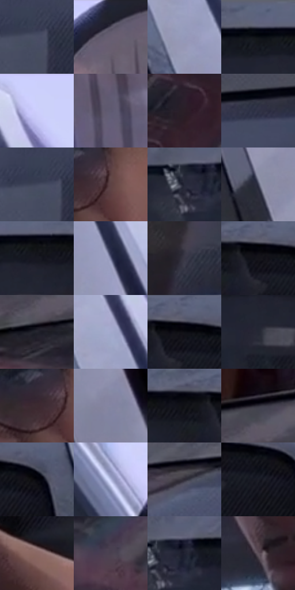

# 电影参考 494

- 状态：条件／活跃；来源世界：miles-home。
- 视角：low-angle；景别：medium；场景：reflection。
- 时段：daylight-time-unspecified（外观依据，中置信度；具体时间／晨昏未知）；光照：neutral-day。
- 材质候选：skin, glass, fabric, painted-metal（帧级，不是像素分割）。
- 明暗组：dark；L* P5/P50/P95：4.03455 / 21.6377 / 78.00256。
- 资格门禁：reflection。
- 原截图 SHA-256：`08c004b01d2a9269f6a065da29ec3ec5f80bcc40785e5986975497764781bb50`；尺寸：2880 × 1210。
- sRGB 像素 SHA-256：`004b1ee04bec6a9325acf20392047af1eef830ba7152c8cb101228cb51d5c977`。

## 观察与迁移

车窗映像、车内脸和外侧镜子有不同边界。

车窗左侧可辨红楼反射，车内面孔透过薄反光可读，后方隔网与外金属柱独立；不合并成一层玻璃纹。

53  /  494  /  屋顶、冲击插帧与巷道：车窗左侧可辨红楼反射，车内面孔透过薄反光可读，后方隔网与外金属柱独立；不合并成一层玻璃纹。

本公开版保存32个128×128原像素色卡上下文；图集格子并非原场景相邻位置。原rect、图集tile和像素SHA见 `data/palette-crops.json`。上下文不足时不得批准替色，不能以小样推断完整构图。

## 实测色卡

颜色比例分母为保留采样像素，不是材料面积；全部 32 色参与全库匹配。表内四舍五入仅用于阅读，原精度在 JSON。

| ID | HEX | Lab | 原图 xy | 像素数 | 比例 | 明度角色 |
| --- | --- | --- | --- | ---: | ---: | --- |
| 494-S01 | #484D65 | [33.188978, 4.088253, -14.613544] | [688, 420] | 9954 | 5.129764% | shadow |
| 494-S02 | #1F202C | [12.647044, 2.934758, -8.141974] | [2612, 36] | 9635 | 4.965369% | deep-shadow |
| 494-S03 | #9499BA | [63.854351, 5.309008, -17.67017] | [2092, 356] | 7896 | 4.069180% | light |
| 494-S04 | #2C2E3E | [19.379672, 3.469107, -10.38932] | [1444, 48] | 7711 | 3.973841% | deep-shadow |
| 494-S05 | #CCD0FA | [84.406406, 7.068216, -20.98321] | [2128, 36] | 7467 | 3.848096% | highlight |
| 494-S06 | #5F5B71 | [39.760445, 6.523031, -11.891443] | [2816, 284] | 7088 | 3.652780% | shadow |
| 494-S07 | #2B1F27 | [13.472359, 7.519683, -3.141505] | [244, 444] | 6770 | 3.488899% | deep-shadow |
| 494-S08 | #303246 | [21.400592, 4.574769, -12.695506] | [900, 112] | 6763 | 3.485292% | shadow |
| 494-S09 | #41465C | [30.099945, 3.656928, -13.670658] | [664, 416] | 6484 | 3.341510% | shadow |
| 494-S10 | #5D4244 | [30.976011, 12.03175, 3.418122] | [1524, 388] | 6472 | 3.335326% | shadow |
| 494-S11 | #272A3A | [17.426101, 3.18057, -10.665187] | [1272, 88] | 6348 | 3.271423% | deep-shadow |
| 494-S12 | #3B3E52 | [26.689442, 3.947688, -12.461795] | [2272, 936] | 6236 | 3.213704% | shadow |
| 494-S13 | #171821 | [8.526406, 2.153001, -6.398376] | [1524, 88] | 6206 | 3.198244% | deep-shadow |
| 494-S14 | #67698A | [45.388467, 6.976038, -18.390477] | [2196, 444] | 6149 | 3.168869% | midtone |
| 494-S15 | #3A3746 | [23.914823, 4.950781, -8.769002] | [232, 924] | 5919 | 3.050339% | shadow |
| 494-S16 | #14131A | [6.224044, 2.164903, -4.557707] | [1708, 76] | 5905 | 3.043124% | deep-shadow |
| 494-S17 | #23242D | [14.448414, 1.970356, -6.084688] | [116, 176] | 5816 | 2.997258% | deep-shadow |
| 494-S18 | #A3A9CB | [69.805403, 5.056555, -17.994744] | [2068, 200] | 5720 | 2.947785% | light |
| 494-S19 | #0C0D13 | [3.730753, 0.839225, -3.206409] | [1728, 68] | 5544 | 2.857084% | deep-shadow |
| 494-S20 | #252834 | [16.299334, 1.995894, -8.214885] | [1480, 160] | 5480 | 2.824102% | deep-shadow |
| 494-S21 | #3C2A31 | [19.385025, 9.695502, -1.232985] | [1468, 388] | 5439 | 2.802973% | deep-shadow |
| 494-S22 | #8485A3 | [56.411236, 6.143802, -16.018901] | [2428, 1124] | 5396 | 2.780813% | midtone |
| 494-S23 | #111117 | [5.256445, 1.356889, -3.693192] | [1632, 72] | 5336 | 2.749892% | deep-shadow |
| 494-S24 | #2F2E3A | [19.489871, 3.494674, -7.448681] | [136, 84] | 5275 | 2.718456% | deep-shadow |
| 494-S25 | #06060C | [1.76599, 0.849818, -2.312962] | [1832, 88] | 5123 | 2.640123% | deep-shadow |
| 494-S26 | #B7BDE3 | [77.285303, 5.76077, -19.613509] | [2484, 536] | 4969 | 2.560759% | light |
| 494-S27 | #2C2A34 | [17.641906, 3.417768, -6.11519] | [644, 132] | 4834 | 2.491188% | deep-shadow |
| 494-S28 | #1C1D27 | [11.07866, 2.374086, -6.920334] | [1780, 116] | 4832 | 2.490157% | deep-shadow |
| 494-S29 | #8A6864 | [47.268125, 12.991647, 7.53834] | [1548, 972] | 4554 | 2.346890% | midtone |
| 494-S30 | #49414F | [28.802838, 6.509579, -7.173463] | [336, 288] | 4435 | 2.285564% | shadow |
| 494-S31 | #222433 | [14.628527, 3.390294, -10.091315] | [1312, 76] | 4400 | 2.267527% | deep-shadow |
| 494-S32 | #5F525B | [36.410081, 7.145464, -3.257456] | [1324, 548] | 3888 | 2.003669% | shadow |

## 色阶与空间分布

- 采样 ROI：`[0.01, 0.02, 0.98, 0.94]`；步长：4；样本数：194044。
- 排除区：`[]`。
- 深暗、暗、中、亮、高光五段计数：`[89297, 59095, 18862, 18489, 8301]`。
- RGB 各 256 箱、L* 100 箱、13×5 色相明度表和 3×3 空间统计全部保存在 [总数据](../film-library.json)。
- [可视化档案](../../references/library.html)按需绘制直方图，不存 2,094 张重复图表图片。

## 纹理特征占比

**这是分块图像特征的面积占比，不是波点／排线／丝网／错版的精确语义覆盖率。** 窗格、发丝、织物也会产生方向或周期特征。
原图 ROI 像素 3109722；已测块覆盖 3109722（100.0000%）；未测 0。

| 特征 | 块覆盖像素 | 占已测面积 | 阈值敏感范围 |
| --- | ---: | ---: | --- |
| low-contrast | 240768 | 7.7424% | 5.5197% ~ 10.7431% |
| directional-structure | 1430528 | 46.0018% | 32.1881% ~ 60.1818% |
| periodic-structure | 1314304 | 42.2644% | 33.7716% ~ 54.1311% |
| mixed-detail | 124122 | 3.9914% | 0.5269% ~ 3.9914% |

阈值敏感范围不是统计置信区间。逐块坐标、尺度、对比、方向一致性、频谱集中度、频率与角度见 [全量特征记录](../texture-features.jsonl)，以帧号定位。
四种印刷层的真实像素覆盖仍标为 `null`，不能填 0，也不能拿上表代替。不得据这些代理测量删除唯一证据。

[测量方法与保留策略](../../references/library-retention.md) · [分类索引](../archive/README.md)
