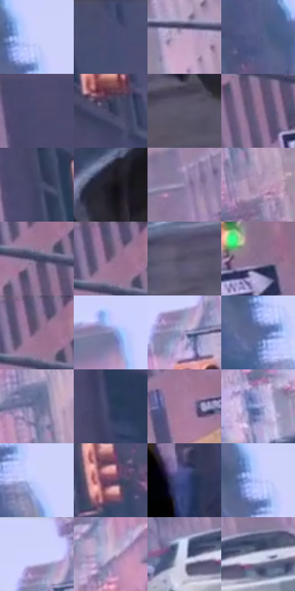

# 电影参考 495

- 状态：常规／活跃；来源世界：miles-home。
- 视角：rolled-or-dutch；景别：environment-wide；场景：street。
- 时段：daylight-time-unspecified（外观依据，中置信度；具体时间／晨昏未知）；光照：neutral-day。
- 材质候选：brick, glass, asphalt, painted-metal, sky（帧级，不是像素分割）。
- 明暗组：middle；L* P5/P50/P95：21.49121 / 43.93605 / 85.01484。
- 资格门禁：无附加门禁。
- 原截图 SHA-256：`33c7bc3175822e33437bf953e24f1c9f72fa7d0145574cce83e5b8dde54c4684`；尺寸：2880 × 1198。
- sRGB 像素 SHA-256：`d662d64364fea756ce5e8a625c95d581b2c4338f33b736ff4d03239304a59ded`。

## 观察与迁移

灰昼警灯街景，不因有警灯就整体夜景化。

浅亮天空、粉灰楼体、街上小人车列逐层简化，窗缘有轻分色；白天街景不套夜店霓虹。

54  /  495  /  屋顶、冲击插帧与巷道：浅亮天空、粉灰楼体、街上小人车列逐层简化，窗缘有轻分色；白天街景不套夜店霓虹。

本公开版保存32个128×128原像素色卡上下文；图集格子并非原场景相邻位置。原rect、图集tile和像素SHA见 `data/palette-crops.json`。上下文不足时不得批准替色，不能以小样推断完整构图。

## 实测色卡

颜色比例分母为保留采样像素，不是材料面积；全部 32 色参与全库匹配。表内四舍五入仅用于阅读，原精度在 JSON。

| ID | HEX | Lab | 原图 xy | 像素数 | 比例 | 明度角色 |
| --- | --- | --- | --- | ---: | ---: | --- |
| 495-S01 | #CCD1FB | [84.690502, 6.752154, -21.082813] | [852, 188] | 22198 | 11.522570% | highlight |
| 495-S02 | #4B4F75 | [34.745528, 8.381385, -22.215475] | [440, 36] | 10700 | 5.554171% | shadow |
| 495-S03 | #C3A6C6 | [71.522621, 16.254929, -12.391134] | [2160, 116] | 10183 | 5.285806% | light |
| 495-S04 | #555B85 | [39.759135, 8.521856, -24.188362] | [924, 608] | 10027 | 5.204830% | shadow |
| 495-S05 | #4D4A6E | [33.137488, 10.232187, -20.325799] | [72, 68] | 9391 | 4.874694% | shadow |
| 495-S06 | #333551 | [23.148629, 6.938575, -17.327774] | [236, 404] | 8774 | 4.554420% | shadow |
| 495-S07 | #59556A | [37.227651, 6.369614, -11.456148] | [2652, 888] | 7936 | 4.119430% | shadow |
| 495-S08 | #967597 | [53.429309, 19.047639, -13.42745] | [2432, 192] | 7592 | 3.940866% | midtone |
| 495-S09 | #434768 | [31.111524, 7.170706, -19.751422] | [108, 272] | 7587 | 3.938271% | shadow |
| 495-S10 | #1D1B22 | [10.263201, 2.810003, -4.453748] | [2720, 452] | 7523 | 3.905050% | deep-shadow |
| 495-S11 | #978AAE | [59.718627, 12.114435, -17.143279] | [2212, 592] | 6904 | 3.583738% | midtone |
| 495-S12 | #B093B4 | [64.478135, 16.789633, -13.127347] | [2044, 392] | 6889 | 3.575952% | light |
| 495-S13 | #414260 | [29.068182, 7.433395, -17.828502] | [2400, 124] | 6873 | 3.567647% | shadow |
| 495-S14 | #5F5974 | [39.307085, 8.498596, -14.423986] | [2392, 36] | 6511 | 3.379739% | shadow |
| 495-S15 | #524C65 | [33.778396, 8.262735, -13.633711] | [1876, 988] | 5814 | 3.017939% | shadow |
| 495-S16 | #876F8F | [50.100808, 15.582314, -13.914414] | [2604, 196] | 5801 | 3.011191% | midtone |
| 495-S17 | #6E5F7D | [42.733241, 12.294362, -14.56849] | [2396, 44] | 5401 | 2.803559% | midtone |
| 495-S18 | #8186AF | [56.891532, 7.505558, -22.189851] | [1072, 584] | 5385 | 2.795254% | midtone |
| 495-S19 | #A19AC3 | [65.457967, 10.989234, -20.173553] | [1692, 120] | 5276 | 2.738674% | light |
| 495-S20 | #5D6996 | [45.125405, 7.142001, -26.007983] | [812, 248] | 5153 | 2.674827% | midtone |
| 495-S21 | #70769D | [50.493971, 6.988945, -21.71775] | [1996, 292] | 5145 | 2.670674% | midtone |
| 495-S22 | #333E61 | [26.768344, 6.008506, -22.142952] | [192, 748] | 4833 | 2.508721% | shadow |
| 495-S23 | #A980A1 | [58.459322, 21.417753, -11.445736] | [2436, 352] | 4471 | 2.320813% | midtone |
| 495-S24 | #A1ABE2 | [71.00338, 8.773306, -28.802921] | [1876, 708] | 3922 | 2.035837% | light |
| 495-S25 | #C9D0FE | [84.320412, 7.028951, -23.253363] | [888, 292] | 2981 | 1.547382% | highlight |
| 495-S26 | #6E4566 | [35.065166, 23.231973, -12.02008] | [516, 496] | 2208 | 1.146132% | shadow |
| 495-S27 | #3D4A85 | [33.09769, 12.886332, -34.79407] | [160, 1024] | 2128 | 1.104605% | shadow |
| 495-S28 | #B6C1F8 | [78.960905, 8.095434, -28.356938] | [832, 200] | 1809 | 0.939018% | light |
| 495-S29 | #CED3FE | [85.435626, 6.948883, -21.527678] | [1668, 32] | 1598 | 0.829492% | highlight |
| 495-S30 | #CEBFDE | [79.418422, 11.014946, -13.527537] | [1904, 444] | 1355 | 0.703355% | light |
| 495-S31 | #D4D9F6 | [87.131868, 3.955433, -14.704471] | [2104, 748] | 170 | 0.088244% | highlight |
| 495-S32 | #CFD6EC | [85.712484, 1.906894, -11.581357] | [2188, 740] | 110 | 0.057099% | highlight |

## 色阶与空间分布

- 采样 ROI：`[0.01, 0.02, 0.98, 0.94]`；步长：4；样本数：192648。
- 排除区：`[]`。
- 深暗、暗、中、亮、高光五段计数：`[8336, 75600, 47492, 32336, 28884]`。
- RGB 各 256 箱、L* 100 箱、13×5 色相明度表和 3×3 空间统计全部保存在 [总数据](../film-library.json)。
- [可视化档案](../../references/library.html)按需绘制直方图，不存 2,094 张重复图表图片。

## 纹理特征占比

**这是分块图像特征的面积占比，不是波点／排线／丝网／错版的精确语义覆盖率。** 窗格、发丝、织物也会产生方向或周期特征。
原图 ROI 像素 3081782；已测块覆盖 3081782（100.0000%）；未测 0。

| 特征 | 块覆盖像素 | 占已测面积 | 阈值敏感范围 |
| --- | ---: | ---: | --- |
| low-contrast | 360448 | 11.6961% | 10.6328% ~ 11.6961% |
| directional-structure | 777344 | 25.2238% | 10.7117% ~ 34.8159% |
| periodic-structure | 1927606 | 62.5484% | 54.0197% ~ 71.4160% |
| mixed-detail | 16384 | 0.5316% | 0.5316% ~ 6.1762% |

阈值敏感范围不是统计置信区间。逐块坐标、尺度、对比、方向一致性、频谱集中度、频率与角度见 [全量特征记录](../texture-features.jsonl)，以帧号定位。
四种印刷层的真实像素覆盖仍标为 `null`，不能填 0，也不能拿上表代替。不得据这些代理测量删除唯一证据。

[测量方法与保留策略](../../references/library-retention.md) · [分类索引](../archive/README.md)
