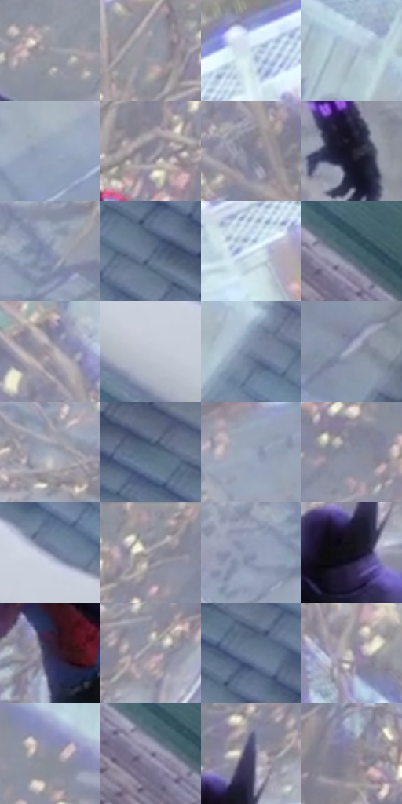

# 电影参考 496

- 状态：条件／活跃；来源世界：miles-home。
- 视角：high-angle；景别：environment-wide；场景：city。
- 时段：daylight-time-unspecified（外观依据，中置信度；具体时间／晨昏未知）；光照：neutral-day。
- 材质候选：skin, fabric, stone, wood, foliage, sky（帧级，不是像素分割）。
- 明暗组：light；L* P5/P50/P95：12.6299 / 60.69357 / 84.58146。
- 资格门禁：motion。
- 原截图 SHA-256：`6dcf8e1730be55e66f84c62c7f2f3fa92e2e923ca69d35d4e4f9962296f9e429`；尺寸：2880 × 1202。
- sRGB 像素 SHA-256：`6d04e0f8716a76aea2912e9ee34ccb9c0db6bd8ba84d4f9108263bf516fd59a3`。

## 观察与迁移

屋顶动作和现有玻璃碎片按原图事实，不新增破损。

屋顶近处人物较深，俯视庭院树篱棚屋低对比概括；空气感与失焦分开，不新添伤害。

55  /  496  /  屋顶、冲击插帧与巷道：屋顶近处人物较深，俯视庭院树篱棚屋低对比概括；空气感与失焦分开，不新添伤害。

本公开版保存32个128×128原像素色卡上下文；图集格子并非原场景相邻位置。原rect、图集tile和像素SHA见 `data/palette-crops.json`。上下文不足时不得批准替色，不能以小样推断完整构图。

## 实测色卡

颜色比例分母为保留采样像素，不是材料面积；全部 32 色参与全库匹配。表内四舍五入仅用于阅读，原精度在 JSON。

| ID | HEX | Lab | 原图 xy | 像素数 | 比例 | 明度角色 |
| --- | --- | --- | --- | ---: | ---: | --- |
| 496-S01 | #9798A2 | [63.047755, 1.629724, -5.348838] | [1840, 416] | 8865 | 4.601657% | light |
| 496-S02 | #9094A0 | [61.348332, 1.008097, -6.797678] | [1388, 72] | 8806 | 4.571031% | light |
| 496-S03 | #C3D5E4 | [84.375843, -3.024935, -9.421729] | [544, 180] | 7418 | 3.850546% | highlight |
| 496-S04 | #ADBED1 | [76.261302, -1.864736, -11.489472] | [2384, 240] | 7323 | 3.801233% | light |
| 496-S05 | #96A4BD | [67.057513, 0.49656, -14.489001] | [804, 972] | 7237 | 3.756592% | light |
| 496-S06 | #898595 | [56.350412, 4.73254, -8.004813] | [1448, 200] | 7163 | 3.718180% | midtone |
| 496-S07 | #808093 | [54.168772, 4.013161, -10.187152] | [940, 364] | 7161 | 3.717142% | midtone |
| 496-S08 | #1F1D2B | [11.58272, 4.840237, -9.048232] | [1844, 624] | 6756 | 3.506914% | deep-shadow |
| 496-S09 | #8892AD | [60.612196, 2.358973, -15.336051] | [1088, 796] | 6720 | 3.488227% | light |
| 496-S10 | #63748D | [48.342938, -0.134835, -15.688457] | [2776, 348] | 6692 | 3.473693% | midtone |
| 496-S11 | #D6E7F3 | [90.742396, -3.29209, -7.733952] | [328, 344] | 6459 | 3.352747% | highlight |
| 496-S12 | #445E6D | [38.442287, -5.544092, -11.624103] | [2384, 1060] | 6412 | 3.328350% | shadow |
| 496-S13 | #A7A0A6 | [66.604216, 3.650778, -2.203867] | [912, 260] | 6406 | 3.325236% | light |
| 496-S14 | #C0C7D2 | [80.013902, -0.271681, -6.302222] | [2488, 688] | 6286 | 3.262946% | highlight |
| 496-S15 | #73829D | [54.073342, 0.884728, -16.227336] | [2484, 336] | 6145 | 3.189755% | midtone |
| 496-S16 | #989FB3 | [65.534619, 1.679265, -11.186733] | [2556, 124] | 6120 | 3.176778% | light |
| 496-S17 | #A8AEBD | [71.057064, 0.901348, -8.36511] | [888, 572] | 6024 | 3.126947% | light |
| 496-S18 | #566B80 | [44.307041, -2.393161, -14.165955] | [2736, 220] | 6003 | 3.116046% | midtone |
| 496-S19 | #9FAAC0 | [69.416343, 0.762741, -12.540237] | [620, 468] | 5941 | 3.083863% | light |
| 496-S20 | #888E9F | [59.051108, 1.421497, -9.718848] | [1708, 104] | 5854 | 3.038703% | midtone |
| 496-S21 | #7E88A3 | [56.769804, 2.441132, -15.519233] | [2528, 608] | 5769 | 2.994581% | midtone |
| 496-S22 | #9B9DAA | [64.95028, 1.887151, -6.993842] | [1524, 40] | 5478 | 2.843528% | light |
| 496-S23 | #9099B4 | [63.34812, 2.630451, -15.09579] | [1008, 836] | 5475 | 2.841971% | light |
| 496-S24 | #11101A | [5.097467, 2.723293, -6.251542] | [1600, 392] | 5336 | 2.769819% | deep-shadow |
| 496-S25 | #302B42 | [19.011058, 8.252947, -13.666059] | [1380, 440] | 4822 | 2.503011% | deep-shadow |
| 496-S26 | #978E9A | [60.121579, 5.635934, -5.141599] | [1712, 276] | 4771 | 2.476538% | light |
| 496-S27 | #6B7D95 | [51.794503, -0.790833, -15.09003] | [2796, 272] | 4694 | 2.436568% | midtone |
| 496-S28 | #B7B1B9 | [72.901403, 3.609783, -3.308782] | [1132, 184] | 4626 | 2.401271% | light |
| 496-S29 | #8B8D9C | [58.917598, 2.365777, -8.179645] | [1880, 108] | 4434 | 2.301607% | midtone |
| 496-S30 | #77758D | [50.177169, 5.950237, -12.760878] | [2360, 1080] | 4382 | 2.274615% | midtone |
| 496-S31 | #444266 | [29.624565, 10.191056, -20.785961] | [1628, 308] | 4102 | 2.129272% | shadow |
| 496-S32 | #908C9C | [59.053531, 4.684882, -7.933742] | [1300, 560] | 2968 | 1.540634% | midtone |

## 色阶与空间分布

- 采样 ROI：`[0.01, 0.02, 0.98, 0.94]`；步长：4；样本数：192648。
- 排除区：`[]`。
- 深暗、暗、中、亮、高光五段计数：`[15072, 10668, 64592, 85179, 17137]`。
- RGB 各 256 箱、L* 100 箱、13×5 色相明度表和 3×3 空间统计全部保存在 [总数据](../film-library.json)。
- [可视化档案](../../references/library.html)按需绘制直方图，不存 2,094 张重复图表图片。

## 纹理特征占比

**这是分块图像特征的面积占比，不是波点／排线／丝网／错版的精确语义覆盖率。** 窗格、发丝、织物也会产生方向或周期特征。
原图 ROI 像素 3087370；已测块覆盖 3087370（100.0000%）；未测 0。

| 特征 | 块覆盖像素 | 占已测面积 | 阈值敏感范围 |
| --- | ---: | ---: | --- |
| low-contrast | 0 | 0.0000% | 0.0000% ~ 2.0688% |
| directional-structure | 603392 | 19.5439% | 8.3996% ~ 28.3830% |
| periodic-structure | 2338186 | 75.7339% | 70.7505% ~ 78.1054% |
| mixed-detail | 145792 | 4.7222% | 0.8665% ~ 11.4262% |

阈值敏感范围不是统计置信区间。逐块坐标、尺度、对比、方向一致性、频谱集中度、频率与角度见 [全量特征记录](../texture-features.jsonl)，以帧号定位。
四种印刷层的真实像素覆盖仍标为 `null`，不能填 0，也不能拿上表代替。不得据这些代理测量删除唯一证据。

[测量方法与保留策略](../../references/library-retention.md) · [分类索引](../archive/README.md)
