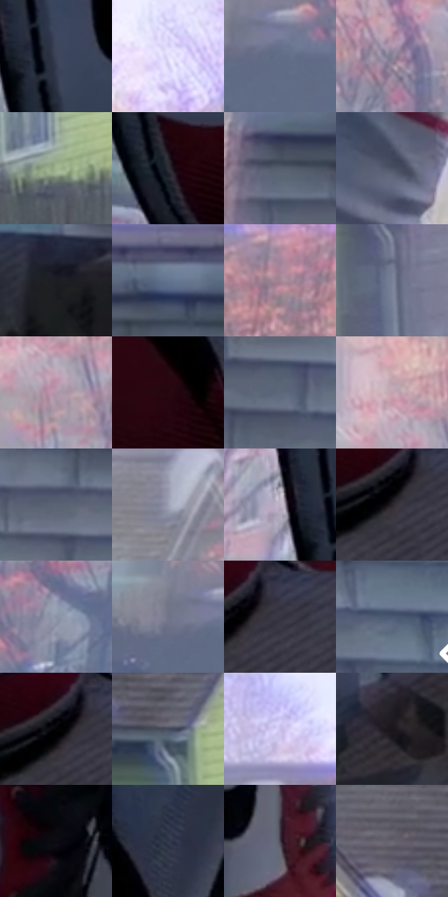

# 电影参考 497

- 状态：条件／活跃；来源世界：miles-home。
- 视角：near-level；景别：detail；场景：city。
- 时段：daylight-time-unspecified（外观依据，中置信度；具体时间／晨昏未知）；光照：neutral-day。
- 材质候选：skin, fabric, stone, wood, foliage, sky（帧级，不是像素分割）。
- 明暗组：middle；L* P5/P50/P95：3.68327 / 43.42128 / 82.27818。
- 资格门禁：motion。
- 原截图 SHA-256：`76d10614080f5e7bfc6ecbac168b3329ceb051b89f526c81f44e7cf88399c77f`；尺寸：2880 × 1210。
- sRGB 像素 SHA-256：`fc55cda173a09a1230f979f5274fc885d219359a20e0f0f7bf210d5060c515c2`。

## 观察与迁移

屋顶动作和现有玻璃碎片按原图事实，不新增破损。

红白鞋是清楚焦点，后方彩色房屋树木雾化，近屋顶物理碎块仍有体量；焦点不必是脸。

56  /  497  /  屋顶、冲击插帧与巷道：红白鞋是清楚焦点，后方彩色房屋树木雾化，近屋顶物理碎块仍有体量；焦点不必是脸。

本公开版保存32个128×128原像素色卡上下文；图集格子并非原场景相邻位置。原rect、图集tile和像素SHA见 `data/palette-crops.json`。上下文不足时不得批准替色，不能以小样推断完整构图。

## 实测色卡

颜色比例分母为保留采样像素，不是材料面积；全部 32 色参与全库匹配。表内四舍五入仅用于阅读，原精度在 JSON。

| ID | HEX | Lab | 原图 xy | 像素数 | 比例 | 明度角色 |
| --- | --- | --- | --- | ---: | ---: | --- |
| 497-S01 | #3D4458 | [28.981311, 2.424299, -12.838195] | [1072, 556] | 9423 | 4.856115% | shadow |
| 497-S02 | #E4E0FD | [90.274011, 6.767263, -13.556917] | [2036, 72] | 8510 | 4.385603% | highlight |
| 497-S03 | #606C85 | [45.503639, 1.562325, -15.275552] | [1772, 612] | 8356 | 4.306240% | midtone |
| 497-S04 | #888398 | [55.820182, 6.176695, -10.538488] | [1956, 392] | 7501 | 3.865618% | midtone |
| 497-S05 | #9FB48F | [70.868437, -14.095095, 16.509623] | [312, 764] | 7446 | 3.837274% | light |
| 497-S06 | #2D2E38 | [19.213345, 2.138423, -6.508513] | [1096, 704] | 7126 | 3.672363% | deep-shadow |
| 497-S07 | #555E6D | [39.648687, 0.111947, -9.684487] | [2468, 248] | 7022 | 3.618767% | shadow |
| 497-S08 | #4B5266 | [34.982218, 2.223153, -12.482353] | [1540, 140] | 6840 | 3.524974% | shadow |
| 497-S09 | #1D1E22 | [11.312054, 0.59887, -2.882979] | [2348, 904] | 6805 | 3.506937% | deep-shadow |
| 497-S10 | #63748E | [48.380485, 0.129021, -16.222103] | [2720, 196] | 6722 | 3.464163% | midtone |
| 497-S11 | #A48696 | [59.108719, 14.16949, -4.217937] | [832, 180] | 6574 | 3.387891% | midtone |
| 497-S12 | #788197 | [53.949938, 1.624508, -12.901526] | [572, 448] | 6427 | 3.312135% | midtone |
| 497-S13 | #AF99AA | [65.592053, 11.157851, -5.856779] | [1792, 380] | 6386 | 3.291006% | light |
| 497-S14 | #260710 | [5.433756, 16.026375, 1.42785] | [1260, 256] | 6354 | 3.274515% | deep-shadow |
| 497-S15 | #5D687C | [43.774288, 0.635291, -12.520158] | [2648, 584] | 6291 | 3.242048% | midtone |
| 497-S16 | #C3A3AF | [70.10069, 13.721002, -1.790588] | [1764, 308] | 6189 | 3.189483% | light |
| 497-S17 | #5A6373 | [41.743419, 0.338352, -10.158797] | [2508, 404] | 6142 | 3.165261% | midtone |
| 497-S18 | #9B9FB3 | [65.763496, 2.681007, -10.82046] | [644, 196] | 5916 | 3.048793% | light |
| 497-S19 | #BDB1C6 | [73.765883, 8.182135, -9.094614] | [992, 532] | 5865 | 3.022510% | light |
| 497-S20 | #29242B | [14.994673, 4.008578, -3.772156] | [1428, 836] | 5743 | 2.959638% | deep-shadow |
| 497-S21 | #8993A6 | [60.727228, 0.503851, -11.184901] | [2008, 544] | 5549 | 2.859661% | light |
| 497-S22 | #73758B | [49.775339, 4.09673, -12.221569] | [1716, 592] | 5430 | 2.798334% | midtone |
| 497-S23 | #373641 | [23.108665, 3.122931, -6.666281] | [1476, 816] | 5397 | 2.781328% | shadow |
| 497-S24 | #4B5971 | [37.540035, 0.886501, -15.422083] | [2780, 560] | 5159 | 2.658675% | shadow |
| 497-S25 | #030206 | [0.685803, 0.81764, -1.42149] | [1424, 816] | 5133 | 2.645276% | deep-shadow |
| 497-S26 | #484D5D | [32.866007, 1.920717, -10.042951] | [176, 388] | 5099 | 2.627755% | shadow |
| 497-S27 | #CBC0EC | [79.870062, 12.35707, -20.395931] | [696, 72] | 5089 | 2.622601% | light |
| 497-S28 | #1A161B | [7.881855, 3.258619, -2.794945] | [2808, 952] | 4509 | 2.323700% | deep-shadow |
| 497-S29 | #0C0C13 | [3.50581, 1.298752, -3.534876] | [1308, 500] | 4405 | 2.270104% | deep-shadow |
| 497-S30 | #31384B | [23.63556, 2.352033, -12.600963] | [1340, 160] | 4091 | 2.108285% | shadow |
| 497-S31 | #433C48 | [26.42745, 5.711061, -6.218113] | [1492, 600] | 3510 | 1.808868% | shadow |
| 497-S32 | #696471 | [43.226431, 4.703022, -6.591055] | [76, 312] | 3035 | 1.564078% | midtone |

## 色阶与空间分布

- 采样 ROI：`[0.01, 0.02, 0.98, 0.94]`；步长：4；样本数：194044。
- 排除区：`[]`。
- 深暗、暗、中、亮、高光五段计数：`[37965, 46492, 57542, 40907, 11138]`。
- RGB 各 256 箱、L* 100 箱、13×5 色相明度表和 3×3 空间统计全部保存在 [总数据](../film-library.json)。
- [可视化档案](../../references/library.html)按需绘制直方图，不存 2,094 张重复图表图片。

## 纹理特征占比

**这是分块图像特征的面积占比，不是波点／排线／丝网／错版的精确语义覆盖率。** 窗格、发丝、织物也会产生方向或周期特征。
原图 ROI 像素 3109722；已测块覆盖 3109722（100.0000%）；未测 0。

| 特征 | 块覆盖像素 | 占已测面积 | 阈值敏感范围 |
| --- | ---: | ---: | --- |
| low-contrast | 11392 | 0.3663% | 0.3663% ~ 1.2595% |
| directional-structure | 819328 | 26.3473% | 11.9368% ~ 36.5429% |
| periodic-structure | 2115162 | 68.0177% | 62.5639% ~ 77.3202% |
| mixed-detail | 163840 | 5.2686% | 0.5269% ~ 9.4835% |

阈值敏感范围不是统计置信区间。逐块坐标、尺度、对比、方向一致性、频谱集中度、频率与角度见 [全量特征记录](../texture-features.jsonl)，以帧号定位。
四种印刷层的真实像素覆盖仍标为 `null`，不能填 0，也不能拿上表代替。不得据这些代理测量删除唯一证据。

[测量方法与保留策略](../../references/library-retention.md) · [分类索引](../archive/README.md)
