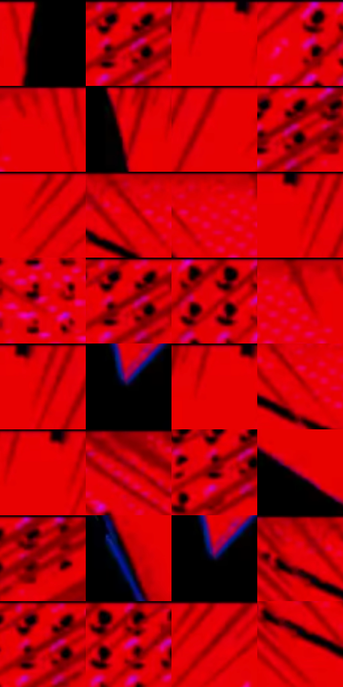

# 电影参考 498

- 状态：条件／活跃；来源世界：miles-home。
- 视角：graphic-nonphysical；景别：close-up；场景：graphic。
- 时段：graphic-no-physical-time（外观依据，中置信度；具体时间／晨昏未知）；光照：graphic-field。
- 材质候选：skin, fabric, stone（帧级，不是像素分割）。
- 明暗组：middle；L* P5/P50/P95：0.0 / 45.52027 / 49.30805。
- 资格门禁：impact。
- 原截图 SHA-256：`73af82bcba61b680b29bea31f93bdea21fb5b698275956a9ceaf7832ef60d00f`；尺寸：2880 × 1198。
- sRGB 像素 SHA-256：`c22292df6d6cbbc98d7867cf1499eb39b0e2ed98f0a885b89e8c0a70f75a86fd`。

## 观察与迁移

红黑点阵与巨字，屋顶锚点仍存在；图形色不当普通阴影。

红色冲击插帧里头部近黑，仅黄眼嘴可见，黑放射线与粉黑点阵并存；不把普通肤色涂黑。

57  /  498  /  屋顶、冲击插帧与巷道：红色冲击插帧里头部近黑，仅黄眼嘴可见，黑放射线与粉黑点阵并存；不把普通肤色涂黑。

本公开版保存32个128×128原像素色卡上下文；图集格子并非原场景相邻位置。原rect、图集tile和像素SHA见 `data/palette-crops.json`。上下文不足时不得批准替色，不能以小样推断完整构图。

## 实测色卡

颜色比例分母为保留采样像素，不是材料面积；全部 32 色参与全库匹配。表内四舍五入仅用于阅读，原精度在 JSON。

| ID | HEX | Lab | 原图 xy | 像素数 | 比例 | 明度角色 |
| --- | --- | --- | --- | ---: | ---: | --- |
| 498-S01 | #000000 | [0.0, 0.0, 0.0] | [1228, 24] | 53012 | 27.517545% | deep-shadow |
| 498-S02 | #E80200 | [48.51724, 74.408366, 62.584364] | [2704, 24] | 19857 | 10.307400% | midtone |
| 498-S03 | #E90102 | [48.704894, 74.744876, 62.200902] | [1712, 24] | 15234 | 7.907687% | midtone |
| 498-S04 | #E40002 | [47.62873, 73.60983, 61.153421] | [2124, 32] | 8497 | 4.410635% | midtone |
| 498-S05 | #E50006 | [47.850093, 73.883495, 60.217524] | [1092, 24] | 7616 | 3.953324% | midtone |
| 498-S06 | #E80202 | [48.522716, 74.4234, 62.004142] | [1620, 24] | 6887 | 3.574914% | midtone |
| 498-S07 | #BD0004 | [39.294687, 63.984301, 52.110104] | [1872, 24] | 6495 | 3.371434% | shadow |
| 498-S08 | #860106 | [27.031488, 49.586316, 37.486329] | [2732, 48] | 6451 | 3.348594% | shadow |
| 498-S09 | #A50001 | [33.991619, 57.833755, 47.788456] | [1956, 24] | 6378 | 3.310701% | shadow |
| 498-S10 | #CC0106 | [42.576579, 67.654889, 54.771453] | [844, 24] | 6121 | 3.177297% | midtone |
| 498-S11 | #EC0006 | [49.316064, 75.578043, 61.714326] | [920, 24] | 5650 | 2.932810% | midtone |
| 498-S12 | #DF0006 | [46.586858, 72.42336, 58.923878] | [1768, 24] | 5607 | 2.910490% | midtone |
| 498-S13 | #E8025D | [49.489949, 77.049948, 17.107677] | [420, 256] | 5479 | 2.844047% | midtone |
| 498-S14 | #E70000 | [48.253228, 74.323305, 62.362176] | [2700, 28] | 4767 | 2.474461% | midtone |
| 498-S15 | #D70002 | [44.880306, 70.431481, 58.431397] | [2232, 28] | 3421 | 1.775778% | midtone |
| 498-S16 | #E9011F | [48.822127, 75.065788, 52.164936] | [996, 64] | 3376 | 1.752419% | midtone |
| 498-S17 | #EA000D | [48.917697, 75.148575, 59.393766] | [1784, 24] | 3369 | 1.748785% | midtone |
| 498-S18 | #040309 | [0.99955, 1.09571, -2.178304] | [1856, 680] | 2702 | 1.402558% | deep-shadow |
| 498-S19 | #EA0001 | [48.884524, 75.057819, 62.683211] | [1704, 24] | 2693 | 1.397886% | midtone |
| 498-S20 | #D70202 | [44.941189, 70.254927, 58.454677] | [872, 88] | 2526 | 1.311200% | midtone |
| 498-S21 | #ED0102 | [49.540501, 75.714, 63.026841] | [1732, 24] | 2273 | 1.179872% | midtone |
| 498-S22 | #9F010D | [32.753608, 56.302157, 41.401696] | [440, 52] | 2174 | 1.128483% | shadow |
| 498-S23 | #4F0005 | [13.672681, 34.425347, 19.34868] | [2672, 92] | 2106 | 1.093185% | deep-shadow |
| 498-S24 | #BB022B | [39.217815, 64.041285, 33.07726] | [1068, 580] | 1691 | 0.877767% | shadow |
| 498-S25 | #D90015 | [45.373907, 71.11082, 52.575469] | [2800, 40] | 1559 | 0.809248% | midtone |
| 498-S26 | #240302 | [4.016898, 14.275578, 5.457491] | [1744, 356] | 1543 | 0.800943% | deep-shadow |
| 498-S27 | #161031 | [6.890738, 13.405226, -20.911154] | [1852, 676] | 1461 | 0.758378% | deep-shadow |
| 498-S28 | #E60011 | [48.094633, 74.220805, 57.193686] | [768, 48] | 1346 | 0.698684% | midtone |
| 498-S29 | #E90100 | [48.699449, 74.72995, 62.778327] | [2696, 28] | 1000 | 0.519081% | midtone |
| 498-S30 | #AF0106 | [36.275037, 60.339623, 48.169199] | [2292, 36] | 978 | 0.507662% | shadow |
| 498-S31 | #F10104 | [50.378653, 76.69416, 63.312428] | [2000, 40] | 279 | 0.144824% | midtone |
| 498-S32 | #F40002 | [50.971346, 77.475451, 64.455355] | [788, 116] | 100 | 0.051908% | midtone |

## 色阶与空间分布

- 采样 ROI：`[0.01, 0.02, 0.98, 0.94]`；步长：4；样本数：192648。
- 排除区：`[]`。
- 深暗、暗、中、亮、高光五段计数：`[60478, 21088, 110767, 261, 54]`。
- RGB 各 256 箱、L* 100 箱、13×5 色相明度表和 3×3 空间统计全部保存在 [总数据](../film-library.json)。
- [可视化档案](../../references/library.html)按需绘制直方图，不存 2,094 张重复图表图片。

## 纹理特征占比

**这是分块图像特征的面积占比，不是波点／排线／丝网／错版的精确语义覆盖率。** 窗格、发丝、织物也会产生方向或周期特征。
原图 ROI 像素 3081782；已测块覆盖 3081782（100.0000%）；未测 0。

| 特征 | 块覆盖像素 | 占已测面积 | 阈值敏感范围 |
| --- | ---: | ---: | --- |
| low-contrast | 852352 | 27.6578% | 24.9996% ~ 32.4425% |
| directional-structure | 954752 | 30.9805% | 18.2211% ~ 40.8989% |
| periodic-structure | 1258294 | 40.8301% | 34.1015% ~ 48.2730% |
| mixed-detail | 16384 | 0.5316% | 0.0000% ~ 1.0633% |

阈值敏感范围不是统计置信区间。逐块坐标、尺度、对比、方向一致性、频谱集中度、频率与角度见 [全量特征记录](../texture-features.jsonl)，以帧号定位。
四种印刷层的真实像素覆盖仍标为 `null`，不能填 0，也不能拿上表代替。不得据这些代理测量删除唯一证据。

[测量方法与保留策略](../../references/library-retention.md) · [分类索引](../archive/README.md)
