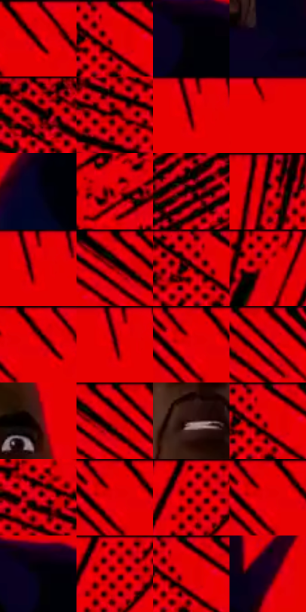

# 电影参考 499

- 状态：条件／活跃；来源世界：miles-home。
- 视角：graphic-nonphysical；景别：medium；场景：graphic。
- 时段：graphic-no-physical-time（外观依据，中置信度；具体时间／晨昏未知）；光照：graphic-field。
- 材质候选：skin, fabric, stone（帧级，不是像素分割）。
- 明暗组：middle；L* P5/P50/P95：0.62749 / 48.04614 / 49.33239。
- 资格门禁：impact。
- 原截图 SHA-256：`0f8ecb4f9f3b29e8cceb7e8ce1f4a8ed3ee57a6b8317c01c7592e6e8adf0b87a`；尺寸：2880 × 1208。
- sRGB 像素 SHA-256：`e7ff55a3d8f0b79fc857232b2782822e819622ef2d9f7c607e6f621b7e49f515`。

## 观察与迁移

红黑点阵与巨字，屋顶锚点仍存在；图形色不当普通阴影。

相近红底冲击画面让面部重新可读，黑线与点阵退至边缘；不由静帧推算持续时间。

58  /  499  /  屋顶、冲击插帧与巷道：相近红底冲击画面让面部重新可读，黑线与点阵退至边缘；不由静帧推算持续时间。

本公开版保存32个128×128原像素色卡上下文；图集格子并非原场景相邻位置。原rect、图集tile和像素SHA见 `data/palette-crops.json`。上下文不足时不得批准替色，不能以小样推断完整构图。

## 实测色卡

颜色比例分母为保留采样像素，不是材料面积；全部 32 色参与全库匹配。表内四舍五入仅用于阅读，原精度在 JSON。

| ID | HEX | Lab | 原图 xy | 像素数 | 比例 | 明度角色 |
| --- | --- | --- | --- | ---: | ---: | --- |
| 499-S01 | #E90102 | [48.704894, 74.744876, 62.200902] | [812, 28] | 39868 | 20.620028% | midtone |
| 499-S02 | #E80200 | [48.51724, 74.408366, 62.584364] | [328, 36] | 30807 | 15.933611% | midtone |
| 499-S03 | #020206 | [0.627494, 0.55614, -1.513628] | [1796, 880] | 10186 | 5.268276% | deep-shadow |
| 499-S04 | #09021F | [1.810169, 7.829212, -15.17383] | [1568, 696] | 9407 | 4.865371% | deep-shadow |
| 499-S05 | #E50011 | [47.884928, 73.978766, 56.961714] | [64, 32] | 6967 | 3.603385% | midtone |
| 499-S06 | #570103 | [15.774261, 36.35276, 23.271982] | [144, 380] | 6366 | 3.292543% | deep-shadow |
| 499-S07 | #990008 | [31.328834, 54.810749, 41.905751] | [1112, 56] | 6349 | 3.283750% | shadow |
| 499-S08 | #E50003 | [47.841705, 73.860543, 61.070162] | [996, 32] | 6188 | 3.200480% | midtone |
| 499-S09 | #03031D | [1.564112, 5.21118, -13.977656] | [1000, 956] | 6175 | 3.193756% | deep-shadow |
| 499-S10 | #C7000C | [41.489295, 66.565293, 51.674735] | [2608, 76] | 6101 | 3.155483% | midtone |
| 499-S11 | #370202 | [7.770943, 25.906859, 11.413092] | [2756, 176] | 5190 | 2.684307% | deep-shadow |
| 499-S12 | #1B0201 | [2.517421, 8.780434, 3.521254] | [1624, 40] | 4327 | 2.237957% | deep-shadow |
| 499-S13 | #B30105 | [37.150801, 61.350453, 49.486985] | [1124, 28] | 4126 | 2.133998% | shadow |
| 499-S14 | #DD0005 | [46.161424, 71.926969, 58.785101] | [496, 32] | 4090 | 2.115379% | midtone |
| 499-S15 | #D90013 | [45.364067, 71.083933, 53.381418] | [284, 48] | 3892 | 2.012972% | midtone |
| 499-S16 | #D40209 | [44.325794, 69.572905, 55.645854] | [1768, 48] | 3558 | 1.840224% | midtone |
| 499-S17 | #E80009 | [48.487603, 74.633388, 60.05114] | [788, 28] | 3481 | 1.800399% | midtone |
| 499-S18 | #810108 | [25.885874, 48.271214, 35.207929] | [1108, 44] | 3392 | 1.754368% | shadow |
| 499-S19 | #E90104 | [48.710338, 74.759797, 61.637106] | [732, 28] | 3274 | 1.693337% | midtone |
| 499-S20 | #710102 | [22.081094, 43.757768, 32.62742] | [592, 64] | 3172 | 1.640582% | shadow |
| 499-S21 | #47211C | [17.970521, 17.546468, 11.642536] | [1528, 368] | 3016 | 1.559898% | deep-shadow |
| 499-S22 | #EF0008 | [49.947071, 76.315745, 61.830452] | [536, 28] | 2705 | 1.399046% | midtone |
| 499-S23 | #290A08 | [6.378766, 15.49228, 6.566887] | [1420, 564] | 2561 | 1.324568% | deep-shadow |
| 499-S24 | #E50006 | [47.850093, 73.883495, 60.217524] | [324, 28] | 2457 | 1.270779% | midtone |
| 499-S25 | #B20112 | [36.991812, 61.26157, 44.077846] | [44, 300] | 2442 | 1.263021% | shadow |
| 499-S26 | #EE0006 | [49.733406, 76.060473, 62.139617] | [736, 32] | 2312 | 1.195784% | midtone |
| 499-S27 | #EF000D | [49.960853, 76.353442, 60.508564] | [1896, 32] | 2242 | 1.159579% | midtone |
| 499-S28 | #EA0004 | [48.892645, 75.080042, 61.836452] | [740, 28] | 2115 | 1.093894% | midtone |
| 499-S29 | #04010D | [0.691683, 2.489134, -4.362961] | [1780, 860] | 1963 | 1.015278% | deep-shadow |
| 499-S30 | #F50110 | [51.241889, 77.747009, 60.95909] | [1912, 40] | 1885 | 0.974936% | midtone |
| 499-S31 | #EA0000 | [48.881817, 75.050409, 62.972264] | [340, 44] | 1461 | 0.755640% | midtone |
| 499-S32 | #1B001E | [2.951838, 15.389958, -12.500639] | [1684, 660] | 1271 | 0.657371% | deep-shadow |

## 色阶与空间分布

- 采样 ROI：`[0.01, 0.02, 0.98, 0.94]`；步长：4；样本数：193346。
- 排除区：`[]`。
- 深暗、暗、中、亮、高光五段计数：`[49795, 20816, 122720, 15, 0]`。
- RGB 各 256 箱、L* 100 箱、13×5 色相明度表和 3×3 空间统计全部保存在 [总数据](../film-library.json)。
- [可视化档案](../../references/library.html)按需绘制直方图，不存 2,094 张重复图表图片。

## 纹理特征占比

**这是分块图像特征的面积占比，不是波点／排线／丝网／错版的精确语义覆盖率。** 窗格、发丝、织物也会产生方向或周期特征。
原图 ROI 像素 3104134；已测块覆盖 3104134（100.0000%）；未测 0。

| 特征 | 块覆盖像素 | 占已测面积 | 阈值敏感范围 |
| --- | ---: | ---: | --- |
| low-contrast | 788352 | 25.3968% | 24.3412% ~ 29.0915% |
| directional-structure | 925440 | 29.8131% | 18.2920% ~ 37.9984% |
| periodic-structure | 1308422 | 42.1510% | 37.1326% ~ 48.2043% |
| mixed-detail | 81920 | 2.6391% | 0.5278% ~ 4.4122% |

阈值敏感范围不是统计置信区间。逐块坐标、尺度、对比、方向一致性、频谱集中度、频率与角度见 [全量特征记录](../texture-features.jsonl)，以帧号定位。
四种印刷层的真实像素覆盖仍标为 `null`，不能填 0，也不能拿上表代替。不得据这些代理测量删除唯一证据。

[测量方法与保留策略](../../references/library-retention.md) · [分类索引](../archive/README.md)
