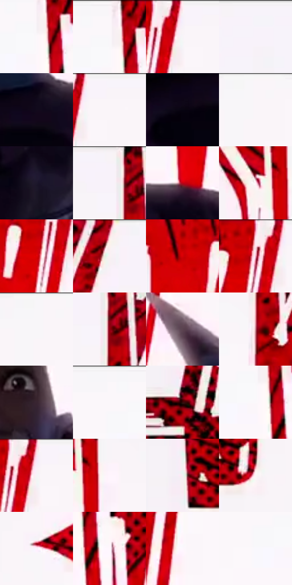

# 电影参考 500

- 状态：条件／活跃；来源世界：miles-home。
- 视角：graphic-nonphysical；景别：medium；场景：graphic。
- 时段：graphic-no-physical-time（外观依据，中置信度；具体时间／晨昏未知）；光照：graphic-field。
- 材质候选：skin, fabric, stone（帧级，不是像素分割）。
- 明暗组：very-light；L* P5/P50/P95：2.90034 / 96.09496 / 97.70536。
- 资格门禁：impact。
- 原截图 SHA-256：`eb2d4362f0d8e5ca785bd28b42cdce362729230461f3ffd1aa7847237df66b58`；尺寸：2880 × 1212。
- sRGB 像素 SHA-256：`5dbe69eefee2cdf8d36c9687c4cecb645730d0a2c5f7c34f08afba67f000d248`。

## 观察与迁移

红黑点阵与巨字，屋顶锚点仍存在；图形色不当普通阴影。

巨白拟声字占据红黑背景，人物遮在文字之前；未确认文字时只借尺度关系，不复制字。

59  /  500  /  屋顶、冲击插帧与巷道：巨白拟声字占据红黑背景，人物遮在文字之前；未确认文字时只借尺度关系，不复制字。

本公开版保存32个128×128原像素色卡上下文；图集格子并非原场景相邻位置。原rect、图集tile和像素SHA见 `data/palette-crops.json`。上下文不足时不得批准替色，不能以小样推断完整构图。

## 实测色卡

颜色比例分母为保留采样像素，不是材料面积；全部 32 色参与全库匹配。表内四舍五入仅用于阅读，原精度在 JSON。

| ID | HEX | Lab | 原图 xy | 像素数 | 比例 | 明度角色 |
| --- | --- | --- | --- | ---: | ---: | --- |
| 500-S01 | #FCF7FB | [97.705363, 2.355223, -1.321001] | [1764, 88] | 18466 | 9.516398% | highlight |
| 500-S02 | #FBF6FA | [97.358571, 2.357035, -1.322004] | [1760, 28] | 18004 | 9.278308% | highlight |
| 500-S03 | #F6F1F7 | [95.671852, 2.720251, -2.28742] | [1296, 28] | 13022 | 6.710849% | highlight |
| 500-S04 | #F8F3FA | [96.393525, 2.893716, -2.762978] | [2740, 48] | 11291 | 5.818783% | highlight |
| 500-S05 | #120A1C | [3.879783, 6.525177, -9.62198] | [1664, 836] | 11169 | 5.755911% | deep-shadow |
| 500-S06 | #F9F4F8 | [96.664188, 2.360684, -1.324025] | [1336, 28] | 9669 | 4.982890% | highlight |
| 500-S07 | #080410 | [1.588563, 2.863373, -4.577698] | [1568, 876] | 8890 | 4.581435% | deep-shadow |
| 500-S08 | #FAF5F9 | [97.011513, 2.358855, -1.323012] | [1496, 28] | 8366 | 4.311393% | highlight |
| 500-S09 | #1D182C | [9.769214, 8.125138, -12.611023] | [1804, 976] | 7701 | 3.968688% | deep-shadow |
| 500-S10 | #F8F2F7 | [96.069871, 2.872553, -1.686318] | [2364, 28] | 7347 | 3.786255% | highlight |
| 500-S11 | #BF0414 | [39.944206, 64.25832, 46.601035] | [1828, 788] | 7027 | 3.621344% | shadow |
| 500-S12 | #FEF2F9 | [96.580745, 5.217473, -1.917856] | [592, 180] | 6848 | 3.529096% | highlight |
| 500-S13 | #E30005 | [47.426878, 73.38983, 60.071653] | [1224, 108] | 6488 | 3.343572% | midtone |
| 500-S14 | #FAF0F2 | [95.603619, 3.690914, 0.237833] | [2540, 52] | 5578 | 2.874606% | highlight |
| 500-S15 | #D60006 | [44.680003, 70.219414, 56.963776] | [1124, 80] | 5537 | 2.853477% | midtone |
| 500-S16 | #F5D6DD | [88.317647, 11.882703, 0.532242] | [1244, 52] | 5386 | 2.775659% | highlight |
| 500-S17 | #F8F6F9 | [97.108806, 1.188718, -1.198336] | [1480, 28] | 5332 | 2.747830% | highlight |
| 500-S18 | #910110 | [29.615543, 52.692141, 36.166339] | [2392, 88] | 5154 | 2.656099% | shadow |
| 500-S19 | #5B4350 | [31.388737, 12.734207, -3.75217] | [1228, 636] | 4636 | 2.389149% | shadow |
| 500-S20 | #BE7881 | [58.005993, 28.535087, 6.625659] | [2388, 200] | 4597 | 2.369050% | midtone |
| 500-S21 | #392531 | [17.52913, 11.77505, -4.027338] | [1520, 436] | 4146 | 2.136629% | deep-shadow |
| 500-S22 | #FBF7FA | [97.605005, 1.848829, -0.961402] | [1696, 32] | 4133 | 2.129929% | highlight |
| 500-S23 | #370A0B | [9.431158, 22.277805, 10.138187] | [2768, 1116] | 2715 | 1.399167% | deep-shadow |
| 500-S24 | #FCF8FB | [97.951616, 1.847409, -0.960667] | [1760, 116] | 2389 | 1.231164% | highlight |
| 500-S25 | #F5F4F7 | [96.339683, 0.859981, -1.317801] | [1292, 64] | 2104 | 1.084290% | highlight |
| 500-S26 | #FFF5FD | [97.493635, 4.716582, -2.635629] | [668, 176] | 2081 | 1.072437% | highlight |
| 500-S27 | #F1F1F3 | [95.195617, 0.352644, -0.957617] | [204, 404] | 1851 | 0.953907% | highlight |
| 500-S28 | #FEF5F5 | [97.214926, 2.999157, 1.074445] | [308, 444] | 1611 | 0.830224% | highlight |
| 500-S29 | #FBF4FD | [96.943875, 3.906257, -3.478292] | [456, 544] | 1081 | 0.557090% | highlight |
| 500-S30 | #FFF7FD | [97.982966, 3.698145, -1.918149] | [1832, 156] | 917 | 0.472573% | highlight |
| 500-S31 | #FDF7FF | [97.883007, 3.391082, -3.112836] | [1944, 252] | 309 | 0.159242% | highlight |
| 500-S32 | #F9F8FD | [97.779404, 1.21301, -2.269322] | [1696, 120] | 199 | 0.102554% | highlight |

## 色阶与空间分布

- 采样 ROI：`[0.01, 0.02, 0.98, 0.94]`；步长：4；样本数：194044。
- 排除区：`[]`。
- 深暗、暗、中、亮、高光五段计数：`[33834, 13582, 18968, 2459, 125201]`。
- RGB 各 256 箱、L* 100 箱、13×5 色相明度表和 3×3 空间统计全部保存在 [总数据](../film-library.json)。
- [可视化档案](../../references/library.html)按需绘制直方图，不存 2,094 张重复图表图片。

## 纹理特征占比

**这是分块图像特征的面积占比，不是波点／排线／丝网／错版的精确语义覆盖率。** 窗格、发丝、织物也会产生方向或周期特征。
原图 ROI 像素 3115310；已测块覆盖 3115310（100.0000%）；未测 0。

| 特征 | 块覆盖像素 | 占已测面积 | 阈值敏感范围 |
| --- | ---: | ---: | --- |
| low-contrast | 1038592 | 33.3383% | 33.3383% ~ 33.8642% |
| directional-structure | 1529344 | 49.0912% | 37.2991% ~ 53.6725% |
| periodic-structure | 530990 | 17.0445% | 12.9892% ~ 28.3107% |
| mixed-detail | 16384 | 0.5259% | 0.0000% ~ 0.5259% |

阈值敏感范围不是统计置信区间。逐块坐标、尺度、对比、方向一致性、频谱集中度、频率与角度见 [全量特征记录](../texture-features.jsonl)，以帧号定位。
四种印刷层的真实像素覆盖仍标为 `null`，不能填 0，也不能拿上表代替。不得据这些代理测量删除唯一证据。

[测量方法与保留策略](../../references/library-retention.md) · [分类索引](../archive/README.md)
