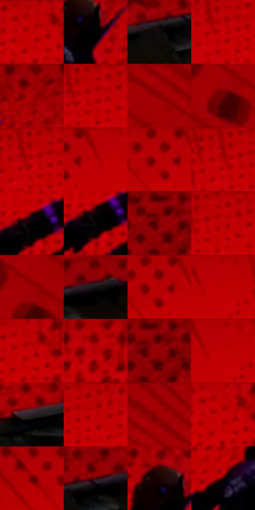

# 电影参考 501

- 状态：条件／活跃；来源世界：miles-home。
- 视角：low-angle；景别：environment-wide；场景：graphic。
- 时段：graphic-no-physical-time（外观依据，中置信度；具体时间／晨昏未知）；光照：graphic-field。
- 材质候选：skin, fabric, stone（帧级，不是像素分割）。
- 明暗组：dark；L* P5/P50/P95：0.31375 / 33.54909 / 40.82055。
- 资格门禁：impact。
- 原截图 SHA-256：`dd01dcefe8a81bd7de93039c22722ca5615caf23e991d188c9315d1d0f11b6ee`；尺寸：2880 × 1206。
- sRGB 像素 SHA-256：`8cc3864e89774e37fb89e269b0b83a8bdd08a57a74f6652db70a7e4c35da28ff`。

## 观察与迁移

红黑点阵与巨字，屋顶锚点仍存在；图形色不当普通阴影。

红点阵抽象天空与实体屋顶及两个人物共存；不能默认把照片背景整块换红或解释为真实红光。

60  /  501  /  屋顶、冲击插帧与巷道：红点阵抽象天空与实体屋顶及两个人物共存；不能默认把照片背景整块换红或解释为真实红光。

本公开版保存32个128×128原像素色卡上下文；图集格子并非原场景相邻位置。原rect、图集tile和像素SHA见 `data/palette-crops.json`。上下文不足时不得批准替色，不能以小样推断完整构图。

## 实测色卡

颜色比例分母为保留采样像素，不是材料面积；全部 32 色参与全库匹配。表内四舍五入仅用于阅读，原精度在 JSON。

| ID | HEX | Lab | 原图 xy | 像素数 | 比例 | 明度角色 |
| --- | --- | --- | --- | ---: | ---: | --- |
| 501-S01 | #C00002 | [39.939572, 64.718204, 53.518011] | [1344, 32] | 10327 | 5.341202% | shadow |
| 501-S02 | #000000 | [0.0, 0.0, 0.0] | [1788, 164] | 10240 | 5.296205% | deep-shadow |
| 501-S03 | #0D0C0A | [3.34605, 0.006037, 0.905568] | [2624, 716] | 9989 | 5.166386% | deep-shadow |
| 501-S04 | #C80104 | [41.710772, 66.639477, 54.556619] | [1172, 80] | 9300 | 4.810030% | midtone |
| 501-S05 | #990002 | [31.298286, 54.727204, 44.328315] | [1908, 28] | 8991 | 4.650213% | shadow |
| 501-S06 | #AD0002 | [35.774714, 59.902536, 49.299168] | [1196, 32] | 8988 | 4.648661% | shadow |
| 501-S07 | #8A0002 | [27.870839, 50.765204, 40.199708] | [320, 28] | 8814 | 4.558667% | shadow |
| 501-S08 | #6B0002 | [20.561954, 42.319065, 30.560639] | [184, 108] | 8431 | 4.360576% | shadow |
| 501-S09 | #B20000 | [36.870431, 61.156541, 51.258006] | [1164, 28] | 7960 | 4.116972% | shadow |
| 501-S10 | #B20002 | [36.878585, 61.178855, 50.446986] | [948, 28] | 7708 | 3.986635% | shadow |
| 501-S11 | #B00006 | [36.454306, 60.714471, 48.381905] | [876, 28] | 7666 | 3.964913% | shadow |
| 501-S12 | #A60002 | [34.219349, 58.104251, 47.628516] | [1144, 60] | 7325 | 3.788545% | shadow |
| 501-S13 | #050302 | [0.919351, 0.383903, 0.5628] | [1532, 304] | 6887 | 3.562008% | deep-shadow |
| 501-S14 | #070608 | [1.742923, 0.539483, -0.664511] | [1528, 320] | 6401 | 3.310645% | deep-shadow |
| 501-S15 | #950103 | [30.448219, 53.540302, 42.896254] | [2764, 36] | 6154 | 3.182895% | shadow |
| 501-S16 | #C30103 | [40.628821, 65.377858, 53.815492] | [1212, 40] | 5862 | 3.031870% | midtone |
| 501-S17 | #9F0102 | [32.699558, 56.153829, 45.913884] | [192, 28] | 5574 | 2.882915% | shadow |
| 501-S18 | #171517 | [7.048887, 1.410377, -1.007548] | [2756, 676] | 5569 | 2.880329% | deep-shadow |
| 501-S19 | #A50008 | [34.023522, 57.921021, 44.95569] | [888, 28] | 5215 | 2.697237% | shadow |
| 501-S20 | #BB0006 | [38.866419, 63.501245, 50.923077] | [1000, 28] | 5114 | 2.644999% | shadow |
| 501-S21 | #B70103 | [38.019385, 62.346973, 51.174335] | [1368, 28] | 5096 | 2.635689% | shadow |
| 501-S22 | #A50001 | [33.991619, 57.833755, 47.788456] | [1504, 28] | 4891 | 2.529662% | shadow |
| 501-S23 | #800002 | [25.548616, 48.081182, 37.254801] | [2784, 28] | 4410 | 2.280885% | shadow |
| 501-S24 | #BB0000 | [38.843693, 63.439062, 53.229578] | [992, 60] | 4287 | 2.217269% | shadow |
| 501-S25 | #29232A | [14.627837, 4.470303, -3.605036] | [2432, 740] | 4213 | 2.178995% | deep-shadow |
| 501-S26 | #B90001 | [38.410595, 62.94417, 52.396135] | [1236, 28] | 3979 | 2.057969% | shadow |
| 501-S27 | #900002 | [29.249539, 52.358859, 41.892553] | [452, 28] | 3682 | 1.904358% | shadow |
| 501-S28 | #BB0202 | [38.926245, 63.242406, 52.461259] | [1352, 36] | 3017 | 1.560415% | shadow |
| 501-S29 | #B20103 | [36.923015, 61.072968, 50.059305] | [800, 32] | 2832 | 1.464732% | shadow |
| 501-S30 | #4A0409 | [13.002319, 31.535706, 16.604242] | [2680, 680] | 1775 | 0.918043% | deep-shadow |
| 501-S31 | #170203 | [2.097488, 6.997756, 2.038302] | [1748, 116] | 1478 | 0.764433% | deep-shadow |
| 501-S32 | #320100 | [6.323434, 24.157193, 9.968664] | [1648, 228] | 1171 | 0.605650% | deep-shadow |

## 色阶与空间分布

- 采样 ROI：`[0.01, 0.02, 0.98, 0.94]`；步长：4；样本数：193346。
- 排除区：`[]`。
- 深暗、暗、中、亮、高光五段计数：`[50358, 123037, 19948, 3, 0]`。
- RGB 各 256 箱、L* 100 箱、13×5 色相明度表和 3×3 空间统计全部保存在 [总数据](../film-library.json)。
- [可视化档案](../../references/library.html)按需绘制直方图，不存 2,094 张重复图表图片。

## 纹理特征占比

**这是分块图像特征的面积占比，不是波点／排线／丝网／错版的精确语义覆盖率。** 窗格、发丝、织物也会产生方向或周期特征。
原图 ROI 像素 3098546；已测块覆盖 3098546（100.0000%）；未测 0。

| 特征 | 块覆盖像素 | 占已测面积 | 阈值敏感范围 |
| --- | ---: | ---: | --- |
| low-contrast | 988416 | 31.8993% | 25.5542% ~ 38.7733% |
| directional-structure | 122752 | 3.9616% | 1.0575% ~ 17.1038% |
| periodic-structure | 1943730 | 62.7304% | 55.9333% ~ 62.7304% |
| mixed-detail | 43648 | 1.4087% | 1.4087% ~ 1.4087% |

阈值敏感范围不是统计置信区间。逐块坐标、尺度、对比、方向一致性、频谱集中度、频率与角度见 [全量特征记录](../texture-features.jsonl)，以帧号定位。
四种印刷层的真实像素覆盖仍标为 `null`，不能填 0，也不能拿上表代替。不得据这些代理测量删除唯一证据。

[测量方法与保留策略](../../references/library-retention.md) · [分类索引](../archive/README.md)
